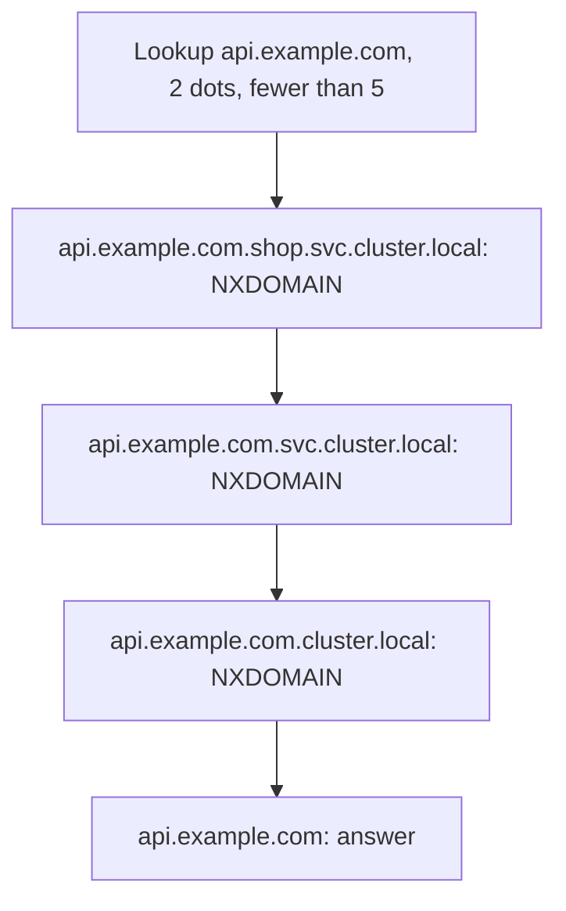

# Lesson 9. Cluster DNS

**Mission link:** The mission is to expose a service inside the cluster by name. Clients almost never use a cluster IP, they use a DNS name, so "unreachable" very often means "the name did not resolve to what you expected". Knowing the name layout, the search path and what a headless Service returns tells you which hop failed.
**Primary source:** [Docs: "DNS for Services and Pods", Kubernetes](https://kubernetes.io/docs/concepts/services-networking/dns-pod-service/)
**Prerequisites:** [Lesson 3](0003-objects-and-manifests.md), [Lesson 4](0004-pods.md), [Lesson 8](0008-services.md), [Namespace](../GLOSSARY.md), [Service](../GLOSSARY.md), [Headless Service](../GLOSSARY.md)

## Warm-up

1. ▢ What does a namespace scope, and does it stop a pod in one namespace from reaching a pod in another?

<details markdown="1"><summary>Check</summary>

A namespace scopes the names of objects, and is the unit RBAC Roles, quotas and Pod Security labels attach to (lesson 3). It is not a network boundary: by default a pod can reach any pod IP in the cluster, and only a NetworkPolicy restricts that.

</details>

2. ▢ Which field of a Service says which pods it routes to, and which controller turns that into addresses?

<details markdown="1"><summary>Check</summary>

`spec.selector`, a label query. The EndpointSlice controller keeps EndpointSlices up to date with the addresses of the ready matching pods, and kube-proxy routes from them (lesson 8).

</details>

3. ▢ A pod in the cluster calls a Service by its cluster IP, which is `10.96.142.31`. Which pod owns that address?

<details markdown="1"><summary>Check</summary>

None. A cluster IP is virtual: it belongs to no interface, and the rules kube-proxy programs on each node rewrite traffic sent to it to a ready endpoint (lesson 8).

</details>

## Know this

### Names for Services

The cluster runs a DNS server, usually CoreDNS, as a Service named `kube-dns` in the `kube-system` namespace. The kubelet writes its address into every pod's `/etc/resolv.conf`, so a container looks Services up by name instead of IP ([DNS for Services and Pods](https://kubernetes.io/docs/concepts/services-networking/dns-pod-service/)).

A normal Service gets an `A` record (and `AAAA` for IPv6) in this form:

```text
<service>.<namespace>.svc.<cluster-domain>
web.shop.svc.cluster.local
```

It resolves to the Service's cluster IP. `cluster.local` is the default cluster domain, and a cluster can set another. Named ports also get `SRV` records. The doc says any other layout that happens to work is an implementation detail that may change, so build on this form only.

### The search path

Nobody types the long form. The kubelet writes a `search` list into each pod, so a short name is tried with suffixes added:

```console
$ kubectl exec probe -n shop -- cat /etc/resolv.conf
search shop.svc.cluster.local svc.cluster.local cluster.local
nameserver 10.96.0.10
options ndots:5
```

The first suffix is the pod's own namespace. So from a pod in `shop`, the name `web` expands to `web.shop.svc.cluster.local` and finds the Service in the same namespace. A name with no namespace never leaves the pod's own namespace. To reach a Service in another namespace, include the namespace: `web.prod`, or the full `web.prod.svc.cluster.local`. The doc's example is a pod in `test` looking for a Service `data` in `prod`: the query `data` finds nothing, and `data.prod` works. Nodes can add entries to the search list as well, so your own output may have extra suffixes after these three.

The pod's `dnsPolicy` decides where this file comes from. The default is `ClusterFirst`. `Default` is a different policy, not the default: it inherits the node's resolver. A pod with `hostNetwork: true` needs `ClusterFirstWithHostNet` to keep using cluster DNS.

### ndots:5 and its cost

`options ndots:5` is a resolver rule. If a name has fewer than 5 dots, the resolver tries the search suffixes first, and only then tries the name as given. A name with 5 or more dots is tried as an absolute name first (see the [resolv.conf manual](https://man7.org/linux/man-pages/man5/resolv.conf.5.html) for how `ndots` is defined). Kubernetes sets 5 because the names it generates need it: the doc notes it is high enough to cover them.

The cost lands on every name that is not a short Service name. Take `api.example.com`, two dots, with three search suffixes:



Three failed lookups happen before the real one, on every new lookup of an external name. Resolvers commonly ask for IPv4 and IPv6 records as separate queries, so the number of packets can be double that. Even the full in-cluster name `web.prod.svc.cluster.local` has four dots, so it also tries the search suffixes first. The fixes, in order of how often they are right:

- Write external names with a trailing dot, `api.example.com.`, which marks the name as absolute and skips the search list.
- Set a lower `ndots` for a pod through `dnsConfig.options`. The doc shows `ndots` with value `2` as an example. A lower value stops short names with a dot, such as `web.prod`, from being expanded, so check that your names still resolve.
- Cache lookups in the application or a node-local cache. This lesson does not cover that.

### Headless Services

A Service with `clusterIP: None` has no virtual IP, and kube-proxy does not handle it. Its name resolves to the addresses of all the ready pods it selects, and the client chooses ([Service: headless](https://kubernetes.io/docs/concepts/services-networking/service/#headless-services)).

```console
$ kubectl exec probe -- nslookup web-headless.shop.svc.cluster.local
Name:      web-headless.shop.svc.cluster.local
Address 1: 10.244.1.4 10-244-1-4.web-headless.shop.svc.cluster.local
Address 2: 10.244.2.3 10-244-2-3.web-headless.shop.svc.cluster.local
```

Use one when clients must reach each pod individually: peers of a clustered database, or a client that does its own balancing. Pods can also get their own names. A pod with `hostname` and a `subdomain` equal to a headless Service in the same namespace gets a record of the form `hostname.subdomain.namespace.svc.cluster.local`, which is how a StatefulSet gives replicas stable names (lesson 17).

## Practice

1. ▢ A pod in namespace `shop` has the search list shown above. Which name reaches the Service `cache` in namespace `data`?

    - a) `cache`, since the search list covers all namespaces
    - b) `cache.data`, which gets expanded by the search list
    - c) `cache.svc`, which gets expanded by the search list
    - d) `data.cache`, since the namespace is written before it

<details markdown="1"><summary>Check</summary>

**b)** `cache.data` has one dot, so the resolver tries `cache.data.shop.svc.cluster.local` (no such name) and then `cache.data.svc.cluster.local`, which exists. (a) only searches the pod's own namespace, `shop`. (c) would look for a Service named `cache` in a namespace named `svc`. (d) has the order backwards: the Service name comes first.

</details>

2. ▢ Predict, then run. What does each lookup print?

    ```console
    $ kubectl create namespace prod; kubectl create namespace test
    $ kubectl -n prod create deployment data --image=nginx:stable
    $ kubectl -n prod expose deployment data --port=80
    $ kubectl -n test run probe --image=busybox:1.28 --restart=Never -- sleep 3600
    $ kubectl -n test wait --for=condition=Ready pod/probe
    $ kubectl -n test exec probe -- nslookup data
    $ kubectl -n test exec probe -- nslookup data.prod
    ```

<details markdown="1"><summary>Hint</summary>

Read the first suffix of the search list in a pod in `test`. In which namespace does a bare name look for a Service?

</details>

<details markdown="1"><summary>Check</summary>

The first lookup fails with `nslookup: can't resolve 'data'`: a bare name is searched in the pod's own namespace, `test`, and `test` has no Service `data`. The second prints the cluster IP of the Service in `prod`, for example:

```text
Name:      data.prod
Address 1: 10.96.201.7 data.prod.svc.cluster.local
```

The exact IP differs on your cluster. The Service exists in both cases, only the name differs.

</details>

3. ▢ Count the queries for names, with the search list `shop.svc.cluster.local svc.cluster.local cluster.local` and `ndots:5`. How many names does the resolver try for each of these, ignoring IPv4 against IPv6?

    ```text
    1. web
    2. api.example.com
    3. api.example.com.
    4. web.prod.svc.cluster.local
    ```

<details markdown="1"><summary>Check</summary>

1. `web` has no dots, so the search list is used: `web.shop.svc.cluster.local` answers on the first try.
2. `api.example.com` has two dots, fewer than five, so it tries three suffixed names that fail, then the name itself: four names.
3. `api.example.com.` ends in a dot, so it is absolute: one name.
4. `web.prod.svc.cluster.local` has four dots, fewer than five, so the first try is `web.prod.svc.cluster.local.shop.svc.cluster.local`, which fails. The three suffixed forms fail and then the name itself answers, four names as in item 2, so the full name is not free either. Resolvers also differ in details, so treat the exact counts as the typical behaviour.

</details>

4. ▢ A pod in namespace `a` calls `http://db:5432` and gets "name or service not known". A Service `db` exists in namespace `b` and has endpoints. What is wrong and what are two fixes?

<details markdown="1"><summary>Hint</summary>

Which namespace does a bare Service name search? The Service and its endpoints being healthy rules out routing, so look at the lookup.

</details>

<details markdown="1"><summary>Check</summary>

The bare name `db` expands only within namespace `a`, where there is no such Service, so the lookup fails before routing is involved. Fix 1: call `db.b` or `db.b.svc.cluster.local`. Fix 2: put the caller and the Service in the same namespace, or add an `ExternalName` Service named `db` in `a` that points at `db.b.svc.cluster.local`. The first is simplest, and it makes the dependency visible in the configuration.

</details>

5. ▢ Predict, then run. A headless Service selects two ready pods. What does `nslookup` return for it, and what changes for a normal Service with the same selector?

    ```console
    $ kubectl create deployment web --image=nginx:stable --replicas=2
    $ kubectl expose deployment web --name=web-ip --port=80
    $ kubectl apply -f - <<'EOF'
    apiVersion: v1
    kind: Service
    metadata:
      name: web-headless
    spec:
      clusterIP: None
      selector:
        app: web
      ports:
        - port: 80
    EOF
    $ kubectl run probe --image=busybox:1.28 --restart=Never -- sleep 3600
    $ kubectl wait --for=condition=Ready pod/probe
    $ kubectl exec probe -- nslookup web-ip
    $ kubectl exec probe -- nslookup web-headless
    ```

<details markdown="1"><summary>Check</summary>

`web-ip` resolves to one address, its cluster IP. `web-headless` resolves to two addresses, the IPs of the two pods, shown with names such as `10-244-1-4.web-headless.default.svc.cluster.local`. A normal Service hides the pods behind one virtual IP, and a headless one hands you the pod IPs and leaves the choice to the client.

</details>

6. ▢ Calls from your service to `payments.example.com` are slow, and the cluster DNS server shows many `NXDOMAIN` answers for names such as `payments.example.com.shop.svc.cluster.local`. Explain why, and give the smallest fix that touches only configuration.

<details markdown="1"><summary>Check</summary>

`payments.example.com` has two dots, fewer than the `ndots:5` threshold, so every lookup tries the search suffixes first and each fails with `NXDOMAIN` before the real name is tried. The smallest fix is to configure the client with the absolute name `payments.example.com.` (with the trailing dot) wherever the library accepts it, or to set `dnsConfig.options` with a lower `ndots` on the pod, then verify that short in-cluster names still resolve. Neither changes the DNS server.

</details>

## Real-world reps

- [ ] On a kind cluster, run a pod and `cat /etc/resolv.conf` in it. Find the `nameserver` address and confirm it is the cluster IP of `kube-dns` with `kubectl -n kube-system get svc kube-dns`.
- [ ] Run Practice item 2 and item 5 and compare what you predicted with what you saw. Then read the DNS server's configuration with `kubectl -n kube-system get configmap coredns -o yaml` and find the `kubernetes cluster.local` block, which is the part that answers for Service names.
- [ ] Tomorrow: without notes, write the full DNS name of a Service, say what a bare name searches, explain what `ndots:5` does to `api.example.com`, and say what a headless Service returns.

## Going further

- [Networking](../reference/networking.md)
- [Docs: "DNS for Services and Pods", Kubernetes](https://kubernetes.io/docs/concepts/services-networking/dns-pod-service/)
- [Docs: "Service", Kubernetes](https://kubernetes.io/docs/concepts/services-networking/service/), the headless Services section
- [Docs: "Debug Services", Kubernetes](https://kubernetes.io/docs/tasks/debug/debug-application/debug-service/)
- [Resources](../RESOURCES.md)

---

Not landing? Reread the primary source at the top, since this lesson compresses it and compression is where understanding leaks. Check the [glossary](../GLOSSARY.md) for any term that felt slippery.

If the lesson itself is unclear rather than the material, that is a defect: [open an issue](https://github.com/TokenCemetery/teach/issues).
