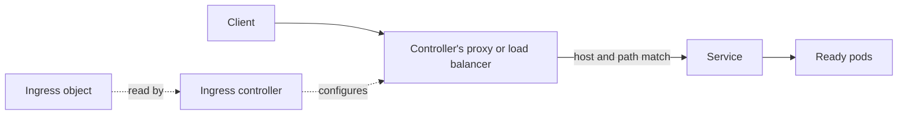

# Lesson 10. Ingress and the Gateway API

**Mission link:** The mission is to make a workload reachable outside the cluster and say which hop failed when it is not. For HTTP that means a controller that is easy to forget is missing, a class that must match, and rules that must name a host and path the controller understands. The Gateway API is where the project's own advice now points.
**Primary source:** [Docs: "Ingress", Kubernetes](https://kubernetes.io/docs/concepts/services-networking/ingress/)
**Prerequisites:** [Lesson 8](0008-services.md), [Lesson 9](0009-cluster-dns.md), [Ingress](../GLOSSARY.md), [Gateway API](../GLOSSARY.md), [Service](../GLOSSARY.md)

## Warm-up

1. ▢ A `ClusterIP` Service is reachable from where, and which Service type adds an external load balancer?

<details markdown="1"><summary>Check</summary>

A `ClusterIP` Service is reachable only from inside the cluster. `LoadBalancer` adds an external load balancer, but only where something provisions one: a cloud provider integration, and nothing by default on kind (lesson 8).

</details>

2. ▢ A pod in namespace `web` needs the Service `auth` in namespace `iam`. Which DNS name does it use?

<details markdown="1"><summary>Check</summary>

`auth.iam`, or the full `auth.iam.svc.cluster.local`. A bare name searches only the pod's own namespace (lesson 9).

</details>

3. ▢ What routes a connection sent to a Service's cluster IP to a pod, and which pods does it consider?

<details markdown="1"><summary>Check</summary>

Rules that kube-proxy programs on each node, built from the Service's EndpointSlices. Only endpoints marked ready are used, and the backend is chosen when the connection is made (lesson 8).

</details>

## Know this

### What an Ingress is, and what it is not

An **Ingress** describes HTTP and HTTPS routes from outside the cluster to Services: a host, a path, and a backend Service and port. It does not expose arbitrary ports or other protocols, which is the job of `NodePort` and `LoadBalancer` Services ([Ingress](https://kubernetes.io/docs/concepts/services-networking/ingress/)).

**An Ingress does nothing on its own.** The doc is blunt: you must have an ingress controller to satisfy an Ingress, and only creating the resource has no effect. The controller is a program running in the cluster that watches Ingress objects and configures a proxy or load balancer to match. Controllers differ, and the project's page lists many ([Ingress controllers](https://kubernetes.io/docs/concepts/services-networking/ingress-controllers/)).



### The fields

```yaml
apiVersion: networking.k8s.io/v1
kind: Ingress
metadata:
  name: web
spec:
  ingressClassName: example-class
  tls:
    - hosts: [app.example.test]
      secretName: app-tls
  rules:
    - host: app.example.test
      http:
        paths:
          - path: /api
            pathType: Prefix
            backend:
              service:
                name: api
                port:
                  number: 80
          - path: /
            pathType: Prefix
            backend:
              service:
                name: web
                port:
                  number: 80
```

**`ingressClassName`** names an `IngressClass` object, which names the controller that should implement the Ingress. If you omit it, a default class must exist, marked with the annotation `ingressclass.kubernetes.io/is-default-class: "true"`. If more than one is marked default, the admission controller rejects new Ingresses that omit the class. The old `kubernetes.io/ingress.class` annotation was never formally defined and the field replaces it.

**Path types.** Every path needs a `pathType`, or validation fails:

|`pathType`|Matches|
|---|---|
|`Exact`|The URL path exactly, case sensitive|
|`Prefix`|A prefix split on `/`, element by element|
|`ImplementationSpecific`|Whatever the class decides|

`Prefix` with `/foo` matches `/foo`, `/foo/` and `/foo/bar`, and does not match `/foobar`, because the last element must match whole. When several paths match, the longest wins, and `Exact` beats `Prefix` on a tie. Hosts can be exact or a wildcard such as `*.example.test`, which covers one DNS label only.

**TLS.** `spec.tls` references a Secret of type `kubernetes.io/tls` with the keys `tls.crt` and `tls.key`. The Ingress supports a single TLS port, 443, and terminates TLS at the ingress point, so traffic from there to the pods is plaintext. Each host in `tls` must match a host in `rules`. Annotations configure behaviour the API does not describe, and each controller has its own, so a manifest full of annotations is tied to one controller.

### Where Ingress stands

The Ingress API is stable and has not been removed, but the project says it is frozen. The Ingress page states that the Kubernetes project recommends Gateway instead of Ingress, that the Ingress API is generally available, that there are no plans to remove it, and that it will have no further changes ([Ingress](https://kubernetes.io/docs/concepts/services-networking/ingress/)). Existing Ingresses keep working. New features go to the Gateway API.

A separate fact concerns one controller. SIG Network and the Security Response Committee announced in November 2025 that the community Ingress NGINX controller would get best-effort maintenance until March 2026, and after that no further releases, bug fixes or fixes for newly found vulnerabilities. Existing deployments keep running, and they recommended migrating to Gateway API or another controller ([Ingress NGINX Retirement](https://kubernetes.io/blog/2025/11/11/ingress-nginx-retirement/)). The retirement is about one implementation, not the Ingress API.

### The Gateway API

The **Gateway API** is a family of resource kinds, installed as custom resources, not part of the core API. The docs list four stable kinds: `GatewayClass`, `Gateway`, `HTTPRoute` and `GRPCRoute` ([Gateway API](https://kubernetes.io/docs/concepts/services-networking/gateway/)). It splits what Ingress puts in one object by who owns it:

|Kind|Owner (the doc's roles)|Says|
|---|---|---|
|`GatewayClass`|Infrastructure provider|Which controller implements gateways of this class|
|`Gateway`|Cluster operator|A listener: port, protocol, hostname, and which namespaces may attach routes|
|`HTTPRoute`|Application developer|Hosts, paths and headers to match, and the backend Services|

```yaml
apiVersion: gateway.networking.k8s.io/v1
kind: Gateway
metadata:
  name: example-gateway
  namespace: infra
spec:
  gatewayClassName: example-class
  listeners:
    - name: http
      protocol: HTTP
      port: 80
      allowedRoutes:
        namespaces:
          from: All
---
apiVersion: gateway.networking.k8s.io/v1
kind: HTTPRoute
metadata:
  name: web
  namespace: shop
spec:
  parentRefs:
    - name: example-gateway
      namespace: infra
  hostnames: ["app.example.test"]
  rules:
    - matches:
        - path:
            type: PathPrefix
            value: /api
      backendRefs:
        - name: api
          port: 80
```

A route attaches to a Gateway through `parentRefs`, and the Gateway decides which routes it accepts. By default a Gateway only accepts routes from its own namespace, and cross-namespace routes need `allowedRoutes`. That two-way agreement is the point: the platform team keeps the listener and its certificates, and an application team changes its routes without touching either. Matching on headers and splitting traffic by weight are part of the typed API, where Ingress used annotations. The Gateway API has no `Ingress` kind, so moving over is a one-time conversion.

**On kind,** nothing implements either API by default. kind documents that Cloud Provider KIND, the same add-on that provides `LoadBalancer` addresses, supports both Ingress and the Gateway API ([kind: Ingress](https://kind.sigs.k8s.io/docs/user/ingress/)), and a third-party controller can be installed instead.

## Practice

1. ▢ You apply an Ingress to a fresh kind cluster with no controller installed. What happens?

    - a) The API server accepts it and nothing routes traffic
    - b) The API server rejects it for lacking a controller
    - c) The scheduler waits until a controller is installed
    - d) The cluster installs a default controller for it

<details markdown="1"><summary>Check</summary>

**a)** An Ingress is only data until a controller reads it. The API server validates the object's shape, not whether anything implements it. (b) confuses validation with implementation. (c) the scheduler places pods and never looks at Ingresses. (d) Kubernetes ships no controller.

</details>

2. ▢ A rule has `path: /api` with `pathType: Prefix`. Which of these request paths match it: `/api`, `/api/`, `/api/users`, `/apiv2`, `/API`?

<details markdown="1"><summary>Check</summary>

`/api`, `/api/` and `/api/users` match. `/apiv2` does not, because a prefix is matched element by element and `apiv2` is not the element `api`. `/API` does not either, because matching is case sensitive. With `pathType: Exact` only `/api` would match, not `/api/`.

</details>

3. ▢ Predict, then run. On a fresh kind cluster with no controller, what do the last three commands print?

    ```console
    $ kubectl create deployment web --image=nginx:stable
    $ kubectl expose deployment web --port=80
    $ kubectl create ingress web --class=example-class --rule="app.example.test/=web:80"
    $ kubectl get ingress web
    $ kubectl get ingressclass
    $ kubectl get gatewayclass
    ```

<details markdown="1"><summary>Hint</summary>

Does the `CLASS` column come from the field you set or from a lookup of the object it names? And which of the two API families is installed with the cluster?

</details>

<details markdown="1"><summary>Check</summary>

`kubectl get ingress web` succeeds, shows `example-class` in `CLASS` and an empty `ADDRESS`, because the field is only a name and no controller fills in an address:

```text
NAME   CLASS           HOSTS              ADDRESS   PORTS   AGE
web    example-class   app.example.test             80      4s
```

`kubectl get ingressclass` prints `No resources found`, since the class object was never created. `kubectl get gatewayclass` fails with `error: the server doesn't have a resource type "gatewayclass"`, because the Gateway API is installed as custom resources and none of them exist yet.

</details>

4. ▢ An Ingress has `tls: - hosts: [app.example.test]` and a rule with `host: www.example.test`. The certificate is fine. Clients see the wrong certificate or none. What is wrong?

<details markdown="1"><summary>Hint</summary>

Read the two host values against each other, and recall how a controller picks a certificate for a connection: by the name the client asks for.

</details>

<details markdown="1"><summary>Check</summary>

The `hosts` under `tls` must explicitly match the host in the rules, and TLS does not apply to the default rule. Here the TLS block covers `app.example.test` while the rule serves `www.example.test`, so no certificate is attached to the host being requested. Make the two the same, or list both hosts in `tls` with a certificate that covers them.

</details>

5. ▢ An `HTTPRoute` in namespace `shop` points `parentRefs` at a Gateway in namespace `infra`, but its status says the route is not accepted. The Gateway listener has no `allowedRoutes` set. Why, and who should change what?

<details markdown="1"><summary>Check</summary>

By default a Gateway only accepts routes from its own namespace, so the listener must allow `shop`. The cluster operator, who owns the `Gateway`, adds `allowedRoutes.namespaces`, with `from: All` or a selector. The application team cannot fix this from its side, and that is deliberate: attaching to the shared entry point is the platform team's decision.

</details>

6. ▢ A colleague wants to start a new service on the community Ingress NGINX controller, because the team already uses it. What do you say, and what do you not say?

<details markdown="1"><summary>Check</summary>

Say what the primary sources say: the project announced the controller's retirement, with no releases or security fixes after March 2026, and recommends moving to Gateway API or another maintained controller. Check what your cluster runs with `kubectl get pods --all-namespaces --selector app.kubernetes.io/name=ingress-nginx`. Do not say the Ingress API is deprecated or removed: it is stable and frozen, and other controllers still implement it. The decision is Gateway API for new work, and a planned migration for what exists.

</details>

## Real-world reps

- [ ] On a kind cluster, run Practice item 3 and compare your prediction with the output. Then run `kubectl explain ingress.spec.rules.http.paths.pathType` and find the three values.
- [ ] Install one Gateway API implementation by following its own documentation, create a `GatewayClass`, a `Gateway` and an `HTTPRoute` for the `web` Service, and read each object's `status` with `kubectl get ... -o yaml` to see which one reports the problem when you misspell the Service name.
- [ ] Tomorrow: without notes, say why an Ingress alone does nothing, what `ingressClassName` points at, which Gateway API kind each of the three roles owns, and what the Kubernetes project says about the future of the Ingress API.

## Going further

- [Networking](../reference/networking.md)
- [Docs: "Ingress", Kubernetes](https://kubernetes.io/docs/concepts/services-networking/ingress/)
- [Docs: "Ingress Controllers", Kubernetes](https://kubernetes.io/docs/concepts/services-networking/ingress-controllers/)
- [Docs: "Gateway API", Kubernetes](https://kubernetes.io/docs/concepts/services-networking/gateway/)
- [Docs: Gateway API project site, Kubernetes SIG Network](https://gateway-api.sigs.k8s.io/)
- [Blog: "Ingress NGINX Retirement: What You Need to Know", Kubernetes](https://kubernetes.io/blog/2025/11/11/ingress-nginx-retirement/)
- [Resources](../RESOURCES.md)

---

Not landing? Reread the primary source at the top, since this lesson compresses it and compression is where understanding leaks. Check the [glossary](../GLOSSARY.md) for any term that felt slippery.

If the lesson itself is unclear rather than the material, that is a defect: [open an issue](https://github.com/TokenCemetery/teach/issues).
