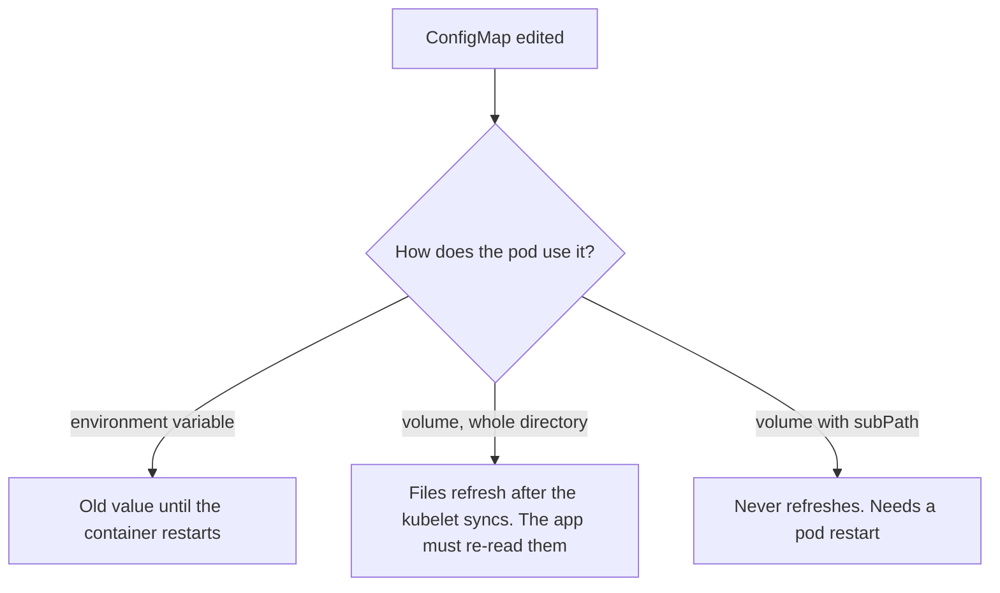

# Lesson 11. ConfigMaps

**Mission link:** The mission is to configure a workload per environment without rebuilding its image. A ConfigMap is how the same image gets different settings in each cluster, and the failure to know about is the quiet one: you edit the ConfigMap, the object changes, and the running pods behave as before.
**Primary source:** [Docs: "ConfigMaps", Kubernetes](https://kubernetes.io/docs/concepts/configuration/configmap/)
**Prerequisites:** [Lesson 4](0004-pods.md), [Lesson 5](0005-deployments-and-replicasets.md), [Lesson 6](0006-rollouts-and-rollbacks.md), [ConfigMap](../GLOSSARY.md), [Deployment](../GLOSSARY.md), [Rollout](../GLOSSARY.md)

## Warm-up

1. ▢ What does a Deployment need to see change before it creates a new ReplicaSet and rolls pods?

<details markdown="1"><summary>Check</summary>

A change to its pod template, `.spec.template`. Scaling and edits elsewhere in the object do not start a rollout (lessons 5 and 6). Remember this: it decides how a config change reaches pods in this lesson.

</details>

2. ▢ You run `kubectl rollout undo deployment/web`. What does it restore, and what does it leave alone?

<details markdown="1"><summary>Check</summary>

It restores the pod template of an earlier revision, by scaling an older ReplicaSet back up (lesson 6). Anything outside the template, such as other objects the pods read, is untouched.

</details>

3. ▢ Two containers in one pod need the same file. What do they share, and what do they not share?

<details markdown="1"><summary>Check</summary>

They share the pod's volumes and its network namespace (lesson 4). Each container has its own root filesystem from its own image, so a file only reaches both through a mounted volume.

</details>

## Know this

### What a ConfigMap is

A **ConfigMap** stores non-secret configuration as key-value pairs, so environment-specific settings stay out of the image. It has `data` for UTF-8 strings and `binaryData` for base64-encoded binary, and its contents are limited to 1 MiB. It provides no secrecy: the doc says confidential data belongs in a Secret (lesson 12). A pod and the ConfigMap it uses must be in the same namespace ([ConfigMaps](https://kubernetes.io/docs/concepts/configuration/configmap/)).

```yaml
apiVersion: v1
kind: ConfigMap
metadata:
  name: app
data:
  LOG_LEVEL: info
  app.properties: |
    pool.size=10
    cache.ttl=60
```

A ConfigMap does not tell single values from file contents. How the pod consumes a key decides what it is.

### Two ways in

```yaml
spec:
  containers:
    - name: app
      image: example/app:1.0
      env:
        - name: LOG_LEVEL
          valueFrom:
            configMapKeyRef:
              name: app
              key: LOG_LEVEL
      envFrom:
        - configMapRef:
            name: app
      volumeMounts:
        - name: cfg
          mountPath: /etc/app
  volumes:
    - name: cfg
      configMap:
        name: app
```

|As|Fields|The container sees|Changes after start|
|---|---|---|---|
|One environment variable|`env[].valueFrom.configMapKeyRef`|The value of one key|Never|
|Many environment variables|`envFrom[].configMapRef`|Every key as a variable|Never|
|Files|`volumes[].configMap` and a `volumeMount`|One read-only file per key (or per listed `items`)|Eventually|

Environment variable names have a restricted character set. A key that does not qualify, such as `app.properties` under `envFrom`, is silently left out, though the pod still starts. And mounting a ConfigMap volume at a directory hides what that directory held in the image.

### Update propagation

**Environment variables are fixed when the container starts.** The doc says ConfigMaps consumed as environment variables are not updated automatically and need a pod restart.

**Mounted files do update, eventually.** The kubelet checks mounted ConfigMaps on its periodic sync and refreshes the files. The delay can be as long as the kubelet sync period plus the propagation delay of the kubelet's cache, which by default follows a watch. In practice, expect up to a minute or two, not seconds. The kubelet changes the file; **your process must notice**. A program that reads its config once at startup keeps the old values, so whether a file update helps depends on the application re-reading it ([ConfigMaps: mounted ConfigMaps are updated automatically](https://kubernetes.io/docs/concepts/configuration/configmap/#mounted-configmaps-are-updated-automatically)).

**`subPath` mounts never update.** Mounting one key as a single file, with `volumeMounts[].subPath`, is common because it avoids hiding the rest of a directory. The docs state that a container using a ConfigMap as a `subPath` volume mount will not receive updates ([Volumes: configMap](https://kubernetes.io/docs/concepts/storage/volumes/#configmap)).



### Immutable ConfigMaps

Set `immutable: true` and the `data` and `binaryData` can no longer be changed, and the flag cannot be turned off. You can only delete and recreate the ConfigMap, and the doc recommends recreating the pods that used the old one, since they keep a mount to the deleted object. The benefits it lists are protection from accidental edits that cause outages, and less load on the API server because watches on immutable ConfigMaps are closed ([Immutable ConfigMaps](https://kubernetes.io/docs/concepts/configuration/configmap/#configmap-immutable)).

### Rolling a Deployment when config changes

A Deployment rolls only when its pod template changes, and a ConfigMap edit is not a template change. Three ways to connect the two:

|Way|How|Costs|
|---|---|---|
|Restart|`kubectl rollout restart deployment/web`|A manual step, and rollbacks do not restore the old config|
|Name the ConfigMap per version|Change the ConfigMap name referenced in the template|A new object per change, and old ones to clean up|
|Hash in the template|Put a checksum of the config in a pod template annotation|Needs a tool to compute it, usually Helm (lesson 23)|

The second one has a real benefit. If each version of the config is its own ConfigMap, the Deployment's template names it, so `kubectl rollout undo` restores the old config together with the old pods. Kustomize's `configMapGenerator` does this for you by appending a content hash to the generated name, so a changed ConfigMap gets a new name and the Deployment referencing it rolls (lesson 22, [Kustomize](https://kubernetes.io/docs/tasks/manage-kubernetes-objects/kustomization/)). Combined with `immutable: true`, a config version can never silently drift.

## Practice

1. ▢ Which change makes a Deployment roll its pods?

    - a) Editing a ConfigMap its pods mount as files
    - b) Editing a ConfigMap its pods read as environment
    - c) Pointing its template at a different ConfigMap name
    - d) Editing both of those ConfigMaps in one command

<details markdown="1"><summary>Check</summary>

**c)** Only a change to the pod template starts a rollout, and the ConfigMap name inside the template is part of it. (a), (b) and (d) change other objects and leave the Deployment's template as it was, so no new ReplicaSet appears. The mounted files in (a) refresh without a restart anyway.

</details>

2. ▢ A ConfigMap has the key `db.host`. A pod uses `envFrom: - configMapRef: {name: app}` and starts normally, yet `DB_HOST` and `db.host` are both unset in the container. Why, and what are the options?

<details markdown="1"><summary>Hint</summary>

Which characters are valid in an environment variable name, and what does the pod do with a key that fails the rule?

</details>

<details markdown="1"><summary>Check</summary>

A key that is not a valid environment variable name is skipped, and the pod is still allowed to start, so nothing reports an error. `envFrom` does not rename keys. Either use a key such as `DB_HOST`, or select it explicitly with `env` and `valueFrom.configMapKeyRef`, which lets you choose the variable name freely, or mount the ConfigMap as a file.

</details>

3. ▢ Predict, then run. After the patch, what does each of the three reads print once the kubelet has synced, which can take a minute or two?

    ```yaml
    apiVersion: v1
    kind: ConfigMap
    metadata:
      name: app
    data:
      LOG_LEVEL: info
      app.properties: |
        level=info
    ---
    apiVersion: v1
    kind: Pod
    metadata:
      name: reader
    spec:
      containers:
        - name: c
          image: busybox:1.36
          command: ["sleep", "3600"]
          env:
            - name: LOG_LEVEL
              valueFrom:
                configMapKeyRef:
                  name: app
                  key: LOG_LEVEL
          volumeMounts:
            - name: cfg
              mountPath: /etc/app
            - name: cfg
              mountPath: /etc/single.properties
              subPath: app.properties
      volumes:
        - name: cfg
          configMap:
            name: app
    ```

    ```console
    $ kubectl apply -f reader.yaml && kubectl wait --for=condition=Ready pod/reader
    $ kubectl patch configmap app --type merge -p '{"data":{"LOG_LEVEL":"debug","app.properties":"level=debug\n"}}'
    $ kubectl exec reader -- sh -c 'echo "$LOG_LEVEL"; cat /etc/app/app.properties; cat /etc/single.properties'
    ```

<details markdown="1"><summary>Hint</summary>

Three consumers read the same updated keys. One is an environment variable, one is a whole mounted directory, and one is a `subPath` mount of a single key.

</details>

<details markdown="1"><summary>Check</summary>

```text
info
level=debug
level=info
```

The environment variable still says `info`, because it was set when the container started. The directory mount shows `level=debug` once the kubelet has refreshed it, and just after the patch it may still show `level=info`, so repeat the command until it changes. The `subPath` file stays `level=info` indefinitely, since subPath mounts never receive updates. Delete the pod and apply the manifest again, and all three read `debug`.

</details>

4. ▢ A ConfigMap was created with `immutable: true`. You run `kubectl patch configmap app --type merge -p '{"data":{"LOG_LEVEL":"debug"}}'`. What happens, and how do you ship the change?

<details markdown="1"><summary>Check</summary>

The API server rejects the patch because the data of an immutable ConfigMap cannot change, and the flag cannot be reverted either. To ship the change, create a new ConfigMap with a new name, for example `app-v2`, and update the Deployment's pod template to reference it, which triggers a rollout. Old pods keep running with the old object, and a rollback goes back to the old name.

</details>

5. ▢ A team edits a ConfigMap that their Deployment uses through `envFrom`, then sees nothing change after ten minutes. A teammate suggests waiting for the kubelet to sync. Explain why that is wrong and give the fix.

<details markdown="1"><summary>Hint</summary>

When is an environment variable written into a container's process?

</details>

<details markdown="1"><summary>Check</summary>

Environment variables come from the ConfigMap when the container starts, and the kubelet never rewrites them in a running container, so no amount of waiting helps. The fix is a new rollout: `kubectl rollout restart deployment/web`, or better, a change to the template such as a new ConfigMap name, so the change is tied to a revision that can be rolled back.

</details>

6. ▢ You must keep `/etc/nginx/nginx.conf` from a ConfigMap and also keep the other files in `/etc/nginx` from the image. A teammate mounts the ConfigMap at `/etc/nginx` and the pod crashes. What did they hide, and what is the trade-off of the fix?

<details markdown="1"><summary>Check</summary>

Mounting the volume at `/etc/nginx` hides everything that directory held in the image, such as `mime.types`, so the server cannot find its includes. The fix is to mount just the one file with `mountPath: /etc/nginx/nginx.conf` and `subPath: nginx.conf`. The trade-off is that `subPath` mounts never receive updates, so a config change needs a pod restart.

</details>

## Real-world reps

- [ ] Run Practice item 3 on a kind cluster and watch the three values over a few minutes with `watch` or a loop. Note how long the directory mount takes to change.
- [ ] Take a Deployment you have from lesson 5, move one setting into a ConfigMap as an environment variable, and change it. Confirm that no rollout starts, then run `kubectl rollout restart` and confirm that it does.
- [ ] Tomorrow: without notes, say which of environment variables, a mounted directory and a `subPath` file see a ConfigMap edit without a restart, what `immutable: true` forbids, and how to make a Deployment roll when its config changes.

## Going further

- [Configuration](../reference/configuration.md)
- [Docs: "ConfigMaps", Kubernetes](https://kubernetes.io/docs/concepts/configuration/configmap/)
- [Docs: "Volumes", Kubernetes](https://kubernetes.io/docs/concepts/storage/volumes/), the `configMap` section
- [Docs: "Configure a Pod to Use a ConfigMap", Kubernetes](https://kubernetes.io/docs/tasks/configure-pod-container/configure-pod-configmap/)
- [Resources](../RESOURCES.md)

---

Not landing? Reread the primary source at the top, since this lesson compresses it and compression is where understanding leaks. Check the [glossary](../GLOSSARY.md) for any term that felt slippery.

If the lesson itself is unclear rather than the material, that is a defect: [open an issue](https://github.com/TokenCemetery/teach/issues).
