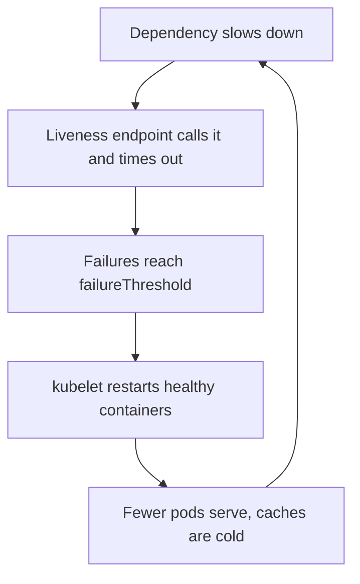

# Lesson 13. Probes

**Mission link:** The mission says to keep a workload healthy: probes that answer the right question. A pod that is running is not necessarily working, and the cluster only knows the difference if you tell it how to ask. Three probes ask three different questions, and mixing them up is a classic way to turn a slow dependency into a full outage.
**Primary source:** [Docs: "Liveness, Readiness, and Startup Probes", Kubernetes](https://kubernetes.io/docs/concepts/workloads/pods/probes/)
**Prerequisites:** [Lesson 4](0004-pods.md), [Lesson 8](0008-services.md), [kubelet](../GLOSSARY.md), [Liveness probe](../GLOSSARY.md), [Readiness probe](../GLOSSARY.md), [Startup probe](../GLOSSARY.md), [EndpointSlice](../GLOSSARY.md)

## Warm-up

1. ▢ Which component sends traffic only to the ready pods behind a Service, and what object does it read to know which those are?

<details markdown="1"><summary>Check</summary>

kube-proxy routes using the EndpointSlices that a controller maintains from the Service's selector, and those record the readiness of each pod (lesson 8). Hold that thought: a readiness probe is what changes that readiness.

</details>

2. ▢ A container in a pod exits. Which component notices, and does the pod object get replaced?

<details markdown="1"><summary>Check</summary>

The kubelet on the node notices and restarts the container inside the same pod, according to the pod's restart policy. The pod object stays, only its restart count grows (lesson 4). A Deployment replaces a pod only when the pod itself is gone (lesson 5).

</details>

3. ▢ In a Docker container, what did a health check do when it reported unhealthy?

<details markdown="1"><summary>Check</summary>

Nothing except report the state. Docker never restarted a container because of a health check ([Running Containers](../../containers/reference/running-containers.md), health checks). Kubernetes probes are different because the kubelet acts on the result.

</details>

## Know this

### Three probes, three questions

A probe is a diagnostic the kubelet runs periodically against a container ([Docs](https://kubernetes.io/docs/concepts/workloads/pods/probes/)). Each of the three asks one question and has one consequence:

|Probe|Question|When it fails|
|---|---|---|
|Startup|Has the application finished starting?|The kubelet kills the container, and the restart policy applies|
|Liveness|Is the application stuck beyond recovery?|The kubelet kills the container, and the restart policy applies|
|Readiness|Can the application take traffic right now?|The pod is marked not ready and its address leaves the EndpointSlices of matching Services|

A startup probe runs only at startup, and while it is configured the other two do not run until it succeeds. Liveness and readiness run for the whole life of the container, and they do not wait for each other. Readiness never restarts anything: it only takes the pod out of rotation, and the pod can come back by itself when the probe passes again. If a container defines no probe of a kind, the kubelet treats it as always succeeding, except that readiness counts as failing before the initial delay has passed.

The kubelet restarts the container, not the pod. The pod stays where it is, `RESTARTS` goes up, and repeated failures show as `CrashLoopBackOff`, where the delay between restarts grows exponentially up to 300 seconds and resets after the container has run for 10 minutes without problems ([Pod Lifecycle](https://kubernetes.io/docs/concepts/workloads/pods/pod-lifecycle/)).

### How a probe checks

Every probe defines exactly one mechanism:

|Mechanism|Succeeds when|
|---|---|
|`httpGet`|The response status is at least 200 and below 400|
|`tcpSocket`|The port accepts a connection|
|`exec`|The command in the container exits with 0|
|`grpc`|The service reports `SERVING` through the gRPC health protocol|

An `exec` probe forks processes on every run, so on a node with many pods a short interval adds real CPU cost, and the docs suggest another mechanism there. The probe is the cluster's side of the bargain. The application's side, an endpoint that tells the truth, is code and belongs to the language tracks, for example C#'s [Logging and Health Checks](../../../programming/csharp/lessons/0039-logging-and-health-checks.md).

### The timing fields and their defaults

|Field|Default|Meaning|
|---|---|---|
|`initialDelaySeconds`|0|Seconds after the container starts before probing begins|
|`periodSeconds`|10|How often to probe, minimum 1|
|`timeoutSeconds`|1|A probe slower than this counts as a failure|
|`failureThreshold`|3|Consecutive failures before the probe is considered failed|
|`successThreshold`|1|Consecutive successes to recover, and it must be 1 for liveness and startup|

These come from the [probe configuration reference](https://kubernetes.io/docs/concepts/workloads/pods/probes/#configuration-fields). The defaults give a liveness probe about 30 seconds of failing checks (3 times 10) before a restart, and the 1 second timeout is tight for an endpoint that touches a database. The time a container may take to start before a liveness probe would kill it is roughly `initialDelaySeconds + failureThreshold * periodSeconds`. If your application regularly needs longer, the docs say to add a startup probe on the same endpoint with a `failureThreshold` high enough to cover the slow start, and leave the liveness settings alone, so a slow start is allowed while a later deadlock is still caught fast.

```yaml
startupProbe:
  httpGet: {path: /healthz, port: 8080}
  periodSeconds: 10
  failureThreshold: 30      # up to 300 seconds to start
livenessProbe:
  httpGet: {path: /healthz, port: 8080}
  periodSeconds: 10
  timeoutSeconds: 3
readinessProbe:
  httpGet: {path: /ready, port: 8080}
  periodSeconds: 5
```

### The liveness probe that causes an outage

Liveness exists to catch a deadlock: the process is running and unable to make progress, and a restart helps. It answers a question about this process only. When it also checks a dependency, such as calling the database, a database slowdown makes every pod fail liveness at once, and the kubelet restarts healthy processes that could not have fixed anything. The restarted pods start cold, shed their caches and connection pools, and hit the already struggling dependency harder. The docs warn that a wrong liveness probe causes cascading failure: restarts under high load, failed client requests, and more work for the remaining pods.



The pattern the docs suggest is to keep liveness cheap and local, often the same low-cost endpoint as readiness but with a higher `failureThreshold`, so a pod is seen as not ready for a while before it is hard killed. A readiness probe may check required back-ends, so traffic does not go to pods that can only answer with errors. That is a judgment with a price: if the shared dependency is down, every pod goes unready together and the Service has no endpoints at all, which is honest but not a cure, so keep readiness checks shallow too unless a pod truly cannot do useful work without that dependency.

Pods that crash by themselves on a fatal error need no liveness probe, since the kubelet already restarts an exited container.

## Practice

1. ▢ Which event makes the kubelet restart a container?

    - a) Readiness probe failure
    - b) Liveness probe failure
    - c) Startup probe success
    - d) Readiness probe success

<details markdown="1"><summary>Check</summary>

**b)** Liveness failure past its threshold kills the container, and the restart policy applies. (a) only removes the pod from Service endpoints. (c) is the event that lets liveness and readiness begin. (d) puts the pod back in rotation. A failing startup probe also restarts the container, but it is not among the options.

</details>

2. ▢ An application needs up to 4 minutes to start, then runs fine. Its liveness probe is `httpGet` with `periodSeconds: 10` and the default `failureThreshold`. Without changing the liveness probe, write the probe that lets it start.

<details markdown="1"><summary>Check</summary>

```yaml
startupProbe:
  httpGet: {path: /healthz, port: 8080}
  periodSeconds: 10
  failureThreshold: 30
```

Thirty failures at 10 seconds is 300 seconds, which covers 4 minutes with margin. Until the startup probe succeeds the liveness probe does not run, and afterwards the default liveness settings catch a deadlock in about 30 seconds. Raising `initialDelaySeconds` on the liveness probe instead would also work for startup but would leave the container with no protection for those minutes on every restart.

</details>

3. ▢ Predict, then run. This pod's readiness probe passes only while `/tmp/ready` exists. Watch it with `kubectl get pod probe-demo -w`. What do the `READY` and `RESTARTS` columns show over the first minute?

    ```yaml
    apiVersion: v1
    kind: Pod
    metadata:
      name: probe-demo
    spec:
      containers:
      - name: app
        image: busybox:1.36
        args: ["sh", "-c", "sleep 20; touch /tmp/ready; sleep 15; rm /tmp/ready; sleep 600"]
        readinessProbe:
          exec:
            command: ["cat", "/tmp/ready"]
          periodSeconds: 5
    ```

<details markdown="1"><summary>Hint</summary>

Readiness never restarts a container. Work out when the file exists and add up to one `periodSeconds` of delay at each edge.

</details>

<details markdown="1"><summary>Check</summary>

```text
NAME         READY   STATUS    RESTARTS   AGE
probe-demo   0/1     Running   0          3s
probe-demo   1/1     Running   0          24s
probe-demo   0/1     Running   0          39s
```

The pod is `Running` but not ready for about 20 seconds, ready for about 15 while the file exists, then not ready again once it is removed. The timestamps vary by up to 5 seconds because of the probe period. `RESTARTS` stays 0 throughout: readiness only changes whether the pod receives traffic, so a not-ready pod is neither killed nor replaced.

</details>

4. ▢ Debug this. After a database failover that took 40 seconds, every pod of a Deployment restarted two or three times and the service stayed down for several minutes. The pod spec has this probe. Name the cause and the fix.

    ```yaml
    livenessProbe:
      httpGet: {path: /health, port: 8080}   # handler runs SELECT 1 on the database
      periodSeconds: 5
      failureThreshold: 2
    ```

    ```console
    $ kubectl describe pod web-6d4b9c7f8-x2kqp | grep -i liveness
      Warning  Unhealthy  41s  kubelet  Liveness probe failed: HTTP probe failed with statuscode: 500
      Normal   Killing    41s  kubelet  Container app failed liveness probe, will be restarted
    ```

<details markdown="1"><summary>Hint</summary>

Ask what a restart of the web container can change about a database that is failing over.

</details>

<details markdown="1"><summary>Check</summary>

The liveness endpoint depends on the database, so the outage of a dependency became a restart of every healthy pod, with cold caches and reconnect storms on top of it. Make the liveness handler check only the process itself (it can respond), with a more forgiving `failureThreshold`. If the pod should not take traffic without the database, let a separate readiness endpoint reflect that, and accept that all pods go unready together during a failover. A 40 second blip then costs 40 seconds, not several minutes.

</details>

5. ▢ A liveness probe on a pod with the defaults starts failing permanently at second 0 of a hang. Roughly how long until the kubelet restarts the container, and what would `timeoutSeconds: 1` change if the endpoint takes 3 seconds to answer when healthy?

<details markdown="1"><summary>Check</summary>

Three failures are needed at 10 second intervals, so the restart comes after roughly 20 to 30 seconds depending on when the first failing check falls. If a healthy endpoint takes 3 seconds and `timeoutSeconds` is 1, every check counts as a failure, and the container is restarted about 30 seconds after each start while perfectly healthy. Set the timeout above the real response time, and do not use a slow dependent call as the check.

</details>

## Real-world reps

- [ ] On a local cluster, apply the pod from practice item 3 and watch the `READY` column change. Then change the probe to `livenessProbe`, apply a fresh copy, and watch `RESTARTS` instead, reading the `Unhealthy` and `Killing` events with `kubectl describe pod`.
- [ ] Find a manifest you run or have seen, and write down for each container which of the three probes it has, what each one checks, and whether any liveness probe calls something outside the process.
- [ ] Tomorrow: without notes, say what each of the three probes does when it fails, name the five timing fields with their defaults, and explain why a liveness probe should not check the database.

## Going further

- [Running Reliably](../reference/running-reliably.md)
- [Docs: "Liveness, Readiness, and Startup Probes", Kubernetes](https://kubernetes.io/docs/concepts/workloads/pods/probes/)
- [Docs: "Configure Liveness, Readiness and Startup Probes", Kubernetes](https://kubernetes.io/docs/tasks/configure-pod-container/configure-liveness-readiness-startup-probes/)
- [Running Containers](../../containers/reference/running-containers.md), the single-host version of health checks
- [Resources](../RESOURCES.md)

---

Not landing? Reread the primary source at the top, since this lesson compresses it and compression is where understanding leaks. Check the [glossary](../GLOSSARY.md) for any term that felt slippery.

If the lesson itself is unclear rather than the material, that is a defect: [open an issue](https://github.com/TokenCemetery/teach/issues).
