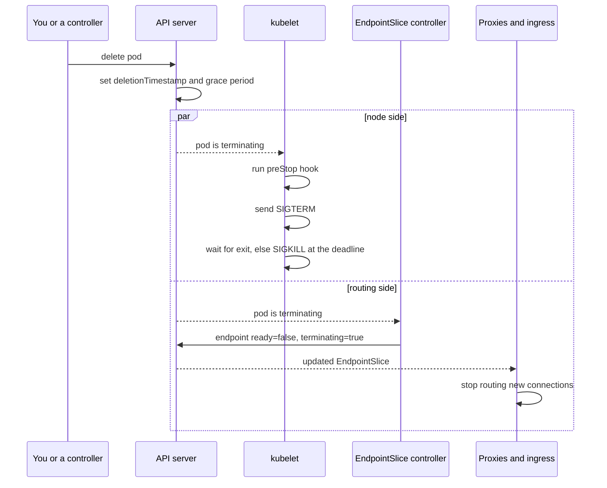

# Lesson 14. Pod Termination

**Mission link:** The mission says to keep a workload healthy through rollouts and node failures, and every rollout is a series of pod terminations. A pod that handles `SIGTERM` perfectly can still drop requests on every deploy, because the cluster stops routing to it at the same moment it starts shutting it down, not before.
**Primary source:** [Docs: "Pod Lifecycle", Kubernetes](https://kubernetes.io/docs/concepts/workloads/pods/pod-lifecycle/), the "Termination of Pods" section
**Prerequisites:** [Lesson 6](0006-rollouts-and-rollbacks.md), [Lesson 8](0008-services.md), [Lesson 13](0013-probes.md), [Termination grace period](../GLOSSARY.md), [EndpointSlice](../GLOSSARY.md), [kubelet](../GLOSSARY.md)

## Warm-up

1. ▢ During a rolling update, what do `maxSurge` and `maxUnavailable` limit?

<details markdown="1"><summary>Check</summary>

`maxSurge` limits how many pods above the desired count may exist during the update, and `maxUnavailable` limits how many may be unavailable. Each old pod the Deployment removes goes through the termination sequence in this lesson (lesson 6).

</details>

2. ▢ Where does a Service get the list of pods it sends traffic to, and who reads that list?

<details markdown="1"><summary>Check</summary>

From EndpointSlices, which a controller keeps in step with the pods matching the selector. kube-proxy on every node, and an ingress controller or gateway, read them and program their own routing (lessons 8 and 10). Each reader updates on its own schedule, which is the root of the problem in this lesson.

</details>

3. ▢ In the containers track, `docker stop` sends `SIGTERM`, waits, then `SIGKILL`. What exit code does a container killed that way show, and what does a PID 1 with no handler do with `SIGTERM`?

<details markdown="1"><summary>Check</summary>

137, which is 128 plus 9 for `SIGKILL`. A PID 1 without a `SIGTERM` handler ignores the signal, because the kernel does not apply default signal actions to PID 1 ([Running Containers](../../containers/reference/running-containers.md), stopping cleanly). The same is true in a pod.

</details>

## Know this

### The sequence after a delete

When a pod is deleted, by you, by a Deployment rollout, by a scale-down or by a drain, the API server does not remove it. It records a deletion timestamp and a grace period, and the pod shows as `Terminating`. Two things then start at the same time ([Pod Lifecycle](https://kubernetes.io/docs/concepts/workloads/pods/pod-lifecycle/)):

1. The kubelet on the pod's node begins shutting the containers down: it runs any `preStop` hook, then asks the container runtime to send `SIGTERM` to process 1 of each container, then waits for the processes to exit.
2. The control plane marks the pod's endpoint in the EndpointSlices of matching Services as terminating, and stops counting the pod as a valid replica.

If the processes are still running when the grace period ends, the kubelet sends `SIGKILL`, and the pod object is removed from the API.



### The grace period

`terminationGracePeriodSeconds` defaults to 30 seconds. The clock starts before the `preStop` hook runs, so the hook and the shutdown after `SIGTERM` share the same budget: the docs give the example of a 60 second period, a hook that takes 55 seconds and a container that needs 10 more to stop, which ends in `SIGKILL` at 60 ([Container Lifecycle Hooks](https://kubernetes.io/docs/concepts/containers/container-lifecycle-hooks/)). If a hook is still running at the deadline, the kubelet grants a single extra 2 seconds. Containers of one pod receive `SIGTERM` in no guaranteed order.

The same period applies to anything that ends a pod gracefully, including API-initiated eviction during a drain (lesson 19). It does not apply to a force delete: `kubectl delete pod NAME --grace-period=0 --force` removes the object from the API immediately without waiting for the kubelet to confirm the containers stopped, and the docs warn the workload may keep running. That is a risk for anything that must not run twice, which is why it has its own warning in the StatefulSet documentation.

### The traffic race

Because the two sides start together, `SIGTERM` can reach the application before every proxy and ingress controller has dropped its address. The docs say the control plane acts at the same moment as the kubelet. They do not promise how long the news takes to reach each consumer, and each runs its own loop: a proxy on every node, an ingress controller, a cloud load balancer, perhaps a service mesh. In that window the pod gets new connections after it began shutting down. An application that exits promptly on `SIGTERM` fails those requests, and the symptom is a handful of 502 or connection reset errors on every deploy.

A terminating endpoint always has `ready` set to false, so ordinary routing skips it, but the EndpointSlice also carries a `serving` condition that follows the pod's readiness, so a consumer that wants to drain can still see whether the pod can answer ([EndpointSlices](https://kubernetes.io/docs/concepts/services-networking/endpoint-slices/)). Proxies may even route to endpoints that are serving and terminating when every endpoint of a Service is terminating, to avoid losing traffic during a rolling update.

### The fix: delay SIGTERM

The usual remedy is to make the pod wait before it starts shutting down, so the routing side catches up while the application still serves normally. The `preStop` hook is where that happens, because the hook must finish before `SIGTERM` is sent. A hook can be an `exec` command, an `httpGet` request, or a `sleep`, and the docs list the sleep action as a handler that the kubelet itself executes ([Container Lifecycle Hooks](https://kubernetes.io/docs/concepts/containers/container-lifecycle-hooks/)). Because the kubelet runs it, the image needs no `sleep` binary, which matters for distroless images.

```yaml
spec:
  terminationGracePeriodSeconds: 45
  containers:
  - name: app
    image: registry.example/app:1.4
    lifecycle:
      preStop:
        sleep:
          seconds: 10
```

The budget has to add up: the sleep, plus the longest in-flight request or drain the application needs after `SIGTERM`, plus a margin, must fit in `terminationGracePeriodSeconds`. Here 10 seconds of sleep and up to 30 seconds of draining fit in 45. The application side is its own subject: stop accepting new connections on `SIGTERM`, finish what is in flight, then exit. That is the language tracks' work, for example Go's [Graceful Shutdown](../../../programming/golang/lessons/0025-graceful-shutdown.md), and this lesson is what the cluster does around it.

## Practice

1. ▢ A pod is deleted. What starts at the same time as the kubelet's shutdown of its containers?

    - a) Moving it onto another node
    - b) Marking its endpoint as terminating
    - c) Sending SIGKILL to the container
    - d) Deleting its volumes from disk

<details markdown="1"><summary>Check</summary>

**b)** The control plane marks the endpoint terminating in parallel with the kubelet's work. (a) is wrong because the pod is never moved, and a controller only creates a replacement pod. (c) happens only after the grace period expires. (d) is wrong because nothing removes volume data when a delete is requested.

</details>

2. ▢ A pod has the default grace period, a `preStop` sleep of 10 seconds, and an application that needs 25 seconds to drain after `SIGTERM`. What happens, and what exit code does the container show?

<details markdown="1"><summary>Check</summary>

The hook takes 10 of the 30 seconds, `SIGTERM` arrives at second 10, and the application would finish at second 35, so `SIGKILL` arrives at second 30 with the drain unfinished. The exit code is 137. The fix is to raise `terminationGracePeriodSeconds` to cover 10 plus 25 plus a margin, for example 45, because the grace period is one budget shared by the hook and the shutdown.

</details>

3. ▢ Predict, then run. How long does `kubectl delete pod grace-demo` take, and what ends the container?

    ```yaml
    apiVersion: v1
    kind: Pod
    metadata:
      name: grace-demo
    spec:
      terminationGracePeriodSeconds: 10
      containers:
      - name: app
        image: busybox:1.36
        command: ["sleep", "3600"]
        lifecycle:
          preStop:
            sleep:
              seconds: 4
    ```

    ```console
    $ kubectl apply -f grace-demo.yaml
    $ kubectl wait --for=condition=Ready pod/grace-demo
    $ time kubectl delete pod grace-demo
    ```

<details markdown="1"><summary>Hint</summary>

`sleep` runs as PID 1 and has no `SIGTERM` handler. Does the hook time add to the grace period or come out of it?

</details>

<details markdown="1"><summary>Check</summary>

```text
pod "grace-demo" deleted
real    0m10.3s
```

The hook runs for 4 seconds, `SIGTERM` is then sent but ignored by PID 1, and the kubelet waits until the 10 second budget, which started before the hook, runs out and sends `SIGKILL`. The delete therefore takes about 10 seconds, not 4 and not 14. A program that handled `SIGTERM` would have exited right after the hook, at about 4 seconds.

</details>

4. ▢ Debug this. A web service handles `SIGTERM` correctly: it stops accepting connections and finishes in-flight requests. Yet every rollout produces a few seconds of 502 responses from the ingress. Why, and what do you change?

<details markdown="1"><summary>Hint</summary>

Compare the moment the application starts refusing connections with the moment the ingress controller learns the pod is going away.

</details>

<details markdown="1"><summary>Check</summary>

The application refuses new connections as soon as `SIGTERM` arrives, but the endpoint removal runs in parallel and takes time to reach the ingress, so new requests are still sent to a pod that stopped listening. Add a `preStop` `sleep` of a few seconds so the pod keeps serving normally while the routing side catches up, and raise `terminationGracePeriodSeconds` so the sleep plus the drain fit. The sleep length is a guess to tune by measuring how long your own ingress takes to react.

</details>

5. ▢ Choose a `terminationGracePeriodSeconds` for a pod that sleeps 5 seconds in `preStop`, handles requests that run up to 20 seconds, and takes 3 seconds to close connections. Say what rule you used.

<details markdown="1"><summary>Check</summary>

The budget must cover the hook, the longest drain and the cleanup: 5 plus 20 plus 3 is 28 seconds, so the default of 30 leaves almost no margin, and 45 is a safer choice. Too small a value cuts requests off with `SIGKILL`. Too large a value slows every rollout and drain, because a stuck pod holds its slot until the deadline.

</details>

6. ▢ A StatefulSet pod is stuck `Terminating` on a dead node, and a colleague proposes `kubectl delete pod --grace-period=0 --force`. What does that do, and why is it risky?

<details markdown="1"><summary>Check</summary>

It removes the pod object from the API at once, without waiting for the kubelet to confirm the containers stopped. A replacement with the same name can then be created while the old containers may still be running on a node you cannot reach, so two copies could write to the same data. Confirm the node is really gone before forcing, as the StatefulSet documentation says.

</details>

## Real-world reps

- [ ] On a local cluster, apply the pod from practice item 3, change the command to a shell with a `trap` on `TERM` that exits at once, and time the delete again. Compare it with the 10 seconds you saw.
- [ ] Run `kubectl get pod NAME -o jsonpath='{.spec.terminationGracePeriodSeconds}'` on a few pods you run, and for each, note whether it has a `preStop` hook and whether the budget covers the longest request.
- [ ] Tomorrow: without notes, draw the sequence from delete to `SIGKILL`, marking what runs in parallel, and state why the endpoint removal can lose a race with `SIGTERM`.

## Going further

- [Running Reliably](../reference/running-reliably.md)
- [Docs: "Pod Lifecycle", Kubernetes](https://kubernetes.io/docs/concepts/workloads/pods/pod-lifecycle/), the "Termination of Pods" section
- [Docs: "Container Lifecycle Hooks", Kubernetes](https://kubernetes.io/docs/concepts/containers/container-lifecycle-hooks/)
- [Docs: "Explore Termination Behavior for Pods And Their Endpoints", Kubernetes](https://kubernetes.io/docs/tutorials/services/pods-and-endpoint-termination-flow/)
- [Graceful Shutdown (Go)](../../../programming/golang/lessons/0025-graceful-shutdown.md), the application side of the same sequence
- [Resources](../RESOURCES.md)

---

Not landing? Reread the primary source at the top, since this lesson compresses it and compression is where understanding leaks. Check the [glossary](../GLOSSARY.md) for any term that felt slippery.

If the lesson itself is unclear rather than the material, that is a defect: [open an issue](https://github.com/TokenCemetery/teach/issues).
