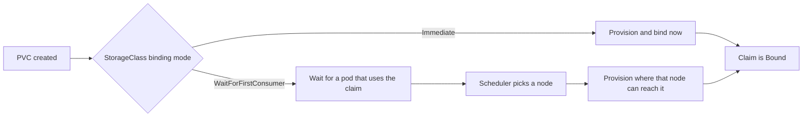

# Lesson 16. Persistent Storage

**Mission link:** The mission says to run stateful workloads on persistent storage. A container's filesystem disappears with the container, and a pod can be replaced on a different node at any time, so data that must survive needs storage that has a lifecycle of its own. Kubernetes separates asking for storage from providing it, and most data-loss stories live in the settings between the two.
**Primary source:** [Docs: "Persistent Volumes", Kubernetes](https://kubernetes.io/docs/concepts/storage/persistent-volumes/)
**Prerequisites:** [Lesson 4](0004-pods.md), [Lesson 5](0005-deployments-and-replicasets.md), [Lesson 11](0011-configmaps.md), [PersistentVolume](../GLOSSARY.md), [PersistentVolumeClaim](../GLOSSARY.md), [StorageClass](../GLOSSARY.md)

## Warm-up

1. ▢ Lesson 11 mounted a ConfigMap as files. What did the pod's `volumes` entry name, and where in the container did the files appear?

<details markdown="1"><summary>Check</summary>

The pod declares a volume under `spec.volumes` that points at the ConfigMap, and each container lists a `volumeMounts` entry with a `mountPath` where the files appear. Persistent storage uses the same two-step shape with a different source: a claim instead of a ConfigMap (lessons 4 and 11).

</details>

2. ▢ A Deployment's pod is deleted and its replacement starts on another node. What is gone, and what is the same?

<details markdown="1"><summary>Check</summary>

The old pod's writable container layer and any `emptyDir` are gone, since both belong to that pod. The Deployment creates a new pod from the same template, so the spec is the same and the identity is not (lesson 5). Only storage outside the pod can carry data across that.

</details>

3. ▢ In the containers track, what kind of Docker volume kept database files across `docker rm`, and who managed it?

<details markdown="1"><summary>Check</summary>

A named volume, managed by Docker on one host, which outlives the container ([Running Containers](../../containers/reference/running-containers.md), volumes). Kubernetes needs the same idea to work across many nodes, which is why the pieces below exist.

</details>

## Know this

### Three objects

Storage is split into who asks and who provides ([Docs](https://kubernetes.io/docs/concepts/storage/persistent-volumes/)):

|Object|Who owns it|What it is|
|---|---|---|
|PersistentVolumeClaim|The application team|A request for a size and an access mode that a pod mounts by name|
|PersistentVolume|The cluster or its administrator|A piece of storage with a lifecycle independent of any pod|
|StorageClass|The administrator|A kind of storage and the provisioner that creates volumes of that kind on demand|

A claim binds to exactly one PersistentVolume, one to one, and a claim stays `Pending` while no volume matches. Pods reference the claim, never the volume:

```yaml
apiVersion: v1
kind: PersistentVolumeClaim
metadata:
  name: data
spec:
  accessModes: ["ReadWriteOnce"]
  resources:
    requests:
      storage: 1Gi
---
apiVersion: v1
kind: Pod
metadata:
  name: writer
spec:
  containers:
  - name: app
    image: busybox:1.36
    command: ["sh", "-c", "echo hello >> /data/log; sleep 3600"]
    volumeMounts:
    - name: data
      mountPath: /data
  volumes:
  - name: data
    persistentVolumeClaim:
      claimName: data
```

### Dynamic provisioning and binding mode

Without a provisioner an administrator must create each PersistentVolume by hand. With one, the claim triggers creation ([Dynamic Volume Provisioning](https://kubernetes.io/docs/concepts/storage/dynamic-provisioning/)). A claim that names a `storageClassName` gets that class, a claim that names none gets the default StorageClass if one exists, and `storageClassName: ""` means no class at all, which asks for a pre-created volume.



`volumeBindingMode` defaults to `Immediate`, which provisions as soon as the claim exists, without knowing where the pod will run. For storage that is tied to a zone or a node, that can produce a volume the pod cannot reach. `WaitForFirstConsumer` delays binding until a pod uses the claim, so the volume is created where the scheduler placed the pod ([Storage Classes](https://kubernetes.io/docs/concepts/storage/storage-classes/)). A claim that stays `Pending` under it is normal until a pod mounts it.

A kind cluster ships with a default StorageClass that provisions from the node's local disk, so claims work without a cloud account. It names itself `standard`, which is why a bare claim works on it.

### What access modes promise

|Mode|Meaning|
|---|---|
|`ReadWriteOnce` (RWO)|Mounted read-write by a single node, and several pods on that node may use it|
|`ReadOnlyMany` (ROX)|Mounted read-only by many nodes|
|`ReadWriteMany` (RWX)|Mounted read-write by many nodes|
|`ReadWriteOncePod` (RWOP)|Mounted read-write by a single pod in the whole cluster|

The mode describes what the volume can do, and the docs note it does not enforce write protection once mounted. Which modes are available depends on the storage backend, since a block disk is usually single-node and shared filesystems offer many. The StatefulSet documentation recommends `ReadWriteOncePod` for production over `ReadWriteOnce` when only one pod should ever hold the volume.

### Reclaim policy and protection

The reclaim policy says what happens to the volume when its claim is deleted:

|Policy|After the claim is deleted|
|---|---|
|`Delete`|The PersistentVolume and the underlying storage are both removed|
|`Retain`|The volume stays, marked released, and an administrator reclaims it by hand because the old data is still on it|

A dynamically provisioned volume inherits the reclaim policy of its StorageClass, which defaults to `Delete`. So deleting a claim, or the namespace holding it, can delete the data. For data you cannot recreate, use a class with `Retain`, or patch the policy on the volume. `Recycle` is deprecated.

Two guards help: a claim that a pod is still using is not removed until no pod uses it (it shows `Terminating`), and a volume bound to a claim is likewise kept until it is unbound. A claim can be grown by editing its requested size, but only if its StorageClass sets `allowVolumeExpansion: true`.

## Practice

1. ▢ Which access mode lets exactly one pod in the whole cluster write to a volume?

    - a) ReadWriteOnce
    - b) ReadOnlyMany
    - c) ReadWriteMany
    - d) ReadWriteOncePod

<details markdown="1"><summary>Check</summary>

**d)** `ReadWriteOncePod` restricts the volume to a single pod across the cluster. (a) restricts it to a single node, and several pods on that node can all write. (b) is read-only. (c) allows many nodes to write at once.

</details>

2. ▢ A claim bound to a dynamically provisioned volume, with the class defaults, is deleted along with its pod. What happens to the data, and what would you change in advance to keep it?

<details markdown="1"><summary>Check</summary>

The class default reclaim policy is `Delete`, so the PersistentVolume and the underlying disk are removed with the claim, and the data is gone. To keep it, use a StorageClass with `reclaimPolicy: Retain`, or patch `persistentVolumeReclaimPolicy` on the volume to `Retain` before deleting the claim. A retained volume then has to be cleaned up and reclaimed by an administrator.

</details>

3. ▢ Predict, then run. Create only the claim from this lesson on a kind cluster, then the pod. What does `kubectl get pvc data` show before the pod exists, and after it runs?

    ```console
    $ kubectl get storageclass
    $ kubectl apply -f pvc.yaml
    $ kubectl get pvc data
    $ kubectl apply -f pod.yaml
    $ kubectl wait --for=condition=Ready pod/writer
    $ kubectl get pvc data
    ```

<details markdown="1"><summary>Hint</summary>

Look at the `VOLUMEBINDINGMODE` column of the first command before you answer.

</details>

<details markdown="1"><summary>Check</summary>

```text
NAME                 PROVISIONER             RECLAIMPOLICY   VOLUMEBINDINGMODE      ALLOWVOLUMEEXPANSION   AGE
standard (default)   rancher.io/local-path   Delete          WaitForFirstConsumer   false                  12m

NAME   STATUS    VOLUME   CAPACITY   ACCESS MODES   STORAGECLASS   VOLUMEATTRIBUTESCLASS   AGE
data   Pending                                      standard       <unset>                 4s

NAME   STATUS   VOLUME                                     CAPACITY   ACCESS MODES   STORAGECLASS   VOLUMEATTRIBUTESCLASS   AGE
data   Bound    pvc-3f5c1b0e-8a47-4d5e-9c11-2b7e6d0a5f31   1Gi        RWO            standard       <unset>                 31s
```

With `WaitForFirstConsumer`, the claim waits for a pod, and `kubectl describe pvc data` shows an event saying it is waiting for the first consumer to be created before binding. Once the pod is scheduled, the volume is provisioned and the claim turns `Bound`. The `Pending` state was not an error.

</details>

4. ▢ Debug this. A pod stays `Pending` and its claim does too. What is wrong, and what fixes it?

    ```console
    $ kubectl describe pvc data
    Name:          data
    StorageClass:  fast
    Status:        Pending
    Events:
      Warning  ProvisioningFailed  8s (x4 over 55s)  persistentvolume-controller
               storageclass.storage.k8s.io "fast" not found
    ```

<details markdown="1"><summary>Hint</summary>

The class name in the event is the claim's `storageClassName`. Check that it exists with `kubectl get storageclass`.

</details>

<details markdown="1"><summary>Check</summary>

The claim names a StorageClass called `fast` that does not exist in this cluster, so nothing can provision the volume. Either create a class with that name, or change `storageClassName` to an existing one, or remove the field to use the default class. Delete and recreate the claim with the corrected class. The pod stays `Pending` because it waits for the claim.

</details>

5. ▢ A Deployment with 3 replicas mounts one `ReadWriteOnce` claim, and the replicas land on different nodes. Which problem do you expect, and what is the structural answer?

<details markdown="1"><summary>Check</summary>

All three pods share the one claim, but `ReadWriteOnce` allows mounting on only a single node, so pods placed on other nodes cannot use the volume and stay unable to start. Even on one node, three replicas writing to the same files is rarely what a database wants. Giving each replica its own volume is what a StatefulSet's volume claim templates do (lesson 17).

</details>

6. ▢ Your database claim is 10Gi and almost full. How do you grow it, and what must already be true?

<details markdown="1"><summary>Check</summary>

Edit the claim's `spec.resources.requests.storage` to a larger value, for example with `kubectl patch`. This only works if the StorageClass has `allowVolumeExpansion: true`, and the storage driver must support expansion. The docs describe growing a claim, not shrinking one, so choose sizes with growth in mind.

</details>

## Real-world reps

- [ ] On a local cluster, run practice item 3. Then delete the pod, apply it again, and read the file with `kubectl exec writer -- cat /data/log` to see the earlier line survive.
- [ ] With the pod deleted, delete the claim and run `kubectl get pv` to see what the `Delete` reclaim policy did to the volume. Then check what the class says with `kubectl get storageclass -o yaml`.
- [ ] Tomorrow: without notes, name the three storage objects and who owns each, say what `WaitForFirstConsumer` waits for, and state what each reclaim policy does when a claim is deleted.

## Going further

- [State, Scheduling and Scale](../reference/state-scheduling-and-scale.md)
- [Docs: "Persistent Volumes", Kubernetes](https://kubernetes.io/docs/concepts/storage/persistent-volumes/)
- [Docs: "Storage Classes", Kubernetes](https://kubernetes.io/docs/concepts/storage/storage-classes/)
- [Docs: "Dynamic Volume Provisioning", Kubernetes](https://kubernetes.io/docs/concepts/storage/dynamic-provisioning/)
- [Docs: "Volumes", Kubernetes](https://kubernetes.io/docs/concepts/storage/volumes/)
- [Resources](../RESOURCES.md)

---

Not landing? Reread the primary source at the top, since this lesson compresses it and compression is where understanding leaks. Check the [glossary](../GLOSSARY.md) for any term that felt slippery.

If the lesson itself is unclear rather than the material, that is a defect: [open an issue](https://github.com/TokenCemetery/teach/issues).
