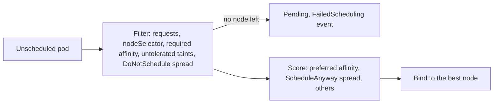

# Lesson 18. Scheduling

**Mission link:** The mission says to place pods deliberately. By default the scheduler spreads pods reasonably, and that is enough until three replicas land on one node that then drains, or a batch job lands on the machines reserved for a database. The constraints in this lesson are how you state a placement rule, and the `Pending` event is how you read why one cannot be met.
**Primary source:** [Docs: "Assigning Pods to Nodes", Kubernetes](https://kubernetes.io/docs/concepts/scheduling-eviction/assign-pod-node/)
**Prerequisites:** [Lesson 2](0002-the-reconciliation-loop.md), [Lesson 15](0015-requests-limits-and-qos.md), [Lesson 17](0017-statefulsets.md), [Scheduler](../GLOSSARY.md), [Label](../GLOSSARY.md), [Taint and toleration](../GLOSSARY.md), [Selector](../GLOSSARY.md)

## Warm-up

1. ▢ What does the scheduler compare a pod against when it decides whether a node has room?

<details markdown="1"><summary>Check</summary>

The pod's resource requests against what is already requested on the node, up to its allocatable capacity, not current usage (lesson 15). A pod whose requests fit no node stays `Pending`.

</details>

2. ▢ In the reconciliation loop of lesson 2, how does the scheduler learn a pod needs a node, and what does it write when it decides?

<details markdown="1"><summary>Check</summary>

It watches the API server for pods with no node assigned, and it records its decision by binding the pod to a node through the API server. The kubelet on that node then sees the pod assigned to it and runs it. The scheduler never starts containers itself (lesson 2).

</details>

3. ▢ A StatefulSet pod's claim is on a volume in one zone. Why does `WaitForFirstConsumer` matter for where the pod runs?

<details markdown="1"><summary>Check</summary>

It delays creating the volume until the scheduler has chosen a node, so the volume is provisioned where the pod can reach it instead of the pod being stuck with a volume in a zone it cannot use (lesson 16).

</details>

## Know this

### Filter, then score

The scheduler picks a node for each pod in two steps ([Kubernetes Scheduler](https://kubernetes.io/docs/concepts/scheduling-eviction/kube-scheduler/)). Filtering removes nodes that cannot run the pod, for example because requests do not fit. Scoring ranks the remaining feasible nodes, and the pod is bound to the highest score, with ties broken at random. If filtering leaves nothing, the pod waits as `Pending` and the scheduler retries.

The constraints below fall on one side of that line: a hard rule filters, and a soft preference only adds to the score.



### Selecting nodes by label

Nodes have labels, and Kubernetes sets standard ones such as `kubernetes.io/hostname`, `kubernetes.io/os` and, from a cloud provider or your own tooling, `topology.kubernetes.io/zone`. The docs note the values of some are provider specific, so check what your nodes carry with `kubectl get nodes --show-labels`.

`nodeSelector` is the simplest form: the pod runs only on nodes that have every listed label.

```yaml
nodeSelector:
  disktype: ssd
```

**Node affinity** is the more expressive form. `requiredDuringSchedulingIgnoredDuringExecution` is a hard rule like `nodeSelector` with operators such as `In`, `NotIn`, `Exists` and `Gt`. `preferredDuringSchedulingIgnoredDuringExecution` is a soft rule with a weight from 1 to 100, which adds to a node's score. `IgnoredDuringExecution` means that if node labels change after the pod is placed, the pod keeps running. Several `nodeSelectorTerms` are ORed, and several expressions inside one term are ANDed. If a pod has both a `nodeSelector` and node affinity, both must be satisfied.

### Pods relative to other pods

**Pod affinity and anti-affinity** place a pod by the labels of pods already running in a topology domain, named by `topologyKey`, such as `kubernetes.io/hostname` for a node or `topology.kubernetes.io/zone` for a zone. The usual use is anti-affinity so replicas do not share a node:

```yaml
affinity:
  podAntiAffinity:
    requiredDuringSchedulingIgnoredDuringExecution:
    - labelSelector:
        matchLabels:
          app: web
      topologyKey: kubernetes.io/hostname
```

With this rule, no two `app: web` pods share a node, so a fourth replica on three nodes stays `Pending`. The docs warn that inter-pod rules take substantial processing and slow scheduling in large clusters, and that every node needs the label named by `topologyKey`.

**Topology spread constraints** express how uneven a spread may be instead of all or nothing:

```yaml
topologySpreadConstraints:
- maxSkew: 1
  topologyKey: topology.kubernetes.io/zone
  whenUnsatisfiable: DoNotSchedule
  labelSelector:
    matchLabels:
      app: web
```

`maxSkew` is the largest allowed difference between the number of matching pods in a domain and the domain with the fewest. With 2, 2 and 1 pods in three zones and `maxSkew: 1`, the global minimum is 1, so the next pod may only go to a zone where it keeps the difference within 1. `whenUnsatisfiable: DoNotSchedule` (the default) is a hard rule, and `ScheduleAnyway` only prefers the better spread. Without any constraints of its own, a pod is spread by built-in soft defaults across hostnames and zones, which shape the score but never block placement ([Topology Spread Constraints](https://kubernetes.io/docs/concepts/scheduling-eviction/topology-spread-constraints/)).

### Taints and tolerations

Affinity attracts a pod to nodes. A **taint** is the opposite: it repels pods from a node, so a node can keep out everything that does not opt in. A **toleration** on a pod allows it onto a tainted node, and does not draw it there. To attract and allow, combine a toleration with a node selector or affinity.

|Taint effect|Meaning|
|---|---|
|`NoSchedule`|No new pod lands on the node without a matching toleration, and running pods stay|
|`PreferNoSchedule`|The scheduler tries to avoid the node, with no guarantee|
|`NoExecute`|Also evicts running pods that do not tolerate the taint|

```console
$ kubectl taint nodes lab-worker dedicated=batch:NoSchedule
$ kubectl taint nodes lab-worker dedicated=batch:NoSchedule-
```

The second command, with the trailing minus, removes the taint. A matching toleration has the same key, effect and, for the `Equal` operator, value.

```yaml
tolerations:
- key: dedicated
  operator: Equal
  value: batch
  effect: NoSchedule
```

The control plane uses taints itself. When a node is not ready or unreachable it gets `node.kubernetes.io/not-ready` or `node.kubernetes.io/unreachable`, and Kubernetes automatically adds a toleration for both with `tolerationSeconds=300` to pods, so pods stay bound to a failed node for 5 minutes before they are evicted ([Taints and Tolerations](https://kubernetes.io/docs/concepts/scheduling-eviction/taint-and-toleration/)). Setting `nodeName` on a pod bypasses the scheduler and its taint check entirely, and is rarely what you want. The scheduler can also preempt lower-priority pods to place a higher-priority one, which `PriorityClass` controls ([Pod Priority and Preemption](https://kubernetes.io/docs/concepts/scheduling-eviction/pod-priority-preemption/)).

### Reading why a pod is Pending

The scheduler records why it failed on the pod. Run `kubectl describe pod NAME` and read the `FailedScheduling` event. It counts the nodes and gives a reason per group, for example `0/4 nodes are available: 1 node(s) had untolerated taint {node-role.kubernetes.io/control-plane: }, 3 node(s) didn't match Pod's node affinity/selector`. Every node is accounted for in that line, and each reason points at one of the mechanisms above or at requests that do not fit.

## Practice

1. ▢ What does a toleration do?

    - a) Attracts a pod to a node
    - b) Allows a pod onto a node
    - c) Repels a pod from a node
    - d) Forces a pod onto a node

<details markdown="1"><summary>Check</summary>

**b)** A toleration only permits scheduling onto a tainted node, and the scheduler may still choose another node. (a) and (d) describe affinity and `nodeName`. (c) describes the taint, which is on the node.

</details>

2. ▢ A zone-spread constraint has `maxSkew: 1` and `DoNotSchedule`. Three zones hold 2, 2 and 1 matching pods. Where can the next pod go, and why?

<details markdown="1"><summary>Check</summary>

Only to the zone with 1 pod. The global minimum is 1, and placing the pod in a zone that already has 2 would make it 3, a difference of 2 from the minimum, which exceeds `maxSkew: 1`. After it lands the counts are 2, 2 and 2. With `ScheduleAnyway` the third zone would only be preferred, not required.

</details>

3. ▢ Predict, then run. On the `lab` cluster from lesson 1 (one control-plane node and two workers, `lab-worker` and `lab-worker2`), you taint one worker and then create a Deployment with 3 replicas and no tolerations. Where do the pods run?

    ```console
    $ kubectl taint nodes lab-worker dedicated=batch:NoSchedule
    $ kubectl create deployment spread --image=registry.k8s.io/pause:3.9 --replicas=3
    $ kubectl get pods -l app=spread -o wide
    ```

<details markdown="1"><summary>Hint</summary>

A kind control-plane node is tainted as well. Count the nodes that carry no taint the pods fail to tolerate.

</details>

<details markdown="1"><summary>Check</summary>

```text
NAME                     READY   STATUS    RESTARTS   AGE   IP           NODE
spread-6d8f7c9b4-4kx2p   1/1     Running   0          9s    10.244.2.2   lab-worker2
spread-6d8f7c9b4-m6tqv   1/1     Running   0          9s    10.244.2.3   lab-worker2
spread-6d8f7c9b4-zr8wd   1/1     Running   0          9s    10.244.2.4   lab-worker2
```

All three run on `lab-worker2`. The tainted worker repels the pods because they have no matching toleration, and the control-plane node carries its own taint, so only one node passes the filter. Taints are hard filters, and the default spreading only influences the score, so with a single node left there is nothing to spread across.

</details>

4. ▢ Debug this. A new Deployment's pods are all `Pending`. What does the event tell you, and what do you check next?

    ```console
    $ kubectl describe pod api-5d8f6c7b9-hq2lz | grep -A2 Events
    Events:
      Warning  FailedScheduling  14s  default-scheduler  0/4 nodes are available: 1 node(s) had untolerated taint {node-role.kubernetes.io/control-plane: }, 3 node(s) didn't match Pod's node affinity/selector. preemption: 0/4 nodes are available: 4 Preemption is not helpful for scheduling.
    ```

<details markdown="1"><summary>Hint</summary>

Three nodes were rejected on a label rule. Compare what the pod asks for with what those nodes carry.

</details>

<details markdown="1"><summary>Check</summary>

The control-plane node is tainted as usual, and the three workers do not satisfy the pod's `nodeSelector` or required node affinity. Read the pod's `nodeSelector` and `affinity` with `kubectl get pod -o yaml`, and compare with `kubectl get nodes --show-labels`. Either label a node to match, relax the rule, or fix a typo in the label. Preemption does not help because no lower-priority pod stands in the way.

</details>

5. ▢ You want three replicas of a service on three different nodes, and you would rather run two on one node than leave one pending when a node is down. Which constraint do you choose, and with which settings?

<details markdown="1"><summary>Check</summary>

A topology spread constraint on `kubernetes.io/hostname` with `whenUnsatisfiable: ScheduleAnyway`, so the scheduler prefers distinct nodes but still places the pod when it cannot. Required pod anti-affinity on the hostname would leave the third replica `Pending` when only two nodes are available, which is the all-or-nothing behaviour you want to avoid here.

</details>

6. ▢ A database node pool is tainted `dedicated=db:NoSchedule`, and database pods carry the matching toleration, yet some of them run on ordinary nodes. Why, and what completes the setup?

<details markdown="1"><summary>Check</summary>

A toleration only permits the tainted nodes, it does not attract the pod to them, so the scheduler may still choose ordinary nodes. Add a `nodeSelector` or required node affinity for a label carried by the database pool. The taint keeps other pods off, and the selector keeps these pods on.

</details>

## Real-world reps

- [ ] On the `lab` cluster, run practice item 3. Then remove the taint with the trailing minus form of `kubectl taint`, delete the pods, and watch where the replacements land.
- [ ] Create a Deployment with 4 replicas and a `topologySpreadConstraints` entry on `kubernetes.io/hostname` with `maxSkew: 1` and `DoNotSchedule`, and read the spread with `kubectl get pods -o wide`.
- [ ] Tomorrow: without notes, say which constraints filter and which only score, what a toleration does and does not do, and where you read why a pod is `Pending`.

## Going further

- [State, Scheduling and Scale](../reference/state-scheduling-and-scale.md)
- [Docs: "Assigning Pods to Nodes", Kubernetes](https://kubernetes.io/docs/concepts/scheduling-eviction/assign-pod-node/)
- [Docs: "Taints and Tolerations", Kubernetes](https://kubernetes.io/docs/concepts/scheduling-eviction/taint-and-toleration/)
- [Docs: "Pod Topology Spread Constraints", Kubernetes](https://kubernetes.io/docs/concepts/scheduling-eviction/topology-spread-constraints/)
- [Docs: "Kubernetes Scheduler", Kubernetes](https://kubernetes.io/docs/concepts/scheduling-eviction/kube-scheduler/)
- [Docs: "Pod Priority and Preemption", Kubernetes](https://kubernetes.io/docs/concepts/scheduling-eviction/pod-priority-preemption/)
- [Resources](../RESOURCES.md)

---

Not landing? Reread the primary source at the top, since this lesson compresses it and compression is where understanding leaks. Check the [glossary](../GLOSSARY.md) for any term that felt slippery.

If the lesson itself is unclear rather than the material, that is a defect: [open an issue](https://github.com/TokenCemetery/teach/issues).
