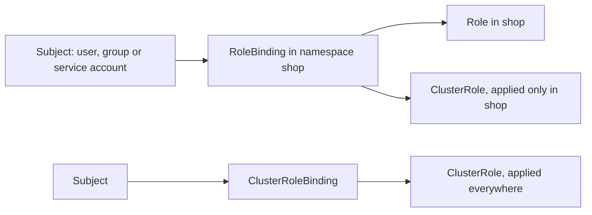

# Lesson 20. RBAC and Service Accounts

**Mission link:** The mission says to lock a workload down. Every pod that talks to the API server does so as a service account, and the default is more access than most pods need. RBAC is how you hand out exactly the verbs a person or a pod requires, and `kubectl auth can-i` is how you prove it without waiting for a failure in production.
**Primary source:** [Docs: "Using RBAC Authorization", Kubernetes](https://kubernetes.io/docs/reference/access-authn-authz/rbac/)
**Prerequisites:** [Lesson 3](0003-objects-and-manifests.md), [Lesson 12](0012-secrets.md), [RBAC](../GLOSSARY.md), [Service account](../GLOSSARY.md), [Namespace](../GLOSSARY.md), [Secret](../GLOSSARY.md)

## Warm-up

1. ▢ A teammate says a Secret is safe because it is base64 encoded. What does protect a Secret, and which of those is this lesson about?

<details markdown="1"><summary>Check</summary>

Three things protect it: RBAC on who may read it through the API, encryption at rest in etcd, and keeping the value out of Git (lesson 12). This lesson is the first one. Base64 is an encoding anyone can reverse, so it protects nothing.

</details>

2. ▢ Is a namespace a security boundary? What does it scope?

<details markdown="1"><summary>Check</summary>

Not on its own. It scopes object names, and it is the unit that RBAC Roles, ResourceQuotas and Pod Security labels attach to (lesson 3). The boundary only exists once something such as a Role or a NetworkPolicy is applied to the namespace.

</details>

3. ▢ Which control plane component receives every `kubectl` request and decides whether to accept it?

<details markdown="1"><summary>Check</summary>

The API server (lesson 2). Authentication, authorization and admission all happen there before anything is written to etcd, so RBAC is enforced in one place for people, controllers and pods alike.

</details>

## Know this

### Four objects and one rule

RBAC has four kinds, all in the `rbac.authorization.k8s.io` group: `Role`, `ClusterRole`, `RoleBinding` and `ClusterRoleBinding` ([RBAC docs](https://kubernetes.io/docs/reference/access-authn-authz/rbac/)). A role is a list of permissions. A binding attaches a role to subjects: users, groups or service accounts.

The one rule that explains the rest: **permissions are purely additive**. There are no deny rules. A subject can do what the union of its bindings allows, so you take access away only by removing a grant, never by adding a "no".

|Object|Scope|Holds|
|---|---|---|
|`Role`|One namespace, the one in its metadata|Rules for namespaced resources|
|`ClusterRole`|The whole cluster, no namespace|Rules for namespaced resources, cluster-scoped resources such as `nodes`, and non-resource URLs such as `/healthz`|
|`RoleBinding`|One namespace|A subject list and a reference to a Role or ClusterRole|
|`ClusterRoleBinding`|The whole cluster|A subject list and a reference to a ClusterRole|

A `RoleBinding` may reference a `ClusterRole`, and then the permissions apply only inside the binding's namespace. That lets you define a set of common roles once and reuse them per namespace. A `ClusterRoleBinding` is the only way to grant a namespaced resource across all namespaces.



### Rules: verbs, resources and subresources

A rule names API groups, resources and verbs:

```yaml
apiVersion: rbac.authorization.k8s.io/v1
kind: Role
metadata:
  namespace: shop
  name: pod-reader
rules:
- apiGroups: [""]
  resources: ["pods"]
  verbs: ["get", "list", "watch"]
```

`apiGroups: [""]` is the core group. Resources use the same names as the URL, so `pods`, not `Pod`. A subresource is written with a slash: logs are `pods/log`, and `pods` alone does not cover them. `resourceNames` restricts a rule to named objects, but it cannot restrict `create` or `deletecollection`, and a restricted `list` or `watch` only works when the client adds a matching `metadata.name` field selector. The wildcard `*` matches every current and future resource or verb, which is why least privilege avoids it.

The API prevents you from granting what you do not hold: you can create or update a role only if you already have all its permissions at that scope, or you hold the `escalate` verb. A binding needs the same, or the `bind` verb on the role. The `roleRef` of a binding is immutable, so changing the role means deleting and recreating the binding.

### Checking access with `kubectl auth can-i`

`kubectl auth can-i VERB RESOURCE` asks the API server whether an action is allowed and prints `yes` or `no` ([kubectl reference](https://kubernetes.io/docs/reference/kubectl/generated/kubectl_auth/kubectl_auth_can-i/)). `--as` impersonates another identity, so you test what a service account can do without holding its token. A service account's username is `system:serviceaccount:<namespace>:<name>`. `--list` prints everything the subject may do in a namespace, and `--subresource=log` checks a subresource. Impersonating needs the `impersonate` permission, which a cluster admin on your kind cluster has.

### Service accounts

A **service account** is the identity a pod uses when it calls the API server ([Service Accounts](https://kubernetes.io/docs/concepts/security/service-accounts/)). It is namespaced, and every namespace gets one named `default`. A pod that names no service account runs as `default`, which gets no permissions beyond the API discovery access every authenticated principal has when RBAC is on. Set `spec.serviceAccountName` to use another.

The kubelet gets a short-lived, automatically rotating token through the TokenRequest API and mounts it as a projected volume at `/var/run/secrets/kubernetes.io/serviceaccount/token`. Before v1.22 the pod instead received a long-lived static token stored in a Secret. Long-lived token Secrets still exist if you create them by hand, and the docs advise against them.

Mounting is on by default, even for a pod that never calls the API. Set `automountServiceAccountToken: false` on the pod or on the service account to stop it; the pod setting wins when both are set ([Configure Service Accounts](https://kubernetes.io/docs/tasks/configure-pod-container/configure-service-account/)). A pod that does not need the API should not carry a credential for it.

### Where privilege escalates

The [RBAC good practices](https://kubernetes.io/docs/concepts/security/rbac-good-practices/) page lists permissions that look modest and are not. Review any role that contains one of these as if it were an admin role.

|Permission|Why it escalates|
|---|---|
|`get`, `list` or `watch` on `secrets`|`list` and `watch` return the contents too, so they reveal every Secret in scope|
|Create pods or anything that makes pods|The pod can mount any Secret in the namespace and run as any service account there|
|Create `persistentvolumes`|A `hostPath` volume gives the pod the node's filesystem|
|`get` on `nodes/proxy`|Reaches the kubelet API, which can run commands in pods, and `get` alone is enough|
|`escalate`, `bind`|Bypass the check that you cannot grant what you lack|
|`impersonate`|Act as another user, including a more powerful one|
|`create` on `serviceaccounts/token`|Mint tokens for existing service accounts|
|`patch` on `namespaces`|Change the labels that Pod Security Admission and NetworkPolicy read (lesson 21)|

Practical rules that follow: bind with `RoleBinding` in a namespace instead of `ClusterRoleBinding`, avoid wildcards, do not hand powerful roles to service accounts that pods use, and keep users out of the `system:masters` group, which bypasses RBAC and cannot be revoked by deleting a binding.

## Practice

1. ▢ Which object lets a user run `kubectl get nodes`?

    - a) A namespaced Role and its RoleBinding
    - b) A ClusterRole and a ClusterRoleBinding
    - c) A namespaced Role and a ClusterRoleBinding
    - d) A ClusterRole and a namespaced RoleBinding

<details markdown="1"><summary>Check</summary>

**b)** `nodes` is a cluster-scoped resource, so only a ClusterRole can name it usefully, and only a ClusterRoleBinding applies it cluster-wide. (a) and (c) fail because a Role cannot be bound cluster-wide and holds namespaced rules only. (d) fails because a RoleBinding confines a ClusterRole to one namespace, where `nodes` does not exist.

</details>

2. ▢ Predict, then run. Given the setup below, what does each `can-i` print?

    ```console
    $ kubectl create namespace shop
    $ kubectl -n shop create serviceaccount api
    $ kubectl -n shop create role pod-reader --verb=get,list,watch --resource=pods
    $ kubectl -n shop create rolebinding api-pods --role=pod-reader --serviceaccount=shop:api
    $ SA=system:serviceaccount:shop:api
    $ kubectl auth can-i list pods -n shop --as=$SA
    $ kubectl auth can-i list pods -n default --as=$SA
    $ kubectl auth can-i delete pods -n shop --as=$SA
    $ kubectl auth can-i get pods -n shop --subresource=log --as=$SA
    ```

<details markdown="1"><summary>Hint</summary>

Check each of the four against the Role's three fields: namespace, verbs and resources. Is `pods/log` the same resource as `pods`?

</details>

<details markdown="1"><summary>Check</summary>

```text
yes
no
no
no
```

The first matches the rule in the namespace the binding lives in. The second is `no` because a RoleBinding grants nothing outside `shop`. The third is `no` because `delete` is not in the verbs. The fourth is `no` because logs are the `pods/log` subresource and the rule names only `pods`. Each `no` also exits non-zero, so `can-i` works in scripts.

</details>

3. ▢ User dave has the ClusterRole `secret-reader` bound by a RoleBinding in namespace `dev`. Can he read Secrets in `prod`?

<details markdown="1"><summary>Check</summary>

No. A RoleBinding that references a ClusterRole grants those permissions only inside the binding's own namespace, here `dev`. To read Secrets in every namespace he would need a ClusterRoleBinding, and that is exactly the wider grant to avoid unless it is needed.

</details>

4. ▢ A pod's logs show the error below. What do you create to fix it, with the smallest grant, and how do you confirm it worked before restarting the pod?

    ```text
    Error from server (Forbidden): pods is forbidden: User "system:serviceaccount:shop:api" cannot list resource "pods" in API group "" in the namespace "shop"
    ```

<details markdown="1"><summary>Hint</summary>

The message names the subject, the verb, the resource and the namespace. You need one Role with that verb and resource, and one binding to that subject, both in that namespace.

</details>

<details markdown="1"><summary>Check</summary>

```console
$ kubectl -n shop create role pod-lister --verb=list --resource=pods
$ kubectl -n shop create rolebinding api-pod-lister --role=pod-lister --serviceaccount=shop:api
$ kubectl auth can-i list pods -n shop --as=system:serviceaccount:shop:api
yes
```

Grant only `list` unless the code also calls `get` or `watch`. The wrong instinct is a ClusterRoleBinding to `view` or `cluster-admin`, which fixes the error and hands the pod far more than it asked for. No pod restart is needed, since RBAC is checked on every request.

</details>

5. ▢ Predict, then run. What does the second command print, and what does that tell you about the pod?

    ```console
    $ kubectl -n shop run tok --image=busybox:1.36 --restart=Never --overrides='{"spec":{"serviceAccountName":"api","automountServiceAccountToken":false}}' -- sleep 3600
    $ kubectl -n shop exec tok -- ls /var/run/secrets/kubernetes.io/serviceaccount
    ```

<details markdown="1"><summary>Hint</summary>

What does the kubelet mount when `automountServiceAccountToken` is left at its default, and what does it mount here?

</details>

<details markdown="1"><summary>Check</summary>

```text
ls: /var/run/secrets/kubernetes.io/serviceaccount: No such file or directory
command terminated with exit code 1
```

With the field false, the kubelet adds no token volume, so the pod holds no API credential. Without the override, the same command lists `ca.crt`, `namespace` and `token`. The pod still runs as service account `api`, so nothing changed about its identity, only whether it carries a token.

</details>

6. ▢ Review this request: "CI needs to deploy, so give its service account `create` on `deployments` and `pods` in the `shop` namespace. That is not admin." What is the flaw, and what would you ask for instead?

<details markdown="1"><summary>Check</summary>

Creating workloads implicitly grants a lot more: a pod the CI account creates can mount any Secret in `shop` and run as any service account there, so it inherits their API access too. Ask what CI actually does. If it applies a fixed set of Deployments, grant `create`, `update` and `patch` on `deployments` only, use `resourceNames` where the verb allows it, enforce the baseline or restricted Pod Security level on the namespace so it cannot run privileged pods, and treat the account as holding every Secret in `shop`.

</details>

## Real-world reps

- [ ] On your `lab` cluster, run the setup from practice item 2, then run `kubectl auth can-i --list --as=system:serviceaccount:shop:api -n shop` and find the line for `pods`. Add `pods/log` to the Role with `kubectl -n shop edit role pod-reader` and repeat the log check.
- [ ] Run `kubectl get clusterrolebindings -o wide` and find every binding to `cluster-admin`. For each one, name the subject and say whether it is a person, a group or a service account.
- [ ] Tomorrow: without notes, draw the four RBAC objects and say which pairing applies a ClusterRole to one namespace, then list five permissions that escalate privilege.

## Going further

- [Cluster Security](../reference/cluster-security.md)
- [Docs: "Using RBAC Authorization", Kubernetes](https://kubernetes.io/docs/reference/access-authn-authz/rbac/)
- [Docs: "Role Based Access Control Good Practices", Kubernetes](https://kubernetes.io/docs/concepts/security/rbac-good-practices/)
- [Docs: "Service Accounts", Kubernetes](https://kubernetes.io/docs/concepts/security/service-accounts/)
- [Docs: "kubectl auth can-i", kubectl reference](https://kubernetes.io/docs/reference/kubectl/generated/kubectl_auth/kubectl_auth_can-i/)
- [Resources](../RESOURCES.md)

---

Not landing? Reread the primary source at the top, since this lesson compresses it and compression is where understanding leaks. Check the [glossary](../GLOSSARY.md) for any term that felt slippery.

If the lesson itself is unclear rather than the material, that is a defect: [open an issue](https://github.com/TokenCemetery/teach/issues).
