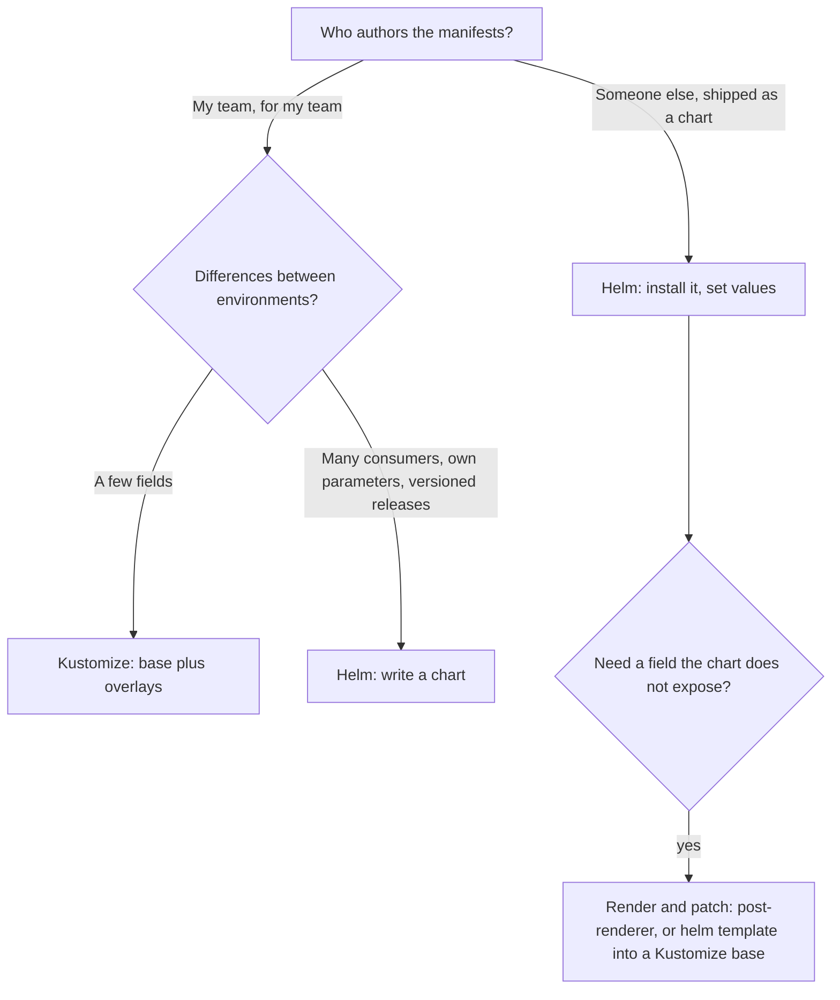

# Lesson 23. Helm Against Kustomize

**Mission link:** The mission says to ship one set of manifests to several environments and defend the tool you chose. Helm and Kustomize both do it and they cost different things: a template language and stored release state on one side, a field-level patch model with no parameters on the other. You need to run both, and to say why one fits a given service better.
**Primary source:** [Docs: "Using Helm", Helm](https://helm.sh/docs/intro/using_helm/)
**Prerequisites:** [Lesson 6](0006-rollouts-and-rollbacks.md), [Lesson 12](0012-secrets.md), [Lesson 22](0022-kustomize.md), [Helm chart](../GLOSSARY.md), [Kustomize](../GLOSSARY.md), [Rollout](../GLOSSARY.md), [Secret](../GLOSSARY.md)

## Warm-up

1. ▢ What does `kubectl rollout undo` restore, and what does it leave alone?

<details markdown="1"><summary>Check</summary>

It restores an earlier ReplicaSet's pod template for one Deployment (lesson 6). It does not touch a Service, a ConfigMap you edited in place, or anything outside that Deployment. A rollback in the packaging tool, below, covers a whole release.

</details>

2. ▢ In Kustomize, what does a generated ConfigMap's hash suffix do when the contents change?

<details markdown="1"><summary>Check</summary>

The name changes, Kustomize rewrites the reference in the Deployment, so the pod template changes and a rollout starts (lesson 22). Without the suffix, an edit would change nothing the Deployment can see.

</details>

3. ▢ Who can read a Secret, and what protects it besides base64?

<details markdown="1"><summary>Check</summary>

Anyone whose RBAC grants `get`, `list` or `watch` on Secrets in that namespace. Base64 is an encoding. Protection is RBAC, encryption at rest and keeping values out of Git (lessons 12 and 20). It matters here because Helm keeps its release records in Secrets.

</details>

## Know this

### What a chart and a release are

A **Helm chart** is a directory of templated manifests plus default values. Installing it with a name creates a **release**, one tracked instance that Helm can upgrade and roll back. You can install the same chart many times under different release names ([Using Helm](https://helm.sh/docs/intro/using_helm/)). Each install, upgrade or rollback adds one to the release's revision number.

```console
$ helm install shop ./web --namespace helm-lab --create-namespace
NAME: shop
LAST DEPLOYED: Mon Mar  2 10:01:12 2026
NAMESPACE: helm-lab
STATUS: deployed
REVISION: 1
$ helm upgrade shop ./web -n helm-lab --set replicaCount=3
$ helm history shop -n helm-lab
REVISION  UPDATED                   STATUS      CHART      APP VERSION  DESCRIPTION
1         Mon Mar  2 10:01:12 2026  superseded  web-0.1.0  1.27         Install complete
2         Mon Mar  2 10:03:40 2026  deployed    web-0.1.0  1.27         Upgrade complete
$ helm rollback shop 1 -n helm-lab
$ helm uninstall shop -n helm-lab
```

By default `helm install` returns once the resources are submitted, not once they are running, so add `--wait` to wait for readiness, up to `--timeout` (5 minutes by default). `helm rollback <release> [revision]` rolls back to the given revision, or to the previous one when it is omitted, and it creates a new revision rather than deleting the newer ones.

### Values

A chart's `values.yaml` holds defaults, and every value is an input to the templates. Later sources override earlier ones: the chart's `values.yaml`, then each `-f` file in order (the rightmost wins), then `--set`. `helm show values <chart>` lists what a chart accepts, and `helm get values <release>` shows what a release was given.

Whether an upgrade keeps the last run's values depends on flags: `--reuse-values` reuses the last release's values, `--reset-values` goes back to the chart's built-in ones, and `--reset-then-reuse-values` resets and then applies the last release's ([upgrade reference](https://helm.sh/docs/helm/helm_upgrade/)). The safe habit is to pass the same `-f` files on every upgrade, so the command line, not Helm's memory, defines the release.

### A minimal chart

A chart needs `Chart.yaml` and a `templates/` directory. The `Chart.yaml` requires `apiVersion` (`v2` for Helm 3 and later), `name` and `version` ([Charts](https://helm.sh/docs/topics/charts/)). `appVersion` is optional and unrelated to `version`.

```text
web/
  Chart.yaml
  values.yaml
  templates/
    deployment.yaml
```

```yaml
# Chart.yaml
apiVersion: v2
name: web
version: 0.1.0
appVersion: "1.27"
```

```yaml
# values.yaml
replicaCount: 2
image:
  repository: nginx
  tag: "1.27"
```

```yaml
# templates/deployment.yaml
apiVersion: apps/v1
kind: Deployment
metadata:
  name: {{ .Release.Name }}-web
spec:
  replicas: {{ .Values.replicaCount }}
  selector:
    matchLabels:
      app.kubernetes.io/instance: {{ .Release.Name }}
  template:
    metadata:
      labels:
        app.kubernetes.io/instance: {{ .Release.Name }}
    spec:
      containers:
      - name: web
        image: "{{ .Values.image.repository }}:{{ .Values.image.tag }}"
```

Prefixing names with `.Release.Name` is what lets two releases of one chart live in the same namespace. `helm template shop ./web` renders the chart locally and prints the manifests without contacting the cluster. Values it would look up in a cluster are faked, and server-side validation is skipped, so it is a fast check, not a proof ([template reference](https://helm.sh/docs/helm/helm_template/)).

```console
$ helm template shop ./web
---
# Source: web/templates/deployment.yaml
apiVersion: apps/v1
kind: Deployment
metadata:
  name: shop-web
spec:
  replicas: 2
...
        image: "nginx:1.27"
```

### Where the state lives

Helm keeps no state on your machine. By default the release records are stored as Secrets in the release's namespace, selectable with the label `owner=helm` ([advanced techniques](https://helm.sh/docs/topics/advanced/)). One record exists per revision, and Helm keeps 10 per release by default (`--history-max`).

```console
$ kubectl -n helm-lab get secret -l owner=helm
NAME                         TYPE                 DATA   AGE
sh.helm.release.v1.shop.v1   helm.sh/release.v1   1      4m
sh.helm.release.v1.shop.v2   helm.sh/release.v1   1      2m
```

That has consequences you can now reason about. Anyone who can read Secrets in the namespace can read the values every revision was installed with, including passwords passed with `--set`. Granting someone `get` on Secrets for debugging also hands them release history. Kustomize has no equivalent: it renders and applies and leaves nothing behind but the objects.

### Hooks and CRDs

A **hook** is a template with the annotation `helm.sh/hook`, set to a lifecycle point such as `pre-install`, `post-install`, `pre-upgrade`, `pre-delete` or `post-delete` ([Chart Hooks](https://helm.sh/docs/topics/charts_hooks/)). Helm waits for a hook Job to finish, and if it fails the release fails. Hook resources are not tracked as part of the release, so `helm uninstall` will not delete them. Set `helm.sh/hook-delete-policy` (`before-hook-creation`, the default, `hook-succeeded` or `hook-failed`) or a Job TTL to clean up.

CRDs have a catch. CustomResourceDefinition files in a chart's `crds/` directory are installed with the chart, are not templated, and are **never upgraded or deleted by Helm**, which the docs describe as a deliberate choice to avoid data loss. `--dry-run` also cannot validate resources of a CRD that is not installed yet ([CRD best practices](https://helm.sh/docs/chart_best_practices/custom_resource_definitions/)). Manage upgrades of CRDs outside the chart, or put them in a chart of their own.

### Choosing by what each costs

|Cost|Helm|Kustomize|
|---|---|---|
|Authoring|A template language over YAML text, with indentation and quoting mistakes that show only on render|Plain YAML plus patches, with no logic, no loops and no computed values|
|Customizing someone else's manifests|Only through the values the chart exposes, or a post-renderer|Patch any field of any resource, with no cooperation from the author|
|Parameter interface|A documented `values.yaml` that consumers can rely on|None: an overlay is coupled to the base's structure|
|State|Release records as Secrets, and revision history|None beyond the live objects|
|Rollback|The whole release, hooks included|Per Deployment (`kubectl rollout undo`), or revert the commit and re-apply|
|Distribution|Versioned, publishable, installable by name|A directory or a Git ref|
|Review|Read templates, then render to see the result|Render with `kubectl kustomize` and read the result|



Using both is normal. Install third-party software as a chart and patch the one field it does not expose, either with Helm's post-renderer (an executable in the older docs, a plugin name in the Helm 4 command reference) or by rendering with `helm template` into a file that a Kustomize base lists. Neither is free: a render step in the pipeline must now stay in sync with the chart version. Both tools also render YAML that `kubectl` could apply, so the question is never whether it works but who maintains the layer.

## Practice

1. ▢ Which command prints the manifests a chart would produce, without installing anything or reading the cluster?

    - a) `helm template web ./web`
    - b) `helm get manifest web`
    - c) `helm show values ./web`
    - d) `helm get values web`

<details markdown="1"><summary>Check</summary>

**a)** It renders locally. (b) prints the manifest of a release that is already installed, so it needs one. (c) prints the chart's default values, not manifests. (d) prints the values a release was given. None of the three renders a chart you have not installed.

</details>

2. ▢ Predict, then run. After these commands, what is the current revision, how many replicas does the Deployment have, and how many lines does `helm history` show?

    ```console
    $ helm install shop ./web -n helm-lab --create-namespace
    $ helm upgrade shop ./web -n helm-lab --set replicaCount=3
    $ helm upgrade shop ./web -n helm-lab --set image.tag=1.28
    $ helm rollback shop 1 -n helm-lab
    ```

<details markdown="1"><summary>Hint</summary>

A rollback is itself a release event. Does it delete revisions 2 and 3, or add one? And which values did revision 1 have?

</details>

<details markdown="1"><summary>Check</summary>

Revision 4, 2 replicas, and four history lines. The rollback adds revision 4 and restores the manifests of revision 1: `replicaCount` 2 from the chart defaults and image tag 1.27. Revisions 2 and 3 stay in the history as superseded. The same steps with `kubectl rollout undo` would have reverted only the pod template.

</details>

3. ▢ A colleague has read access to Secrets in `helm-lab` for debugging and says they cannot see production passwords because the chart reads them from a values file. What do you tell them?

<details markdown="1"><summary>Check</summary>

The release records are Secrets in the same namespace, and they hold the values each revision was installed with, including anything passed through `-f` or `--set`. So Secret access in a Helm namespace includes release history. Take the passwords out of release values and feed them from an external Secret, or restrict who may read Secrets there.

</details>

4. ▢ A new chart version adds a field to a CRD in its `crds/` directory. After `helm upgrade`, `kubectl explain` still shows the old schema. Why, and what do you do?

<details markdown="1"><summary>Hint</summary>

Think about when Helm installs the contents of `crds/`, and what the docs say it will never do.

</details>

<details markdown="1"><summary>Check</summary>

Helm installs `crds/` only when the chart is first installed, and skips a CRD that already exists with a warning. It has no support for upgrading or deleting CRDs. Apply the new CRD yourself with `kubectl apply -f` before the chart upgrade, in the same pipeline, or move CRDs to a separate chart you upgrade deliberately. Remember that deleting a CRD deletes every resource of that kind, which is why Helm refuses to do it.

</details>

5. ▢ Write the annotations that make a Job run before both installs and upgrades, and be removed once it succeeds.

<details markdown="1"><summary>Check</summary>

```yaml
metadata:
  annotations:
    "helm.sh/hook": pre-install,pre-upgrade
    "helm.sh/hook-weight": "0"
    "helm.sh/hook-delete-policy": hook-succeeded
```

Weights are strings, and the docs advise always giving one. Helm waits for the Job to complete, and a failing Job fails the release, so a broken migration stops the rollout before any new pod exists. Without a delete policy, the default `before-hook-creation` leaves the finished Job in the namespace until the next run.

</details>

6. ▢ Choose Helm or Kustomize, with one reason each: (a) an ingress controller maintained by another team, (b) your team's service whose three environments differ in replicas, image tag and one config value, (c) a platform team shipping a standard service skeleton to 40 teams that each set their own port and resources.

<details markdown="1"><summary>Check</summary>

(a) Helm: it ships as a versioned chart with a stable values interface, and you need not own its manifests. (b) Kustomize: three fields differ, the manifests are your own, and plain YAML plus an overlay is the least to maintain. (c) Helm: many consumers need a documented parameter interface and versioned upgrades, which an overlay coupled to a base's structure cannot give. If (a) needs one field the chart hides, add a post-renderer or a render-and-patch step rather than forking the chart.

</details>

## Real-world reps

- [ ] Install Helm from its official instructions, write the `web` chart above, run `helm lint ./web` and `helm template shop ./web`, then install it into `helm-lab` on your `lab` cluster with `--create-namespace` and `--wait`.
- [ ] Run the upgrade and rollback commands from practice item 2, then `helm history shop -n helm-lab` and `kubectl -n helm-lab get secret -l owner=helm`. Match each history line to a Secret.
- [ ] Tomorrow: without notes, state the order in which `values.yaml`, `-f` and `--set` override each other, name two things Helm stores that Kustomize does not, and say which tool you would pick for a service of your own with two environments.

## Going further

- [Packaging](../reference/packaging.md)
- [Docs: "Using Helm", Helm](https://helm.sh/docs/intro/using_helm/)
- [Docs: "Charts", Helm](https://helm.sh/docs/topics/charts/)
- [Docs: "Chart Template Guide", Helm](https://helm.sh/docs/chart_template_guide/)
- [Docs: "Chart Hooks", Helm](https://helm.sh/docs/topics/charts_hooks/)
- [Docs: "Custom Resource Definitions", Helm chart best practices](https://helm.sh/docs/chart_best_practices/custom_resource_definitions/)
- [Resources](../RESOURCES.md)

---

Not landing? Reread the primary source at the top, since this lesson compresses it and compression is where understanding leaks. Check the [glossary](../GLOSSARY.md) for any term that felt slippery.

If the lesson itself is unclear rather than the material, that is a defect: [open an issue](https://github.com/TokenCemetery/teach/issues).
