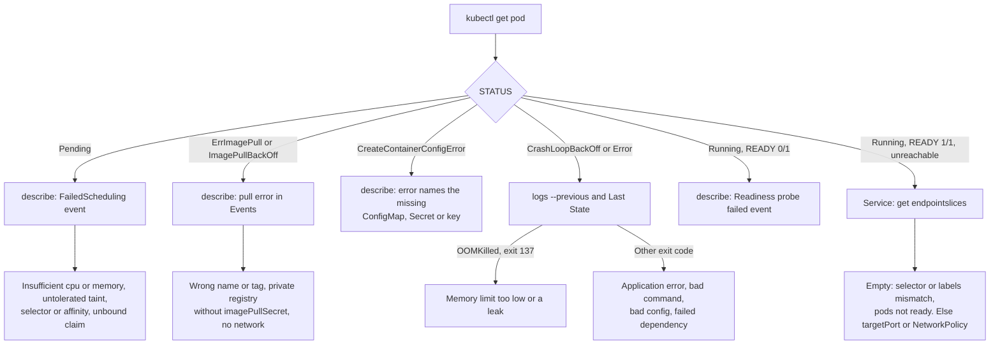

# Lesson 25. Debugging a Workload

**Mission link:** The mission ends with finding out why a workload is Pending, crashing or unreachable. Each failure state has a short list of causes and one command that tells you which, so debugging is reading the right field in the right order, not guessing.
**Primary source:** [Docs: "Debug Running Pods", Kubernetes](https://kubernetes.io/docs/tasks/debug/debug-application/debug-running-pod/)
**Prerequisites:** [Lesson 8](0008-services.md), [Lesson 11](0011-configmaps.md), [Lesson 18](0018-scheduling.md), [Lesson 24](0024-observability.md), [EndpointSlice](../GLOSSARY.md), [Selector](../GLOSSARY.md), [Taint and toleration](../GLOSSARY.md), [Readiness probe](../GLOSSARY.md)

## Warm-up

1. ▢ A Service has pods that are Running, and traffic never reaches them. Which object lists the pods the Service will actually send traffic to?

<details markdown="1"><summary>Check</summary>

The EndpointSlice for that Service, which a controller fills from the Service's selector and which carries each pod's readiness. A pod that is Running but not ready, or that the selector does not match, is not in it (lesson 8).

</details>

2. ▢ A ConfigMap is used by one pod as an environment variable and by another as a mounted file. You edit the ConfigMap. Which pod sees the change without a restart?

<details markdown="1"><summary>Check</summary>

The one that mounts it as a file: the kubelet refreshes mounted ConfigMap content after a delay. Environment variables are fixed when the container starts, so that pod needs a restart (lesson 11).

</details>

3. ▢ Name three reasons the scheduler leaves a pod Pending.

<details markdown="1"><summary>Check</summary>

No node has enough free CPU or memory for its requests, no node satisfies its node selector or affinity, every node has a taint it does not tolerate, or a PersistentVolumeClaim it needs is not bound (lesson 18 and lesson 16).

</details>

## Know this

### Read the status, then the events, then the logs

Start every investigation the same way, because each step narrows the next.

1. `kubectl get pod` gives the `STATUS` and `READY` columns. `STATUS` is a summary meant for people, not the pod's phase ([pod lifecycle](https://kubernetes.io/docs/concepts/workloads/pods/pod-lifecycle/)).
2. `kubectl describe pod NAME` gives the container state, `Last State`, exit code, conditions and the `Events:` at the bottom. Most causes are printed here.
3. `kubectl logs NAME --previous` gives what the process said before it died (lesson 24).
4. Only then reach inside with `kubectl exec` or `kubectl debug`.

Events expire after an hour by default, so read them early.



### The failure states

**Pending.** The pod exists and no node has been chosen, so no container has started. The reason is an event from the scheduler, `FailedScheduling`, with a count of nodes and why each was rejected ([resource management](https://kubernetes.io/docs/concepts/configuration/manage-resources-containers/)):

```console
$ kubectl describe pod web-6d9c7f8b4-xk2lp
...
Events:
  Type     Reason            Age   From               Message
  ----     ------            ----  ----               -------
  Warning  FailedScheduling  23s   default-scheduler  0/3 nodes are available: 1 node(s) had untolerated taint {node-role.kubernetes.io/control-plane: }, 2 Insufficient memory.
```

Read the clause that names a count: `Insufficient memory` means requests do not fit, and a taint or affinity message points at lesson 18. A pod with no events at all may be waiting on a PersistentVolumeClaim, so check `kubectl get pvc`.

**ErrImagePull and ImagePullBackOff.** The container sits in the `Waiting` state because the image could not be pulled: an invalid image name or tag, or a private registry without an `imagePullSecret`. `ErrImagePull` is the failed attempt and `ImagePullBackOff` is the wait before the next one, which grows to a limit of 300 seconds ([images](https://kubernetes.io/docs/concepts/containers/images/)). The event message holds the registry's actual answer: "not found" is a typo, "unauthorized" is a credential.

**CreateContainerConfigError.** The kubelet could not assemble the container's configuration, most often because the pod references a ConfigMap, a Secret or a key in one that does not exist. The message in `describe` names the missing object. Create it and the kubelet retries on its own; the pod does not need to be recreated.

**CrashLoopBackOff.** The container starts, exits, and the kubelet restarts it after an exponential backoff (10s, 20s, 40s, and so on) capped at 5 minutes. The backoff resets once a container has run for 10 minutes without problems ([pod lifecycle](https://kubernetes.io/docs/concepts/workloads/pods/pod-lifecycle/)). `CrashLoopBackOff` says that the restart delay is in effect, not why the container died. The why is in `Last State` and in `kubectl logs --previous`.

**OOMKilled.** When a container uses more memory than its limit, the kernel may kill it ([resource management](https://kubernetes.io/docs/concepts/configuration/manage-resources-containers/)), and the container status reads `Reason: OOMKilled` with `Exit Code: 137`:

```console
$ kubectl describe pod memory-demo-2 | grep -A 6 'Last State'
    Last State:     Terminated
      Reason:       OOMKilled
      Exit Code:    137
      Started:      Fri, 07 Jul 2023 12:54:30 +0000
      Finished:     Fri, 07 Jul 2023 12:54:33 +0000
    Ready:          False
```

137 is 128 plus signal 9, `SIGKILL`. The number alone is ambiguous, because anything killed by `SIGKILL` exits with it, including a process that ignored `SIGTERM` for the whole grace period (lesson 14). `Reason: OOMKilled` is what says memory. The fix is a higher limit if the workload really needs it, or a fix for the leak if usage climbs without bound, and `kubectl top` shows which (lesson 24).

**Running but not Ready.** The container runs and `READY` shows `0/1`. The readiness probe is failing, and the event says how: `Readiness probe failed: HTTP probe failed with statuscode: 503`, or `connection refused` if the probe targets a port nothing listens on. The pod is out of the Service's endpoints, so the symptom shows up as unreachable. Compare the probe's path and port in the spec with the logs for what the app actually serves.

**Service with no endpoints.** `kubectl describe svc` shows `Endpoints: <none>`. The [Debug Services](https://kubernetes.io/docs/tasks/debug/debug-application/debug-service/) walk goes in this order: list the EndpointSlices for the Service (`kubectl get endpointslices -l kubernetes.io/service-name=web`), then compare the Service's selector with the pods' labels (`kubectl get pods -l app=web`), then check the pods are ready, then check the Service's `targetPort` against the port the container listens on. An empty list means the selector matched nothing or matched only unready pods. A populated list with failing traffic means `targetPort`, a NetworkPolicy or the application.

### Getting inside: `kubectl debug`

`kubectl exec` needs a shell in the image, and a running container. Minimal images have no shell, and a crashing one is not running. `kubectl debug` covers both ([debug running pods](https://kubernetes.io/docs/tasks/debug/debug-application/debug-running-pod/)).

An **ephemeral container** is a container added to an existing pod to troubleshoot it, never restarted and removed with the pod ([ephemeral containers](https://kubernetes.io/docs/concepts/workloads/pods/ephemeral-containers/)):

```console
$ kubectl debug -it web-6d9c7f8b4-xk2lp --image=busybox:1.36 --target=web
Defaulting debug container name to debugger-8xzrl.
/ # ps
PID   USER     COMMAND
    1 65532    /app/server
   14 root      sh
```

`--target=web` joins the process namespace of the container named `web`, so `ps` shows its processes, and `/proc/1/root` reaches its filesystem. The docs note the container runtime must support `--target`, and without it `ps` may show only the debug container. Ephemeral containers cannot be changed or removed once added.

**`--copy-to`** creates a copy of the pod with a new name, so you can change it without touching the original. `kubectl debug web-6d9c7f8b4-xk2lp -it --copy-to=web-debug --container=web -- sh` runs a shell in place of the crashing command, and `--set-image=web=web:debug` swaps an image. The copy is outside the Deployment, so it has none of the Service's traffic and you delete it when you finish. It also loses the original's probes unless you pass the `--keep-*` flags, which is often exactly what lets a crash-looping pod stay up long enough to inspect.

## Practice

1. ▢ A pod shows `OOMKilled` in `describe` with exit code 137. Which statement is correct?

    - a) The kernel killed it for exceeding its memory limit
    - b) The kubelet killed it after a failed liveness probe
    - c) The container shut down cleanly after receiving the SIGTERM
    - d) The scheduler evicted it because the node was full

<details markdown="1"><summary>Check</summary>

**a)** `Reason: OOMKilled` is the kernel's out-of-memory kill for going over the memory limit. (b) is a different path: a failed liveness probe gives a `Liveness probe failed` event and no `OOMKilled` reason, though the exit code can also be 137 if the process ignores `SIGTERM`. (c) would exit with 0 or 143, not 137. (d) is wrong because the scheduler only places pods, and node-pressure eviction ends a pod with reason `Evicted`.

</details>

2. ▢ Predict, then run. What does `STATUS` show over the first minute, and what do `Reason` and `Exit Code` read in `Last State`?

    ```yaml
    apiVersion: v1
    kind: Pod
    metadata:
      name: memory-demo-2
    spec:
      containers:
        - name: memory-demo-2-ctr
          image: polinux/stress
          resources:
            requests:
              memory: 50Mi
            limits:
              memory: 100Mi
          command: ["stress"]
          args: ["--vm", "1", "--vm-bytes", "250M", "--vm-hang", "1"]
    ```

<details markdown="1"><summary>Hint</summary>

The container asks for 250 MiB against a 100 MiB limit, and the default restart policy for a bare pod is `Always`. What does the kubelet do after the kill, and what does it do after the third?

</details>

<details markdown="1"><summary>Check</summary>

```text
NAME            READY   STATUS             RESTARTS      AGE
memory-demo-2   0/1     OOMKilled          1 (4s ago)    9s
memory-demo-2   0/1     CrashLoopBackOff   2 (12s ago)   25s
```

`Last State` reads `Terminated`, `Reason: OOMKilled`, `Exit Code: 137`. `STATUS` flips between `OOMKilled`, while the last termination is fresh, and `CrashLoopBackOff`, while the kubelet waits out the backoff. The exact timings differ, the pattern does not. Delete the pod when done.

</details>

3. ▢ A new Deployment's pod stays `0/1 Running` and the Service has no traffic. Read the output and name the cause and the fix.

    ```console
    $ kubectl describe pod api-5f7c9d6b8-tz9vq
    ...
        Ready:          False
    ...
    Events:
      Type     Reason     Age                From     Message
      ----     ------     ----               ----     -------
      Warning  Unhealthy  4s (x12 over 58s)  kubelet  Readiness probe failed: Get "http://10.244.1.7:8080/ready": dial tcp 10.244.1.7:8080: connect: connection refused
    $ kubectl logs api-5f7c9d6b8-tz9vq
    listening on :3000
    ```

<details markdown="1"><summary>Hint</summary>

Compare the port in the probe with the port in the log line.

</details>

<details markdown="1"><summary>Check</summary>

The probe targets port 8080 but the application listens on 3000, so every probe is refused, the pod never becomes ready, and the EndpointSlice leaves it out. Fix the probe's `port` (and the Service's `targetPort` if it also says 8080). The container is healthy, so a restart would not help, and it is not being restarted because this is a readiness probe, not a liveness one.

</details>

4. ▢ Your Service's `describe` shows `Selector: app=web` and `Endpoints: <none>`, while `kubectl get pods --show-labels` shows three Running, ready pods labelled `app=webapp`. What is wrong, and why did Kubernetes not tell you?

<details markdown="1"><summary>Hint</summary>

What does the selector compare, and is a selector that matches nothing an error?

</details>

<details markdown="1"><summary>Check</summary>

The Service's selector `app=web` matches no pod, because the pods carry `app=webapp`. Labels are matched exactly. A selector that matches nothing is valid, so the API accepts the Service and simply keeps an empty EndpointSlice. Fix whichever side is wrong, usually the Service selector, then check `kubectl get endpointslices -l kubernetes.io/service-name=web`.

</details>

5. ▢ A pod is `Pending`. The `FailedScheduling` event says `0/3 nodes are available: 3 Insufficient memory.` Which two numbers do you compare, and which two commands show them?

<details markdown="1"><summary>Check</summary>

The pod's memory request against each node's allocatable memory minus what other pods already request. `kubectl get pod NAME -o jsonpath='{.spec.containers[*].resources.requests}'` shows the request, and `kubectl describe node NODE` shows `Allocatable` and `Allocated resources`. Scheduling uses requests, not live usage, so `kubectl top` can show a node nearly idle while the scheduler still reports it full.

</details>

6. ▢ A distroless image crashes on start and has no shell. You need to read its config file and run its command by hand. Which `kubectl debug` form do you use, and what do you give up compared with an ephemeral container?

<details markdown="1"><summary>Check</summary>

`kubectl debug POD -it --copy-to=POD-debug --container=NAME --image=busybox:1.36 -- sh` gives a copy whose command is replaced by a shell, so you can run the real command by hand, but it is a new pod: it is not the original, so a bug that depended on that pod's node, timing or state may not reproduce. An ephemeral container (`--target`) sits in the original pod and shares its processes, but it cannot change the container's command, so it does not help when the main container exits at once.

</details>

## Real-world reps

- [ ] On your kind cluster, create three broken pods on purpose: `nginx:no-such-tag`, a pod that mounts a ConfigMap that does not exist, and the `memory-demo-2` pod above. For each, read `STATUS`, then `describe`, and write down the one line that gave the cause.
- [ ] Create a Service whose selector matches no pod, find `Endpoints: <none>` in `kubectl describe svc`, then fix the label and watch `kubectl get endpointslices -w` fill.
- [ ] Tomorrow: without notes, list the seven failure states from this lesson and, for each, the first command you run and the field or event that gives the cause.

## Going further

- [Debugging Workloads](../reference/debugging-workloads.md)
- [Docs: "Debug Running Pods", Kubernetes](https://kubernetes.io/docs/tasks/debug/debug-application/debug-running-pod/)
- [Docs: "Debug Pods", Kubernetes](https://kubernetes.io/docs/tasks/debug/debug-application/debug-pods/)
- [Docs: "Debug Services", Kubernetes](https://kubernetes.io/docs/tasks/debug/debug-application/debug-service/)
- [Docs: "Ephemeral Containers", Kubernetes](https://kubernetes.io/docs/concepts/workloads/pods/ephemeral-containers/)
- [Docs: "kubectl debug", kubectl reference](https://kubernetes.io/docs/reference/kubectl/generated/kubectl_debug/)
- [Resources](../RESOURCES.md)

---

Not landing? Reread the primary source at the top, since this lesson compresses it and compression is where understanding leaks. Check the [glossary](../GLOSSARY.md) for any term that felt slippery.

If the lesson itself is unclear rather than the material, that is a defect: [open an issue](https://github.com/TokenCemetery/teach/issues).
