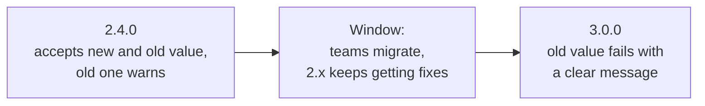

# Lesson 27. Upgrading What Others Depend On

**Mission link:** The mission ends with upgrading what other teams depend on without breaking them. A cluster minor upgrade and a shared Helm chart are the same problem: you control the change, other people's manifests and releases carry the risk, and the work is finding them and giving them time before the old thing stops working.
**Primary source:** [Docs: "Deprecated API Migration Guide", Kubernetes](https://kubernetes.io/docs/reference/using-api/deprecation-guide/)
**Prerequisites:** [Lesson 3](0003-objects-and-manifests.md), [Lesson 19](0019-autoscaling-and-disruptions.md), [Lesson 23](0023-helm-against-kustomize.md), [Lesson 26](0026-reviewing-manifests.md), [Helm chart](../GLOSSARY.md), [PodDisruptionBudget](../GLOSSARY.md), [kubelet](../GLOSSARY.md), [API server](../GLOSSARY.md)

## Warm-up

1. ▢ What does the `apiVersion` field of an object say, and what does the API server do with a manifest whose version it does not serve?

<details markdown="1"><summary>Check</summary>

It names the API group and version the manifest is written against, such as `policy/v1`. If the server does not serve that version, it cannot map the kind and refuses the request with a "no matches for kind" style error (lesson 3).

</details>

2. ▢ What is a Helm release, and what do `helm upgrade` and `helm rollback` do to it?

<details markdown="1"><summary>Check</summary>

A release is one installation of a chart with a set of values, tracked by Helm in the cluster. `helm upgrade` renders the chart again and applies the difference as a new revision, and `helm rollback` applies an earlier revision's manifests (lesson 23).

</details>

3. ▢ What does `kubectl drain` do to a node, and what keeps a service up while it runs?

<details markdown="1"><summary>Check</summary>

It cordons the node and evicts its pods through the eviction API. A PodDisruptionBudget limits how many pods of a workload it may take down at once, and enough replicas on other nodes carry the traffic (lesson 19).

</details>

## Know this

### What actually breaks in a minor upgrade

A Kubernetes minor release rarely changes what a running pod does. What it removes is **API versions**. The [deprecation policy](https://kubernetes.io/docs/reference/deprecation-policy/) sets how long each stability level must be served:

|Level|Rule|
|---|---|
|GA (`v1`)|May be marked deprecated, but not removed within a major version of Kubernetes|
|Beta|Deprecated no more than 9 months or 3 minor releases after introduction (whichever is longer), and no longer served 9 months or 3 minor releases after deprecation (whichever is longer)|
|Alpha|May be removed in any release without a deprecation notice|

The [migration guide](https://kubernetes.io/docs/reference/using-api/deprecation-guide/) lists what each release stopped serving and what replaces it. A few of the entries: `policy/v1beta1` PodDisruptionBudget and `batch/v1beta1` CronJob in v1.25, `autoscaling/v2beta2` HorizontalPodAutoscaler in v1.26, and `flowcontrol.apiserver.k8s.io/v1beta3` in v1.32.

The guide notes that existing persisted objects stay accessible through the new version. So a removal does not delete anything in the cluster. What breaks is every actor that still **submits** the old version: a manifest in Git, a pipeline, a Helm chart, a controller or script that calls the API. They fail at apply time, after the upgrade, when it is too late to ask nicely. Some replacements also change behaviour: in `policy/v1` an empty PodDisruptionBudget `selector` selects all pods in the namespace, where in `v1beta1` it selected none, and the HPA field `targetAverageUtilization` became `target.averageUtilization`. A blind find-and-replace of the version string is not enough.

### Finding who still uses it

Use two kinds of evidence, because each misses what the other finds.

**What the cluster saw.** Since v1.19 a request to a deprecated API gets a `Warning` header, adds a `"k8s.io/deprecated":"true"` annotation to the audit event, and sets a gauge, `apiserver_requested_deprecated_apis`, with labels for group, version, resource and subresource and a `removed_release` label ([deprecation policy](https://kubernetes.io/docs/reference/deprecation-policy/)):

```console
$ kubectl get --raw /metrics | grep apiserver_requested_deprecated_apis
apiserver_requested_deprecated_apis{group="policy",removed_release="1.25",resource="poddisruptionbudgets",subresource="",version="v1beta1"} 1
```

The metric tells you that someone called it and which API, not who. The audit event carries the caller, so join the two. Reading `/metrics` needs permission to that non-resource URL under RBAC ([system metrics](https://kubernetes.io/docs/concepts/cluster-administration/system-metrics/)).

**What is written down.** The metric only sees what ran recently. A chart for a yearly batch job, or a manifest applied only at release, shows nothing until the day it breaks. Search repositories for the `apiVersion` and `kind` pairs on the removal list, render charts and search the output (`helm template`), and read what each release deployed with `helm get manifest RELEASE` ([Helm: Deprecated Kubernetes APIs](https://helm.sh/docs/topics/kubernetes_apis/)). To rehearse a removal, the guide suggests starting a test API server with the version off, `--runtime-config=<group>/<version>=false`, and running the real pipelines against it.

### Order, skew and the day itself

Plan from the [version skew policy](https://kubernetes.io/releases/version-skew-policy/):

- Upgrade one minor version at a time. Skipping minor versions is unsupported ([kubeadm upgrade](https://kubernetes.io/docs/tasks/administer-cluster/kubeadm/kubeadm-upgrade/)).
- Control plane first: `etcd`, then every `kube-apiserver`, then the controller manager, scheduler and cloud controller manager ([upgrade a cluster](https://kubernetes.io/docs/tasks/administer-cluster/cluster-upgrade/)).
- A kubelet must not be newer than the API server and may be up to three minor versions older, so nodes can follow after the control plane. `kubectl` is supported one minor version either side of the API server.
- Drain each node before upgrading its kubelet. In-place minor kubelet upgrades are not supported without it.
- After the upgrade, rewrite objects to the new storage version, and convert manifests, with `kubectl convert` if you need it.

The drain is where unprepared teams find out. Every node you upgrade evicts its pods, so a service with one replica and no PodDisruptionBudget has an outage during your upgrade, whatever its API versions are.

### Telling the teams

The technical part is the smaller half. Send one message to every owner you found, early enough to act on, with:

- **What**: the API version going away and the cluster upgrade date that removes it.
- **Where**: the exact files, charts and releases found in them, not a general warning.
- **Fix**: the old and new `apiVersion` and any field that changes meaning, with one worked example.
- **How to check**: the command that shows the manifest is clean.
- **Deadline**: before the upgrade, and what happens to a team that misses it. Decide that before you send, because it is your choice to delay the upgrade for one team or to go ahead.

Upgrade a non-production cluster first, rerun the search afterwards, and only then touch the shared one.

### The same shape in a shared chart

A chart used by many teams is an API of yours. A change is **breaking** when an existing `values.yaml` or an existing release stops working: a removed or renamed value, a changed default that alters behaviour, a different resource name, or different selector labels. The last one is nasty, because a Deployment's `.spec.selector` is immutable ([Deployments](https://kubernetes.io/docs/concepts/workloads/controllers/deployment/)), so `helm upgrade` cannot apply a chart that changed it to an existing release.

Chart versions follow SemVer 2, and `Chart.yaml` can carry `kubeVersion` (a range of compatible Kubernetes versions) and `deprecated: true` ([Helm charts](https://helm.sh/docs/topics/charts/)). SemVer says what that means: a breaking change is a new major version, and a minor release keeps existing callers working. Use a deprecation window, the way Kubernetes does:



In the release that opens the window, take either value and warn:

```yaml
# templates/deployment.yaml in 2.4.0
replicas: {{ default .Values.replicaCount .Values.replicas }}
```

```text
{{- /* templates/NOTES.txt in 2.4.0 */ -}}
{{- if .Values.replicas }}
WARNING: values.replicas is renamed replicaCount and is removed in chart 3.0.0.
{{- end }}
```

In the next major release, make the old value fail loudly instead of being ignored:

```yaml
{{- if .Values.replicas }}
{{- fail "values.replicas was renamed replicaCount in 3.0.0; see UPGRADING.md" }}
{{- end }}
```

Write the migration in an `UPGRADING.md` or release notes with before and after values, render every consumer's values against the new version and diff, and keep the old major patched until the window closes.

## Practice

1. ▢ A team's chart still creates a `policy/v1beta1` PodDisruptionBudget, and live ones exist. The cluster moves to a release that removed that version. What happens?

    - a) All live PodDisruptionBudgets are deleted as the upgrade completes
    - b) Live objects remain, but old manifests no longer apply
    - c) Live objects remain, and old manifests still apply unchanged
    - d) The API server refuses to start until they migrate

<details markdown="1"><summary>Check</summary>

**b)** Removal stops the API server serving that version. Persisted objects stay readable through `policy/v1`, so nothing is deleted (a) and nothing blocks startup (d), but the old manifest can no longer be applied, so the next pipeline run or `helm upgrade` fails. (c) is what the deprecated period looked like, which is why the failure arrives as a surprise.

</details>

2. ▢ Predict, then run. Save this as `pdb.yaml` and apply it to your kind cluster. What does `kubectl apply` print, and what is the smallest edit that fixes it?

    ```yaml
    apiVersion: policy/v1beta1
    kind: PodDisruptionBudget
    metadata:
      name: web
    spec:
      minAvailable: 1
      selector:
        matchLabels:
          app: web
    ```

<details markdown="1"><summary>Hint</summary>

Ask the cluster which versions of the `policy` group it serves: `kubectl api-versions | grep policy`.

</details>

<details markdown="1"><summary>Check</summary>

```text
error: resource mapping not found for name: "web" namespace: "" from "pdb.yaml": no matches for kind "PodDisruptionBudget" in version "policy/v1beta1"
ensure CRDs are installed first
```

The version was removed in v1.25, so any current cluster refuses it. Change the first line to `apiVersion: policy/v1`. The spec here works as it is, but if the selector were empty, the meaning would change between the versions, so read the migration notes rather than assuming.

</details>

3. ▢ A plan reads: "Upgrade every node to the new minor first, since that is where workloads run, then upgrade the control plane. Go from two minors back in one jump." Name the two defects.

<details markdown="1"><summary>Check</summary>

A kubelet must not be newer than the API server, so nodes cannot go first. The control plane has to move before the kubelets. And skipping minor versions is unsupported, so two minors back is two upgrades, in order. Each node must also be drained before its kubelet is upgraded.

</details>

4. ▢ You maintain a shared chart used by twelve teams and want to rename the value `replicas` to `replicaCount`. What do you ship, in what order, and what version numbers?

<details markdown="1"><summary>Hint</summary>

Two releases, and the first must not break anyone.

</details>

<details markdown="1"><summary>Check</summary>

A minor release first (for example 2.4.0) that accepts both values, prefers the new one, and warns when the old one is set, with the migration written down. Announce a window and keep 2.x patched. Then a major release (3.0.0) that removes the old value and fails with a message pointing at the migration. Removing it in a minor release would break every release whose `values.yaml` still sets it, which is what SemVer's minor version promises not to do.

</details>

5. ▢ After a cluster upgrade, `helm upgrade` for an old release fails with `current release manifest contains removed kubernetes api(s)`. The new chart version is fine. Where is the problem and how was it avoidable?

<details markdown="1"><summary>Hint</summary>

Helm computes a diff between what it has stored for the current release and the new render.

</details>

<details markdown="1"><summary>Check</summary>

The release's stored manifest still contains a removed API version, so Helm cannot build the objects to diff, even though the new chart is clean. The Helm docs describe editing the stored release manifest to the supported versions. It was avoidable by running `helm get manifest` on every release before the upgrade and upgrading each one to a chart with supported API versions while the cluster still served both. Do not roll such a release back past the revision that fixed the versions.

</details>

6. ▢ Draft the first three lines of the message to dependent teams about a removal of `autoscaling/v2beta2`, assuming your search found it in two charts and one pipeline script.

<details markdown="1"><summary>Check</summary>

For example: "The cluster upgrade on the 14th removes `autoscaling/v2beta2`, which HorizontalPodAutoscalers in `payments-chart` and `search-chart` and the script `scale-nightly.sh` still use. After the upgrade, applying them fails. Change `apiVersion` to `autoscaling/v2` and replace `targetAverageUtilization` with `target.type: Utilization` and `target.averageUtilization`, and confirm with `helm template . | grep apiVersion`." It names the removal, the date, the exact artifacts, the fix and a check, which is what a team needs in order to act without asking you a question.

</details>

## Real-world reps

- [ ] On your kind cluster, run `kubectl api-versions` and `kubectl api-resources`, pick a group such as `policy` or `autoscaling`, and list which versions it serves. Apply the `pdb.yaml` from the practice and fix it.
- [ ] Take any chart or set of manifests from this track and list its `apiVersion` and `kind` pairs (`helm template . | grep -E '^(apiVersion|kind):'`). Check each pair against the migration guide and write down which release, if any, removes it.
- [ ] Tomorrow: without notes, write the order in which cluster components are upgraded, the three signals the API server gives for a deprecated call, and the two releases it takes to rename a shared chart value.

## Going further

- [Manifest Review Checklist](../reference/manifest-review-checklist.md)
- [Docs: "Deprecated API Migration Guide", Kubernetes](https://kubernetes.io/docs/reference/using-api/deprecation-guide/)
- [Docs: "Kubernetes Deprecation Policy", Kubernetes](https://kubernetes.io/docs/reference/deprecation-policy/)
- [Docs: "Version Skew Policy", Kubernetes](https://kubernetes.io/releases/version-skew-policy/)
- [Docs: "Upgrade A Cluster", Kubernetes](https://kubernetes.io/docs/tasks/administer-cluster/cluster-upgrade/)
- [Docs: "Deprecated Kubernetes APIs", Helm](https://helm.sh/docs/topics/kubernetes_apis/)
- [Docs: "Charts", Helm](https://helm.sh/docs/topics/charts/)
- [Resources](../RESOURCES.md)

---

Not landing? Reread the primary source at the top, since this lesson compresses it and compression is where understanding leaks. Check the [glossary](../GLOSSARY.md) for any term that felt slippery.

If the lesson itself is unclear rather than the material, that is a defect: [open an issue](https://github.com/TokenCemetery/teach/issues).
