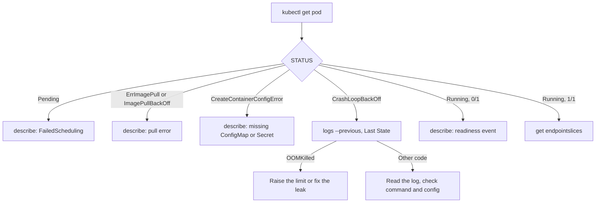

# Debugging Workloads: Evidence, Failure States and Ways In

Stage 9 compressed for lookup. [Lesson 24](../lessons/0024-observability.md) covers resource metrics, events, logs and object state metrics, and [lesson 25](../lessons/0025-debugging-a-workload.md) covers the failure states and `kubectl debug`. For the single-host version of reading exit codes, see [Debugging Containers](../../containers/reference/debugging-containers.md).

## Which source answers which question

|Question|Source|Command|Lifetime|
|---|---|---|---|
|CPU and memory in use now|metrics-server|`kubectl top pod`, `kubectl top node`|Latest value only|
|What the cluster did to this object|Events|`kubectl events --for pod/NAME`, bottom of `kubectl describe`|1 hour by default (`--event-ttl`)|
|What the process wrote|Container logs|`kubectl logs NAME`, `--previous`, `-c`, `--since`, `--tail`|Until the pod goes, within rotation (10Mi, 5 files by default)|
|Whether objects are in the state they should be, over time|kube-state-metrics, scraped by Prometheus|A query or an alert|As long as you store it|

- A fresh kind cluster has no metrics-server. Install it with `kubectl apply -f https://github.com/kubernetes-sigs/metrics-server/releases/latest/download/components.yaml`, then add `--kubelet-insecure-tls` to its arguments. That flag is for local test clusters only.
- `kubectl top` shows usage, not requests or limits. Compare it with `kubectl describe pod` for those.
- If a pod is evicted or deleted, its logs go with it. Ship them off the node if you need them later.

## The commands, in order

|#|Command|Answers|
|---|---|---|
|1|`kubectl get pod NAME`|`STATUS` and `READY`: which state to follow below|
|2|`kubectl describe pod NAME`|Container state, `Last State`, exit code, conditions, and the `Events:` at the bottom|
|3|`kubectl logs NAME -c CONTAINER --previous`|What the container said before it died. Plain `logs` shows the new instance|
|4|`kubectl get pod NAME -o jsonpath='{.status.containerStatuses[*].lastState}'`|The recorded termination: reason, exit code, times|
|5|`kubectl get endpointslices -l kubernetes.io/service-name=SVC`|Which ready pods a Service will route to|
|6|`kubectl debug -it NAME --image=busybox:1.36 --target=CONTAINER`|A shell next to the container, sharing its processes|

Read events early: they are the least durable evidence.

## Failure states

|State|What it means|Common causes|Confirm with|
|---|---|---|---|
|`Pending`|No node chosen, nothing started|Not enough CPU or memory for the requests, node selector or affinity unmet, untolerated taint, unbound PersistentVolumeClaim|`describe`: `FailedScheduling` event with a count per reason. `kubectl get pvc`|
|`ContainerCreating` for long|Node chosen, sandbox or volumes not ready|A volume or Secret that will not mount, the network plugin|`describe`: events from the kubelet|
|`ErrImagePull`, `ImagePullBackOff`|The image could not be pulled. The wait between tries grows to 5 minutes|Wrong name or tag, private registry without `imagePullSecret`|`describe`: the registry's message ("not found" or "unauthorized")|
|`CreateContainerConfigError`|The kubelet could not build the container's configuration|A referenced ConfigMap, Secret or key does not exist|`describe`: the message names the object|
|`CrashLoopBackOff`|The container keeps exiting. Restart delay 10s, 20s, 40s, capped at 5 minutes, reset after 10 minutes of running|Application error, wrong command or arguments, bad configuration, failed dependency, a failing liveness probe|`logs --previous`, `Last State` exit code|
|`OOMKilled`, exit code 137|The kernel killed the container for exceeding its memory limit|Limit below real need, a leak|`describe`: `Reason: OOMKilled`. `kubectl top pod --containers`|
|`Running`, `READY 0/1`|The readiness probe is failing|Wrong probe port or path, the app not yet listening, a dependency check that fails|`describe`: `Readiness probe failed` event. Compare the probe with `logs`|
|`Running`, `READY 1/1`, unreachable|The pod is fine and the route is not|Service selector matches nothing, wrong `targetPort`, NetworkPolicy, wrong DNS name|`get endpointslices`, compare selector with `kubectl get pods --show-labels`|
|`Evicted`|The kubelet ended the pod under node pressure|Node out of memory or disk, a `BestEffort` pod chosen first|`describe`: the eviction message. `kubectl describe node`|

Exit code above 128 is a signal: 137 is `SIGKILL` (128 + 9), 143 is `SIGTERM` (128 + 15). 137 alone does not mean memory: a container that ignored `SIGTERM` for the whole grace period also ends with it. The `OOMKilled` reason is what says memory.

## Getting inside

|Need|Command|Notes|
|---|---|---|
|A shell in an image that has one|`kubectl exec -it POD -c NAME -- sh`|Fails on distroless images and on a container that is not running|
|A shell next to a running container with none|`kubectl debug -it POD --image=busybox:1.36 --target=NAME`|Adds an ephemeral container. `--target` shares the named container's process namespace, if the runtime supports it. It is never restarted and cannot be changed or removed|
|A copy of the pod to change freely|`kubectl debug POD -it --copy-to=POD-debug --container=NAME -- sh`|New pod, not managed by the Deployment. It does not keep the original's probes unless `--keep-liveness`, `--keep-readiness` or `--keep-startup` is set. Delete it afterwards|
|The copy with a different image|`kubectl debug POD --copy-to=POD-debug --set-image=NAME=IMAGE`|For testing a candidate fix or a debug build|
|The node|`kubectl debug node/NODE -it --image=busybox:1.36`|Runs in the host namespaces with the host filesystem mounted at `/host`|

## Sources

- [Docs: "Debug Pods", Kubernetes](https://kubernetes.io/docs/tasks/debug/debug-application/debug-pods/)
- [Docs: "Debug Running Pods", Kubernetes](https://kubernetes.io/docs/tasks/debug/debug-application/debug-running-pod/)
- [Docs: "Debug Services", Kubernetes](https://kubernetes.io/docs/tasks/debug/debug-application/debug-service/)
- [Docs: "kubectl debug", kubectl reference](https://kubernetes.io/docs/reference/kubectl/generated/kubectl_debug/)
- [Docs: "Resource metrics pipeline", Kubernetes](https://kubernetes.io/docs/tasks/debug/debug-cluster/resource-metrics-pipeline/)
- [Docs: "Logging Architecture", Kubernetes](https://kubernetes.io/docs/concepts/cluster-administration/logging/)
