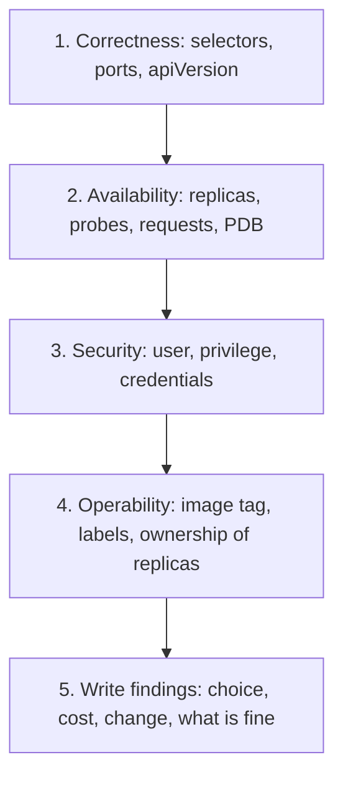

# Manifest Review Checklist: Reviewing, Upgrading and Doubting

Stage 10 compressed for lookup. [Lesson 26](../lessons/0026-reviewing-manifests.md) covers reviewing manifests by what each choice costs, [lesson 27](../lessons/0027-upgrading-what-others-depend-on.md) covers moving a cluster or a shared chart past a removed API, and [lesson 28](../lessons/0028-when-kubernetes-is-the-wrong-answer.md) covers when Kubernetes or a default is the wrong answer and settling a dispute from the source.

## A finding has four parts

|Part|Says|
|---|---|
|Choice|What you saw, quoted from the manifest|
|Cost|What it costs, in availability, security or operability|
|Change|The smallest edit that removes the cost|
|What is fine|What the author got right, so the review is read to the end|

Rank by cost, not by size of the edit. "This is wrong" is not a finding.

## Questions by currency

|Currency|Ask|Smell and cost|Change|
|---|---|---|---|
|Correctness|Does the Service selector equal the pod template labels? Does the Service `targetPort` match the container port?|Selector mismatch: valid Service, no endpoints, no apply-time error|Fix the selector, check `kubectl get endpointslices`|
|Correctness|Does the Deployment selector match its template labels?|The API rejects a mismatch. The selector is immutable after creation|Set both, never change the selector later|
|Availability|Are there requests on every container?|None: `BestEffort`, evicted first, and an HPA on CPU utilization has nothing to divide by|Requests from observed usage|
|Availability|Is there a readiness probe?|None: traffic reaches a pod before it can serve|Cheap readiness endpoint|
|Availability|What does the liveness probe check?|A dependency: an outage restarts every replica together|Check the process only|
|Availability|How many replicas?|One: every rollout, drain and crash is an outage|Two or more, spread across nodes|
|Availability|Is there a PodDisruptionBudget?|None on several replicas: one drain can evict them all. `minAvailable: 1` on one replica blocks drains|`minAvailable` or `maxUnavailable` sized to the replicas|
|Availability|Is `spec.replicas` set while an HPA targets the Deployment?|Each apply resets the count and fights the autoscaler|Remove `spec.replicas`|
|Security|Does `securityContext` set a non-root user and block escalation?|None: the process starts with whatever privilege the image allows|`runAsNonRoot: true`, `allowPrivilegeEscalation: false`, a `seccompProfile`, the `restricted` level fields|
|Security|Is a credential in a ConfigMap or a plain `env` value?|ConfigMaps give no secrecy or encryption. Anyone who reads it or the repository has the credential|A Secret, delivered without the value in Git. Rotate what was exposed|
|Security|Does the pod need its service account token?|An unused token is a credential for nothing|`automountServiceAccountToken: false` if unused|
|Operability|What is the image tag?|`:latest`: unknown build, unreliable rollback, `imagePullPolicy` defaults to `Always`|Version tag or digest|
|Operability|Are labels, resource names and probes consistent and findable?|On-call cannot select, scale or roll back what they cannot name|Common labels, one name per workload|

## The review order

## When the usual answer is wrong

|Default|Built for|Fails when|Instead|Costs|
|---|---|---|---|---|
|CPU limit on every container|Protecting neighbours on a shared node|A latency-sensitive service is throttled while the node has idle CPU|Keep the CPU request, drop the CPU limit, keep memory limit equal to request|`Burstable` instead of `Guaranteed`, noisy neighbour risk, a quota may require limits|
|Liveness probe on every Deployment|Restarting a hung process|The process exits on its own when broken, or the probe is wrong and restarts healthy pods|Readiness always, startup for slow starts, liveness for a seen hang|A hang with no probe stays up until someone notices|
|Required one replica per node anti-affinity|Surviving a node loss|More replicas than nodes leave pods `Pending`, and a rollout stalls when `maxUnavailable` rounds to 0|Topology spread with `maxSkew: 1` and `ScheduleAnyway`, or preferred anti-affinity|Two replicas can share a node|
|A cluster for the service|Many services, many teams|One service, one team, a tolerable outage|A host with a process manager, Compose, a managed platform|Giving up rescheduling, rollouts and a shared platform|

## Settling a dispute

|Order|Source|Settles|
|---|---|---|
|1|API reference, or `kubectl explain TYPE.FIELD` on your cluster|What a field is and its default, for your version|
|2|Concept page, with its "Feature state" label|Behaviour and maturity|
|3|KEP in the enhancements repository, `kep.yaml` for `stage` and `latest-milestone`|Why it was designed that way, how far it has graduated|
|4|An experiment on kind: `--dry-run=server`, a ten-line manifest|What your cluster does|

Write the claim as something that can be false. Put the link in the pull request.

## Upgrading what others depend on

|Step|Do|
|---|---|
|Find|Metric `apiserver_requested_deprecated_apis` (with `removed_release`), the audit annotation `k8s.io/deprecated`, `Warning` headers, a repository search for removed `apiVersion` and `kind` pairs, `helm template`, `helm get manifest RELEASE`|
|Rehearse|Test cluster with the API version off: `--runtime-config=<group>/<version>=false`|
|Order|One minor at a time. `etcd`, `kube-apiserver`, controller manager, scheduler. Then drain and upgrade kubelets, which may be up to three minors behind the API server and never ahead. `kubectl` within one minor|
|After|Rewrite objects to the new storage version, convert manifests|
|Tell|What, where (exact files and releases), the fix, how to check, the deadline|
|Shared chart|Minor release that accepts old and new and warns, a window, then a major release that removes the old value and fails with a message. `kubeVersion` and `deprecated` in `Chart.yaml` for compatibility and retirement. Never change selector labels in a minor release|

Removed examples from the migration guide: `policy/v1beta1` PodDisruptionBudget and `batch/v1beta1` CronJob (v1.25), `autoscaling/v2beta2` HorizontalPodAutoscaler (v1.26), `flowcontrol.apiserver.k8s.io/v1beta3` (v1.32). In `policy/v1` an empty PodDisruptionBudget selector selects all pods in the namespace, so a version rename can change behaviour.

## Sources

- [Docs: "Security Checklist", Kubernetes](https://kubernetes.io/docs/concepts/security/security-checklist/)
- [Docs: "Deprecated API Migration Guide", Kubernetes](https://kubernetes.io/docs/reference/using-api/deprecation-guide/)
- [Docs: "Kubernetes Deprecation Policy", Kubernetes](https://kubernetes.io/docs/reference/deprecation-policy/)
- [Docs: "Version Skew Policy", Kubernetes](https://kubernetes.io/releases/version-skew-policy/)
- [Docs: "Deprecated Kubernetes APIs", Helm](https://helm.sh/docs/topics/kubernetes_apis/)
- [Docs: "Kubernetes API" reference, Kubernetes](https://kubernetes.io/docs/reference/kubernetes-api/)
- [Repository: Kubernetes Enhancement Proposals, Kubernetes](https://github.com/kubernetes/enhancements)
