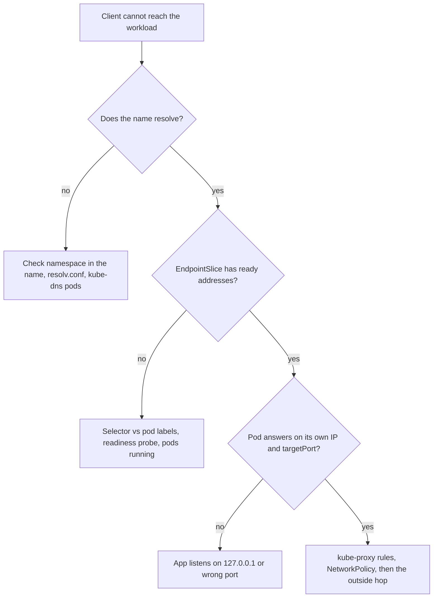

# Networking: Services, EndpointSlices, DNS, Ingress and the Gateway API

Stage 3 compressed for lookup. [Lesson 8](../lessons/0008-services.md) covers Services, EndpointSlices and kube-proxy, [lesson 9](../lessons/0009-cluster-dns.md) cluster DNS, and [lesson 10](../lessons/0010-ingress-and-the-gateway-api.md) Ingress and the Gateway API.

## Service types

|Type|Adds|Reachable from|Needs|
|---|---|---|---|
|`ClusterIP` (default)|Virtual IP|Inside the cluster|Nothing|
|`NodePort`|Same port on every node, 30000 to 32767 by default|Any node IP|Nothing|
|`LoadBalancer`|External load balancer to the node ports|The load balancer address|A cloud integration. Not on kind by default (Cloud Provider KIND adds one)|
|`ExternalName`|DNS `CNAME` to `externalName`|Inside the cluster|Nothing. No proxying, so HTTP `Host` and TLS names mismatch|
|Headless (`clusterIP: None`)|No virtual IP, DNS returns pod IPs|Inside the cluster|Nothing. kube-proxy ignores it|

- Types nest: each includes the one before it, except `ExternalName` and headless.
- `port` is what clients use, `targetPort` is the pod port (default: same as `port`, and it may be a port name). A multi-port Service must name each port.
- A Service with no selector gets no EndpointSlices: you create them.
- kube-proxy picks a backend per connection, so a long-lived connection stays on one pod.

## Which hop failed



|Check|Command|
|---|---|
|Service and type|`kubectl get svc web`|
|Who is behind it|`kubectl get endpointslices -l kubernetes.io/service-name=web`|
|Ready addresses only|`kubectl get endpointslices -l kubernetes.io/service-name=web -o jsonpath='{.items[*].endpoints[?(@.conditions.ready==true)].addresses[0]}'`|
|Pod labels against selector|`kubectl get pods -l app=web --show-labels`|
|Tunnel to a Service|`kubectl port-forward service/web 8080:80`|
|DNS from inside|`kubectl exec <pod> -- nslookup web.<namespace>`|

## EndpointSlice conditions

|Condition|Meaning|
|---|---|
|`ready`|Roughly serving and not terminating|
|`serving`|Follows the pod's Ready condition|
|`terminating`|The pod has a deletion timestamp|

- A slice holds at most 100 endpoints by default. The older `Endpoints` object is deprecated.
- Proxies skip endpoints that are not ready, but may use serving and terminating ones if all remaining endpoints are terminating.

## DNS names

|Name|Resolves to|
|---|---|
|`<svc>.<ns>.svc.cluster.local`|The Service's cluster IP, or for a headless Service all ready pod IPs|
|`<svc>` or `<svc>.<ns>`|The same, through the pod's search list|
|`<hostname>.<subdomain>.<ns>.svc.cluster.local`|One pod, when `subdomain` equals a headless Service in the same namespace|
|`_<port>._<proto>.<svc>.<ns>.svc.cluster.local`|`SRV` record for a named port|

Typical `/etc/resolv.conf` in a pod in namespace `shop`:

```text
search shop.svc.cluster.local svc.cluster.local cluster.local
nameserver 10.96.0.10
options ndots:5
```

|Name looked up|Dots|Tried first|
|---|---|---|
|`web`|0|`web.shop.svc.cluster.local`, found at once|
|`web.prod`|1|`web.prod.shop.svc.cluster.local`, fails, then `web.prod.svc.cluster.local`|
|`api.example.com`|2|Three suffixed names fail, then the real name|
|`api.example.com.`|trailing dot|The real name only|

- A name with fewer than `ndots` dots is tried with the search suffixes before as given.
- Fix a slow external lookup with a trailing dot or a lower `ndots` in `dnsConfig.options`, and check short names still resolve.
- `dnsPolicy` defaults to `ClusterFirst`. `Default` inherits the node's resolver. `hostNetwork: true` needs `ClusterFirstWithHostNet`.

## Ingress

|Field|Notes|
|---|---|
|`ingressClassName`|Names an `IngressClass`, which names the controller. If omitted, a default class must exist (annotation `ingressclass.kubernetes.io/is-default-class: "true"`)|
|`rules[].host`|Exact or wildcard (`*.example.test`, one label only)|
|`paths[].pathType`|Required: `Exact`, `Prefix`, `ImplementationSpecific`|
|`tls[].secretName`|Secret of type `kubernetes.io/tls` with `tls.crt` and `tls.key`. Hosts must match the rules. TLS ends at the ingress|
|`defaultBackend`|What serves requests no rule matched, if the controller supports it|

|`Prefix` `/foo` against|Match|
|---|---|
|`/foo`, `/foo/`, `/foo/bar`|Yes|
|`/foobar`, `/Foo`|No|

- An Ingress needs a controller, or it does nothing.
- Longest matching path wins, and `Exact` beats `Prefix` on a tie.
- The Ingress API is stable and frozen. The project recommends Gateway for new work, and has no plans to remove Ingress.
- The community Ingress NGINX controller was announced for retirement after March 2026. That is one controller, not the API.

## Gateway API

|Kind|Owner|Says|
|---|---|---|
|`GatewayClass`|Infrastructure provider|Which controller implements gateways of this class (`controllerName`)|
|`Gateway`|Cluster operator|Listeners (port, protocol, hostname) and `allowedRoutes`|
|`HTTPRoute`, `GRPCRoute`|Application developer|Matches, filters and `backendRefs`, attached with `parentRefs`|

- Installed as custom resources: `kubectl get gatewayclass` fails until the CRDs exist.
- A Gateway accepts routes from its own namespace only, unless `allowedRoutes` says otherwise.
- There is no `Ingress` kind in it, so migration is a one-time conversion.

## Sources

- [Service](https://kubernetes.io/docs/concepts/services-networking/service/)
- [EndpointSlices](https://kubernetes.io/docs/concepts/services-networking/endpoint-slices/)
- [Virtual IPs and Service Proxies](https://kubernetes.io/docs/reference/networking/virtual-ips/)
- [DNS for Services and Pods](https://kubernetes.io/docs/concepts/services-networking/dns-pod-service/)
- [Ingress](https://kubernetes.io/docs/concepts/services-networking/ingress/)
- [Gateway API](https://kubernetes.io/docs/concepts/services-networking/gateway/)
- [Debug Services](https://kubernetes.io/docs/tasks/debug/debug-application/debug-service/)
