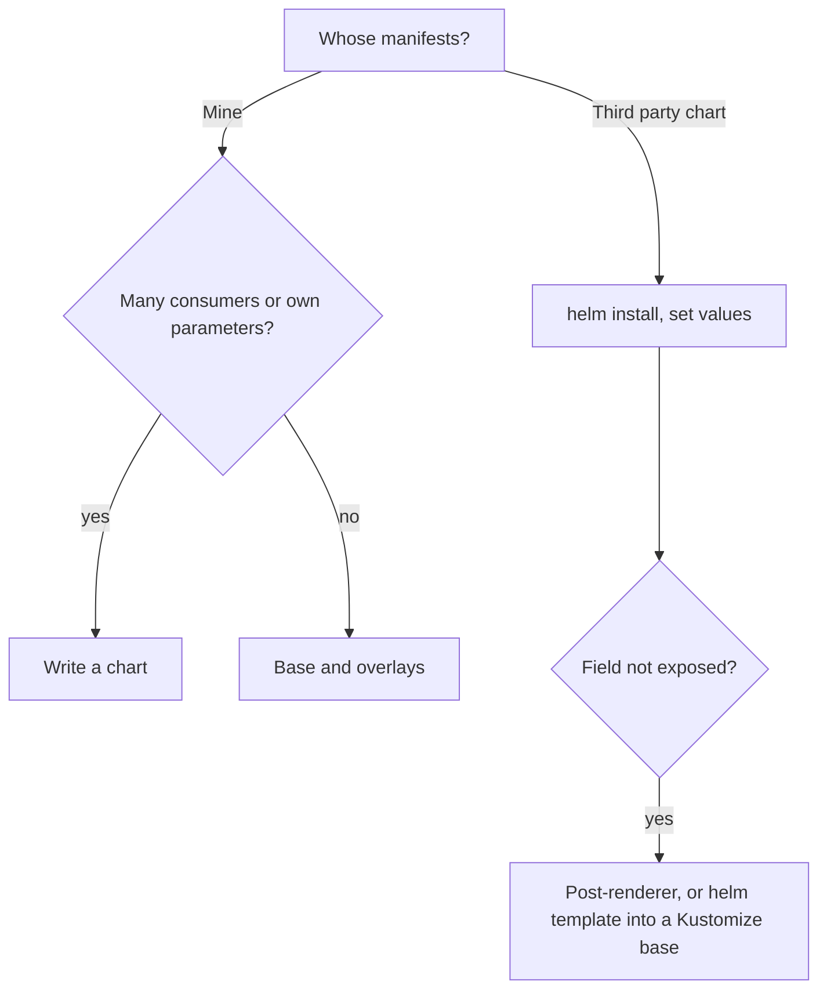

# Packaging: Kustomize and Helm Side by Side

Stage 8 compressed for lookup. [Lesson 22](../lessons/0022-kustomize.md) covers Kustomize bases, overlays, patches and generators, and [lesson 23](../lessons/0023-helm-against-kustomize.md) covers Helm charts and releases and the choice between the two.

## Kustomize

|Task|Command|
|---|---|
|Render, no cluster contact|`kubectl kustomize DIR`|
|Apply|`kubectl apply -k DIR`|
|Preview the change|`kubectl diff -k DIR`|

```text
app/
  base/
    deployment.yaml
    kustomization.yaml     # resources, configMapGenerator
  overlays/
    prod/
      kustomization.yaml   # resources: [../../base], plus changes
```

|Field|Does|
|---|---|
|`resources`|Files, or other Kustomization directories, to include|
|`namespace`|Sets the namespace on resources. Does not create the Namespace|
|`namePrefix`, `nameSuffix`|Renames, and updates references|
|`replicas`|`name` and `count` for a workload|
|`images`|`name` plus `newName`, `newTag` or `digest`. Matches the image name without its tag|
|`labels`|Adds labels|
|`patches`|Strategic merge or JSON 6902, as a `path` or inline `patch`, with an optional `target`|
|`configMapGenerator`, `secretGenerator`|Builds the object from `literals` or `files`|
|`generatorOptions`|`disableNameSuffixHash`, labels and annotations for generated objects|

- A generated name carries a content hash, and references are rewritten. A content change renames the object, changes the pod template and starts a rollout.
- `behavior: merge` or `replace` in an overlay changes the base's generated object. Define the generator in the base to keep the hash behaviour.
- A strategic merge patch finds its target by `apiVersion`, `kind` and `name` and merges lists by key, so containers merge by `name`. A wrong container name adds a new container.
- The old generated ConfigMap stays after an apply.
- No logic: no loops, no conditions, no computed values.

|Symptom|Cause|
|---|---|
|`namespaces "X" not found` on apply|`namespace:` does not create it. Add a Namespace to `resources`|
|`containers[0].image: Required value`|A patch named a container that does not exist, which created a second one|
|Config edit did not restart pods|`disableNameSuffixHash: true`, or a hand-edited ConfigMap|

## Helm

|Task|Command|
|---|---|
|Install|`helm install RELEASE CHART -n NS --create-namespace -f values.yaml --wait`|
|Upgrade|`helm upgrade RELEASE CHART -n NS -f values.yaml`|
|Install or upgrade|`helm upgrade --install RELEASE CHART`|
|Roll back|`helm rollback RELEASE [REVISION]`, which adds a new revision|
|History|`helm history RELEASE`|
|Remove|`helm uninstall RELEASE` (`--keep-history` keeps the record)|
|Render locally|`helm template RELEASE CHART`|
|Check the chart|`helm lint CHART`|
|Defaults a chart takes|`helm show values CHART`|
|Values a release has|`helm get values RELEASE`|
|Manifest of a release|`helm get manifest RELEASE`|
|List releases|`helm list -n NS`|

```text
web/
  Chart.yaml        # apiVersion v2, name, version required. appVersion optional
  values.yaml       # defaults
  crds/             # plain CRDs, installed once, never upgraded
  templates/        # templated manifests, hooks, NOTES.txt
```

|Value source|Order|
|---|---|
|Chart `values.yaml`|Lowest|
|`-f file`|Next, the rightmost file wins|
|`--set`|Highest, the rightmost wins|

- On upgrade, `--reuse-values` reuses the last release's values, `--reset-values` returns to the chart's, and `--reset-then-reuse-values` does both. Pass the same `-f` files every time.
- `helm install` does not wait for readiness unless you pass `--wait` (timeout 5 minutes by default).
- Release records are Secrets in the release namespace, labelled `owner=helm`, 10 revisions per release by default (`--history-max`). Reading Secrets there reads release values.
- Hooks: annotation `helm.sh/hook` with `pre-install`, `post-install`, `pre-upgrade`, `post-upgrade`, `pre-delete` or `post-delete`, plus `helm.sh/hook-weight` as a string. A Job hook is awaited and a failure fails the release.
- Hook resources are not part of the release. `helm.sh/hook-delete-policy` takes `before-hook-creation` (default), `hook-succeeded`, `hook-failed`.
- CRDs in `crds/`: not templated, installed on first install, never upgraded or deleted by Helm, and not validated by `--dry-run`.
- `helm template` fakes in-cluster lookups and skips server-side validation. It is a quick check, not a proof.

## Helm or Kustomize

|Question|Helm|Kustomize|
|---|---|---|
|Who wrote the manifests?|Often someone else|You|
|Customize a field the author did not expose|Post-renderer, or fork|Patch it|
|Stable, documented parameters for consumers|Yes, `values.yaml`|No, overlays couple to the base|
|Release history and whole-release rollback|Yes, in cluster Secrets|No, use `kubectl rollout undo` or Git|
|Logic in the manifests|Yes, templates|No|
|What a reviewer reads|Templates, then the render|The render|
|Distribution|Versioned chart, by name|Directory or Git ref|



- Using both: render the chart with `helm template`, list the output as a Kustomize resource, patch what it does not expose, and pin the chart version so the render stays reproducible.
- Both tools produce YAML that `kubectl` can apply. The choice is about who maintains the layer, not whether it works.

## Sources

- [Docs: "Declarative Management of Kubernetes Objects Using Kustomize", Kubernetes](https://kubernetes.io/docs/tasks/manage-kubernetes-objects/kustomization/)
- [Docs: Kustomize reference, kubectl documentation](https://kubectl.docs.kubernetes.io/references/kustomize/)
- [Docs: "Using Helm", Helm](https://helm.sh/docs/intro/using_helm/)
- [Docs: "Charts", Helm](https://helm.sh/docs/topics/charts/)
- [Docs: "Chart Hooks", Helm](https://helm.sh/docs/topics/charts_hooks/)
- [Docs: "Custom Resource Definitions", Helm chart best practices](https://helm.sh/docs/chart_best_practices/custom_resource_definitions/)
