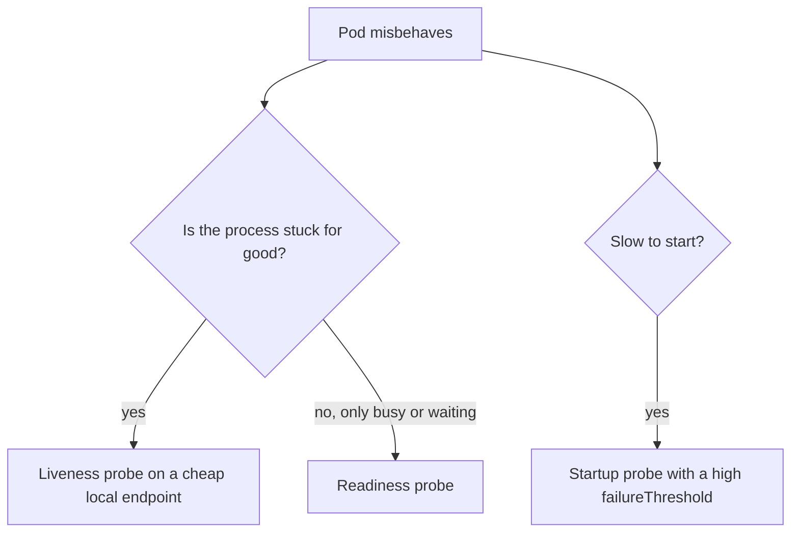
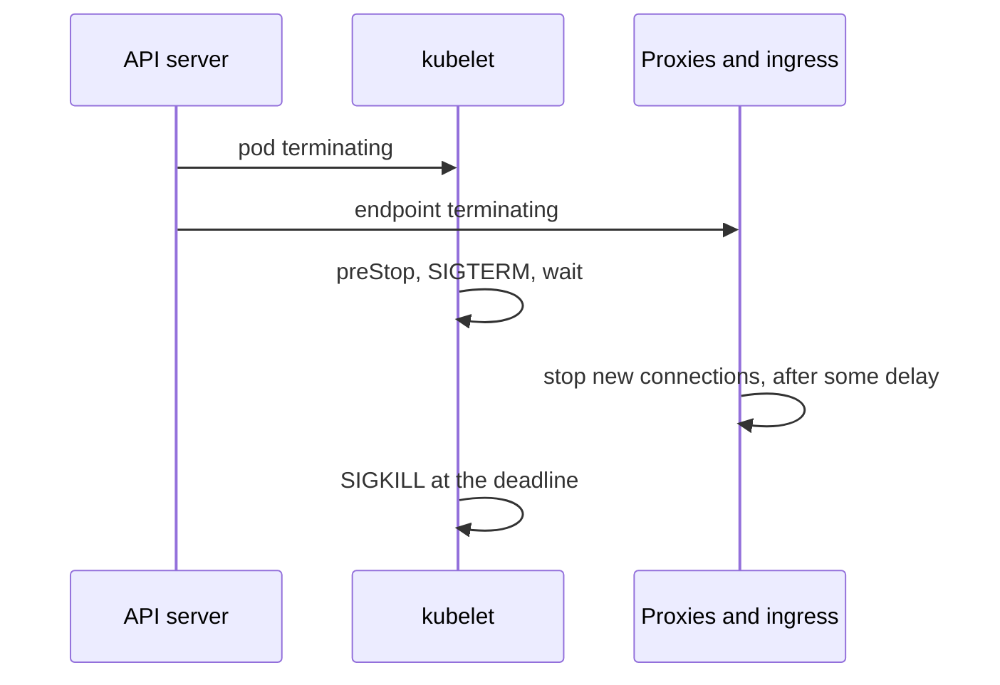

# Running Reliably: Probes, Termination, Requests, Limits and QoS

Stage 5 compressed for lookup. [Lesson 13](../lessons/0013-probes.md) covers the probes, [lesson 14](../lessons/0014-pod-termination.md) pod termination, and [lesson 15](../lessons/0015-requests-limits-and-qos.md) requests, limits and QoS classes. The single-host version of this stage is the containers track's [Running Containers](../../containers/reference/running-containers.md).

## The three probes

|Probe|Asks|On failure|Runs|
|---|---|---|---|
|Startup|Has it finished starting?|Container killed, restart policy applies|Only at startup, and holds back the other two until it succeeds|
|Liveness|Is it stuck beyond recovery?|Container killed, restart policy applies|For the container's whole life|
|Readiness|Can it take traffic now?|Pod marked not ready, address leaves the EndpointSlices|For the container's whole life|

- A missing probe counts as success, except readiness counts as failing before its initial delay.
- Readiness never restarts anything. Liveness restarts the container, not the pod.
- A probe result of Unknown triggers no action.

## Mechanisms and fields

|Mechanism|Succeeds when|
|---|---|
|`httpGet`|Status at least 200 and below 400|
|`tcpSocket`|The port accepts a connection|
|`exec`|The command exits 0, and it forks processes on every run|
|`grpc`|The service reports `SERVING`|

|Field|Default|Notes|
|---|---|---|
|`initialDelaySeconds`|0|Honored in current versions, and starts after the startup probe succeeds if there is one|
|`periodSeconds`|10|Minimum 1|
|`timeoutSeconds`|1|A slower probe is a failure|
|`failureThreshold`|3|Consecutive failures to act|
|`successThreshold`|1|Must be 1 for liveness and startup|

```yaml
startupProbe:
  httpGet: {path: /healthz, port: 8080}
  periodSeconds: 10
  failureThreshold: 30      # up to 300 s to start
livenessProbe:
  httpGet: {path: /healthz, port: 8080}
  timeoutSeconds: 3
readinessProbe:
  httpGet: {path: /ready, port: 8080}
  periodSeconds: 5
```

- Start budget with no startup probe is about `initialDelaySeconds + failureThreshold * periodSeconds`. Longer needs a startup probe on the liveness endpoint.
- Liveness checks this process only. A liveness probe that calls a dependency turns that dependency's outage into restarts of every pod.
- A pod that exits on its own fatal errors needs no liveness probe.
- Restart delay in `CrashLoopBackOff` grows exponentially to 300 s and resets after 10 minutes of healthy running.



## Termination sequence

|Step|What happens|
|---|---|
|1|Delete is requested, API server sets a deletion timestamp and the grace period, pod shows `Terminating`|
|2a (node)|kubelet runs `preStop`, then the runtime sends `SIGTERM` to process 1 of each container|
|2b (routing)|At the same time the endpoint becomes `ready=false`, `terminating=true` in EndpointSlices|
|3|If still running when the grace period ends, `SIGKILL`|
|4|The kubelet removes the pod object from the API server|

|Setting|Value|
|---|---|
|`terminationGracePeriodSeconds`|Default 30, one budget that starts before `preStop`|
|`preStop` hook|Must finish before `SIGTERM`, counts against the grace period, one extra 2 s if still running at the deadline|
|Hook handlers|`exec`, `httpGet`, `sleep` (run by the kubelet, so no binary needed in the image)|
|Container order|`SIGTERM` to containers in no guaranteed order|
|Force delete|`kubectl delete pod NAME --grace-period=0 --force` removes the object without kubelet confirmation|

- The traffic race: endpoint removal and `SIGTERM` start together, and proxies learn at their own speed, so new connections can reach a pod that has begun shutting down.
- The fix is a short `preStop` `sleep` (`sleep: {seconds: N}`), plus a grace period of at least `sleep + longest drain + margin`.
- Exit 137 is `SIGKILL`, 143 is `SIGTERM` handled by the default action. A PID 1 with no handler ignores `SIGTERM`.
- The application half, handling the signal and draining, is in the language tracks.



## Requests, limits and QoS

|Setting|Read by|Effect|
|---|---|---|
|Request|Scheduler|Reserves capacity, and the sum of requests on a node must fit its allocatable capacity|
|CPU limit|Kernel|Throttles, so the container is slower and never killed|
|Memory limit|Kernel|May OOM-kill the container, `OOMKilled`, exit 137|

- A limit with no request uses the limit as the request.
- CPU: `1` is a core, `250m` a quarter. Memory: `128Mi` is not `128M`.
- Pending with `Insufficient cpu` or `Insufficient memory` means requests do not fit, not that usage is high.
- `kubectl describe node` shows `Allocated resources`, the sums the scheduler compares.
- Whether to set CPU limits is debated, and it is covered in lesson 28.

|QoS class|Rule|
|---|---|
|`Guaranteed`|Every container has CPU and memory requests and limits, and requests equal limits|
|`Burstable`|Not Guaranteed, with at least one request or limit|
|`BestEffort`|No requests or limits at all|

- Read it with `kubectl get pod NAME -o jsonpath='{.status.qosClass}'`.
- Node-pressure eviction ranks pods by usage over requests, then priority, then how far over. The class is a guide, not the rule.
- Default hard thresholds on Linux include `memory.available<100Mi`, `nodefs.available<10%` and `imagefs.available<15%`.
- Node-pressure eviction ignores PodDisruptionBudgets and the grace period for hard thresholds.

|Namespace object|Does|
|---|---|
|LimitRange|Injects default requests and limits, enforces minimum and maximum, rejects violations with 403|
|ResourceQuota|Caps totals such as `requests.cpu` and object counts, and may reject pods that set no requests|

## Failure lookup

|Symptom|Likely cause|Check|
|---|---|---|
|`RESTARTS` grows, `Last State` is `OOMKilled`|Memory limit too low or a leak|`kubectl describe pod`|
|`RESTARTS` grows, events show `Liveness probe failed`|Probe too strict, wrong endpoint or too early|`kubectl describe pod`, probe fields|
|All pods restart together during a dependency outage|Liveness probe checks the dependency|The liveness handler|
|Pod running but `READY 0/1`|Readiness failing|Events, the readiness endpoint|
|502s on every rollout|Traffic race at termination|`preStop` and the grace period|
|Delete takes the full grace period|No `SIGTERM` handler, or PID 1 behind a shell|Container's PID 1|
|`Pending`, `Insufficient cpu`|Requests do not fit any node|`kubectl describe node`|

## Sources

- [Docs: "Liveness, Readiness, and Startup Probes", Kubernetes](https://kubernetes.io/docs/concepts/workloads/pods/probes/)
- [Docs: "Pod Lifecycle", Kubernetes](https://kubernetes.io/docs/concepts/workloads/pods/pod-lifecycle/)
- [Docs: "Container Lifecycle Hooks", Kubernetes](https://kubernetes.io/docs/concepts/containers/container-lifecycle-hooks/)
- [Docs: "Resource Management for Pods and Containers", Kubernetes](https://kubernetes.io/docs/concepts/configuration/manage-resources-containers/)
- [Docs: "Pod Quality of Service Classes", Kubernetes](https://kubernetes.io/docs/concepts/workloads/pods/pod-qos/)
- [Docs: "Node-pressure Eviction", Kubernetes](https://kubernetes.io/docs/concepts/scheduling-eviction/node-pressure-eviction/)
