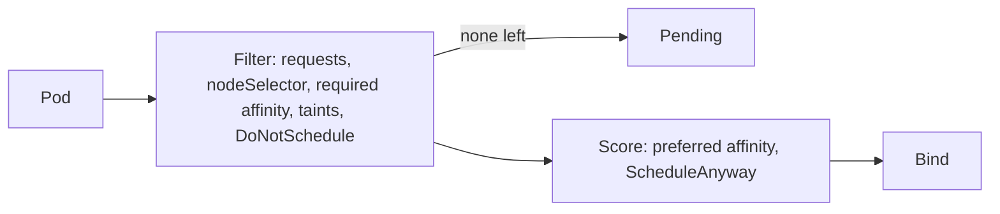

# State, Scheduling and Scale: Storage, StatefulSets, Placement, Autoscaling and Disruptions

Stage 6 compressed for lookup. [Lesson 16](../lessons/0016-persistent-storage.md) covers persistent storage, [lesson 17](../lessons/0017-statefulsets.md) StatefulSets, [lesson 18](../lessons/0018-scheduling.md) scheduling, and [lesson 19](../lessons/0019-autoscaling-and-disruptions.md) autoscaling and disruptions.

## Storage objects

|Object|Owner|Holds|
|---|---|---|
|PersistentVolumeClaim|Application team|A request: size, access mode, optional class|
|PersistentVolume|Cluster or administrator|The storage, with a lifecycle independent of pods|
|StorageClass|Administrator|A kind of storage, its provisioner, reclaim policy and binding mode|

- A claim binds to exactly one volume, and a pod references the claim by name in `volumes` under `persistentVolumeClaim.claimName`.
- A claim with no `storageClassName` gets the default class if there is one, and `storageClassName: ""` asks for a pre-created volume.
- Deleting a claim that a pod still uses is postponed until no pod uses it, and the claim shows `Terminating` meanwhile.

|Access mode|Meaning|
|---|---|
|`ReadWriteOnce`|Read-write by one node, several pods on it may share|
|`ReadOnlyMany`|Read-only by many nodes|
|`ReadWriteMany`|Read-write by many nodes|
|`ReadWriteOncePod`|Read-write by one pod in the cluster|

|Setting|Values|Default and notes|
|---|---|---|
|`reclaimPolicy` of a class|`Delete`, `Retain`|`Delete`: deleting the claim deletes the volume and its data|
|`volumeBindingMode`|`Immediate`, `WaitForFirstConsumer`|`Immediate`, and `WaitForFirstConsumer` waits for a pod so the volume is created where the pod runs|
|`allowVolumeExpansion`|true or false|Needed to grow a claim by editing its requested size|

- `Pending` claim under `WaitForFirstConsumer` is normal until a pod uses it.
- `storageclass ... not found` in a claim event means a wrong `storageClassName`.
- `Retain` leaves the volume released and needs manual reclaim, and `Recycle` is deprecated.

## StatefulSet

|Field|Purpose|
|---|---|
|`serviceName`|The governing headless Service, which you create yourself|
|`volumeClaimTemplates`|One claim per pod, reattached to the same ordinal|
|`podManagementPolicy`|`OrderedReady` (default) or `Parallel`|
|`updateStrategy`|`RollingUpdate` (default) with optional `partition`, or `OnDelete`|
|`persistentVolumeClaimRetentionPolicy`|`whenDeleted` and `whenScaled`, each `Retain` (default) or `Delete`|

- Names are `NAME-0` to `NAME-(N-1)`, DNS is `POD.SERVICE.NAMESPACE.svc.cluster.local`, and the pod label is `statefulset.kubernetes.io/pod-name`.
- `OrderedReady` creates upward and waits for ready, terminates downward and waits for shutdown. `Parallel` does neither wait.
- Rolling updates go from the highest ordinal down, one at a time.
- Claims are kept on scale-down and on deleting the StatefulSet, unless the retention policy says `Delete`. A pod replaced after a node failure keeps its claim in every case.
- A rollout stuck on a broken pod needs the broken pod deleted after the template is fixed.
- Deleting a StatefulSet gives no shutdown order, so scale to 0 first.

|The StatefulSet gives|You or an operator supply|
|---|---|
|Name, address, disk per replica|Replication, leader election, failover|
|Ordered start and update|Backups and restores, schema-aware upgrades|

## Placement

|Mechanism|Kind|Notes|
|---|---|---|
|`nodeSelector`|Hard|All listed labels must match|
|Node affinity `required...`|Hard|Terms ORed, expressions in a term ANDed|
|Node affinity `preferred...`|Soft|Weight 1 to 100 added to the score|
|Pod affinity and anti-affinity|Hard or soft|Needs `topologyKey`, costly in large clusters|
|Topology spread|Hard (`DoNotSchedule`, default) or soft (`ScheduleAnyway`)|`maxSkew` is the allowed difference from the emptiest domain|
|Taint|Repels|The node's side|
|Toleration|Permits|The pod's side, never attracts|

|Taint effect|Effect|
|---|---|
|`NoSchedule`|No new pods without a toleration, running pods stay|
|`PreferNoSchedule`|Avoided if possible|
|`NoExecute`|Also evicts running pods that do not tolerate it|

- `kubectl taint nodes NODE key=value:NoSchedule` adds, and the same with a trailing `-` removes.
- To dedicate nodes, taint them and also select them, since a toleration does not attract.
- Not-ready and unreachable nodes get taints, and pods get a default 300 s toleration for both.
- `nodeName` bypasses the scheduler and its taint check.
- Read a `Pending` pod with `kubectl describe pod`, and each reason in the `FailedScheduling` event covers a group of nodes.



## Autoscaling

|Autoscaler|Changes|Needs|
|---|---|---|
|HorizontalPodAutoscaler|Replica count|Requests, metrics API (usually metrics-server)|
|VerticalPodAutoscaler|Requests and limits|Installed separately, a metrics source|
|Node autoscaler|Number of nodes|Pending pods and their requests, a cloud or node provider|

```text
desiredReplicas = ceil( currentReplicas * currentMetricValue / desiredMetricValue )
```

- The HPA loop runs every 15 s by default, ignores ratios within 0.1 of 1, and takes the largest result across metrics.
- Utilization is a percentage of the request, so no request means no scaling on that metric.
- Scale-down uses the highest recommendation over a window, 5 minutes by default.
- With an HPA, remove `spec.replicas` from the manifest.
- `TARGETS` of `<unknown>` means no metrics API or no requests.
- VPA modes include `Off` (recommend only), and its updater respects PodDisruptionBudgets.
- Node autoscaling provisions for pending pods and consolidates underused nodes, both from requests.

## Disruptions

|Kind|Examples|Stopped by a PDB|
|---|---|---|
|Voluntary|Drain, node autoscaler scale-down|Yes, through the Eviction API|
|Voluntary, direct|Deleting a pod or Deployment, rolling updates|No|
|Involuntary|Hardware failure, node-pressure eviction|No, but it counts against the budget|

|PodDisruptionBudget field|Notes|
|---|---|
|`selector`|Required, normally the workload's selector|
|`minAvailable`|Pods that must stay, number or percentage|
|`maxUnavailable`|Pods that may be down, recommended since it tracks replicas|
|`unhealthyPodEvictionPolicy`|`IfHealthyBudget` (default) or `AlwaysAllow`, the latter recommended to avoid stuck drains|

- Use only one of `minAvailable` and `maxUnavailable`. Percentages round up.
- Zero allowed disruptions makes a drain never finish.
- `kubectl drain NODE --ignore-daemonsets` cordons, then evicts, and retries on `429` until the budget allows or `--timeout` ends.
- `kubectl uncordon NODE` makes it schedulable again.

|Property|API-initiated eviction|Node-pressure eviction|
|---|---|---|
|Respects PDB|Yes|No|
|Respects grace period|Yes|Hard thresholds use 0|
|Triggered by|Drain, autoscalers|The kubelet under resource pressure|

## Sources

- [Docs: "Persistent Volumes", Kubernetes](https://kubernetes.io/docs/concepts/storage/persistent-volumes/)
- [Docs: "Storage Classes", Kubernetes](https://kubernetes.io/docs/concepts/storage/storage-classes/)
- [Docs: "StatefulSets", Kubernetes](https://kubernetes.io/docs/concepts/workloads/controllers/statefulset/)
- [Docs: "Assigning Pods to Nodes", Kubernetes](https://kubernetes.io/docs/concepts/scheduling-eviction/assign-pod-node/)
- [Docs: "Taints and Tolerations", Kubernetes](https://kubernetes.io/docs/concepts/scheduling-eviction/taint-and-toleration/)
- [Docs: "Pod Topology Spread Constraints", Kubernetes](https://kubernetes.io/docs/concepts/scheduling-eviction/topology-spread-constraints/)
- [Docs: "Horizontal Pod Autoscaling", Kubernetes](https://kubernetes.io/docs/concepts/workloads/autoscaling/horizontal-pod-autoscale/)
- [Docs: "Disruptions", Kubernetes](https://kubernetes.io/docs/concepts/workloads/pods/disruptions/)
