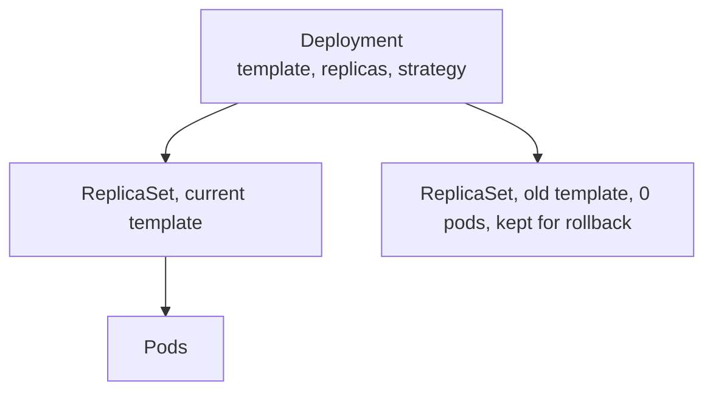
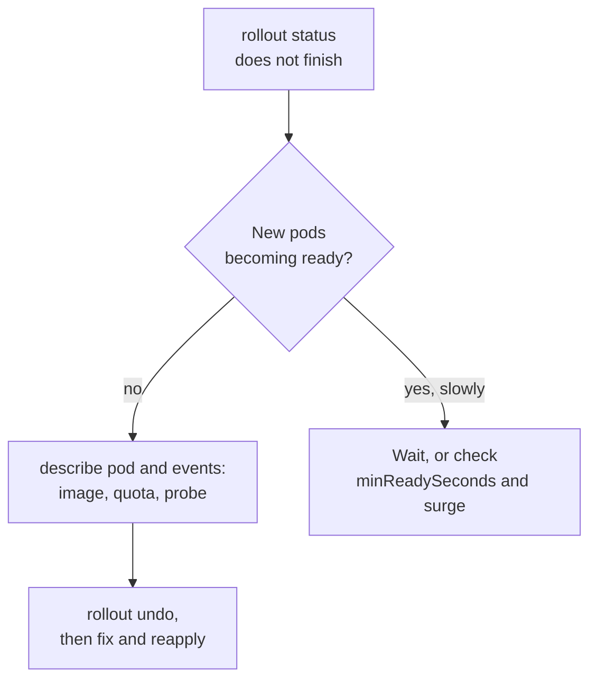
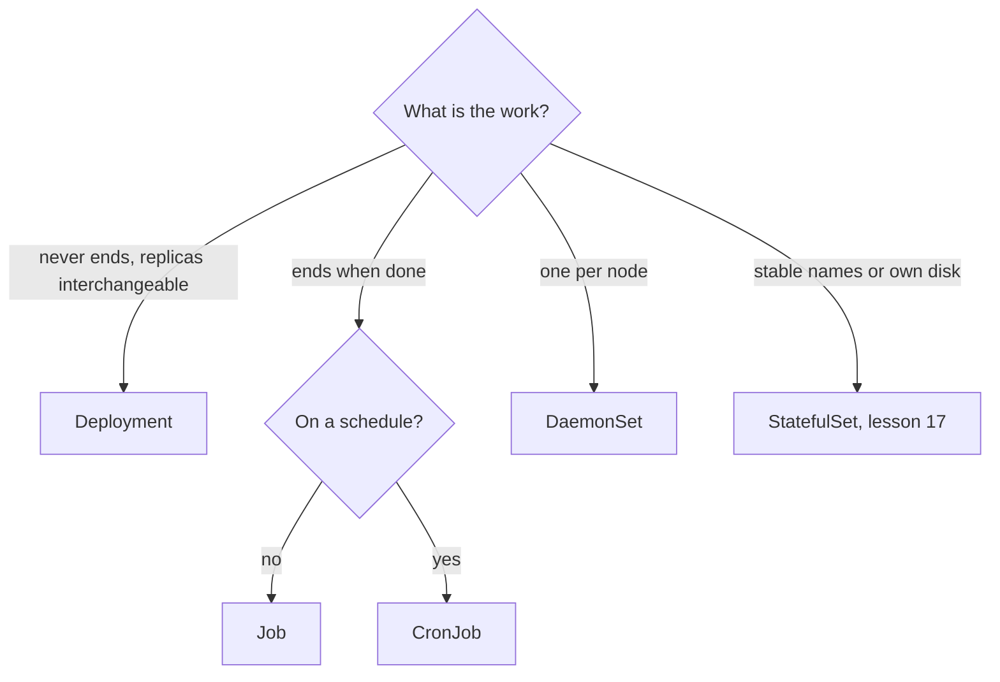

# Workloads: Object Fields, Selectors, Pods and Controllers

Stages 1 and 2 compressed for lookup. [Lesson 1](../lessons/0001-what-kubernetes-is-for.md) covers the cluster, [lesson 2](../lessons/0002-the-reconciliation-loop.md) the reconciliation loop, [lesson 3](../lessons/0003-objects-and-manifests.md) object fields, labels, namespaces and `kubectl apply`, [lesson 4](../lessons/0004-pods.md) pods, [lesson 5](../lessons/0005-deployments-and-replicasets.md) Deployments and ReplicaSets, [lesson 6](../lessons/0006-rollouts-and-rollbacks.md) rollouts and [lesson 7](../lessons/0007-jobs-cronjobs-and-daemonsets.md) Jobs, CronJobs and DaemonSets. The commands are on the [kubectl](kubectl.md) sheet.

## The loop in one table

|Piece|Role|
|---|---|
|`spec`|Desired state, written by you|
|`status`|Observed state, written by the cluster|
|Controller|Watches objects through the API server, compares, acts through the API server, repeats|
|API server|The only way in, and the only component that talks to etcd|
|Scheduler|Gives each pod with no node a node, once|
|kubelet|Runs the pods bound to its node and restarts their containers there|

|When|What happens|
|---|---|
|You delete a pod a controller owns|The controller sees fewer pods than the spec and creates one|
|A node stops reporting|Its `Ready` condition becomes `Unknown` and it is tainted `node.kubernetes.io/unreachable`. Pods tolerate that for 300 seconds by default, then are evicted and replaced|
|The control plane is unreachable|Running pods keep running. Nothing can be changed and nothing is replaced until it returns|
|You delete a bare pod, or its node dies|Nothing recreates it|

## Fields every object has

|Field|Says|
|---|---|
|`apiVersion`|`group/version`. The core group is just `v1`. Deployments are `apps/v1`, Jobs and CronJobs `batch/v1`|
|`kind`|The type of object|
|`metadata.name`|Unique per kind within a namespace. Most kinds need a DNS subdomain name: at most 253 characters, lowercase alphanumerics, `-` and `.`|
|`metadata.namespace`|Optional scope for the name. Omit it from a manifest to choose it at apply time with `-n`|
|`metadata.labels`|Identify and select|
|`metadata.annotations`|Non-identifying information. Selectors cannot match them|
|`metadata.uid`|Unique across the cluster. A replacement pod has a new one|
|`spec`|Desired state, shaped by the kind. A ConfigMap has `data` instead|
|`status`|Written by the cluster. Do not set it|

- `kubectl explain <kind>.spec.<field>` prints any field. `kubectl api-resources` lists every kind with its `apiVersion` and whether it is namespaced.
- Not namespaced: Nodes, PersistentVolumes, Namespaces. Initial namespaces: `default`, `kube-system`, `kube-public`, `kube-node-lease`.
- A Service's DNS name includes the namespace: `<service>.<namespace>.svc.cluster.local`.

## Labels and selectors

|Item|Rule|
|---|---|
|Label key|Optional DNS-subdomain prefix and `/`, then a name of at most 63 characters (alphanumerics, `-`, `_`, `.`). `kubernetes.io/` and `k8s.io/` are reserved|
|Label value|At most 63 characters, may be empty, same character set|
|Equality selector|`app=web`, `app==web`, `tier!=cache` (also matches objects without `tier`)|
|Set selector|`env in (prod,qa)`, `tier notin (cache)`, `partition`, `!partition`|
|Several requirements|Comma means AND. There is no OR except values inside `in`|
|`kubectl`|`-l 'env in (prod,qa),tier!=cache'`|

```yaml
selector:
  matchLabels:
    app: web
  matchExpressions:
    - { key: tier, operator: NotIn, values: [cache] }
```

- Deployments, ReplicaSets, Jobs and DaemonSets use `matchLabels` and `matchExpressions`. A Service uses a plain map of equality requirements.
- Do not overlap selectors between controllers. Kubernetes does not stop you, and they can fight over pods.
- Use labels, not namespaces, to tell versions of the same software apart.

## Applying

|Command|Behavior|
|---|---|
|`apply`|Creates or updates. Prints `created`, `configured` or `unchanged`|
|`create`|Creates only. `AlreadyExists` if the name is taken|
|`apply --dry-run=server`|The API server validates, nothing is stored|
|`diff`|Prints what `apply` would change|
|`apply --server-side`|The server merges, records which manager owns each field, and reports conflicts. `--force-conflicts` takes them over|

- Client-side `apply` compares your file, the live object and the `kubectl.kubernetes.io/last-applied-configuration` annotation. Fields in the file are set, fields removed from the file are cleared, fields never in the file are left alone.
- A field in the file overwrites the live value on each apply, so a manual `kubectl scale` is undone if the file sets `replicas`.
- Unknown and duplicate fields are errors by default (`--validate=strict`).
- Mixing `apply` with `create` or `replace` on one object is not supported.

## Pods

|Fact|Detail|
|---|---|
|Shared by a pod's containers|Network namespace (one IP, `localhost`, one port space), declared volumes, the node, the hostname|
|Not shared|Image and root filesystem|
|Phases|`Pending`, `Running`, `Succeeded`, `Failed`, `Unknown`|
|Container states|`Waiting`, `Running`, `Terminated`|
|`restartPolicy`|`Always` (default), `OnFailure`, `Never`. Applies to app containers and regular init containers|
|Restart back-off|10s, 20s, 40s and so on, capped at 300s, reset after 10 minutes without problems. In place, on the same node|
|Updatable in place|A container `image`, `activeDeadlineSeconds`, `terminationGracePeriodSeconds`, added `tolerations`. Almost everything else needs a new pod|
|Rescheduling|Never. A pod is replaced by a new one with a new UID, not moved|
|Default grace period|30 seconds|

|Container kind|Defined in|Runs|Probes|
|---|---|---|---|
|App|`containers`|Together, after the init containers|All|
|Regular init|`initContainers`|One at a time, each to completion before the next|No liveness, readiness, startup or lifecycle|
|Sidecar|`initContainers` with `restartPolicy: Always`|Starts in order, then runs for the pod's life, stopped after the main container|Supported, and its readiness counts toward the pod|

- A failing init container is restarted until it succeeds, unless the pod's `restartPolicy` is `Never`, which fails the pod. `STATUS` shows `Init:N/M`, then `PodInitializing`.
- Native sidecars are stable since v1.33 per the sidecar page, and do not keep a Job from completing.
- Put containers in one pod only when tightly coupled. Replicate with more pods.
- Create pods through a Deployment, Job or DaemonSet, never directly for anything you care about.

## Deployments and ReplicaSets



|Field|Default|Notes|
|---|---|---|
|`spec.replicas`|1|Scaling does not start a rollout or create a revision|
|`spec.selector`|none, required|Immutable after creation. Must match the template labels. Not defaulted from them in `apps/v1`|
|`spec.template`|required|A change here starts a rollout|
|`spec.strategy.type`|`RollingUpdate`|Or `Recreate`, which kills all old pods first|
|`spec.minReadySeconds`|0|A ready pod counts as available after this long without a crash|
|`spec.progressDeadlineSeconds`|600|Must exceed `minReadySeconds`|
|`spec.revisionHistoryLimit`|10|Old ReplicaSets kept. 0 means no rollback|
|`spec.paused`|false|A paused Deployment ignores template changes|

|Name|Pattern|
|---|---|
|ReplicaSet|`<deployment>-<pod-template-hash>`|
|Pod|`<replicaset>-<random suffix>`|

- The `pod-template-hash` label is added to every ReplicaSet, its selector and its pods. Never change it.
- A ReplicaSet acquires any ownerless pod that matches its selector, and deletes surplus pods. Scale-down order: pending first, then pods on nodes with more replicas, then newer pods.
- Do not manage ReplicaSets that a Deployment owns.
- `kubectl delete deployment` deletes ReplicaSets and pods. `--cascade=orphan` leaves them.
- `kubectl get deploy` columns: `READY` ready over desired, `UP-TO-DATE` on the latest template, `AVAILABLE` serving.

## Rollouts

|Field|Default|Rounding|
|---|---|---|
|`rollingUpdate.maxSurge`|25%|Up|
|`rollingUpdate.maxUnavailable`|25%|Down|

|Replicas|`maxSurge`|`maxUnavailable`|Pods in total|Available at least|
|---|---|---|---|---|
|1, defaults|1|0|1 to 2|1|
|3, defaults|1|0|3 to 4|3|
|4, defaults|1|1|3 to 5|3|
|3, surge 0 and unavailable 1|0|1|at most 3|2|
|3, surge 3 and unavailable 0|3|0|up to 6|3|

- Both cannot be 0.
- A rollout is only as safe as readiness: with no readiness probe a container counts as ready as soon as it runs.
- A stuck rollout (bad image, failing readiness, quota) leaves the old pods serving when `maxUnavailable` allows no loss. After the deadline the Deployment reports `Progressing` `False` with reason `ProgressDeadlineExceeded`. Kubernetes does not roll back by itself.
- A rollback is a rollout. It restores the pod template as the newest revision, so undo to revision 2 from 3 revisions makes revision 4 and removes the entry for 2. It does not restore `replicas`.
- `CHANGE-CAUSE` comes from the `kubernetes.io/change-cause` annotation at the time of the change.



## Jobs

|Field|Default|Notes|
|---|---|---|
|`template.spec.restartPolicy`|required|`Never` or `OnFailure` only|
|`backoffLimit`|6|Retries, with delays of 10s, 20s, 40s and so on, capped at ten minutes|
|`completions`, `parallelism`|1, 1|`completionMode: Indexed` gives each pod an index from 0 to completions minus 1|
|`activeDeadlineSeconds`|none|Fails the Job with `DeadlineExceeded`, takes precedence over `backoffLimit`|
|`ttlSecondsAfterFinished`|none|Deletes the finished Job and its pods. Set it for Jobs you create directly|
|`suspend`|false|True terminates active pods with `SIGTERM`|

- Terminal conditions: `Complete`, `Failed`.
- `OnFailure` re-runs the container in the same pod, and the pod is terminated when the Job gives up. `Never` keeps one failed pod per attempt, so choose it while debugging.
- A Job's program may be started twice. Make the work idempotent.

## CronJobs

|Field|Default|Notes|
|---|---|---|
|`schedule`|required|`minute hour day-of-month month day-of-week`, and macros such as `@daily`|
|`timeZone`|controller manager's zone|Stable since v1.27. `CRON_TZ` inside the schedule is rejected|
|`concurrencyPolicy`|`Allow`|`Forbid` skips an overlapping run, `Replace` stops the old Job|
|`startingDeadlineSeconds`|none|How late a run may start. Under 10 seconds may never run|
|`suspend`|false|Stops new runs only|
|`successfulJobsHistoryLimit`|3|Finished Jobs kept|
|`failedJobsHistoryLimit`|1|Failed Jobs kept|

- Names are limited to 52 characters, since 11 are appended for the Job.
- It creates a Job about once per slot: occasionally two or none. Make the Job idempotent.
- More than 100 missed schedules and it logs `too many missed start times` and does not start.
- Editing a CronJob affects only Jobs created afterwards. Run now: `kubectl create job manual-1 --from=cronjob/<name>`.

## DaemonSets

|Fact|Detail|
|---|---|
|Target|Every node, or those matching the template's `nodeSelector` or `affinity`|
|Pod `restartPolicy`|`Always` only|
|Selector|Immutable after creation|
|Update strategy|`RollingUpdate` (default, `maxUnavailable` 1, `maxSurge` 0) or `OnDelete`|
|Tolerations added|`not-ready` and `unreachable` (`NoExecute`), `disk-pressure`, `memory-pressure`, `pid-pressure`, `unschedulable` (`NoSchedule`), and `network-unavailable` for `hostNetwork` pods|
|Not added|The control plane taint. Tolerate `node-role.kubernetes.io/control-plane` yourself|
|Scheduling|The controller sets node affinity to the target node, the default scheduler binds it|

- `kubectl get ds`: `DESIRED` below the node count means a nodeSelector or an untolerated taint, and `READY` below `DESIRED` means pods that cannot start.
- Cost scales with the node count: each pod's requests are paid once per node.
- In kind, `kube-proxy` and `kindnet` are DaemonSets.

## Choosing a controller



## Sources

- [Docs: "Pods", Kubernetes](https://kubernetes.io/docs/concepts/workloads/pods/), [Pod Lifecycle](https://kubernetes.io/docs/concepts/workloads/pods/pod-lifecycle/), [Init Containers](https://kubernetes.io/docs/concepts/workloads/pods/init-containers/), [Sidecar Containers](https://kubernetes.io/docs/concepts/workloads/pods/sidecar-containers/)
- [Docs: "Deployments", Kubernetes](https://kubernetes.io/docs/concepts/workloads/controllers/deployment/) and [ReplicaSet](https://kubernetes.io/docs/concepts/workloads/controllers/replicaset/)
- [Docs: "Jobs", Kubernetes](https://kubernetes.io/docs/concepts/workloads/controllers/job/), [CronJob](https://kubernetes.io/docs/concepts/workloads/controllers/cron-jobs/), [DaemonSet](https://kubernetes.io/docs/concepts/workloads/controllers/daemonset/)
- [Docs: "Labels and Selectors", Kubernetes](https://kubernetes.io/docs/concepts/overview/working-with-objects/labels/)
