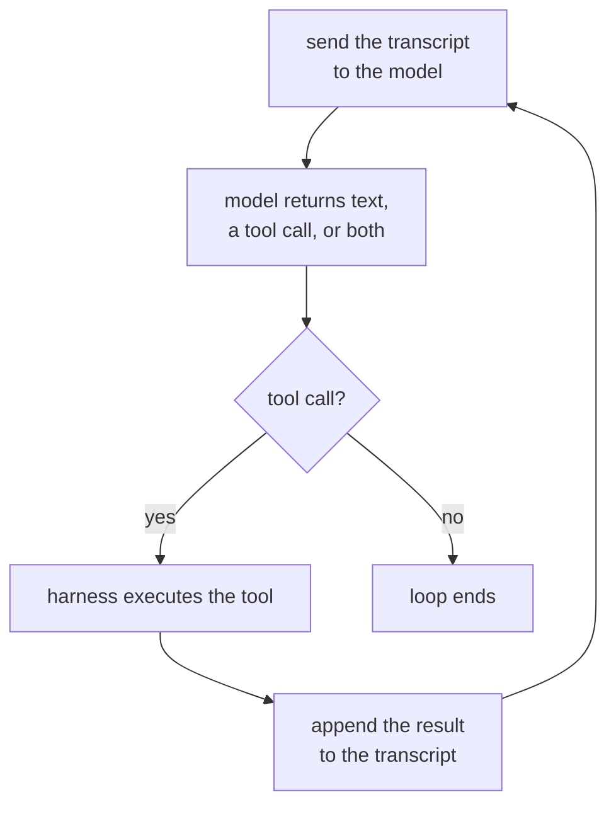

# Lección 1. El bucle del agente

**Vínculo con la misión:** "Escribir el bucle del agente para una tarea dada, y nombrar qué hace cada mensaje de su contexto y qué termina el bucle" es el primer punto de Cómo se ve el éxito, y empieza por saber qué es siquiera el bucle.
**Fuente principal:** [Article: "Building Effective Agents", Anthropic Engineering](https://www.anthropic.com/engineering/building-effective-agents)
**Requisitos previos:** ninguno

## Qué debes saber

### Qué convierte algo en un agente

Un **agente** es un sistema que ejecuta un modelo de lenguaje en un bucle con herramientas, y deja que el modelo decida qué herramienta llamar, cuándo y cuándo parar, en lugar de seguir un camino que el desarrollador fijó de antemano. La palabra se pega a muchos productos que no encajan: un chatbot sin herramientas no es un agente por buenas que sean sus respuestas, y un script que siempre llama a las mismas tres APIs en el mismo orden no es un agente por mucho que lo parezca visto desde fuera. Lo que decide es el flujo de control: ¿elige el modelo el siguiente paso, o lo eligió un desarrollador de antemano?

### El bucle, en concreto

Quita todo lo demás y un agente es este ciclo, repetido:

Cada pasada envía al modelo toda la transcripción hasta ese momento, recibe de vuelta una respuesta en texto plano o una petición de llamar a una herramienta, ejecuta esa herramienta si se pidió una, añade el resultado y da otra vuelta. Nada de este ciclo es específico de un proveedor o de un framework: es lo que significa "agente" por debajo de la marca.

### Quién hace qué: harness frente a modelo

En ese diagrama hay dos cosas distintas haciendo trabajo, y confundirlas es de donde salen muchas explicaciones confusas sobre agentes. El **harness** es el código que rodea al modelo: guarda la transcripción, ejecuta la llamada a herramienta que vuelva, aplica límites como un presupuesto de turnos y decide cuándo termina de verdad el bucle. El modelo no ejecuta nada por sí mismo. No puede salir y llamar a una API; solo puede emitir una petición que el harness decide atender. El modelo elige qué herramienta y con qué argumentos; el harness decide si la ejecuta, cómo y a qué se le permite tocar. Un modelo con un criterio excelente detrás de un harness sin límites sigue siendo un bucle sin acotar, y un harness prudente no puede convertir en buena una mala elección de herramienta.

### Qué termina el bucle

Un bucle que nunca se detiene no sirve, así que todo agente tiene una condición de parada, normalmente varias superpuestas:

1. **El modelo deja de pedir herramientas.** Devuelve una respuesta en texto plano sin llamada a herramienta, que el harness lee como "terminado".
2. **Se agota un presupuesto.** El número de turnos, el tiempo real o el gasto de tokens llega a un límite que el harness aplica sin importar lo que el modelo quiera hacer después.
3. **Una señal de parada explícita.** Algunos harness le dan al modelo una herramienta dedicada de "terminar", de modo que detenerse es en sí una llamada deliberada a una herramienta y no la ausencia de una.
4. **Un umbral de errores.** Tras suficientes fallos consecutivos de herramientas, el harness se rinde en lugar de dejar que el modelo dé tumbos indefinidamente.

La primera es decisión del modelo; el resto son el harness imponiéndose al modelo. Una trayectoria que corre para siempre sin producir una respuesta casi siempre es un harness que solo implementó la primera.

## Práctica

1. ▢ Un sistema de atención al cliente lee un mensaje, lo clasifica en una de tres categorías fijas y siempre llama a la misma API específica de la categoría como respuesta, sin importar lo que el propio modelo habría elegido hacer. ¿Es esto un agente? Explica por qué sí o por qué no.

Comprobación

No. La secuencia de pasos la fijó el desarrollador de antemano; la clasificación del modelo elige una rama, pero nunca elige qué herramienta llamar ni si llamar a alguna. Eso es un flujo de trabajo con un modelo incrustado, no un agente. La prueba es el flujo de control, no si hay un modelo involucrado en algún punto.

2. ▢ Pon en orden los cuatro pasos del bucle del agente: (a) el harness ejecuta la herramienta solicitada, (b) la transcripción se envía al modelo, (c) el resultado de la herramienta se añade a la transcripción, (d) el modelo devuelve una llamada a herramienta.

Comprobación

b, d, a, c: se envía la transcripción, el modelo responde con una llamada a herramienta, el harness la ejecuta, se añade el resultado y el ciclo se repite desde b.

3. ▢ ¿Cuál de estas describe mejor el trabajo del harness?

    - a) Decidir qué herramienta debe llamar el agente a continuación
    - b) Guardar la transcripción, ejecutar las llamadas a herramientas y aplicar límites que el modelo no puede anular
    - c) Generar la respuesta en lenguaje natural que lee el usuario
    - d) Elegir la redacción de la descripción de cada herramienta

Pista

El modelo decide qué pedir. La pregunta es sobre lo que pasa después de que lo pide.

Comprobación

**b)** Guardar la transcripción, ejecutar las llamadas a herramientas y aplicar límites que el modelo no puede anular. (a) es trabajo del modelo, no del harness. (c) también es salida del modelo, no algo que produzca el harness. (d) es una decisión de diseño que se toma antes de que el bucle corra, no algo que el harness haga en tiempo de ejecución.

4. ▢ Una traza muestra doce turnos, cada uno una llamada a herramienta y un resultado, que terminan en un decimotercer turno de texto plano sin llamada a herramienta. ¿Qué terminó este bucle y de quién fue la decisión?

Comprobación

El modelo dejó de pedir una herramienta: devolvió una respuesta sin nada más que ejecutar, así que el harness leyó esa ausencia como "terminado". Esa es decisión del modelo, no un presupuesto ni un umbral de errores que cortó el bucle desde fuera.

## Prácticas en el mundo real

- [ ] Elige un producto con marca de IA que uses con regularidad. Decide, usando la prueba del flujo de control de esta lección, si en realidad es un agente, un flujo de trabajo con un modelo dentro o un solo prompt sin bucle alguno. Escribe tu razonamiento en una frase.
- [ ] Busca la documentación de una herramienta de un asistente de programación agéntico o un producto similar. Lista cada condición de parada que menciona y marca cuáles son decisión del modelo y cuáles son el harness imponiéndose a él.
- [ ] Mañana: si tienes acceso a una traza o a un log de un agente en ejecución (basta el log de una sesión de un asistente de programación), recórrelo turno a turno y etiqueta cada uno: llamada al modelo, ejecución de herramienta o resultado añadido. Anota dónde terminó el bucle y por qué.

## Para profundizar

- [Article: "Building Effective Agents", Anthropic Engineering](https://www.anthropic.com/engineering/building-effective-agents)
- [Recursos](../RESOURCES.md)

---

¿No termina de quedar claro? Vuelve a leer la fuente primaria de arriba, ya que esta lección la comprime y en la compresión es donde se escapa la comprensión. Consulta el [glosario](../GLOSSARY.md) por si algún término te resultó resbaladizo.

Si lo poco claro es la propia lección y no el material, eso es un defecto: [abre un issue](https://github.com/TokenCemetery/teach/issues).
