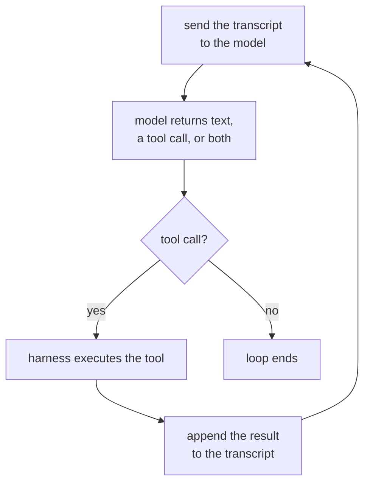

# Leçon 1. La boucle d'agent

**Lien avec la mission :** « Écrire la boucle d'agent pour une tâche donnée, et nommer ce que fait chaque message de son contexte et ce qui met fin à la boucle » est le premier point de la section Objectif, et cela commence par savoir ce qu'est la boucle.
**Source primaire :** [Billet : "Building Effective Agents", Anthropic Engineering](https://www.anthropic.com/engineering/building-effective-agents)
**Prérequis :** aucun

## À savoir

### Ce qui fait d'un système un agent

Un **agent** est un système qui exécute un modèle de langage dans une boucle avec des outils, en laissant le modèle décider quel outil appeler, quand, et quand s'arrêter, au lieu de suivre un chemin que le développeur a fixé à l'avance. Le mot est collé à beaucoup de produits qui n'y correspondent pas : un chatbot sans outils n'est pas un agent, aussi bonnes que soient ses réponses, et un script qui appelle toujours les trois mêmes API dans le même ordre n'est pas un agent, même s'il y ressemble beaucoup vu de l'extérieur. Ce qui tranche, c'est le flux de contrôle : est-ce le modèle qui choisit l'étape suivante, ou un développeur l'a-t-il choisie à l'avance ?

### La boucle, concrètement

En enlevant tout le reste, un agent est ce cycle, répété :

Chaque passage envoie au modèle l'intégralité du transcript jusque-là, reçoit en retour soit une réponse en texte simple, soit une demande d'appel d'outil, exécute cet outil si on en a demandé un, ajoute le résultat, puis recommence. Rien dans ce cycle n'est propre à un fournisseur ou à un framework : c'est ce que « agent » veut dire sous la marque commerciale.

### Qui fait quoi : harness contre modèle

Deux éléments différents travaillent dans ce schéma, et les confondre est à l'origine de beaucoup d'explications confuses sur les agents. Le **harness** est le code qui entoure le modèle : il conserve le transcript, exécute l'appel d'outil qui revient, applique des limites comme un budget de tours, et décide quand la boucle se termine vraiment. Le modèle n'exécute rien lui-même. Il ne peut pas appeler une API de sa propre initiative ; il peut seulement émettre une demande que le harness choisit d'honorer. Le modèle choisit quel outil et avec quels arguments ; le harness décide s'il l'exécute, comment, et ce qu'il a le droit de toucher. Un modèle au excellent jugement derrière un harness sans limites reste une boucle sans bornes, et un harness prudent ne peut pas transformer un mauvais choix d'outil en bon choix.

### Ce qui met fin à la boucle

Une boucle qui ne s'arrête jamais n'est pas utile, donc tout agent a une condition d'arrêt, le plus souvent plusieurs superposées :

1. **Le modèle cesse de demander des outils.** Il renvoie une réponse en texte simple sans appel d'outil, que le harness lit comme « terminé ».
2. **Un budget est épuisé.** Le nombre de tours, le temps réel ou la dépense en tokens atteint une limite que le harness impose, quoi que le modèle veuille faire ensuite.
3. **Un signal d'arrêt explicite.** Certains harness donnent au modèle un outil « finish » dédié, de sorte que l'arrêt est lui-même un appel d'outil délibéré plutôt que l'absence d'un appel.
4. **Un seuil d'erreurs.** Après assez d'échecs d'outils consécutifs, le harness abandonne plutôt que de laisser le modèle se débattre indéfiniment.

La première est la décision du modèle ; les autres sont le harness qui passe outre le modèle. Une trajectoire qui tourne indéfiniment sans produire de réponse est presque toujours celle d'un harness qui n'a implémenté que la première.

## Pratique

1. ▢ Un système de support client lit un message, le classe dans l'une de trois catégories fixes, et appelle toujours en réponse la même API propre à la catégorie, quoi que le modèle lui-même aurait choisi de faire. Est-ce un agent ? Dites pourquoi, ou pourquoi pas.

Vérifier

Non. La séquence d'étapes a été fixée à l'avance par le développeur ; la classification du modèle choisit une branche, mais il ne choisit jamais quel outil appeler ni s'il faut en appeler un. C'est un workflow dans lequel un modèle est intégré, pas un agent. Le test porte sur le flux de contrôle, pas sur la présence d'un modèle quelque part.

2. ▢ Mettez dans l'ordre les quatre étapes de la boucle d'agent : (a) le harness exécute l'outil demandé, (b) le transcript est envoyé au modèle, (c) le résultat de l'outil est ajouté au transcript, (d) le modèle renvoie un appel d'outil.

Vérifier

b, d, a, c : on envoie le transcript, le modèle répond par un appel d'outil, le harness l'exécute, le résultat est ajouté, et le cycle reprend à partir de b.

3. ▢ Laquelle de ces propositions décrit le mieux le rôle du harness ?

    - a) Décider quel outil l'agent doit appeler ensuite
    - b) Conserver le transcript, exécuter les appels d'outils et appliquer des limites que le modèle ne peut pas contourner
    - c) Générer la réponse en langage naturel que lit l'utilisateur
    - d) Choisir la formulation de la description de chaque outil

Indice

Le modèle décide ce qu'il demande. La question porte sur ce qui se passe après sa demande.

Vérifier

**b)** Conserver le transcript, exécuter les appels d'outils et appliquer des limites que le modèle ne peut pas contourner. (a) relève du modèle, pas du harness. (c) est aussi une sortie du modèle, pas quelque chose que produit le harness. (d) est une décision de conception prise avant que la boucle ne tourne, pas quelque chose que le harness fait à l'exécution.

4. ▢ Une trace montre douze tours, chacun composé d'un appel d'outil et d'un résultat, et se termine par un treizième tour en texte simple sans appel d'outil. Qu'est-ce qui a mis fin à cette boucle, et de qui était la décision ?

Vérifier

Le modèle a cessé de demander un outil : il a renvoyé une réponse sans plus rien à exécuter, et le harness a lu cette absence comme « terminé ». C'est la décision du modèle, pas un budget ou un seuil d'erreurs qui coupe la boucle de l'extérieur.

## Exercices en situation réelle

- [ ] Choisissez un produit estampillé IA que vous utilisez régulièrement. Décidez, avec le test du flux de contrôle de cette leçon, s'il s'agit réellement d'un agent, d'un workflow avec un modèle à l'intérieur, ou d'un prompt unique sans aucune boucle. Écrivez votre raisonnement en une phrase.
- [ ] Trouvez la documentation d'un assistant de code agentique ou d'un produit similaire. Listez toutes les conditions d'arrêt qu'elle mentionne, et marquez lesquelles sont la décision du modèle et lesquelles sont le harness qui passe outre.
- [ ] Demain : si vous avez accès à une trace ou à un log d'un agent en exécution (le log de session d'un assistant de code suffit), parcourez-le tour par tour et étiquetez chacun : appel du modèle, exécution d'un outil ou résultat ajouté. Notez où la boucle s'est terminée et pourquoi.

## Pour aller plus loin

- [Billet : "Building Effective Agents", Anthropic Engineering](https://www.anthropic.com/engineering/building-effective-agents)
- [Ressources](../RESOURCES.md)

---

Ça ne passe pas ? Relisez la source primaire en haut de page, car cette leçon la condense et c'est dans la condensation que la compréhension s'échappe. Consultez le [glossaire](../GLOSSARY.md) pour tout terme qui vous a paru glissant.

Si c'est la leçon elle-même qui n'est pas claire plutôt que la matière, c'est un défaut : [ouvrez une issue](https://github.com/TokenCemetery/teach/issues).
