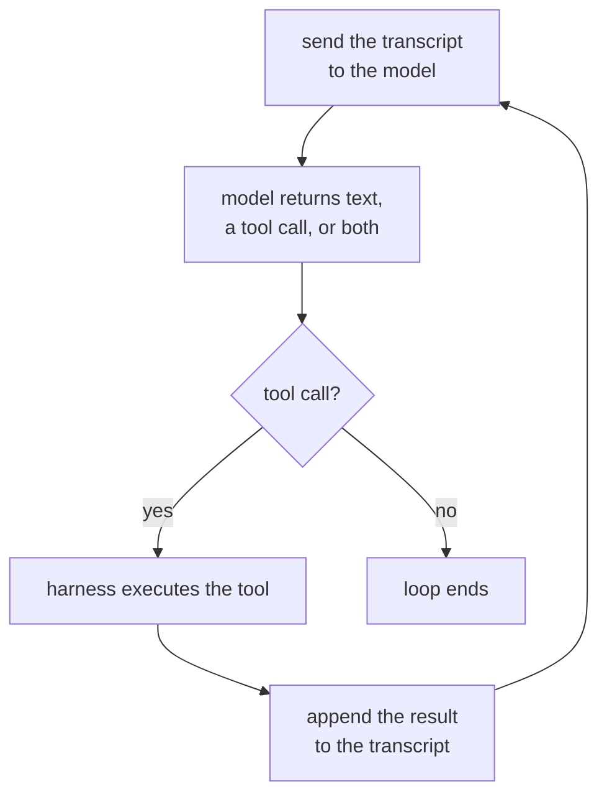

# पाठ 1. Agent Loop

**मिशन से संबंध:** "किसी दिए गए task के लिए agent loop लिखें, और बताएँ कि उसके context का हर message क्या कर रहा है और loop को क्या ख़त्म करता है" सफलता कैसी दिखती है के तहत पहला बिंदु है, और इसकी शुरुआत यह जानने से होती है कि loop असल में है क्या।
**मुख्य स्रोत:** [लेख: "Building Effective Agents", Anthropic Engineering](https://www.anthropic.com/engineering/building-effective-agents)
**पूर्व-आवश्यकताएँ:** कोई नहीं

## यह जानें

### कोई चीज़ agent कब बनती है

**Agent** ऐसा system है जो language model को tools के साथ एक loop में चलाता है, और model को तय करने देता है कि कौन-सा tool कब call करना है और कब रुकना है, बजाय इसके कि वह developer के पहले से तय किए रास्ते पर चले। यह शब्द बहुत-से ऐसे products पर चिपका दिया जाता है जो इस पर खरे नहीं उतरते: tools के बिना chatbot agent नहीं है, चाहे उसके जवाब कितने भी अच्छे हों, और जो script हमेशा वही तीन APIs उसी क्रम में call करती है वह agent नहीं है, चाहे बाहर से वह कितनी भी वैसी दिखे। फ़ैसला control flow से होता है: अगला चरण model चुनता है, या developer ने उसे पहले से चुन रखा था?

### Loop, ठोस रूप में

बाक़ी सब हटा दें तो agent बस यही चक्र है, जो दोहराया जाता है:

हर बार अब तक का पूरा transcript model को भेजा जाता है, बदले में या सादा उत्तर आता है या tool call करने का अनुरोध, अनुरोध हो तो वह tool चलाया जाता है, नतीजा जोड़ा जाता है, और चक्र फिर घूमता है। इस चक्र में कुछ भी किसी एक provider या framework के लिए ख़ास नहीं है: branding के नीचे "agent" का यही मतलब है।

### कौन क्या करता है: harness बनाम model

उस चित्र में दो अलग चीज़ें काम कर रही हैं, और इन्हें मिला देना ही agent की कई उलझी हुई व्याख्याओं की जड़ है। **Harness** model के आसपास का code है: वह transcript रखता है, जो भी tool call लौटे उसे चलाता है, turn budget जैसी सीमाएँ लागू करता है, और तय करता है कि loop सच में कब ख़त्म हो। Model ख़ुद कुछ execute नहीं करता। वह बाहर हाथ बढ़ाकर API call नहीं कर सकता; वह सिर्फ़ ऐसा अनुरोध भेज सकता है जिसे harness मानना चाहे तो माने। Model चुनता है कि कौन-सा tool और कौन-से arguments; harness तय करता है कि उसे चलाना है या नहीं, कैसे चलाना है, और वह क्या छू सकता है। बहुत अच्छे विवेक वाला model बिना सीमाओं वाले harness के पीछे भी असीमित loop ही है, और सतर्क harness बुरे tool चुनाव को अच्छा नहीं बना सकता।

### Loop को क्या रोकता है

कभी न रुकने वाला loop किसी काम का नहीं, इसलिए हर agent की एक stopping condition होती है, आमतौर पर एक से ज़्यादा, परत-दर-परत:

1. **Model tools माँगना बंद कर दे।** वह बिना tool call के सादा text उत्तर लौटाता है, जिसे harness "हो गया" पढ़ता है।
2. **Budget ख़त्म हो जाए।** Turn की गिनती, wall-clock समय या token ख़र्च उस सीमा को छू लेता है जिसे harness लागू करता है, चाहे model आगे कुछ भी चाहे।
3. **स्पष्ट stop संकेत।** कुछ harnesses model को समर्पित "finish" tool देते हैं, इसलिए रुकना ख़ुद एक सोची-समझी tool call है, न कि किसी call की ग़ैरमौजूदगी।
4. **Error की सीमा।** लगातार इतनी tool विफलताएँ हो जाएँ तो harness हार मान लेता है, बजाय इसके कि model को अनिश्चित काल तक छटपटाने दे।

पहला model का फ़ैसला है; बाक़ी harness का model को override करना है। जो trajectory बिना उत्तर दिए हमेशा चलती रहे, वह लगभग हमेशा ऐसे harness की है जिसने सिर्फ़ पहला लागू किया था।

## अभ्यास

1. ▢ एक customer support system message पढ़ता है, उसे तीन तय श्रेणियों में से एक में वर्गीकृत करता है, और जवाब में हमेशा उसी श्रेणी की ख़ास API call करता है, चाहे model ख़ुद कुछ भी करना चुनता। क्या यह agent है? कारण बताएँ कि क्यों या क्यों नहीं।

जाँचें

नहीं। चरणों का क्रम developer ने पहले से तय किया था; model का वर्गीकरण एक branch चुनता है, पर वह कभी नहीं चुनता कि कौन-सा tool call करना है या call करना भी है या नहीं। यह ऐसा workflow है जिसमें model जड़ा हुआ है, agent नहीं। कसौटी control flow है, यह नहीं कि कहीं न कहीं model शामिल है।

2. ▢ Agent loop के चार चरण क्रम में रखें: (a) harness माँगा हुआ tool चलाता है, (b) transcript model को भेजा जाता है, (c) tool का नतीजा transcript में जोड़ा जाता है, (d) model tool call लौटाता है।

जाँचें

b, d, a, c: transcript भेजें, model tool call के साथ जवाब दे, harness उसे चलाए, नतीजा जोड़ा जाए, और चक्र फिर b से दोहराया जाए।

3. ▢ इनमें से कौन-सा harness के काम का सबसे अच्छा वर्णन है?

    - a) यह तय करना कि agent को अगला कौन-सा tool call करना चाहिए
    - b) Transcript रखना, tool calls चलाना, और ऐसी सीमाएँ लागू करना जिन्हें model override नहीं कर सकता
    - c) वह प्राकृतिक भाषा का उत्तर बनाना जो उपयोगकर्ता पढ़ता है
    - d) हर tool के विवरण के शब्द चुनना

संकेत

Model तय करता है कि क्या माँगना है। सवाल इस बारे में है कि माँगने के बाद क्या होता है।

जाँचें

**b)** Transcript रखना, tool calls चलाना, और ऐसी सीमाएँ लागू करना जिन्हें model override नहीं कर सकता। (a) model का काम है, harness का नहीं। (c) भी model का output है, harness उसे नहीं बनाता। (d) loop चलने से पहले लिया गया डिज़ाइन का फ़ैसला है, harness का run के समय का काम नहीं।

4. ▢ एक trace में बारह turns दिखते हैं, हर एक tool call और नतीजा, और तेरहवाँ turn बिना tool call का सादा text है जिस पर trace ख़त्म होती है। इस loop को किसने ख़त्म किया, और यह फ़ैसला किसका था?

जाँचें

Model ने tool माँगना बंद कर दिया: उसने उत्तर लौटाया जिसमें चलाने को कुछ बचा नहीं था, इसलिए harness ने उस कमी को "हो गया" पढ़ा। यह model का फ़ैसला है, किसी budget या error सीमा का नहीं जिसने loop को बाहर से काट दिया हो।

## असली दुनिया का अभ्यास

- [ ] एक AI-ब्रांड वाला product चुनें जिसे आप नियमित इस्तेमाल करते हैं। इस पाठ की control-flow कसौटी से तय करें कि वह असल में agent है, model वाला workflow है, या बिना किसी loop का एक अकेला prompt। अपना तर्क एक वाक्य में लिखें।
- [ ] किसी agentic coding assistant या वैसे ही product के tool का दस्तावेज़ ढूँढें। उसमें बताई हर stopping condition की सूची बनाएँ, और चिह्नित करें कि कौन-सी model का फ़ैसला है और कौन-सी harness का उसे override करना।
- [ ] कल: अगर आपके पास किसी चलते agent का trace या log है (coding assistant का session log काफ़ी है), तो उसे turn-दर-turn देखें और हर एक को लेबल करें: model call, tool execution, या नतीजा जोड़ा गया। नोट करें कि loop कहाँ और क्यों ख़त्म हुआ।

## आगे बढ़ने के लिए

- [लेख: "Building Effective Agents", Anthropic Engineering](https://www.anthropic.com/engineering/building-effective-agents)
- [संसाधन](../RESOURCES.md)

---

बात नहीं बन रही? ऊपर दिए primary source को दोबारा पढ़ें, क्योंकि यह पाठ उसे संक्षिप्त करता है और समझ संक्षेप में ही रिसती है। जो शब्द फिसलन भरा लगे, उसके लिए [शब्दावली](../GLOSSARY.md) देखें।

अगर दिक़्क़त सामग्री की नहीं बल्कि पाठ की ही है, तो वह एक खोट है: [issue खोलें](https://github.com/TokenCemetery/teach/issues)।
