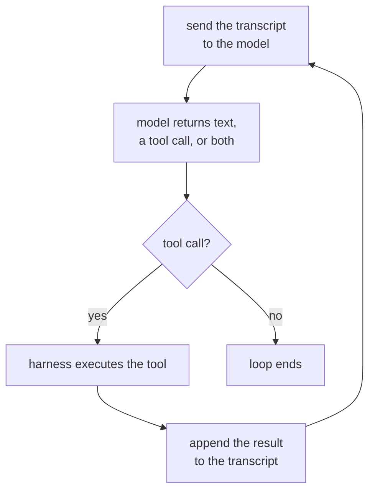

# Lição 1. O loop do agente

**Ligação com a missão:** "Escrever o loop de agente para uma tarefa dada e nomear o que cada mensagem do contexto está fazendo e o que encerra o loop" é o primeiro item de O sucesso se parece com isto, e começa por saber o que é o loop, afinal.
**Fonte principal:** [Article: "Building Effective Agents", Anthropic Engineering](https://www.anthropic.com/engineering/building-effective-agents)
**Pré-requisitos:** nenhum

## Saiba isto

### O que faz de algo um agente

Um **agente** é um sistema que executa um modelo de linguagem em um loop com ferramentas, deixando que o modelo decida qual ferramenta chamar, quando chamá-la e quando parar, em vez de seguir um caminho que o desenvolvedor fixou de antemão. A palavra é aplicada a muitos produtos que não se encaixam nisso: um chatbot sem ferramentas não é um agente, por melhores que sejam suas respostas, e um script que sempre chama as mesmas três APIs na mesma ordem não é um agente, por mais que pareça um visto de fora. O que decide é o fluxo de controle: o modelo escolhe o próximo passo, ou um desenvolvedor o escolheu de antemão?

### O loop, concretamente

Tire tudo o mais e um agente é este ciclo, repetido:

Cada passada envia ao modelo a transcrição inteira até ali, recebe de volta uma resposta simples ou um pedido para chamar uma ferramenta, executa essa ferramenta se uma foi solicitada, anexa o resultado e dá outra volta. Nada nesse ciclo é específico de um provedor ou de um framework: é isso que "agente" significa por baixo da marca.

### Quem faz o quê: harness contra modelo

Duas coisas diferentes estão trabalhando nesse diagrama, e confundi-las é de onde vêm muitas explicações confusas sobre agentes. O **harness** é o código ao redor do modelo: ele guarda a transcrição, executa a chamada de ferramenta que voltar, impõe limites como um orçamento de turnos e decide quando o loop de fato termina. O modelo não executa nada por conta própria. Ele não consegue sair e chamar uma API; só consegue emitir um pedido que o harness escolhe atender. O modelo escolhe qual ferramenta e quais argumentos; o harness decide se vai executá-la, como e com o que ela pode mexer. Um modelo com excelente julgamento por trás de um harness sem limites continua sendo um loop sem limites, e um harness cauteloso não consegue transformar uma má escolha de ferramenta em uma boa.

### O que encerra o loop

Um loop que nunca para não serve, então todo agente tem uma condição de parada, em geral mais de uma combinadas em camadas:

1. **O modelo para de pedir ferramentas.** Ele devolve uma resposta em texto simples, sem chamada de ferramenta, que o harness lê como "terminado".
2. **Um orçamento se esgota.** A contagem de turnos, o tempo de relógio ou o gasto de tokens atinge um limite que o harness impõe, não importa o que o modelo queira em seguida.
3. **Um sinal explícito de parada.** Alguns harnesses dão ao modelo uma ferramenta dedicada de "finalizar", de modo que parar é, em si, uma chamada de ferramenta deliberada, e não a ausência de uma.
4. **Um limite de erros.** Falhas de ferramenta consecutivas em número suficiente, e o harness desiste em vez de deixar o modelo se debater indefinidamente.

A primeira é decisão do modelo; as demais são o harness sobrepondo-se ao modelo. Uma trajetória que roda para sempre sem produzir uma resposta é quase sempre um harness que implementou só a primeira.

## Prática

1. ▢ Um sistema de suporte ao cliente lê uma mensagem, a classifica em uma de três categorias fixas e sempre chama, em resposta, a API específica daquela categoria, independentemente do que o próprio modelo teria escolhido fazer. Isso é um agente? Diga por que sim ou por que não.

Verificação

Não. A sequência de passos foi fixada de antemão pelo desenvolvedor; a classificação do modelo escolhe um ramo, mas ele nunca escolhe qual ferramenta chamar nem se vai chamar alguma. Isso é um workflow com um modelo embutido, não um agente. O teste é o fluxo de controle, e não haver um modelo envolvido em algum ponto.

2. ▢ Coloque em ordem os quatro passos do loop do agente: (a) o harness executa a ferramenta solicitada, (b) a transcrição é enviada ao modelo, (c) o resultado da ferramenta é anexado à transcrição, (d) o modelo devolve uma chamada de ferramenta.

Verificação

b, d, a, c: envia-se a transcrição, o modelo responde com uma chamada de ferramenta, o harness a executa, o resultado é anexado e o ciclo recomeça em b.

3. ▢ Qual destas descreve melhor o trabalho do harness?

    - a) Decidir qual ferramenta o agente deve chamar em seguida
    - b) Guardar a transcrição, executar as chamadas de ferramenta e impor limites que o modelo não pode sobrepor
    - c) Gerar a resposta em linguagem natural que o usuário lê
    - d) Escolher a redação da descrição de cada ferramenta

Dica

O modelo decide o que pedir. A pergunta é sobre o que acontece depois que ele pede.

Verificação

**b)** Guardar a transcrição, executar as chamadas de ferramenta e impor limites que o modelo não pode sobrepor. (a) é trabalho do modelo, não do harness. (c) também é saída do modelo, não algo que o harness produz. (d) é uma decisão de projeto tomada antes de o loop sequer rodar, não algo que o harness faz em tempo de execução.

4. ▢ Um trace mostra doze turnos, cada um com uma chamada de ferramenta e um resultado, terminando em um décimo terceiro turno que é texto simples, sem chamada de ferramenta. O que encerrou esse loop, e de quem foi a decisão?

Verificação

O modelo parou de pedir uma ferramenta: devolveu uma resposta sem nada mais a executar, então o harness leu essa ausência como "terminado". Essa é a decisão do modelo, e não um orçamento ou um limite de erros cortando o loop de fora.

## Prática no mundo real

- [ ] Escolha um produto com marca de IA que você usa com regularidade. Decida, usando o teste de fluxo de controle desta lição, se ele é de fato um agente, um workflow com um modelo dentro ou um único prompt sem loop algum. Escreva seu raciocínio em uma frase.
- [ ] Encontre a documentação de uma ferramenta de um assistente de código agêntico ou produto semelhante. Liste toda condição de parada que ela menciona e marque quais são decisão do modelo e quais são o harness sobrepondo-se a ele.
- [ ] Amanhã: se você tem acesso a um trace ou log de um agente em execução (o log de sessão de um assistente de código basta), percorra-o turno a turno e rotule cada um: chamada ao modelo, execução de ferramenta ou resultado anexado. Anote onde o loop terminou e por quê.

## Para ir além

- [Article: "Building Effective Agents", Anthropic Engineering](https://www.anthropic.com/engineering/building-effective-agents)
- [Recursos](../RESOURCES.md)

---

Não ficou claro? Releia a fonte principal no topo, já que esta lição a comprime e é na compressão que o entendimento escapa. Consulte o [glossário](../GLOSSARY.md) para qualquer termo que pareceu escorregadio.

Se o problema é a lição em si, e não o material, isso é um defeito: [abra uma issue](https://github.com/TokenCemetery/teach/issues).
