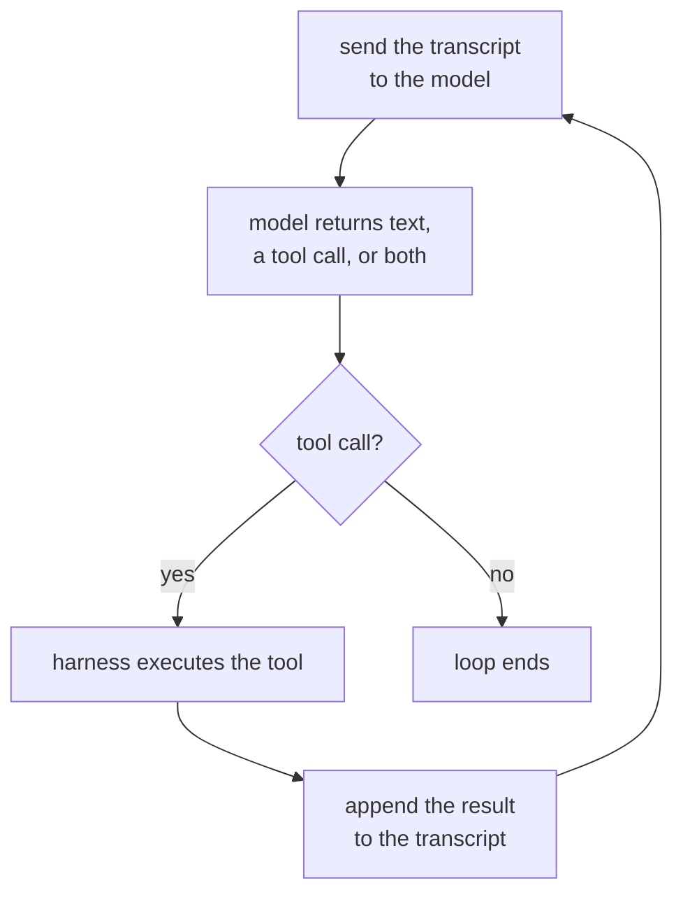

# Урок 1. Цикл агента

**Связь с целью курса:** «Напишите цикл агента для поставленной задачи и назовите, что делает каждое сообщение в его контексте и что завершает цикл» это первый пункт раздела «Каким выглядит результат», и начинается он с понимания того, что вообще такое цикл.
**Первоисточник:** [Статья: "Building Effective Agents", Anthropic Engineering](https://www.anthropic.com/engineering/building-effective-agents)
**Предварительные требования:** нет

## Что нужно знать

### Что делает систему агентом

**Агент** это система, которая запускает языковую модель в цикле с инструментами и позволяет модели решать, какой инструмент вызвать, когда и когда остановиться, вместо того чтобы идти по пути, заранее заданному разработчиком. Это слово навешивают на множество продуктов, которым оно не подходит: чат-бот без инструментов не агент, как бы хороши ни были его ответы, а скрипт, который всегда вызывает одни и те же три API в одном и том же порядке, не агент, как бы он ни походил на него снаружи. Решает поток управления: следующий шаг выбирает модель или его заранее выбрал разработчик?

### Цикл на практике

Отбросьте всё остальное, и агент окажется вот этим циклом, повторяемым снова и снова:

Каждый проход отправляет модели весь транскрипт на данный момент, получает обратно либо обычный ответ, либо запрос вызвать инструмент, выполняет этот инструмент, если он был запрошен, добавляет результат и идёт на новый круг. Ничто в этом цикле не привязано к конкретному провайдеру или фреймворку: именно это означает «агент» под любым брендингом.

### Кто что делает: обвязка и модель

На этой схеме работают две разные сущности, и их смешение порождает множество путаных объяснений про агентов. **Обвязка** (harness) это код вокруг модели: она хранит транскрипт, исполняет пришедший в ответ вызов инструмента, обеспечивает лимиты вроде бюджета ходов и решает, когда цикл действительно заканчивается. Сама модель ничего не исполняет. Она не может дотянуться и вызвать API, а может лишь выдать запрос, который обвязка решает выполнить. Модель выбирает, какой инструмент и с какими аргументами; обвязка решает, запускать ли его, как и до чего ему разрешено дотрагиваться. Модель с превосходным суждением за обвязкой без лимитов всё равно остаётся неограниченным циклом, а осторожная обвязка не может превратить плохой выбор инструмента в хороший.

### Что завершает цикл

Цикл, который никогда не останавливается, бесполезен, поэтому у каждого агента есть условие остановки, обычно несколько наложенных друг на друга:

1. **Модель перестаёт просить инструменты.** Она возвращает ответ обычным текстом без вызова инструмента, и обвязка читает это как «готово».
2. **Исчерпан бюджет.** Число ходов, реальное время или расход токенов упирается в лимит, который обвязка обеспечивает независимо от того, чего модель хочет дальше.
3. **Явный сигнал остановки.** Некоторые обвязки дают модели специальный инструмент «завершить», так что остановка сама становится осознанным вызовом инструмента, а не отсутствием вызова.
4. **Порог ошибок.** После достаточного числа подряд идущих сбоев инструментов обвязка сдаётся, а не позволяет модели бесконечно барахтаться.

Первое это решение модели; остальные это обвязка, переопределяющая модель. Траектория, которая идёт вечно и не выдаёт ответа, почти всегда принадлежит обвязке, реализовавшей только первое условие.

## Практика

1. ▢ Система поддержки клиентов читает сообщение, относит его к одной из трёх фиксированных категорий и в ответ всегда вызывает один и тот же API, специфичный для категории, независимо от того, что сама модель выбрала бы сделать. Это агент? Объясните, почему да или почему нет.

Проверка

Нет. Последовательность шагов заранее зафиксировал разработчик; классификация модели выбирает ветку, но модель никогда не выбирает, какой инструмент вызвать и вызывать ли его вообще. Это воркфлоу со встроенной моделью, а не агент. Критерий это поток управления, а не то, участвует ли где-то модель.

2. ▢ Расположите четыре шага цикла агента по порядку: (a) обвязка исполняет запрошенный инструмент, (b) транскрипт отправляется модели, (c) результат инструмента добавляется в транскрипт, (d) модель возвращает вызов инструмента.

Проверка

b, d, a, c: транскрипт отправляется, модель отвечает вызовом инструмента, обвязка его исполняет, результат добавляется, и цикл повторяется с b.

3. ▢ Что из этого лучше всего описывает работу обвязки?

    - a) Решать, какой инструмент агенту вызвать следующим
    - b) Хранить транскрипт, исполнять вызовы инструментов и обеспечивать лимиты, которые модель не может переопределить
    - c) Генерировать ответ на естественном языке, который читает пользователь
    - d) Выбирать формулировку описания каждого инструмента

Подсказка

Что запросить, решает модель. Вопрос о том, что происходит после запроса.

Проверка

**b)** Хранить транскрипт, исполнять вызовы инструментов и обеспечивать лимиты, которые модель не может переопределить. (a) это работа модели, а не обвязки. (c) тоже вывод модели, а не то, что производит обвязка. (d) это проектное решение, принимаемое до запуска цикла, а не то, что обвязка делает во время работы.

4. ▢ Трассировка показывает двенадцать ходов, каждый из которых вызов инструмента и результат, и заканчивается тринадцатым ходом обычным текстом без вызова инструмента. Что завершило этот цикл и чьё это было решение?

Проверка

Модель перестала просить инструмент: она вернула ответ, исполнять после которого было нечего, и обвязка прочитала это отсутствие как «готово». Это решение модели, а не бюджет или порог ошибок, оборвавшие цикл снаружи.

## Практика в реальной работе

- [ ] Выберите один продукт с пометкой ИИ, которым вы регулярно пользуетесь. Решите по критерию потока управления из этого урока, агент ли он на самом деле, воркфлоу с моделью внутри или одиночный промпт без всякого цикла. Запишите своё рассуждение одним предложением.
- [ ] Найдите документацию инструмента для агентного ассистента по программированию или похожего продукта. Перечислите каждое упомянутое в ней условие остановки и отметьте, какие из них решение модели, а какие обвязка, переопределяющая её.
- [ ] Завтра: если у вас есть доступ к трассировке или логу работающего агента (хватит лога сессии ассистента по программированию), пройдите по нему ход за ходом и пометьте каждый: вызов модели, исполнение инструмента или добавленный результат. Запишите, где цикл закончился и почему.

## Что почитать дальше

- [Статья: "Building Effective Agents", Anthropic Engineering](https://www.anthropic.com/engineering/building-effective-agents)
- [Ресурсы](../RESOURCES.md)

---

Не доходит? Перечитайте первоисточник в начале: этот урок его сжимает, а при сжатии понимание как раз и теряется. Загляните в [глоссарий](../GLOSSARY.md), если какой-то термин показался скользким.

Если неясен сам урок, а не материал, это дефект: [откройте issue](https://github.com/TokenCemetery/teach/issues).
