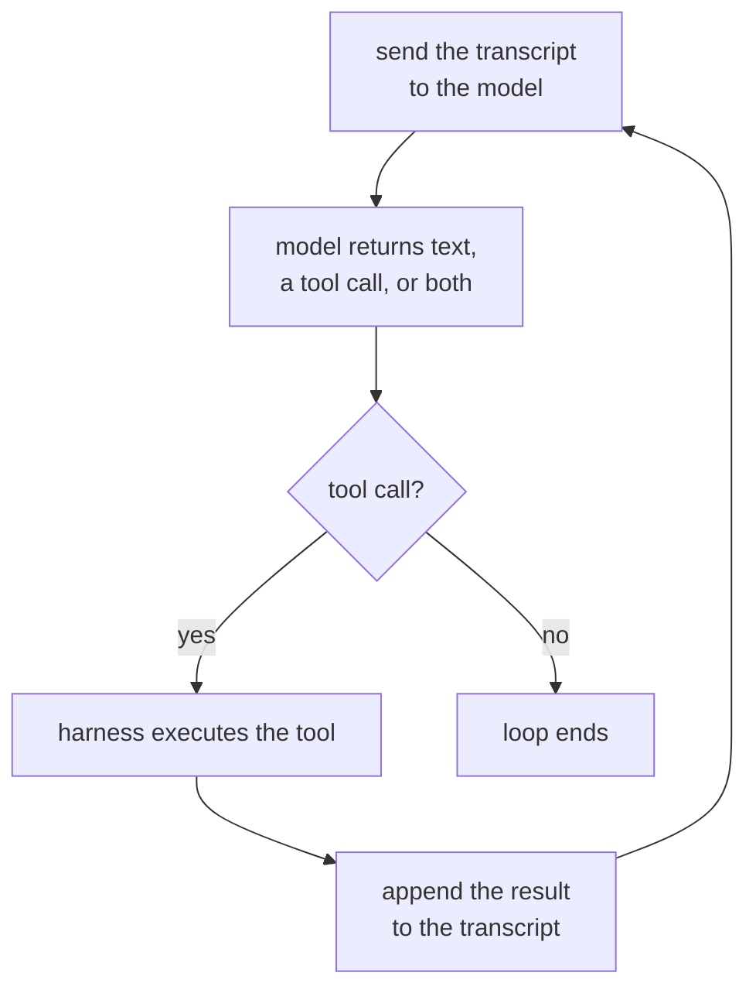

# 第 1 课：智能体循环

**使命关联:** “成功的标准”下的第一条是“为一个给定的任务写出智能体循环，说清上下文里每条消息在做什么，以及什么会让循环结束”，而这要从弄清循环本身是什么开始。
**主要来源:** [文章：“Building Effective Agents”，Anthropic Engineering](https://www.anthropic.com/engineering/building-effective-agents)
**前置知识:** 无

## 要点

### 什么让一个东西成为智能体

**智能体**是在循环中带着工具运行语言模型的系统，由模型决定调用哪个工具、何时调用以及何时停止，而不是沿着开发者预先固定的路径执行。很多产品都被贴上了这个词，却并不符合这个定义：没有工具的聊天机器人，回答再好也不是智能体；一个总是按同样顺序调用同样三个 API 的脚本，从外面看起来再像，也不是智能体。真正起决定作用的是控制流：下一步是由模型选择的，还是由开发者事先选定的？

### 具体的循环

剥掉其余的一切，智能体就是不断重复的这个周期：

每一轮都会把到目前为止的完整对话记录发给模型，得到一个普通的回答，或一个调用工具的请求。如果有工具请求，就执行该工具，追加结果，然后再来一轮。这个周期并不特定于任何服务商或框架：撇开各家品牌的包装，“智能体”说的就是它。

### 谁做什么：运行框架与模型

图中有两个不同的东西在干活，把它们混为一谈，正是很多智能体解释让人困惑的根源。**运行框架**是模型周围的那层代码：它保存对话记录，执行返回的任何工具调用，强制执行轮次预算之类的限制，并决定循环何时真正结束。模型自己不执行任何东西。它无法主动去调用某个 API，只能发出一个请求，由运行框架决定是否照办。模型选择用哪个工具、传什么参数，运行框架则决定是否运行、怎么运行，以及允许它碰什么。判断力再好的模型，如果背后的运行框架没有任何限制，循环依然是没有边界的；而一个谨慎的运行框架，也无法把一次糟糕的工具选择变成好选择。

### 什么让循环结束

一个永不停止的循环没有用处，所以每个智能体都有停止条件，通常是好几个叠加在一起：

1. **模型不再请求工具。** 它返回一段没有工具调用的纯文本回答，运行框架把这当作“完成”。
2. **预算耗尽。** 轮次数、实际耗时或 token 花费触及运行框架强制执行的上限，无论模型接下来想做什么。
3. **明确的停止信号。** 有些运行框架会给模型一个专门的“完成”工具，于是停止本身就是一次有意的工具调用，而不是没有工具调用。
4. **错误阈值。** 连续的工具失败达到一定次数，运行框架就放弃，而不是任由模型无休止地乱撞。

第一种是模型的决定，其余几种都是运行框架在推翻模型。一条一直运行下去却始终没有得出答案的轨迹，几乎总是因为运行框架只实现了第一种。

## 练习

1. ▢ 一个客服系统读取一条消息，把它分到三个固定类别之一，然后无论模型自己会选择怎么做，总是调用与该类别对应的同一个 API。这是智能体吗？说明理由。

检查

不是。步骤的顺序是开发者事先固定的；模型的分类只是选了一条分支，它从未选择调用哪个工具，也从未决定要不要调用工具。这是嵌入了一个模型的工作流，而不是智能体。判断的标准是控制流，而不是某处是否用到了模型。

2. ▢ 把智能体循环的四个步骤按顺序排列：(a) 运行框架执行所请求的工具，(b) 把对话记录发给模型，(c) 把工具结果追加到对话记录，(d) 模型返回一个工具调用。

检查

b、d、a、c：发送对话记录，模型以一个工具调用作答，运行框架执行它，结果被追加，然后从 b 开始重复这个周期。

3. ▢ 下面哪一项最能描述运行框架的工作？

    - a) 决定智能体下一步该调用哪个工具
    - b) 保存对话记录、执行工具调用，并强制执行模型无法推翻的限制
    - c) 生成用户读到的自然语言回答
    - d) 选择每个工具描述的措辞

提示

决定要请求什么的是模型。这道题问的是它请求之后发生什么。

检查

**b)** 保存对话记录、执行工具调用，并强制执行模型无法推翻的限制。(a) 是模型的工作，不是运行框架的。(c) 同样是模型的输出，不是运行框架产生的。(d) 是在循环运行之前就已做出的设计决定，不是运行框架在运行时做的事。

4. ▢ 一条追踪显示有十二轮，每一轮都是一次工具调用和一个结果，到第十三轮是没有工具调用的纯文本。是什么让这个循环结束的，这是谁的决定？

检查

是模型不再请求工具：它返回了一个回答，没有任何东西需要执行，所以运行框架把这种没有当作“完成”。这是模型的决定，而不是预算或错误阈值从外部切断了循环。

## 实战练习

- [ ] 挑一个你经常用的、带 AI 名头的产品。用本课的控制流判断标准，判断它究竟是智能体、内嵌了模型的工作流，还是根本没有循环的单个提示词。用一句话写下你的理由。
- [ ] 找一份智能体式编程助手或类似产品的工具文档。列出它提到的每一个停止条件，并标出哪些是模型的决定，哪些是运行框架在推翻模型。
- [ ] 明天：如果你能拿到某个正在运行的智能体的追踪或日志（编程助手的会话日志就够了），逐轮走一遍，并给每一轮打上标签：模型调用、工具执行，或结果被追加。记下循环在哪里、因为什么而结束。

## 延伸阅读

- [文章：“Building Effective Agents”，Anthropic Engineering](https://www.anthropic.com/engineering/building-effective-agents)
- [资源](../RESOURCES.md)

---

没学明白？请重读顶部的主要来源，因为本课是对它的压缩，而理解正是在压缩中流失的。如果有哪个术语觉得含糊，可以查看[术语表](../GLOSSARY.md)。

如果问题出在课程本身，而不是学习材料，那就是一个缺陷：[提交 issue](https://github.com/TokenCemetery/teach/issues)。
