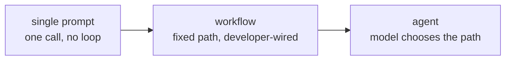

# Lección 2. Agente, flujo de trabajo o solo un prompt

**Vínculo con la misión:** "Elegir entre un solo prompt, un flujo de trabajo fijo y un agente para una tarea dada, y defender la elección frente al costo de la opción rechazada" es el segundo punto de Cómo se ve el éxito.
**Fuente principal:** [Article: "Building Effective Agents", Anthropic Engineering](https://www.anthropic.com/engineering/building-effective-agents)
**Requisitos previos:** [Lección 1](0001-the-agent-loop.md), [Agente](../GLOSSARY.md), [Flujo de trabajo](../GLOSSARY.md)

## Calentamiento

1. ▢ Nombra los cuatro pasos del bucle del agente, en orden.

Comprobación

Se envía la transcripción al modelo, el modelo devuelve una llamada a herramienta, el harness la ejecuta, el resultado se añade a la transcripción y el ciclo se repite.

2. ▢ Un sistema siempre llama a las mismas tres APIs en el mismo orden, sin importar lo que habría elegido un modelo incrustado en él. ¿Agente o no?

Comprobación

No es un agente. El desarrollador fijó el flujo de control de antemano; el modelo aún puede hacer un trabajo útil dentro de uno de esos pasos, pero nunca elige el camino.

## Qué debes saber

### El espectro, no un binario

La lección 1 trazó una línea dura entre agente y no agente según el flujo de control. En la práctica, "no es un agente" abarca un rango amplio, desde un único prompt sin estructura hasta sistemas realmente elaborados que siguen siendo caminos fijos. Tres puntos que vale la pena nombrar en este **espectro de autonomía**:

- **Un solo prompt.** Una llamada al modelo, una respuesta. Sin bucle, sin herramientas, nada que orquestar.
- **Un flujo de trabajo.** Una secuencia de llamadas al modelo y a herramientas fijada por el desarrollador. Puede bifurcarse, hacer bucles y llamar al modelo más de una vez, y puede parecer sofisticado: encadenamiento de prompts (la salida de una llamada alimenta la siguiente), enrutamiento (clasificar y luego despachar a un camino especializado), paralelización, orquestador-workers, bucles evaluador-optimizador. Cada uno de ellos sigue siendo un flujo de trabajo, porque el desarrollador cableó los caminos entre las llamadas; el modelo rellena contenido, no estructura.
- **Un agente.** El propio modelo elige el siguiente paso, incluido si hay un siguiente paso. El flujo de control lo decide el modelo en tiempo de ejecución, dentro del límite que imponga el harness.

Moverse hacia la derecha compra flexibilidad para tareas cuya forma no se puede predecir de antemano. Cuesta previsibilidad: un flujo de trabajo hace lo mismo con la misma entrada cada vez, y un agente no tiene por qué hacerlo.

### El argumento a favor de quedarse a la izquierda

El argumento central de la fuente principal no es "usa agentes". Es: encuentra la solución más simple que funcione, y aumenta la complejidad solo cuando mejore de forma demostrable los resultados en las tareas que importan. Un flujo de trabajo, incluso uno elaborado construido con los patrones de arriba, te da un sistema cuyo comportamiento puedes predecir, probar con casos fijos y razonar sin verlo correr. Un agente renuncia a esa previsibilidad a cambio de manejar entradas que el autor del flujo de trabajo no anticipó. Si la forma de la tarea es conocida y estable, ese intercambio no compra nada y cuesta fiabilidad.

### Cuándo vale la pena el intercambio

Un agente se gana su imprevisibilidad cuando el número de caminos que necesitaría un flujo de trabajo empieza a explotar, o cuando el camino correcto realmente no se puede conocer hasta que la tarea está en marcha: una investigación abierta donde la siguiente consulta depende de lo que devolvió la anterior, una tarea de programación donde el archivo correcto que mirar a continuación depende de lo que dijo el último archivo, un ticket de soporte cuya ruta de resolución se bifurca según detalles que ningún clasificador fijo separará con limpieza. La señal no es "esta tarea es difícil". Es "el número de ramas que un flujo de trabajo necesitaría para cubrir esto no tiene límite, o la rama depende de información que solo está disponible a mitad de la tarea".

### Defender la elección

Nombrar una elección no es lo mismo que defenderla. Una respuesta defendible nombra lo que habría costado la opción rechazada: "aquí un flujo de trabajo necesitaría una rama por tipo de documento, y llegan tipos nuevos cada semana, así que la flexibilidad de un agente vale su imprevisibilidad" defiende un agente. "Esta tarea siempre toca los mismos cuatro sistemas en el mismo orden, así que un agente no compra nada que un flujo de trabajo no me dé ya, al costo de una ejecución que quizá haga algo distinto la próxima vez" defiende un flujo de trabajo. Cualquier respuesta que se salte el costo de la opción rechazada todavía no es una defensa.

## Práctica

1. ▢ Un generador de informes semanales extrae las mismas cinco métricas de los mismos dos sistemas, las formatea igual y las envía por correo a los mismos destinatarios, cada semana sin excepción. ¿Dónde se ubica esto en el espectro de autonomía y por qué?

Comprobación

Un flujo de trabajo, probablemente uno que ni siquiera necesita un modelo en tiempo de ejecución más allá de dar formato al texto. El camino nunca varía y las entradas se conocen de antemano, así que la capacidad de un agente de elegir un camino distinto en cada ejecución no compra nada y solo añade imprevisibilidad.

2. ▢ ¿Cuál de estas afirmaciones es cierta para un flujo de trabajo construido con el patrón orquestador-workers?

    - a) Es un agente, porque coordina varias llamadas al modelo
    - b) El desarrollador sigue habiendo fijado la secuencia de llamadas de antemano; el modelo rellena contenido dentro de cada paso, no la estructura entre ellos
    - c) Solo califica como flujo de trabajo si usa una única llamada al modelo
    - d) Se convierte en un agente en cuanto usa más de una herramienta

Pista

Vuelve a leer qué significa "flujo de control" en esta lección: quién decidió la secuencia, no cuántas llamadas o herramientas intervienen.

Comprobación

**b)** El desarrollador sigue habiendo fijado la secuencia de llamadas de antemano. (a) y (d) asumen que lo que convierte algo en agente es la complejidad o el número de herramientas, cuando es el flujo de control. (c) es simplemente falsa: un flujo de trabajo puede implicar, y a menudo implica, muchas llamadas al modelo.

3. ▢ Un sistema de soporte necesita resolver tickets que, tras inspeccionarlos, se bifurcan en unos cuarenta caminos de resolución distintos, con categorías nuevas que aparecen cada pocos meses a medida que cambia el producto. Defiende una elección entre un flujo de trabajo y un agente para esto, nombrando lo que habría costado la opción que rechazas.

Comprobación

Un agente es la elección defendible: cuarenta caminos hoy y un conjunto que crece significan que el número de ramas de un flujo de trabajo no tiene límite y requiere mantenimiento continuo cada vez que cambia el producto, que es exactamente el costo de quedarse con un camino fijo aquí. La opción rechazada del flujo de trabajo habría costado un esfuerzo continuo de ingeniería para añadir ramas, y aun así fallaría en silencio con cualquier tipo de ticket que nadie anticipó. El costo del agente, una ejecución imprevisible, es menor que esa carga de mantenimiento para esta tarea.

4. ▢ Un script puntual necesita convertir una sola hoja de cálculo en un PDF con formato, una tarea con exactamente un camino de la entrada a la salida. ¿Sería defendible construir esto como un agente? ¿Por qué sí o por qué no?

Comprobación

No. Un único camino de la entrada a la salida es un flujo de trabajo, o discutiblemente ni siquiera eso: un solo prompt o un script simple hace el trabajo. Un agente añade la capacidad de elegir un camino distinto en cada ejecución, de la que esta tarea no tiene ningún uso, y la variabilidad del bucle es puro costo sin un beneficio correspondiente.

## Prácticas en el mundo real

- [ ] Elige una tarea que tú o tu equipo automaticen hoy. Ubícala en el espectro de autonomía de esta lección y escribe una frase que defienda la ubicación nombrando lo que habría costado la opción de cada lado.
- [ ] Busca la descripción de un producto o una entrada de blog que llame "agente" a algo. Compárala con la prueba del flujo de control: ¿el sistema elige su propio camino, o un desarrollador cableó un flujo de trabajo y lo llamó agente por razones de marketing?
- [ ] Mañana: esboza, en papel o en un documento, el número de ramas que necesitaría un flujo de trabajo para una tarea que consideres digna de un agente. Si puedes enumerar las ramas en menos de diez minutos, reconsidera si necesita ser un agente.

## Para profundizar

- [Article: "Building Effective Agents", Anthropic Engineering](https://www.anthropic.com/engineering/building-effective-agents)
- [Guide: "A Practical Guide to Building Agents", OpenAI](https://cdn.openai.com/business-guides-and-resources/a-practical-guide-to-building-agents.pdf)
- [Recursos](../RESOURCES.md)

---

¿No termina de quedar claro? Vuelve a leer la fuente primaria de arriba, ya que esta lección la comprime y en la compresión es donde se escapa la comprensión. Consulta el [glosario](../GLOSSARY.md) por si algún término te resultó resbaladizo.

Si lo poco claro es la propia lección y no el material, eso es un defecto: [abre un issue](https://github.com/TokenCemetery/teach/issues).
