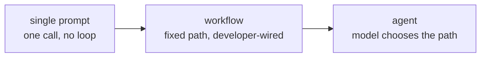

# Leçon 2. Agent, workflow ou simple prompt

**Lien avec la mission :** « Choisir entre un prompt unique, un workflow fixe et un agent pour une tâche donnée, et défendre ce choix face au coût de l'option écartée » est le deuxième point de la section Objectif.
**Source primaire :** [Billet : "Building Effective Agents", Anthropic Engineering](https://www.anthropic.com/engineering/building-effective-agents)
**Prérequis :** [Leçon 1](0001-the-agent-loop.md), [Agent](../GLOSSARY.md), [Workflow](../GLOSSARY.md)

## Échauffement

1. ▢ Nommez dans l'ordre les quatre étapes de la boucle d'agent.

Vérifier

On envoie le transcript au modèle, le modèle renvoie un appel d'outil, le harness l'exécute, le résultat est ajouté au transcript, et le cycle se répète.

2. ▢ Un système appelle toujours les trois mêmes API dans le même ordre, quoi que le modèle qui y est intégré aurait choisi. Agent ou non ?

Vérifier

Ce n'est pas un agent. Le développeur a fixé le flux de contrôle à l'avance ; le modèle peut quand même faire un travail utile à l'intérieur de l'une de ces étapes, mais il ne choisit jamais le chemin.

## À savoir

### Un spectre, pas un choix binaire

La leçon 1 a tracé une ligne nette entre agent et non-agent d'après le flux de contrôle. En pratique, « n'est pas un agent » couvre un large éventail, d'un simple prompt non structuré jusqu'à des systèmes réellement élaborés qui restent des chemins fixes. Trois points méritent d'être nommés sur ce **spectre d'autonomie** :

- **Un prompt unique.** Un appel au modèle, une réponse. Pas de boucle, pas d'outils, rien à orchestrer.
- **Un workflow.** Une séquence d'appels au modèle et d'appels d'outils fixée par le développeur. Il peut se ramifier, boucler et appeler un modèle plus d'une fois, et il peut avoir l'air sophistiqué : prompt chaining (la sortie d'un appel alimente le suivant), routage (classer, puis aiguiller vers un chemin spécialisé), parallélisation, orchestrateur et workers, boucles évaluateur et optimiseur. Chacun reste un workflow, parce que le développeur a câblé les chemins entre les appels ; le modèle remplit le contenu, pas la structure.
- **Un agent.** Le modèle choisit lui-même l'étape suivante, y compris s'il y en a une. Le flux de contrôle est décidé à l'exécution par le modèle, à l'intérieur de la frontière que le harness impose.

Aller vers la droite achète de la flexibilité pour des tâches dont la forme ne peut pas être prévue à l'avance. Cela coûte de la prévisibilité : un workflow fait la même chose sur la même entrée à chaque fois, alors qu'un agent n'y est pas tenu.

### L'argument pour rester à gauche

L'argument central de la source primaire n'est pas « utilisez des agents ». C'est : trouvez la solution la plus simple qui fonctionne, et n'augmentez la complexité que lorsqu'elle améliore de façon démontrable les résultats sur les tâches qui comptent. Un workflow, même élaboré à partir des schémas ci-dessus, vous donne un système dont vous pouvez prévoir le comportement, que vous pouvez tester avec des cas fixes et dont vous pouvez raisonner sans le regarder tourner. Un agent abandonne cette prévisibilité en échange de la capacité à traiter des entrées que l'auteur du workflow n'avait pas anticipées. Si la forme de la tâche est connue et stable, cet échange n'achète rien et coûte de la fiabilité.

### Quand l'échange vaut le coup

Un agent mérite son imprévisibilité quand le nombre de chemins qu'un workflow devrait couvrir se met à exploser, ou quand le bon chemin ne peut vraiment pas être connu avant que la tâche soit en cours : une recherche ouverte où la requête suivante dépend de ce que la précédente a renvoyé, une tâche de code où le prochain fichier à regarder dépend de ce que disait le dernier, un ticket de support dont le chemin de résolution se ramifie selon des détails qu'aucun classifieur fixe ne séparera proprement. Le signe n'est pas « cette tâche est difficile ». C'est « le nombre de branches qu'un workflow devrait couvrir est illimité, ou la branche dépend d'une information disponible seulement en cours de tâche ».

### Défendre le choix

Nommer un choix n'est pas la même chose que le défendre. Une réponse défendable nomme ce que l'option écartée aurait coûté : « un workflow ici aurait besoin d'une branche par type de document, et de nouveaux types arrivent chaque semaine, donc la flexibilité d'un agent vaut son imprévisibilité » défend un agent. « Cette tâche touche toujours les quatre mêmes systèmes dans le même ordre, donc un agent n'achète rien qu'un workflow ne me donne déjà, au prix d'une exécution qui pourrait faire autre chose la prochaine fois » défend un workflow. Toute réponse qui saute le coût de l'option écartée n'est pas encore une défense.

## Pratique

1. ▢ Un générateur de rapport hebdomadaire récupère les mêmes cinq métriques dans les deux mêmes systèmes, les met en forme de la même façon et les envoie aux mêmes destinataires, chaque semaine sans exception. Où cela se situe-t-il sur le spectre d'autonomie, et pourquoi ?

Vérifier

Un workflow, et probablement même pas un qui ait besoin d'un modèle à l'exécution au-delà de la mise en forme du texte. Le chemin ne varie jamais et les entrées sont connues à l'avance, donc la capacité d'un agent à choisir un chemin différent à chaque exécution n'achète rien et n'ajoute que de l'imprévisibilité.

2. ▢ Laquelle de ces propositions est vraie d'un workflow construit sur le schéma orchestrateur et workers ?

    - a) C'est un agent, parce qu'il coordonne plusieurs appels au modèle
    - b) Le développeur a quand même fixé à l'avance la séquence des appels ; le modèle remplit le contenu à l'intérieur de chaque étape, pas la structure entre elles
    - c) Il ne compte comme workflow que s'il utilise un seul appel au modèle
    - d) Il devient un agent dès qu'il utilise plus d'un outil

Indice

Relisez ce que « flux de contrôle » veut dire dans cette leçon : qui a décidé de la séquence, pas combien d'appels ou d'outils sont en jeu.

Vérifier

**b)** Le développeur a quand même fixé à l'avance la séquence des appels. (a) et (d) supposent toutes deux que c'est la complexité ou le nombre d'outils qui fait d'un système un agent, alors que c'est le flux de contrôle. (c) est tout simplement faux : un workflow peut impliquer, et implique souvent, de nombreux appels au modèle.

3. ▢ Un système de support doit résoudre des tickets qui, à l'examen, se ramifient en une quarantaine de chemins de résolution distincts, avec de nouvelles catégories qui apparaissent tous les quelques mois à mesure que le produit évolue. Défendez un choix entre un workflow et un agent pour ce cas, en nommant ce que l'option que vous écartez aurait coûté.

Vérifier

Un agent est le choix défendable : quarante chemins aujourd'hui et un ensemble qui grandit signifient que le nombre de branches d'un workflow est illimité et demande une maintenance continue à chaque évolution du produit, ce qui est exactement le coût de rester sur un chemin fixe ici. L'option workflow écartée aurait coûté un effort d'ingénierie continu pour ajouter des branches, et échouerait quand même silencieusement sur tout type de ticket que personne n'avait anticipé. Le coût de l'agent, une exécution imprévisible, est plus petit que cette charge de maintenance pour cette tâche.

4. ▢ Un script ponctuel doit convertir une seule feuille de calcul en PDF mis en forme, une tâche avec exactement un chemin de l'entrée à la sortie. Construire cela comme un agent serait-il un choix défendable ? Pourquoi, ou pourquoi pas ?

Vérifier

Non. Un chemin unique de l'entrée à la sortie est un workflow, ou même pas : un prompt unique ou un simple script fait le travail. Un agent ajoute la capacité de choisir un chemin différent à chaque exécution, dont cette tâche n'a aucun usage, et la variabilité de la boucle n'est que du coût sans bénéfice correspondant.

## Exercices en situation réelle

- [ ] Choisissez une tâche que vous ou votre équipe automatisez aujourd'hui. Placez-la sur le spectre d'autonomie de cette leçon, et écrivez une phrase qui défend ce placement en nommant ce qu'aurait coûté l'option de chaque côté.
- [ ] Trouvez une description de produit ou un billet de blog qui appelle quelque chose un « agent ». Vérifiez-le avec le test du flux de contrôle : le système choisit-il son propre chemin, ou un développeur a-t-il câblé un workflow et l'a-t-il appelé agent pour des raisons marketing ?
- [ ] Demain : esquissez, sur papier ou dans un document, le nombre de branches qu'un workflow devrait avoir pour une tâche que vous jugez digne d'un agent. Si vous pouvez énumérer les branches en moins de dix minutes, reconsidérez si elle a vraiment besoin d'un agent.

## Pour aller plus loin

- [Billet : "Building Effective Agents", Anthropic Engineering](https://www.anthropic.com/engineering/building-effective-agents)
- [Guide : "A Practical Guide to Building Agents", OpenAI](https://cdn.openai.com/business-guides-and-resources/a-practical-guide-to-building-agents.pdf)
- [Ressources](../RESOURCES.md)

---

Ça ne passe pas ? Relisez la source primaire en haut de page, car cette leçon la condense et c'est dans la condensation que la compréhension s'échappe. Consultez le [glossaire](../GLOSSARY.md) pour tout terme qui vous a paru glissant.

Si c'est la leçon elle-même qui n'est pas claire plutôt que la matière, c'est un défaut : [ouvrez une issue](https://github.com/TokenCemetery/teach/issues).
