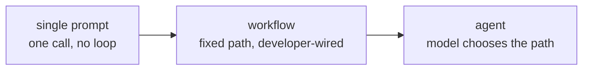

# पाठ 2. Agent, Workflow या सिर्फ़ एक Prompt

**मिशन से संबंध:** "किसी task के लिए एक अकेले prompt, तय workflow और agent में से चुनें, और अपने चुनाव का बचाव उस विकल्प की cost के सामने करें जिसे आपने छोड़ा" सफलता कैसी दिखती है के तहत दूसरा बिंदु है।
**मुख्य स्रोत:** [लेख: "Building Effective Agents", Anthropic Engineering](https://www.anthropic.com/engineering/building-effective-agents)
**पूर्व-आवश्यकताएँ:** [पाठ 1](0001-the-agent-loop.md), [Agent](../GLOSSARY.md), [Workflow](../GLOSSARY.md)

## वार्म-अप

1. ▢ Agent loop के चारों चरण क्रम से बताएँ।

जाँचें

Transcript model को भेजें, model tool call लौटाए, harness उसे चलाए, नतीजा transcript में जोड़ा जाए, और चक्र दोहराया जाए।

2. ▢ एक system हमेशा वही तीन APIs उसी क्रम में call करता है, चाहे उसमें जड़ा model कुछ भी चुनता। Agent है या नहीं?

जाँचें

Agent नहीं। Developer ने control flow पहले से तय कर दिया; model उन चरणों में से किसी के भीतर फिर भी काम का काम कर सकता है, पर रास्ता वह कभी नहीं चुनता।

## यह जानें

### Spectrum, दो में से एक नहीं

पाठ 1 ने control flow के आधार पर agent और not-agent के बीच सख़्त रेखा खींची थी। व्यवहार में "agent नहीं" का दायरा बड़ा है, एक अकेले असंरचित prompt से लेकर सचमुच जटिल systems तक जो फिर भी तय रास्ते हैं। इस **autonomy spectrum** पर तीन बिंदुओं का नाम लेना ठीक है:

- **एक अकेला prompt।** एक model call, एक उत्तर। न loop, न tools, न कुछ orchestrate करने को।
- **एक workflow।** Model और tool calls का developer का तय किया हुआ क्रम। उसमें branches और loops हो सकते हैं, वह model को एक से ज़्यादा बार call कर सकता है, और वह परिष्कृत दिख सकता है: prompt chaining (एक call का output अगली को मिलता है), routing (वर्गीकृत करो, फिर विशेष रास्ते पर भेजो), parallelization, orchestrator-workers, evaluator-optimizer loops। इनमें से हर एक फिर भी workflow है, क्योंकि calls के बीच के रास्ते developer ने जोड़े हैं; model content भरता है, structure नहीं।
- **एक agent।** Model ख़ुद अगला चरण चुनता है, यह भी कि अगला चरण है या नहीं। Control flow का फ़ैसला run के समय model करता है, उस सीमा के भीतर जो harness लागू करता है।

दाईं ओर बढ़ने से उन tasks के लिए लचीलापन मिलता है जिनका आकार पहले से अनुमान नहीं लगाया जा सकता। इसकी क़ीमत पूर्वानुमेयता है: workflow एक ही input पर हर बार वही करता है, और agent को ऐसा करना ज़रूरी नहीं।

### बाईं ओर रहने का तर्क

मुख्य स्रोत की केंद्रीय दलील "agents इस्तेमाल करो" नहीं है। वह यह है: काम करने वाला सबसे सरल समाधान खोजो, और जटिलता तभी बढ़ाओ जब वह उन tasks पर नतीजे सचमुच बेहतर करे जो मायने रखते हैं। Workflow, ऊपर के patterns से बना जटिल workflow भी, आपको ऐसा system देता है जिसका व्यवहार आप भाँप सकते हैं, तय cases से test कर सकते हैं, और उसे चलते देखे बिना उसके बारे में तर्क कर सकते हैं। Agent वह पूर्वानुमेयता छोड़ देता है, बदले में उन inputs को संभालने के लिए जिनका workflow के लेखक ने अनुमान नहीं लगाया था। अगर task का आकार जाना हुआ और स्थिर है, तो वह सौदा कुछ नहीं ख़रीदता और विश्वसनीयता गँवाता है।

### सौदा कब फ़ायदे का है

Agent अपनी अनिश्चितता तब कमाता है जब workflow को जितने रास्ते चाहिए उनकी संख्या फटने लगे, या सही रास्ता task शुरू होने तक सचमुच पता न चल सके: खुला शोध जहाँ अगली query इस पर निर्भर है कि पिछली ने क्या लौटाया, coding task जहाँ अगली कौन-सी file देखनी है यह इस पर निर्भर है कि पिछली file में क्या था, या support ticket जिसका हल उन ब्योरों पर branch करता है जिन्हें कोई तय classifier साफ़-साफ़ अलग नहीं करेगा। संकेत यह नहीं कि "यह task कठिन है।" संकेत यह है कि "इसे कवर करने के लिए workflow को जितनी branches चाहिए उनकी गिनती असीमित है, या branch ऐसी जानकारी पर निर्भर है जो task के बीच में ही मिलती है।"

### चुनाव का बचाव करना

चुनाव का नाम लेना उसका बचाव करना नहीं है। बचाव लायक़ उत्तर बताता है कि छोड़े गए विकल्प की क्या क़ीमत होती: "यहाँ workflow को हर document type के लिए एक branch चाहिए, और नए types हर हफ़्ते आते हैं, इसलिए agent का लचीलापन उसकी अनिश्चितता के लायक़ है" agent का बचाव करता है। "यह task हमेशा उन्हीं चार systems को उसी क्रम में छूता है, इसलिए agent ऐसा कुछ नहीं ख़रीदता जो workflow पहले से मुझे नहीं दे रहा, उल्टे ऐसे run की क़ीमत पर जो अगली बार कुछ और कर सकता है" workflow का बचाव करता है। जो भी उत्तर छोड़े गए विकल्प की क़ीमत छोड़ देता है, वह अभी बचाव नहीं है।

## अभ्यास

1. ▢ एक साप्ताहिक report generator दो ही systems से वही पाँच metrics खींचता है, उन्हें उसी तरह format करता है, और हर हफ़्ते बिना अपवाद उन्हीं लोगों को email करता है। यह autonomy spectrum पर कहाँ बैठता है, और क्यों?

जाँचें

Workflow, और शायद ऐसा भी नहीं जिसे text format करने से आगे run के समय model चाहिए। रास्ता कभी नहीं बदलता और inputs पहले से पता हैं, इसलिए हर run में अलग रास्ता चुनने की agent की क्षमता कुछ नहीं ख़रीदती और सिर्फ़ अनिश्चितता जोड़ती है।

2. ▢ Orchestrator-workers pattern से बने workflow के बारे में इनमें से क्या सच है?

    - a) वह agent है, क्योंकि वह कई model calls का तालमेल बिठाता है
    - b) Calls का क्रम फिर भी developer ने पहले से तय किया है; model हर चरण के भीतर content भरता है, उनके बीच का structure नहीं
    - c) वह workflow तभी कहलाता है जब वह एक ही model call इस्तेमाल करे
    - d) एक से ज़्यादा tool इस्तेमाल करते ही वह agent बन जाता है

संकेत

इस पाठ में "control flow" का मतलब फिर पढ़ें: क्रम किसने तय किया, कितनी calls या tools शामिल हैं यह नहीं।

जाँचें

**b)** Calls का क्रम फिर भी developer ने पहले से तय किया है। (a) और (d) दोनों मानते हैं कि जटिलता या tools की गिनती किसी चीज़ को agent बनाती है, जबकि वह control flow है। (c) बस ग़लत है: workflow में कई model calls हो सकती हैं और अक्सर होती भी हैं।

3. ▢ एक support system को ऐसे tickets हल करने हैं जो जाँचने पर लगभग चालीस अलग हल-रास्तों में branch होते हैं, और product बदलने के साथ हर कुछ महीनों में नई श्रेणियाँ आती हैं। इसके लिए workflow और agent के बीच एक चुनाव का बचाव करें, और बताएँ कि जिस विकल्प को आप छोड़ रहे हैं उसकी क्या क़ीमत होती।

जाँचें

Agent बचाव लायक़ चुनाव है: आज चालीस रास्ते और बढ़ता हुआ सेट मतलब workflow की branches की गिनती असीमित है और product बदलने पर हर बार निरंतर रखरखाव माँगती है, और तय रास्ते पर टिके रहने की यहाँ ठीक यही क़ीमत है। छोड़े गए workflow विकल्प की क़ीमत branches जोड़ने में लगातार engineering मेहनत होती, और फिर भी वह किसी ऐसे ticket type पर चुपचाप फेल होता जिसका किसी ने अनुमान नहीं लगाया। Agent की क़ीमत, यानी अप्रत्याशित run, इस task के लिए उस रखरखाव के बोझ से छोटी है।

4. ▢ एक बार की script को एक spreadsheet को format किए हुए PDF में बदलना है, ऐसा task जिसमें input से output तक बिल्कुल एक ही रास्ता है। क्या इसे agent के रूप में बनाना बचाव लायक़ चुनाव होगा? क्यों या क्यों नहीं?

जाँचें

नहीं। Input से output तक एक ही रास्ता workflow है, या शायद वह भी नहीं: एक अकेला prompt या सादी script काम कर देती है। Agent हर run में अलग रास्ता चुनने की क्षमता जोड़ता है, जिसका इस task में कोई उपयोग नहीं, और loop की परिवर्तनशीलता बिना किसी बदले के फ़ायदे के सिर्फ़ क़ीमत है।

## असली दुनिया का अभ्यास

- [ ] कोई ऐसा task चुनें जिसे आप या आपकी टीम आज automate करती है। उसे इस पाठ के autonomy spectrum पर रखें, और यह बताकर कि दोनों ओर के विकल्प की क्या क़ीमत होती, उस जगह का बचाव एक वाक्य में लिखें।
- [ ] कोई product विवरण या blog post खोजें जो किसी चीज़ को "agent" कहता है। उसे control-flow कसौटी पर जाँचें: क्या system अपना रास्ता ख़ुद चुनता है, या developer ने workflow जोड़ा और marketing के कारणों से उसे agent कह दिया?
- [ ] कल: किसी ऐसे task के लिए जिसे आप agent के लायक़ मानते हैं, काग़ज़ या doc में खींचें कि workflow को कितनी branches चाहिए होतीं। अगर आप दस मिनट से कम में branches गिन सकते हैं, तो दोबारा सोचें कि उसे agent होने की ज़रूरत भी है या नहीं।

## आगे बढ़ने के लिए

- [लेख: "Building Effective Agents", Anthropic Engineering](https://www.anthropic.com/engineering/building-effective-agents)
- [गाइड: "A Practical Guide to Building Agents", OpenAI](https://cdn.openai.com/business-guides-and-resources/a-practical-guide-to-building-agents.pdf)
- [संसाधन](../RESOURCES.md)

---

बात नहीं बन रही? ऊपर दिए primary source को दोबारा पढ़ें, क्योंकि यह पाठ उसे संक्षिप्त करता है और समझ संक्षेप में ही रिसती है। जो शब्द फिसलन भरा लगे, उसके लिए [शब्दावली](../GLOSSARY.md) देखें।

अगर दिक़्क़त सामग्री की नहीं बल्कि पाठ की ही है, तो वह एक खोट है: [issue खोलें](https://github.com/TokenCemetery/teach/issues)।
