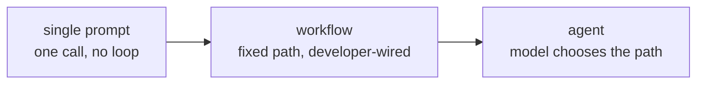

# Lição 2. Agente, workflow ou apenas um prompt

**Ligação com a missão:** "Escolher entre um único prompt, um workflow fixo e um agente para uma dada tarefa, e defender a escolha contra o custo da opção rejeitada" é o segundo item de O sucesso se parece com isto.
**Fonte principal:** [Article: "Building Effective Agents", Anthropic Engineering](https://www.anthropic.com/engineering/building-effective-agents)
**Pré-requisitos:** [Lição 1](0001-the-agent-loop.md), [Agente](../GLOSSARY.md), [Workflow](../GLOSSARY.md)

## Aquecimento

1. ▢ Nomeie, em ordem, os quatro passos do loop do agente.

Verificação

Envia-se a transcrição ao modelo, o modelo devolve uma chamada de ferramenta, o harness a executa, o resultado é anexado à transcrição e o ciclo se repete.

2. ▢ Um sistema sempre chama as mesmas três APIs na mesma ordem, independentemente do que um modelo embutido nele teria escolhido. É um agente ou não?

Verificação

Não é um agente. O desenvolvedor fixou o fluxo de controle de antemão; o modelo ainda pode fazer um trabalho útil dentro de um desses passos, mas nunca escolhe o caminho.

## Saiba isto

### O espectro, não um binário

A lição 1 traçou uma linha rígida entre agente e não agente pelo fluxo de controle. Na prática, "não é um agente" cobre uma faixa ampla, de um único prompt sem estrutura até sistemas genuinamente elaborados que ainda são caminhos fixos. Três pontos que vale nomear neste **espectro de autonomia**:

- **Um único prompt.** Uma chamada ao modelo, uma resposta. Sem loop, sem ferramentas, nada a orquestrar.
- **Um workflow.** Uma sequência de chamadas ao modelo e a ferramentas fixada pelo desenvolvedor. Pode ramificar, fazer loop e chamar um modelo mais de uma vez, e pode parecer sofisticado: prompt chaining (a saída de uma chamada alimenta a próxima), roteamento (classificar e depois despachar para um caminho especializado), paralelização, orquestrador e workers, loops de avaliador e otimizador. Cada um desses ainda é um workflow, porque o desenvolvedor ligou os caminhos entre as chamadas; o modelo preenche o conteúdo, não a estrutura.
- **Um agente.** O próprio modelo escolhe o próximo passo, inclusive se há um próximo passo. O fluxo de controle é decidido em tempo de execução pelo modelo, dentro de qualquer fronteira que o harness imponha.

Ir para a direita compra flexibilidade para tarefas cujo formato não pode ser previsto de antemão. Custa previsibilidade: um workflow faz a mesma coisa para a mesma entrada todas as vezes, e um agente não precisa fazer.

### O argumento para ficar à esquerda

O argumento central da fonte principal não é "use agentes". É este: encontre a solução mais simples que funcione e só aumente a complexidade quando isso demonstravelmente melhorar os resultados nas tarefas que importam. Um workflow, mesmo um elaborado, construído com os padrões acima, dá a você um sistema cujo comportamento você consegue prever, testar com casos fixos e raciocinar sobre ele sem vê-lo rodar. Um agente abre mão dessa previsibilidade em troca de lidar com entradas que o autor do workflow não antecipou. Se o formato da tarefa é conhecido e estável, essa troca não compra nada e custa confiabilidade.

### Quando a troca vale a pena

Um agente merece sua imprevisibilidade quando o número de caminhos de que um workflow precisaria começa a explodir, ou quando o caminho certo genuinamente não pode ser conhecido até que a tarefa esteja em andamento: pesquisa aberta em que a próxima consulta depende do que a última devolveu, uma tarefa de código em que o próximo arquivo a olhar depende do que o último disse, um ticket de suporte cujo caminho de resolução se ramifica em detalhes que nenhum classificador fixo vai separar com nitidez. O sinal não é "esta tarefa é difícil". É "o número de ramos de que um workflow precisaria para cobrir isto é ilimitado, ou o ramo depende de informação disponível apenas no meio da tarefa".

### Defendendo a escolha

Nomear uma escolha não é o mesmo que defendê-la. Uma resposta defensável nomeia o que a opção rejeitada teria custado: "um workflow aqui precisaria de um ramo por tipo de documento, e novos tipos chegam toda semana, então a flexibilidade de um agente vale a sua imprevisibilidade" defende um agente. "Esta tarefa sempre toca os mesmos quatro sistemas na mesma ordem, então um agente não compra nada que um workflow já não me dê, ao custo de uma execução que pode fazer algo diferente da próxima vez" defende um workflow. Qualquer resposta que pule o custo da opção rejeitada ainda não é uma defesa.

## Prática

1. ▢ Um gerador de relatório semanal puxa as mesmas cinco métricas dos mesmos dois sistemas, as formata do mesmo jeito e envia e-mail aos mesmos destinatários, toda semana sem exceção. Onde isso fica no espectro de autonomia, e por quê?

Verificação

Um workflow, provavelmente nem sequer um que precise de um modelo em tempo de execução além de formatar texto. O caminho nunca varia e as entradas são conhecidas de antemão, então a capacidade de um agente de escolher um caminho diferente a cada execução não compra nada e só acrescenta imprevisibilidade.

2. ▢ Qual destas é verdadeira sobre um workflow construído com o padrão de orquestrador e workers?

    - a) É um agente, porque coordena várias chamadas ao modelo
    - b) O desenvolvedor ainda fixou de antemão a sequência de chamadas; o modelo preenche o conteúdo dentro de cada passo, não a estrutura entre eles
    - c) Só se qualifica como workflow se usar uma única chamada ao modelo
    - d) Ele se torna um agente quando usa mais de uma ferramenta

Dica

Releia o que "fluxo de controle" significa nesta lição: quem decidiu a sequência, e não quantas chamadas ou ferramentas estão envolvidas.

Verificação

**b)** O desenvolvedor ainda fixou de antemão a sequência de chamadas. (a) e (d) pressupõem que complexidade ou número de ferramentas é o que faz de algo um agente, quando é o fluxo de controle. (c) é simplesmente falsa: um workflow pode envolver, e com frequência envolve, muitas chamadas ao modelo.

3. ▢ Um sistema de suporte precisa resolver tickets que, ao inspeção, se ramificam em cerca de quarenta caminhos de resolução distintos, com novas categorias aparecendo a cada poucos meses conforme o produto muda. Defenda uma escolha entre um workflow e um agente para isso, nomeando o que a opção rejeitada teria custado.

Verificação

Um agente é a escolha defensável: quarenta caminhos hoje e um conjunto crescente significam que o número de ramos de um workflow é ilimitado e exige manutenção contínua a cada mudança do produto, que é exatamente o custo de ficar com um caminho fixo aqui. A opção rejeitada, o workflow, teria custado esforço de engenharia contínuo para adicionar ramos, e ainda falharia em silêncio em qualquer tipo de ticket que ninguém antecipou. O custo do agente, uma execução imprevisível, é menor do que esse fardo de manutenção para esta tarefa.

4. ▢ Um script avulso precisa converter uma única planilha em um PDF formatado, uma tarefa com exatamente um caminho da entrada à saída. Construir isso como um agente seria uma escolha defensável? Por que sim ou por que não?

Verificação

Não. Um único caminho da entrada à saída é um workflow, ou discutivelmente nem isso: um único prompt ou um script simples resolve. Um agente acrescenta a capacidade de escolher um caminho diferente a cada execução, para a qual esta tarefa não tem uso, e a variabilidade do loop é puro custo sem benefício correspondente.

## Prática no mundo real

- [ ] Escolha uma tarefa que você ou sua equipe automatiza hoje. Coloque-a no espectro de autonomia desta lição e escreva uma frase defendendo a posição, nomeando o que a opção de cada lado teria custado.
- [ ] Encontre a descrição de um produto ou um post de blog que chame algo de "agente". Confira contra o teste de fluxo de controle: o sistema escolhe o próprio caminho, ou um desenvolvedor ligou um workflow e o chamou de agente por razões de marketing?
- [ ] Amanhã: esboce, no papel ou em um documento, o número de ramos de que um workflow precisaria para uma tarefa que você considera digna de um agente. Se você consegue enumerar os ramos em menos de dez minutos, reconsidere se ela precisa mesmo ser um agente.

## Para ir além

- [Article: "Building Effective Agents", Anthropic Engineering](https://www.anthropic.com/engineering/building-effective-agents)
- [Guide: "A Practical Guide to Building Agents", OpenAI](https://cdn.openai.com/business-guides-and-resources/a-practical-guide-to-building-agents.pdf)
- [Recursos](../RESOURCES.md)

---

Não ficou claro? Releia a fonte principal no topo, já que esta lição a comprime e é na compressão que o entendimento escapa. Consulte o [glossário](../GLOSSARY.md) para qualquer termo que pareceu escorregadio.

Se o problema é a lição em si, e não o material, isso é um defeito: [abra uma issue](https://github.com/TokenCemetery/teach/issues).
