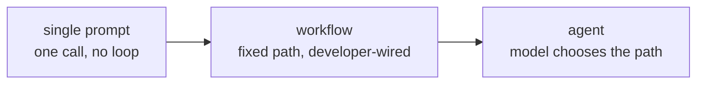

# Урок 2. Агент, воркфлоу или просто промпт

**Связь с целью курса:** «Выберите между одиночным промптом, фиксированным воркфлоу и агентом для данной задачи и защитите выбор, сопоставив его со стоимостью отвергнутого варианта» это второй пункт раздела «Каким выглядит результат».
**Первоисточник:** [Статья: "Building Effective Agents", Anthropic Engineering](https://www.anthropic.com/engineering/building-effective-agents)
**Предварительные требования:** [Урок 1](0001-the-agent-loop.md), [Агент](../GLOSSARY.md), [Воркфлоу](../GLOSSARY.md)

## Разминка

1. ▢ Назовите четыре шага цикла агента по порядку.

Проверка

Транскрипт отправляется модели, модель возвращает вызов инструмента, обвязка его исполняет, результат добавляется в транскрипт, и цикл повторяется.

2. ▢ Система всегда вызывает одни и те же три API в одном и том же порядке, независимо от того, что выбрала бы встроенная в неё модель. Агент или нет?

Проверка

Не агент. Поток управления заранее зафиксировал разработчик; модель всё ещё может делать полезную работу внутри одного из этих шагов, но путь она никогда не выбирает.

## Что нужно знать

### Спектр, а не бинарный выбор

В уроке 1 между агентом и не-агентом проведена жёсткая линия по потоку управления. На практике «не агент» охватывает широкий диапазон: от одиночного неструктурированного промпта до по-настоящему сложных систем, которые всё равно остаются фиксированными путями. Три точки на этом **спектре автономности** стоит назвать:

- **Одиночный промпт.** Один вызов модели, один ответ. Ни цикла, ни инструментов, нечего оркестрировать.
- **Воркфлоу.** Заданная разработчиком последовательность вызовов модели и инструментов. Она может ветвиться, зацикливаться и вызывать модель не один раз, и выглядеть изощрённо: цепочка промптов (вывод одного вызова питает следующий), маршрутизация (классифицировать, затем направить на специализированный путь), распараллеливание, оркестратор и исполнители, циклы «оценщик и оптимизатор». Каждый из них всё равно воркфлоу, потому что пути между вызовами проложил разработчик; модель заполняет содержание, а не структуру.
- **Агент.** Следующий шаг выбирает сама модель, включая вопрос о том, будет ли он вообще. Поток управления определяется во время работы моделью, в рамках границы, которую обеспечивает обвязка.

Движение вправо покупает гибкость для задач, форму которых нельзя предсказать заранее. Платить за это приходится предсказуемостью: воркфлоу каждый раз делает одно и то же на одном и том же входе, а агенту этого не обязательно.

### Довод в пользу того, чтобы оставаться слева

Главный довод первоисточника не «используйте агентов». Он такой: найдите простейшее решение, которое работает, и повышайте сложность, только когда она доказуемо улучшает результаты на важных задачах. Воркфлоу, даже сложный, построенный из перечисленных выше приёмов, даёт систему, поведение которой можно предсказать, протестировать на фиксированных случаях и обдумать, не наблюдая за её работой. Агент отказывается от этой предсказуемости в обмен на способность обрабатывать входы, которых автор воркфлоу не предвидел. Если форма задачи известна и стабильна, этот обмен ничего не покупает и стоит надёжности.

### Когда обмен оправдан

Агент заслуживает свою непредсказуемость, когда число путей, которые понадобились бы воркфлоу, начинает взрываться или верный путь по-настоящему нельзя знать, пока задача не пошла: открытое исследование, где следующий запрос зависит от того, что вернул предыдущий; задача по программированию, где то, какой файл смотреть дальше, зависит от того, что сказал последний файл; тикет поддержки, путь решения которого ветвится по деталям, которые ни один фиксированный классификатор чисто не разделит. Признак не «эта задача трудная». Признак такой: число веток, которое понадобилось бы воркфлоу, чтобы её покрыть, не ограничено или ветка зависит от информации, доступной только посреди задачи.

### Защита выбора

Назвать выбор не значит защитить его. Защищаемый ответ называет, чего стоил бы отвергнутый вариант: «воркфлоу здесь потребовал бы ветку на каждый тип документа, а новые типы приходят каждую неделю, поэтому гибкость агента стоит его непредсказуемости» защищает агента. «Эта задача всегда затрагивает одни и те же четыре системы в одном порядке, поэтому агент не покупает ничего, чего воркфлоу уже не даёт, а стоит запуском, который в следующий раз может сделать что-то иное» защищает воркфлоу. Любой ответ, пропускающий стоимость отвергнутого варианта, пока ещё не защита.

## Практика

1. ▢ Генератор еженедельного отчёта берёт одни и те же пять метрик из одних и тех же двух систем, форматирует их одинаково и отправляет одним и тем же получателям каждую неделю без исключений. Где это лежит на спектре автономности и почему?

Проверка

Воркфлоу, и скорее всего такой, которому модель во время работы не нужна даже сверх форматирования текста. Путь никогда не меняется, входы известны заранее, поэтому способность агента выбирать другой путь при каждом запуске ничего не покупает и лишь добавляет непредсказуемости.

2. ▢ Что верно для воркфлоу, построенного по приёму «оркестратор и исполнители»?

    - a) Это агент, потому что он координирует несколько вызовов модели
    - b) Последовательность вызовов всё равно заранее зафиксировал разработчик; модель заполняет содержание внутри каждого шага, а не структуру между ними
    - c) Он считается воркфлоу, только если использует один вызов модели
    - d) Он становится агентом, как только использует больше одного инструмента

Подсказка

Перечитайте, что в этом уроке значит «поток управления»: кто решил последовательность, а не сколько вызовов или инструментов задействовано.

Проверка

**b)** Последовательность вызовов всё равно заранее зафиксировал разработчик. (a) и (d) оба исходят из того, что агентом делает сложность или число инструментов, хотя это поток управления. (c) попросту неверно: воркфлоу может включать и часто включает много вызовов модели.

3. ▢ Системе поддержки нужно решать тикеты, которые при разборе ветвятся примерно на сорок отдельных путей решения, а новые категории появляются каждые несколько месяцев по мере изменения продукта. Защитите выбор между воркфлоу и агентом для этого случая, назвав, чего стоил бы отвергнутый вариант.

Проверка

Защищаемый выбор это агент: сорок путей сегодня и растущий набор означают, что число веток воркфлоу не ограничено и требует постоянной поддержки при каждом изменении продукта, а это ровно та цена, которую здесь платят за фиксированный путь. Отвергнутый воркфлоу стоил бы непрерывных инженерных усилий на добавление веток и всё равно молча проваливался бы на любом типе тикета, которого никто не предвидел. Цена агента, непредсказуемый запуск, для этой задачи меньше этого бремени поддержки.

4. ▢ Одноразовому скрипту нужно превратить одну электронную таблицу в отформатированный PDF, задача ровно с одним путём от входа к выходу. Будет ли оправданным построить это как агента? Почему да или почему нет?

Проверка

Нет. Единственный путь от входа к выходу это воркфлоу, а то и не он: с работой справится одиночный промпт или обычный скрипт. Агент добавляет способность выбирать другой путь при каждом запуске, а этой задаче она ни к чему, и вариативность цикла это чистая цена без соответствующей выгоды.

## Практика в реальной работе

- [ ] Выберите задачу, которую вы или ваша команда сегодня автоматизируете. Поместите её на спектр автономности из этого урока и напишите одно предложение в защиту этого места, назвав, чего стоил бы вариант по каждую сторону.
- [ ] Найдите описание продукта или запись в блоге, где что-то названо «агентом». Проверьте это критерием потока управления: система сама выбирает свой путь или разработчик проложил воркфлоу и назвал его агентом из маркетинговых соображений?
- [ ] Завтра: набросайте на бумаге или в документе число веток, которое понадобилось бы воркфлоу для задачи, которую вы считаете достойной агента. Если вы можете перечислить ветки меньше чем за десять минут, пересмотрите, нужен ли здесь вообще агент.

## Что почитать дальше

- [Статья: "Building Effective Agents", Anthropic Engineering](https://www.anthropic.com/engineering/building-effective-agents)
- [Руководство: "A Practical Guide to Building Agents", OpenAI](https://cdn.openai.com/business-guides-and-resources/a-practical-guide-to-building-agents.pdf)
- [Ресурсы](../RESOURCES.md)

---

Не доходит? Перечитайте первоисточник в начале: этот урок его сжимает, а при сжатии понимание как раз и теряется. Загляните в [глоссарий](../GLOSSARY.md), если какой-то термин показался скользким.

Если неясен сам урок, а не материал, это дефект: [откройте issue](https://github.com/TokenCemetery/teach/issues).
