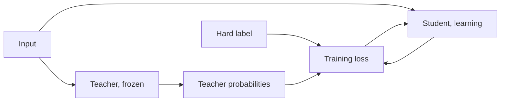

# Lección 1. Qué aporta la destilación

**Vínculo con la misión:** La misión te pide explicar por qué los soft targets de un profesor llevan más señal de entrenamiento que los hard labels, y eso empieza por saber qué son un profesor y un estudiante y qué consiguió la imitación en el paper que dio nombre al método.
**Fuente principal:** [Paper: "Distilling the Knowledge in a Neural Network", Hinton, Vinyals and Dean, 2015](https://arxiv.org/abs/1503.02531)
**Requisitos previos:** [Logit](../GLOSSARY.md), el softmax y la pérdida de entropía cruzada (las restricciones del README dicen qué se da por sabido)

## Qué debes saber

### Profesor y estudiante

La [destilación](../GLOSSARY.md) entrena un modelo pequeño para que reproduzca el comportamiento de uno mayor. El modelo mayor es el [profesor](../GLOSSARY.md). Está fijo durante el entrenamiento. El modelo menor es el [estudiante](../GLOSSARY.md), y es lo único que aprende.

Hinton, Vinyals y Dean parten de una observación sencilla. Un modelo se entrena para optimizar su puntuación sobre los datos de entrenamiento, pero lo que quieres es que generalice a datos nuevos. Entrenar con [hard labels](../GLOSSARY.md) no puede decir cómo generalizar, porque esa información normalmente no está disponible. Un modelo grande, o un ensemble, ya ha encontrado una forma de generalizar bien. Si el estudiante se entrena para generalizar de la misma manera, dice el paper, normalmente lo hará mucho mejor sobre los datos de prueba que el mismo modelo pequeño entrenado de la forma habitual con el mismo conjunto de entrenamiento.

El mecanismo es el objetivo. En lugar de una etiqueta one-hot, el estudiante se entrena con las probabilidades del profesor sobre cada clase, que el paper llama soft targets. La lección 2 los desarrolla. Por ahora quédate con una afirmación del paper: cuando los soft targets tienen alta entropía dan mucha más información por caso de entrenamiento que los hard targets, y menos varianza en el gradiente entre casos. Los autores dicen que el estudiante a menudo puede entrenarse con muchos menos datos y con un learning rate mucho mayor que el del modelo original.

### Qué informa el paper

Estas son las cifras del paper en sus propias configuraciones. Ninguna es una promesa sobre otros modelos.

En MNIST, una red con dos capas ocultas de 1200 unidades lineales rectificadas, muy regularizada con dropout y restricciones de pesos y entrenada con entradas con jitter, cometió 67 errores de prueba. Una red más pequeña con dos capas ocultas de 800 unidades y sin regularización cometió 146 errores. Cuando esa red más pequeña se regularizó solo añadiendo la tarea de igualar los soft targets de la red grande con una temperatura de 20, cometió 74 errores (sección 3). Los soft targets llevaban lo que los datos de entrenamiento con jitter le habían enseñado a la red grande, aunque el conjunto de transferencia del estudiante no contenía imágenes trasladadas.

En reconocimiento de voz, el paper entrena un modelo acústico con 8 capas ocultas de 2560 unidades, unos 85M de parámetros, con unas 2000 horas de inglés. La Tabla 1 informa de la exactitud por frame en prueba y de la tasa de error de palabras en el conjunto de desarrollo:

| Sistema | Exactitud por frame en prueba | WER |
|---|---|---|
| Baseline | 58.9% | 10.9% |
| Ensemble de 10 modelos | 61.1% | 10.7% |
| Modelo único destilado | 60.8% | 10.7% |

El profesor aquí es el ensemble de 10 modelos inicializados por separado. El modelo único destilado tiene el tamaño del baseline y casi la exactitud del ensemble. El paper dice que se transfirió más del 80% de la mejora de exactitud por frame del ensemble.

### Un ejemplo resuelto con un transformer

DistilBERT (Sanh et al., 2019) aplica la misma idea a BERT durante el preentrenamiento. El estudiante tiene la mitad de las capas y se inicializa tomando una de cada dos capas del profesor. Su pérdida es una combinación lineal de tres términos: la pérdida de destilación sobre las probabilidades suaves del profesor, la pérdida de modelado de lenguaje enmascarado y una pérdida de coseno entre embeddings que alinea los estados ocultos del estudiante y del profesor. El paper informa de un modelo un 40% más pequeño y un 60% más rápido en inferencia que conserva el 97% del rendimiento de BERT en el benchmark GLUE. Eso es un estudiante, un profesor, un benchmark.

### En qué se diferencia la destilación de LLM

Todo lo anterior predice una etiqueta por entrada a partir de un conjunto pequeño de clases. Un modelo de lenguaje predice una secuencia, un token a la vez, sobre un vocabulario de decenas o cientos de miles de entradas, así que hay una distribución en cada posición y el estudiante continuará más tarde desde prefijos que escribió él mismo. Igualar distribuciones posición por posición exige que ambos modelos usen el mismo índice de vocabulario, cosa que dos familias de modelos normalmente no hacen. Y exige acceso a los logits del profesor. MiniLLM (Gu et al., 2023) nombra la división: la destilación black-box solo tiene el texto que generó el profesor, y la destilación white-box tiene además su distribución de salida.

Las lecciones 4 a 7 enseñan la pérdida a nivel de token, la elección de divergencia, la restricción del vocabulario compartido y la destilación durante el preentrenamiento. Las lecciones 8 y 9 enseñan qué hacer cuando solo hay texto disponible.

## Práctica

1. ▢ En MNIST la red de 800 unidades sin regularización cometió 146 errores de prueba por sí sola. Entrenada con la tarea extra de igualar los soft targets de la red de 1200 unidades con temperatura 20, ¿aproximadamente cuántos errores cometió?

    - a) Unos 146 errores, sin cambios
    - b) Unos 74 errores, casi la mitad
    - c) Unos 67 errores, igual que el profesor
    - d) Unos 206 errores, mucho peor

Pista

La afirmación del paper es que los soft targets transfieren mucho conocimiento, no todo.

Comprobación

**b)** El paper informa de 74 errores (sección 3). No es (a), porque los soft targets ayudaron. No es (c): la red destilada se acercó a los 67 del profesor pero no los igualó. No es (d): 206 es otro experimento, el del estudiante que nunca vio el dígito 3.

2. ▢ En el experimento de voz, ¿qué fracción de la brecha entre el baseline y el ensemble de 10 modelos en exactitud por frame en prueba cerró el modelo único destilado?

Pista

Resta el baseline a cada una de las otras dos cifras antes de dividir.

Comprobación

(60.8 - 58.9) / (61.1 - 58.9) = 1.9 / 2.2, alrededor del 86%. El paper dice más del 80%. La mejora en WER es menor porque la exactitud por frame no es el objetivo que importa al final, y el paper señala el mismo desajuste.

3. ▢ ¿Qué parte de la receta de DistilBERT costó más puntuación macro en GLUE al quitarla, en la Tabla 4 del paper?

    - a) La pérdida de destilación con soft targets
    - b) La pérdida de alineación de coseno entre embeddings
    - c) La pérdida de modelado de lenguaje enmascarado
    - d) Inicializar desde una de cada dos capas

Comprobación

**d)** Entrenar con inicialización aleatoria en lugar de con las capas del profesor costó 3.69 puntos. Quitar la pérdida de destilación costó 2.96, la pérdida de coseno 1.46 y la pérdida de modelado de lenguaje enmascarado solo 0.31. La ablación es del propio DistilBERT, así que dice qué importó para ese estudiante, no para todos los estudiantes.

4. ▢ ¿Por qué un colega que solo puede llamar a la API de un modelo alojado y leer sus respuestas en texto no tiene lo que necesitan los soft targets de esta lección?

Comprobación

Los soft targets son la distribución de salida del profesor. MiniLLM llama black-box a la destilación que usa solo texto generado por el profesor, y white-box a la que además tiene la distribución de salida. El texto solo da una respuesta muestreada por prompt, que se parece más a un hard label del profesor. La etapa 3 enseña qué puede transferir todavía esa vía.

5. ▢ Hinton et al. dicen que un estudiante entrenado para generalizar como su profesor normalmente lo hace mejor que el mismo estudiante entrenado de la forma habitual. ¿Qué dicen que debe tener el profesor para que eso se cumpla?

Comprobación

Debe generalizar bien por sí mismo, por ejemplo porque es un promedio sobre un ensemble grande. Un estudiante solo puede heredar una forma de generalizar que el profesor tenga. El paper enuncia la condición en su introducción, y la brecha de imitación de la etapa 6 vuelve sobre lo que la imitación no copia.

## Prácticas en el mundo real

- [ ] Lee las secciones 1 y 3 de la fuente principal y anota en una frase cada una cuál fue el conjunto de transferencia en los experimentos de MNIST y qué tenía la red grande que le faltaba a la pequeña.
- [ ] Elige un modelo pequeño que uses y anota cuál sería su probable profesor: ¿desde qué modelo mayor de la misma familia lo entrenarías, y tienes sus logits o solo su texto?
- [ ] Mañana: sin apuntes, define profesor, estudiante y soft targets en una frase cada uno, y luego nombra las cifras de MNIST y de voz que recuerdes.

## Para profundizar

- [Pérdidas de destilación](../reference/distillation-losses.md)
- [Paper: "Distilling the Knowledge in a Neural Network", Hinton, Vinyals and Dean, 2015](https://arxiv.org/abs/1503.02531)
- [Paper: "DistilBERT, a distilled version of BERT: smaller, faster, cheaper and lighter", Sanh et al., 2019](https://arxiv.org/abs/1910.01108)
- [Paper: "MiniLLM: On-Policy Distillation of Large Language Models", Gu et al., 2023](https://arxiv.org/abs/2306.08543)
- [Recursos](../RESOURCES.md)

---

¿No termina de quedar claro? Vuelve a leer la fuente primaria de arriba, ya que esta lección la comprime y en la compresión es donde se escapa la comprensión. Consulta el [glosario](../GLOSSARY.md) por si algún término te resultó resbaladizo.

Si lo poco claro es la propia lección y no el material, eso es un defecto: [abre un issue](https://github.com/TokenCemetery/teach/issues).
