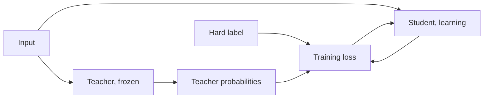

# Leçon 1. Ce que la distillation apporte

**Lien avec la mission :** La mission vous demande d'expliquer pourquoi les soft targets d'un enseignant portent plus de signal d'entraînement que les hard labels, et cela commence par ce que sont un enseignant et un élève, et par ce que l'imitation a apporté dans l'article qui a donné son nom à la méthode.
**Source primaire :** [Article : "Distilling the Knowledge in a Neural Network", Hinton, Vinyals et Dean, 2015](https://arxiv.org/abs/1503.02531)
**Prérequis :** [Logit](../GLOSSARY.md), le softmax et la loss d'entropie croisée (les contraintes du README disent ce qui est supposé acquis)

## À savoir

### Enseignant et élève

La [distillation](../GLOSSARY.md) entraîne un petit modèle à reproduire le comportement d'un modèle plus grand. Le modèle plus grand est l'[enseignant](../GLOSSARY.md). Il est fixe pendant l'entraînement. Le modèle plus petit est l'[élève](../GLOSSARY.md), et c'est la seule chose qui apprend.

Hinton, Vinyals et Dean partent d'une observation simple. On entraîne un modèle à optimiser son score sur les données d'entraînement, mais ce que l'on veut, c'est qu'il généralise à de nouvelles données. L'entraînement sur des [hard labels](../GLOSSARY.md) ne peut pas dire comment généraliser, parce que cette information n'est normalement pas disponible. Un grand modèle, ou un ensemble, a déjà trouvé une manière de bien généraliser. Si l'on entraîne l'élève à généraliser de la même façon, l'article dit qu'il fera typiquement bien mieux sur les données de test que le même petit modèle entraîné normalement sur le même jeu d'entraînement.

Le mécanisme, c'est la cible. Au lieu d'un label one-hot, l'élève est entraîné sur les probabilités de l'enseignant pour chaque classe, que l'article appelle soft targets. La leçon 2 les détaille. Pour l'instant, retenez une affirmation de l'article : quand les soft targets ont une entropie élevée, elles donnent bien plus d'information par cas d'entraînement que les hard targets, et moins de variance dans le gradient d'un cas à l'autre. Les auteurs disent que l'élève peut souvent être entraîné avec bien moins de données et un learning rate bien plus élevé que le modèle d'origine.

### Ce que rapporte l'article

Ce sont les chiffres de l'article sur ses propres configurations. Aucun n'est une promesse pour d'autres modèles.

Sur MNIST, un réseau à deux couches cachées de 1200 unités linéaires rectifiées, fortement régularisé par du dropout et des contraintes sur les poids et entraîné sur des entrées décalées aléatoirement, a fait 67 erreurs de test. Un réseau plus petit, à deux couches cachées de 800 unités et sans régularisation, a fait 146 erreurs. Quand ce réseau plus petit était régularisé uniquement par l'ajout de la tâche consistant à reproduire les soft targets du grand réseau à une température de 20, il a fait 74 erreurs (section 3). Les soft targets portaient ce que les données d'entraînement décalées avaient appris au grand réseau, alors même que le jeu de transfert de l'élève ne contenait aucune image translatée.

Sur la reconnaissance vocale, l'article entraîne un modèle acoustique à 8 couches cachées de 2560 unités, environ 85M de paramètres, sur environ 2000 heures d'anglais. Le tableau 1 rapporte la précision par trame sur le test et le taux d'erreur sur les mots (WER) sur le jeu de développement :

| Système | Précision par trame sur le test | WER |
|---|---|---|
| Référence | 58.9% | 10.9% |
| Ensemble de 10 modèles | 61.1% | 10.7% |
| Modèle unique distillé | 60.8% | 10.7% |

L'enseignant est ici l'ensemble de 10 modèles initialisés séparément. Le modèle unique distillé a la taille de la référence et presque la précision de l'ensemble. L'article dit que plus de 80 % de l'amélioration de précision par trame de l'ensemble a été transférée.

### Un exemple détaillé avec un transformer

DistilBERT (Sanh et al., 2019) applique la même idée à BERT pendant le pré-entraînement. L'élève a deux fois moins de couches et est initialisé en prenant une couche sur deux de l'enseignant. Sa loss est une combinaison linéaire de trois termes : la loss de distillation sur les probabilités douces de l'enseignant, la loss de modélisation de langage masqué, et une loss d'embedding par cosinus qui aligne les états cachés de l'élève et de l'enseignant. L'article rapporte un modèle 40 % plus petit et 60 % plus rapide à l'inférence, qui conserve 97 % des performances de BERT sur le benchmark GLUE. C'est un élève, un enseignant, un benchmark.

### En quoi la distillation de LLM diffère

Tout ce qui précède prédit un label par entrée parmi un petit ensemble de classes. Un modèle de langage prédit une séquence, un token à la fois, sur un vocabulaire de dizaines ou de centaines de milliers d'entrées, donc il y a une distribution à chaque position, et l'élève poursuivra plus tard à partir de préfixes qu'il a écrits lui-même. Faire correspondre les distributions position par position exige que les deux modèles utilisent le même index de vocabulaire, ce que deux familles de modèles n'ont généralement pas. Et cela exige l'accès aux logits de l'enseignant. MiniLLM (Gu et al., 2023) nomme la séparation : la distillation black-box ne dispose que du texte généré par l'enseignant, et la distillation white-box dispose aussi de sa distribution de sortie.

Les leçons 4 à 7 enseignent la loss au niveau du token, le choix de la divergence, la contrainte du vocabulaire partagé et la distillation pendant le pré-entraînement. Les leçons 8 et 9 enseignent quoi faire quand seul le texte est disponible.

## Pratique

1. ▢ Sur MNIST, le réseau de 800 unités sans régularisation a fait 146 erreurs de test seul. Entraîné avec la tâche supplémentaire de reproduire les soft targets du réseau de 1200 unités à la température 20, combien d'erreurs a-t-il faites à peu près ?

    - a) Environ 146 erreurs, inchangé
    - b) Environ 74 erreurs, presque divisé par deux
    - c) Environ 67 erreurs, comme l'enseignant
    - d) Environ 206 erreurs, bien pire

Indice

L'affirmation de l'article est que les soft targets transfèrent beaucoup de connaissance, pas toute.

Vérifier

**b)** L'article rapporte 74 erreurs (section 3). Ce n'est pas (a), car les soft targets ont aidé. Ce n'est pas (c) : le réseau distillé s'est approché des 67 de l'enseignant sans les égaler. Ce n'est pas (d) : 206 correspond à une autre expérience, celle de l'élève qui n'a jamais vu le chiffre 3.

2. ▢ Dans l'expérience de parole, quelle fraction de l'écart de précision par trame sur le test entre la référence et l'ensemble de 10 modèles le modèle unique distillé a-t-il comblée ?

Indice

Soustrayez la référence de chacun des deux autres chiffres avant de diviser.

Vérifier

(60.8 - 58.9) / (61.1 - 58.9) = 1.9 / 2.2, soit environ 86 %. L'article dit plus de 80 %. Le gain en WER est plus faible parce que la précision par trame n'est pas l'objectif qui compte au bout du compte, et l'article note le même décalage.

3. ▢ Quelle partie de la recette de DistilBERT a coûté le plus au macro-score GLUE quand elle a été retirée, dans le tableau 4 de l'article ?

    - a) La loss de distillation sur les soft targets
    - b) La loss d'alignement par embedding cosinus
    - c) La loss de modélisation de langage masqué
    - d) L'initialisation à partir d'une couche sur deux

Vérifier

**d)** Un entraînement avec une initialisation aléatoire au lieu des couches de l'enseignant a coûté 3.69 points. Retirer la loss de distillation a coûté 2.96, la loss cosinus 1.46, et la loss de modélisation de langage masqué seulement 0.31. L'ablation est celle de DistilBERT lui-même, elle dit donc ce qui comptait pour cet élève, pas pour tous les élèves.

4. ▢ Pourquoi un collègue qui ne peut qu'appeler l'API d'un modèle hébergé et lire ses réponses textuelles n'a-t-il pas ce dont les soft targets de cette leçon ont besoin ?

Vérifier

Les soft targets sont la distribution de sortie de l'enseignant. MiniLLM appelle black-box la distillation qui n'utilise que le texte généré par l'enseignant, et white-box celle qui dispose aussi de la distribution de sortie. Le texte seul donne une réponse échantillonnée par prompt, ce qui est plus proche d'un hard label venant de l'enseignant. L'étape 3 enseigne ce que cette voie peut encore transférer.

5. ▢ Hinton et al. disent qu'un élève entraîné à généraliser comme son enseignant fait typiquement mieux que le même élève entraîné normalement. Que disent-ils que l'enseignant doit avoir pour que cela tienne ?

Vérifier

Il doit lui-même bien généraliser, par exemple parce qu'il est une moyenne sur un grand ensemble. Un élève ne peut hériter que d'une manière de généraliser que possède l'enseignant. L'article énonce la condition dans son introduction, et l'écart d'imitation à l'étape 6 revient sur ce que l'imitation ne copie pas.

## Exercices en situation réelle

- [ ] Lisez les sections 1 et 3 de la source primaire et notez en une phrase chacune ce qu'était le jeu de transfert dans les expériences MNIST et ce que le grand réseau avait que le petit n'avait pas.
- [ ] Choisissez un petit modèle que vous utilisez et notez son enseignant probable : à partir de quel modèle plus grand de la même famille l'entraîneriez-vous, et disposez-vous de ses logits ou seulement de son texte ?
- [ ] Demain : sans notes, définissez enseignant, élève et soft targets en une phrase chacun, puis citez les chiffres MNIST et de parole dont vous vous souvenez.

## Pour aller plus loin

- [Loss de distillation](../reference/distillation-losses.md)
- [Article : "Distilling the Knowledge in a Neural Network", Hinton, Vinyals et Dean, 2015](https://arxiv.org/abs/1503.02531)
- [Article : "DistilBERT, a distilled version of BERT: smaller, faster, cheaper and lighter", Sanh et al., 2019](https://arxiv.org/abs/1910.01108)
- [Article : "MiniLLM: On-Policy Distillation of Large Language Models", Gu et al., 2023](https://arxiv.org/abs/2306.08543)
- [Ressources](../RESOURCES.md)

---

Ça ne passe pas ? Relisez la source primaire en haut de page, car cette leçon la condense et c'est dans la condensation que la compréhension s'échappe. Consultez le [glossaire](../GLOSSARY.md) pour tout terme qui vous a paru glissant.

Si c'est la leçon elle-même qui n'est pas claire plutôt que la matière, c'est un défaut : [ouvrez une issue](https://github.com/TokenCemetery/teach/issues).
