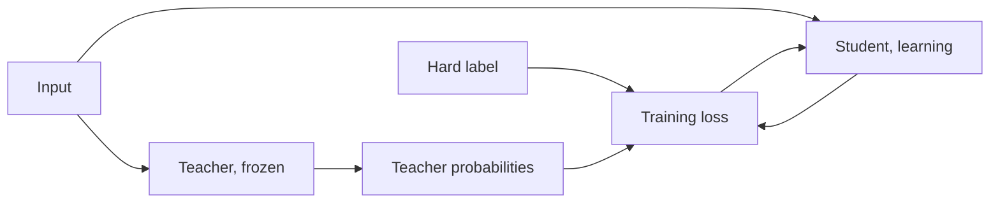

# पाठ 1. Distillation से क्या मिलता है

**मिशन से संबंध:** मिशन आपसे माँगता है कि आप समझा सकें कि teacher के soft targets में hard labels से ज़्यादा training signal क्यों होता है, और उसकी शुरुआत इससे होती है कि teacher और student क्या हैं और जिस पेपर ने इस विधि को नाम दिया, उसमें नक़ल से क्या मिला।
**मुख्य स्रोत:** [पेपर: "Distilling the Knowledge in a Neural Network", Hinton, Vinyals and Dean, 2015](https://arxiv.org/abs/1503.02531)
**पूर्व-आवश्यकताएँ:** [Logit](../GLOSSARY.md), softmax, और cross-entropy loss (README की सीमाएँ बताती हैं कि क्या माना गया है)

## यह जानें

### Teacher और student

[Distillation](../GLOSSARY.md) छोटे model को बड़े model का व्यवहार दोहराना सिखाता है। बड़ा model [teacher](../GLOSSARY.md) है। वह training के दौरान तय (fixed) रहता है। छोटा model [student](../GLOSSARY.md) है, और सिर्फ़ वही सीखता है।

Hinton, Vinyals और Dean एक सीधी-सादी बात से शुरू करते हैं। Model को training data पर अपना score बेहतर करने के लिए train किया जाता है, पर आप चाहते हैं कि वह नए data पर generalize करे। [Hard labels](../GLOSSARY.md) पर training यह नहीं बता सकती कि generalize कैसे करना है, क्योंकि वह जानकारी आम तौर पर उपलब्ध नहीं होती। बड़े model या ensemble ने अच्छी तरह generalize करने का तरीक़ा पहले ही खोज लिया है। अगर student को उसी तरह generalize करना सिखाया जाए, तो पेपर के अनुसार वह test data पर आम तौर पर उसी छोटे model से कहीं बेहतर करेगा जिसे उसी training set पर सामान्य तरीक़े से train किया गया हो।

तरीक़ा target में है। One-hot label की जगह student को हर class पर teacher की probabilities से train किया जाता है, जिन्हें पेपर soft targets कहता है। पाठ 2 इसे खोलता है। फ़िलहाल पेपर का एक दावा याद रखें: जब soft targets में entropy ज़्यादा हो, तो वे हर training case पर hard targets से बहुत ज़्यादा जानकारी देते हैं, और cases के बीच gradient में variance कम होता है। लेखक कहते हैं कि student को अक्सर बहुत कम data पर और मूल model से कहीं ऊँची learning rate के साथ train किया जा सकता है।

### पेपर क्या बताता है

ये पेपर की अपनी setups पर संख्याएँ हैं। इनमें से कोई भी दूसरे models के बारे में वादा नहीं है।

MNIST पर, 1200 rectified linear units की दो hidden layers वाले net को, dropout और weight constraints से कसकर regularize करके और jittered inputs पर train करके, 67 test errors मिले। 800 units की दो hidden layers वाले छोटे net को, बिना regularization के, 146 errors मिले। जब उसी छोटे net को सिर्फ़ इस तरह regularize किया गया कि उसमें 20 के temperature पर बड़े net के soft targets से मेल बिठाने का task जोड़ा गया, तो उसे 74 errors मिले (section 3)। Soft targets में वह सब था जो jittered training data ने बड़े net को सिखाया था, भले ही student के transfer set में कोई translated images नहीं थीं।

Speech recognition पर, पेपर 2560 units की 8 hidden layers वाला acoustic model train करता है, लगभग 85M parameters, लगभग 2000 घंटे की अंग्रेज़ी पर। Table 1 development set पर test frame accuracy और word error rate बताती है:

| System | Test frame accuracy | WER |
|---|---|---|
| Baseline | 58.9% | 10.9% |
| 10 model ensemble | 61.1% | 10.7% |
| Distilled single model | 60.8% | 10.7% |

यहाँ teacher 10 अलग-अलग initialize किए गए models का ensemble है। Distilled single model का आकार baseline जितना है और accuracy लगभग ensemble जितनी। पेपर कहता है कि ensemble की frame accuracy में हुए सुधार का 80% से ज़्यादा हिस्सा transfer हुआ।

### Transformer का एक हल किया हुआ उदाहरण

DistilBERT (Sanh et al., 2019) यही विचार pretraining के दौरान BERT पर लगाता है। Student में आधी layers हैं और उसे teacher से हर दो में से एक layer लेकर initialize किया गया है। उसका loss तीन terms का रैखिक मेल है: teacher की soft probabilities पर distillation loss, masked language modeling loss, और cosine embedding loss जो student और teacher की hidden states को align करता है। पेपर बताता है कि model 40% छोटा और inference में 60% तेज़ है, और GLUE benchmark पर BERT का 97% प्रदर्शन बनाए रखता है। यह एक student, एक teacher, एक benchmark है।

### LLM distillation कैसे अलग है

ऊपर की हर चीज़ छोटे-से classes के सेट में से हर input पर एक label predict करती है। Language model एक sequence predict करता है, एक-एक token करके, दसियों या सैकड़ों हज़ार entries वाली vocabulary पर, इसलिए हर position पर एक distribution होता है और student आगे चलकर उन prefixes से जारी रखेगा जो उसने ख़ुद लिखे हैं। Position-दर-position distributions मिलाने के लिए दोनों models को एक ही vocabulary index इस्तेमाल करना होगा, जो दो model परिवार आम तौर पर नहीं करते। और इसके लिए teacher के logits तक पहुँच चाहिए। MiniLLM (Gu et al., 2023) इस बँटवारे को नाम देता है: black-box distillation के पास सिर्फ़ वह text होता है जो teacher ने generate किया, और white-box distillation के पास उसका output distribution भी होता है।

पाठ 4 से 7 token-level loss, divergence का चुनाव, साझा-vocabulary की बाध्यता और pretraining के दौरान distillation सिखाते हैं। पाठ 8 और 9 सिखाते हैं कि जब सिर्फ़ text उपलब्ध हो तो क्या करना है।

## अभ्यास

1. ▢ MNIST पर बिना regularization वाले 800 unit net को अकेले 146 test errors मिले थे। जब उसे 20 temperature पर 1200 unit net के soft targets से मेल बिठाने का अतिरिक्त task देकर train किया गया, तो लगभग कितने errors आए?

    - a) लगभग 146 errors, कोई बदलाव नहीं
    - b) लगभग 74 errors, क़रीब आधे
    - c) लगभग 67 errors, teacher के बराबर
    - d) लगभग 206 errors, बहुत ख़राब

संकेत

पेपर का दावा यह है कि soft targets बहुत सारा ज्ञान transfer करते हैं, पूरा नहीं।

जाँचें

**b)** पेपर 74 errors बताता है (section 3)। यह (a) नहीं है, क्योंकि soft targets ने मदद की। यह (c) नहीं है: distilled net teacher के 67 के क़रीब पहुँचा पर बराबर नहीं हुआ। यह (d) नहीं है: 206 दूसरा experiment है, वह student जिसने कभी अंक 3 देखा ही नहीं।

2. ▢ Speech experiment में, distilled single model ने test frame accuracy में baseline और 10 model ensemble के बीच के फ़ासले का कितना हिस्सा पाटा?

संकेत

भाग देने से पहले बाक़ी दोनों संख्याओं में से baseline घटाएँ।

जाँचें

(60.8 - 58.9) / (61.1 - 58.9) = 1.9 / 2.2, लगभग 86%। पेपर कहता है 80% से ज़्यादा। WER में फ़ायदा छोटा है क्योंकि frame accuracy वह objective नहीं है जो अंत में मायने रखता है, और पेपर भी यही बेमेल दर्ज करता है।

3. ▢ पेपर की Table 4 में, DistilBERT की विधि का कौन-सा हिस्सा हटाने पर GLUE macro-score को सबसे ज़्यादा नुक़सान हुआ?

    - a) Soft target distillation loss
    - b) Cosine embedding alignment loss
    - c) Masked language modeling loss
    - d) हर दूसरी layer से initialize करना

जाँचें

**d)** Teacher की layers के बजाय random initialization से training करने पर 3.69 अंक का नुक़सान हुआ। Distillation loss हटाने पर 2.96, cosine loss हटाने पर 1.46, और masked language modeling loss हटाने पर सिर्फ़ 0.31। यह ablation DistilBERT का अपना है, इसलिए यह बताता है कि उस student के लिए क्या मायने रखा, हर student के लिए नहीं।

4. ▢ कोई सहकर्मी जो सिर्फ़ hosted model API call कर सकता है और उसके text जवाब पढ़ सकता है, उसके पास इस पाठ के soft targets के लिए ज़रूरी चीज़ क्यों नहीं है?

जाँचें

Soft targets teacher का output distribution हैं। MiniLLM सिर्फ़ teacher-generated text इस्तेमाल करने वाले distillation को black-box कहता है, और जिसके पास output distribution भी हो उसे white-box। अकेला text हर prompt पर एक sampled उत्तर देता है, जो teacher की ओर से hard label के ज़्यादा क़रीब है। चरण 3 सिखाता है कि वह रास्ता फिर भी क्या transfer कर सकता है।

5. ▢ Hinton et al. कहते हैं कि teacher की तरह generalize करना सीखा student आम तौर पर उसी student से बेहतर करता है जो सामान्य तरीक़े से train हुआ हो। वे कहते हैं कि इसके सच होने के लिए teacher के पास क्या होना चाहिए?

जाँचें

उसे ख़ुद अच्छी तरह generalize करना चाहिए, उदाहरण के लिए इसलिए कि वह किसी बड़े ensemble का औसत है। Student सिर्फ़ वही generalize करने का तरीक़ा विरासत में पा सकता है जो teacher के पास हो। पेपर यह शर्त अपनी introduction में बताता है, और चरण 6 का imitation gap इस पर लौटता है कि नक़ल क्या नहीं उतारती।

## असली दुनिया का अभ्यास

- [ ] मुख्य स्रोत के section 1 और 3 पढ़ें और एक-एक वाक्य में लिखें कि MNIST experiments में transfer set क्या था और बड़े net के पास ऐसा क्या था जो छोटे net के पास नहीं था।
- [ ] कोई छोटा model चुनें जिसे आप इस्तेमाल करते हैं और लिखें कि उसका संभावित teacher कौन-सा होगा: उसी परिवार का कौन-सा बड़ा model आप उसे train करने के लिए लेंगे, और क्या आपके पास उसके logits हैं या सिर्फ़ उसका text?
- [ ] कल: बिना नोट्स के teacher, student और soft targets को एक-एक वाक्य में परिभाषित करें, फिर MNIST और speech की जो संख्याएँ आपको याद हों उनका नाम लें।

## आगे बढ़ने के लिए

- [Distillation Losses शीट](../reference/distillation-losses.md)
- [पेपर: "Distilling the Knowledge in a Neural Network", Hinton, Vinyals and Dean, 2015](https://arxiv.org/abs/1503.02531)
- [पेपर: "DistilBERT, a distilled version of BERT: smaller, faster, cheaper and lighter", Sanh et al., 2019](https://arxiv.org/abs/1910.01108)
- [पेपर: "MiniLLM: On-Policy Distillation of Large Language Models", Gu et al., 2023](https://arxiv.org/abs/2306.08543)
- [संसाधन](../RESOURCES.md)

---

बात नहीं बन रही? ऊपर दिए मुख्य स्रोत को दोबारा पढ़ें, क्योंकि यह पाठ उसे संक्षिप्त करता है और समझ संक्षेप में ही रिसती है। जो शब्द फिसलन भरा लगे, उसके लिए [शब्दावली](../GLOSSARY.md) देखें।

अगर दिक़्क़त सामग्री की नहीं बल्कि पाठ की ही है, तो वह एक खोट है: [issue खोलें](https://github.com/TokenCemetery/teach/issues)।
