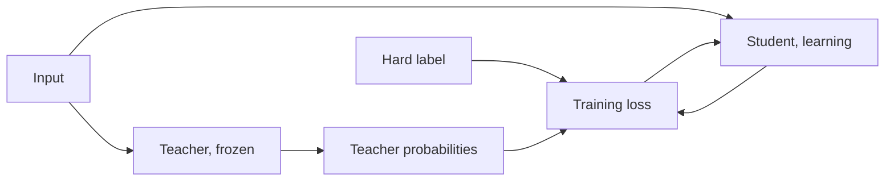

# Lesson 1. What Distillation Buys

**Mission link:** The mission asks you to explain why a teacher's soft targets carry more training signal than hard labels, and that starts with what a teacher and a student are and what imitation bought in the paper that named the method.
**Primary source:** [Paper: "Distilling the Knowledge in a Neural Network", Hinton, Vinyals and Dean, 2015](https://arxiv.org/abs/1503.02531)
**Prerequisites:** [Logit](../GLOSSARY.md), the softmax, and cross-entropy loss (the README's constraints say what is assumed)

## Know this

### Teacher and student

[Distillation](../GLOSSARY.md) trains a small model to reproduce the behaviour of a larger one. The larger model is the [teacher](../GLOSSARY.md). It is fixed during training. The smaller model is the [student](../GLOSSARY.md), and it is the only thing that learns.

Hinton, Vinyals and Dean start from a plain observation. A model is trained to optimise its score on the training data, but what you want is for it to generalize to new data. Training on [hard labels](../GLOSSARY.md) cannot say how to generalize, because that information is not normally available. A big model, or an ensemble, has already found a way to generalize well. If the student is trained to generalize the same way, the paper says it will typically do much better on test data than the same small model trained the normal way on the same training set.

The mechanism is the target. Instead of a one-hot label, the student is trained on the teacher's probabilities over every class, which the paper calls soft targets. Lesson 2 opens that up. For now hold one claim from the paper: when the soft targets have high entropy they give much more information per training case than hard targets, and less variance in the gradient between cases. The authors say the student can often be trained on much less data and with a much higher learning rate than the original model.

### What the paper reports

These are the paper's numbers on its own setups. Neither is a promise about other models.

On MNIST, a net with two hidden layers of 1200 rectified linear units, strongly regularized with dropout and weight constraints and trained on jittered inputs, made 67 test errors. A smaller net with two hidden layers of 800 units and no regularization made 146 errors. When that smaller net was regularized only by adding the task of matching the large net's soft targets at a temperature of 20, it made 74 errors (section 3). The soft targets carried what the jittered training data had taught the large net, even though the student's transfer set contained no translated images.

On speech recognition, the paper trains an acoustic model with 8 hidden layers of 2560 units, about 85M parameters, on about 2000 hours of English. Table 1 reports test frame accuracy and word error rate on the development set:

| System | Test frame accuracy | WER |
|---|---|---|
| Baseline | 58.9% | 10.9% |
| 10 model ensemble | 61.1% | 10.7% |
| Distilled single model | 60.8% | 10.7% |

The teacher here is the ensemble of 10 separately initialized models. The distilled single model has the baseline's size and nearly the ensemble's accuracy. The paper says more than 80% of the ensemble's frame accuracy improvement was transferred.

### A transformer worked example

DistilBERT (Sanh et al., 2019) applies the same idea to BERT during pretraining. The student has half the layers and is initialized by taking one layer out of two from the teacher. Its loss is a linear combination of three terms: the distillation loss on the teacher's soft probabilities, the masked language modeling loss, and a cosine embedding loss that aligns student and teacher hidden states. The paper reports a model 40% smaller and 60% faster at inference that retains 97% of BERT's performance on the GLUE benchmark. That is one student, one teacher, one benchmark.

### How LLM distillation differs

Everything above predicts one label per input from a small set of classes. A language model predicts a sequence, one token at a time, over a vocabulary of tens or hundreds of thousands of entries, so there is a distribution at every position and the student will later continue from prefixes it wrote itself. Matching distributions position by position needs both models to use the same vocabulary index, which two model families usually do not. And it needs access to the teacher's logits. MiniLLM (Gu et al., 2023) names the split: black-box distillation has only the text the teacher generated, and white-box distillation also has its output distribution.

Lessons 4 to 7 teach the token-level loss, the choice of divergence, the shared-vocabulary constraint and distillation during pretraining. Lessons 8 and 9 teach what to do when only text is available.

## Practice

1. ▢ On MNIST the 800 unit net with no regularization made 146 test errors by itself. Trained with the extra task of matching the 1200 unit net's soft targets at temperature 20, about how many errors did it make?

    - a) About 146 errors, unchanged
    - b) About 74 errors, nearly halved
    - c) About 67 errors, the same as the teacher
    - d) About 206 errors, much worse

Hint

The paper's claim is that soft targets transfer a great deal of knowledge, not all of it.

Check

**b)** The paper reports 74 errors (section 3). It is not (a), because the soft targets helped. It is not (c): the distilled net came close to the teacher's 67 but did not match it. It is not (d): 206 is a different experiment, the student that never saw the digit 3.

2. ▢ In the speech experiment, what fraction of the gap between the baseline and the 10 model ensemble in test frame accuracy did the distilled single model close?

Hint

Subtract the baseline from each of the other two numbers before dividing.

Check

(60.8 - 58.9) / (61.1 - 58.9) = 1.9 / 2.2, about 86%. The paper says more than 80%. The gain in WER is smaller because frame accuracy is not the objective that matters in the end, and the paper notes the same mismatch.

3. ▢ Which part of DistilBERT's recipe cost the GLUE macro-score the most when it was removed, in the paper's Table 4?

    - a) The soft target distillation loss
    - b) The cosine embedding alignment loss
    - c) The masked language modeling loss
    - d) Initializing from every other layer

Check

**d)** Training with random initialization instead of the teacher's layers cost 3.69 points. Removing the distillation loss cost 2.96, the cosine loss 1.46, and the masked language modeling loss only 0.31. The ablation is DistilBERT's own, so it says what mattered for that student, not for every student.

4. ▢ Why does a colleague who can only call a hosted model API and read its text replies not have what the soft targets of this lesson need?

Check

Soft targets are the teacher's output distribution. MiniLLM calls distillation that uses only teacher-generated text black-box, and distillation that also has the output distribution white-box. Text alone gives one sampled answer per prompt, which is closer to a hard label from the teacher. Stage 3 teaches what that route can still transfer.

5. ▢ Hinton et al. say a student trained to generalize like its teacher typically does better than the same student trained normally. What do they say the teacher must have for that to hold?

Check

It must itself generalize well, for example because it is an average over a large ensemble. A student can only inherit a way of generalizing that the teacher has. The paper states the condition in its introduction, and the imitation gap in stage 6 returns to what imitation does not copy.

## Real-world reps

- [ ] Read sections 1 and 3 of the primary source and write down in one sentence each what the transfer set was in the MNIST experiments and what the large net had that the small net lacked.
- [ ] Pick a small model you use and write down its likely teacher: which larger model from the same family would you train it from, and do you have its logits or only its text?
- [ ] Tomorrow: without notes, define teacher, student and soft targets in one sentence each, then name the MNIST and speech numbers you remember.

## Going further

- [Distillation Losses](../reference/distillation-losses.md)
- [Paper: "Distilling the Knowledge in a Neural Network", Hinton, Vinyals and Dean, 2015](https://arxiv.org/abs/1503.02531)
- [Paper: "DistilBERT, a distilled version of BERT: smaller, faster, cheaper and lighter", Sanh et al., 2019](https://arxiv.org/abs/1910.01108)
- [Paper: "MiniLLM: On-Policy Distillation of Large Language Models", Gu et al., 2023](https://arxiv.org/abs/2306.08543)
- [Resources](../RESOURCES.md)

---

Not landing? Reread the primary source at the top, since this lesson compresses it and compression is where understanding leaks. Check the [glossary](../GLOSSARY.md) for any term that felt slippery.

If the lesson itself is unclear rather than the material, that is a defect: [open an issue](https://github.com/TokenCemetery/teach/issues).
