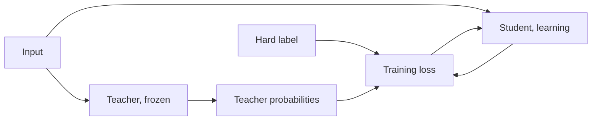

# Lição 1. O que a destilação oferece

**Ligação com a missão:** A missão pede que você explique por que os soft targets de um professor carregam mais sinal de treinamento do que os hard labels, e isso começa com o que são um professor e um aluno e com o que a imitação rendeu no artigo que deu nome ao método.
**Fonte principal:** [Artigo científico: "Distilling the Knowledge in a Neural Network", Hinton, Vinyals e Dean, 2015](https://arxiv.org/abs/1503.02531)
**Pré-requisitos:** [Logit](../GLOSSARY.md), o softmax e a loss de cross-entropy (as restrições do README dizem o que é pressuposto)

## Saiba isto

### Professor e aluno

A [destilação](../GLOSSARY.md) treina um modelo pequeno para reproduzir o comportamento de um modelo maior. O modelo maior é o [professor](../GLOSSARY.md). Ele fica fixo durante o treinamento. O modelo menor é o [aluno](../GLOSSARY.md), e é a única coisa que aprende.

Hinton, Vinyals e Dean partem de uma observação simples. Um modelo é treinado para otimizar a sua pontuação nos dados de treinamento, mas o que você quer é que ele generalize para dados novos. Treinar com [hard labels](../GLOSSARY.md) não consegue dizer como generalizar, porque essa informação normalmente não está disponível. Um modelo grande, ou um ensemble, já encontrou um jeito de generalizar bem. Se o aluno for treinado para generalizar do mesmo jeito, diz o artigo, ele tipicamente vai muito melhor nos dados de teste do que o mesmo modelo pequeno treinado da maneira normal no mesmo conjunto de treinamento.

O mecanismo é o alvo. Em vez de um rótulo one-hot, o aluno é treinado nas probabilidades do professor sobre todas as classes, que o artigo chama de soft targets. A lição 2 abre isso. Por enquanto, guarde uma afirmação do artigo: quando os soft targets têm alta entropia, eles dão muito mais informação por caso de treinamento do que os hard targets, e menos variância no gradiente entre os casos. Os autores dizem que o aluno muitas vezes pode ser treinado com muito menos dados e com um learning rate muito maior do que o modelo original.

### O que o artigo relata

Estes são os números do artigo nos seus próprios cenários. Nenhum deles é uma promessa sobre outros modelos.

No MNIST, uma rede com duas camadas ocultas de 1200 unidades lineares retificadas, fortemente regularizada com dropout e restrições de pesos e treinada em entradas com jitter, cometeu 67 erros de teste. Uma rede menor, com duas camadas ocultas de 800 unidades e sem regularização, cometeu 146 erros. Quando essa rede menor foi regularizada apenas pelo acréscimo da tarefa de igualar os soft targets da rede grande a uma temperatura de 20, ela cometeu 74 erros (seção 3). Os soft targets carregaram o que os dados de treinamento com jitter haviam ensinado à rede grande, mesmo que o conjunto de transferência do aluno não contivesse nenhuma imagem transladada.

No reconhecimento de fala, o artigo treina um modelo acústico com 8 camadas ocultas de 2560 unidades, cerca de 85M de parâmetros, em cerca de 2000 horas de inglês. A Tabela 1 relata a acurácia de frames de teste e a taxa de erro de palavras (WER) no conjunto de desenvolvimento:

| Sistema | Acurácia de frames de teste | WER |
|---|---|---|
| Baseline | 58,9% | 10,9% |
| Ensemble de 10 modelos | 61,1% | 10,7% |
| Modelo único destilado | 60,8% | 10,7% |

O professor aqui é o ensemble de 10 modelos inicializados separadamente. O modelo único destilado tem o tamanho do baseline e quase a acurácia do ensemble. O artigo diz que mais de 80% da melhora de acurácia de frames do ensemble foi transferida.

### Um exemplo prático com transformer

O DistilBERT (Sanh et al., 2019) aplica a mesma ideia ao BERT durante o pré-treinamento. O aluno tem metade das camadas e é inicializado tirando uma camada de cada duas do professor. Sua loss é uma combinação linear de três termos: a loss de destilação sobre as probabilidades suaves do professor, a loss de masked language modeling e uma loss de embedding por cosseno que alinha os estados ocultos do aluno e do professor. O artigo relata um modelo 40% menor e 60% mais rápido na inferência que retém 97% do desempenho do BERT no benchmark GLUE. Isso é um aluno, um professor, um benchmark.

### Como a destilação de LLMs difere

Tudo o que foi dito acima prevê um rótulo por entrada, dentre um pequeno conjunto de classes. Um modelo de linguagem prevê uma sequência, um token por vez, sobre um vocabulário de dezenas ou centenas de milhares de entradas, então há uma distribuição em cada posição, e o aluno depois vai continuar a partir de prefixos que ele mesmo escreveu. Igualar distribuições posição por posição exige que os dois modelos usem o mesmo índice de vocabulário, o que duas famílias de modelos geralmente não fazem. E exige acesso aos logits do professor. O MiniLLM (Gu et al., 2023) nomeia a divisão: a destilação black-box tem apenas o texto que o professor gerou, e a destilação white-box também tem a sua distribuição de saída.

As lições 4 a 7 ensinam a loss em nível de token, a escolha da divergência, a restrição do vocabulário compartilhado e a destilação durante o pré-treinamento. As lições 8 e 9 ensinam o que fazer quando só há texto disponível.

## Prática

1. ▢ No MNIST, a rede de 800 unidades sem regularização cometeu 146 erros de teste sozinha. Treinada com a tarefa extra de igualar os soft targets da rede de 1200 unidades a uma temperatura de 20, mais ou menos quantos erros ela cometeu?

    - a) Cerca de 146 erros, sem mudança
    - b) Cerca de 74 erros, quase pela metade
    - c) Cerca de 67 erros, o mesmo que o professor
    - d) Cerca de 206 erros, muito pior

Dica

A afirmação do artigo é que os soft targets transferem muito conhecimento, não todo ele.

Verificação

**b)** O artigo relata 74 erros (seção 3). Não é (a), porque os soft targets ajudaram. Não é (c): a rede destilada chegou perto dos 67 do professor, mas não os igualou. Não é (d): 206 é outro experimento, o do aluno que nunca viu o dígito 3.

2. ▢ No experimento de fala, que fração da distância entre o baseline e o ensemble de 10 modelos, em acurácia de frames de teste, o modelo único destilado fechou?

Dica

Subtraia o baseline de cada um dos outros dois números antes de dividir.

Verificação

(60,8 - 58,9) / (61,1 - 58,9) = 1,9 / 2,2, cerca de 86%. O artigo diz mais de 80%. O ganho no WER é menor porque a acurácia de frames não é o objetivo que importa no fim, e o artigo registra a mesma incompatibilidade.

3. ▢ Qual parte da receita do DistilBERT custou mais ao macro-score do GLUE quando foi removida, na Tabela 4 do artigo?

    - a) A loss de destilação com soft targets
    - b) A loss de alinhamento por embedding de cosseno
    - c) A loss de masked language modeling
    - d) Inicializar a partir de uma camada sim, outra não

Verificação

**d)** Treinar com inicialização aleatória em vez de usar as camadas do professor custou 3,69 pontos. Remover a loss de destilação custou 2,96, a loss de cosseno 1,46 e a loss de masked language modeling apenas 0,31. A ablação é do próprio DistilBERT, então ela diz o que importou para aquele aluno, não para todos os alunos.

4. ▢ Por que um colega que só consegue chamar a API de um modelo hospedado e ler as suas respostas em texto não tem o que os soft targets desta lição exigem?

Verificação

Os soft targets são a distribuição de saída do professor. O MiniLLM chama de black-box a destilação que usa apenas texto gerado pelo professor, e de white-box a que também tem a distribuição de saída. O texto sozinho dá uma resposta amostrada por prompt, o que se parece mais com um hard label vindo do professor. A etapa 3 ensina o que esse caminho ainda consegue transferir.

5. ▢ Hinton et al. dizem que um aluno treinado para generalizar como o seu professor tipicamente se sai melhor do que o mesmo aluno treinado normalmente. O que eles dizem que o professor precisa ter para isso valer?

Verificação

Ele próprio precisa generalizar bem, por exemplo porque é uma média sobre um grande ensemble. Um aluno só consegue herdar um jeito de generalizar que o professor tem. O artigo enuncia a condição na introdução, e a lacuna de imitação, na etapa 6, volta ao que a imitação não copia.

## Prática no mundo real

- [ ] Leia as seções 1 e 3 da fonte principal e anote, em uma frase cada, o que era o conjunto de transferência nos experimentos do MNIST e o que a rede grande tinha que a rede pequena não tinha.
- [ ] Escolha um modelo pequeno que você usa e anote o seu provável professor: de qual modelo maior da mesma família você o treinaria, e você tem os logits dele ou apenas o texto?
- [ ] Amanhã: sem consultar anotações, defina professor, aluno e soft targets em uma frase cada e depois diga os números do MNIST e da fala de que você se lembra.

## Para ir além

- [Losses de Destilação](../reference/distillation-losses.md)
- [Artigo científico: "Distilling the Knowledge in a Neural Network", Hinton, Vinyals e Dean, 2015](https://arxiv.org/abs/1503.02531)
- [Artigo científico: "DistilBERT, a distilled version of BERT: smaller, faster, cheaper and lighter", Sanh et al., 2019](https://arxiv.org/abs/1910.01108)
- [Artigo científico: "MiniLLM: On-Policy Distillation of Large Language Models", Gu et al., 2023](https://arxiv.org/abs/2306.08543)
- [Recursos](../RESOURCES.md)

---

Não ficou claro? Releia a fonte principal no topo, já que esta lição a comprime e é na compressão que o entendimento escapa. Consulte o [glossário](../GLOSSARY.md) para qualquer termo que pareceu escorregadio.

Se o problema é a lição em si, e não o material, isso é um defeito: [abra uma issue](https://github.com/TokenCemetery/teach/issues).
