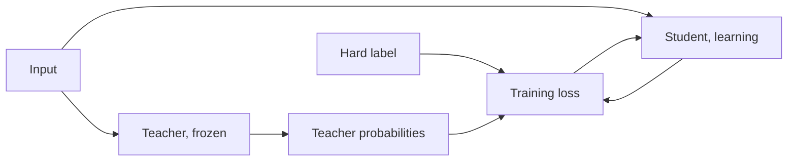

# Урок 1. Что даёт дистилляция

**Связь с целью курса:** Цель курса требует, чтобы вы могли объяснить, почему мягкие метки учителя несут больше обучающего сигнала, чем жёсткие, а это начинается с понимания того, что такое учитель и ученик и что дала имитация в статье, давшей название методу.
**Первоисточник:** [Научная статья: "Distilling the Knowledge in a Neural Network", Hinton, Vinyals and Dean, 2015](https://arxiv.org/abs/1503.02531)
**Предварительные требования:** [логит](../GLOSSARY.md), softmax и функция потерь кросс-энтропии (что предполагается известным, сказано в разделе «Ограничения» файла README)

## Что нужно знать

### Учитель и ученик

[Дистилляция](../GLOSSARY.md) обучает маленькую модель воспроизводить поведение более крупной. Более крупная модель это [учитель](../GLOSSARY.md). Во время обучения он зафиксирован. Меньшая модель это [ученик](../GLOSSARY.md), и только он и учится.

Hinton, Vinyals и Dean исходят из простого наблюдения. Модель обучают оптимизировать её оценку на обучающих данных, но вам нужно, чтобы она обобщалась на новые данные. Обучение на [жёстких метках](../GLOSSARY.md) не говорит, как обобщать, потому что эта информация обычно недоступна. Большая модель или ансамбль уже нашли способ хорошо обобщать. Если обучить ученика обобщать так же, то, как утверждает статья, на тестовых данных он обычно сработает заметно лучше, чем та же маленькая модель, обученная обычным способом на том же обучающем наборе.

Механизм состоит в цели обучения. Вместо one-hot-метки ученика обучают на вероятностях учителя по каждому классу, которые статья называет мягкими метками. Урок 2 раскрывает это подробно. Пока запомните одно утверждение из статьи: когда у мягких меток высокая энтропия, они дают гораздо больше информации на один обучающий пример, чем жёсткие, и меньшую дисперсию градиента между примерами. Авторы говорят, что ученика часто можно обучать на гораздо меньшем объёме данных и со значительно большей скоростью обучения, чем исходную модель.

### Что сообщает статья

Это числа статьи на её собственных постановках. Ни одно из них не является обещанием для других моделей.

На MNIST сеть с двумя скрытыми слоями по 1200 блоков линейной ректификации, сильно регуляризованная дропаутом и ограничениями на веса и обученная на искажённых входах, сделала 67 ошибок на тесте. Меньшая сеть с двумя скрытыми слоями по 800 блоков без регуляризации сделала 146 ошибок. Когда эту меньшую сеть регуляризовали только тем, что добавили задачу воспроизводить мягкие метки большой сети при температуре 20, она сделала 74 ошибки (раздел 3). Мягкие метки передали то, чему искажённые обучающие данные научили большую сеть, хотя в переносимом наборе ученика не было сдвинутых изображений.

На распознавании речи статья обучает акустическую модель с 8 скрытыми слоями по 2560 блоков, около 85M параметров, на примерно 2000 часов английской речи. Таблица 1 приводит точность по кадрам на тесте и долю ошибочных слов (WER) на отладочном наборе:

| Система | Точность по кадрам на тесте | WER |
|---|---|---|
| Базовая модель | 58.9% | 10.9% |
| Ансамбль из 10 моделей | 61.1% | 10.7% |
| Дистиллированная одиночная модель | 60.8% | 10.7% |

Учитель здесь это ансамбль из 10 отдельно инициализированных моделей. Дистиллированная одиночная модель имеет размер базовой и почти точность ансамбля. Статья говорит, что было передано более 80% прироста точности по кадрам, который даёт ансамбль.

### Разобранный пример на трансформере

DistilBERT (Sanh et al., 2019) применяет ту же идею к BERT во время предобучения. У ученика вдвое меньше слоёв, и он инициализируется взятием одного слоя из каждых двух слоёв учителя. Его функция потерь это линейная комбинация трёх слагаемых: потери дистилляции на мягких вероятностях учителя, потери маскированного языкового моделирования и потери косинусной близости эмбеддингов, которая выравнивает скрытые состояния ученика и учителя. Статья сообщает о модели, которая на 40% меньше и на 60% быстрее при инференсе и сохраняет 97% качества BERT на бенчмарке GLUE. Это один ученик, один учитель, один бенчмарк.

### Чем дистилляция LLM отличается

Всё сказанное выше предсказывает одну метку на вход из небольшого набора классов. Языковая модель предсказывает последовательность, по одному токену за раз, по словарю из десятков или сотен тысяч элементов, так что в каждой позиции есть распределение, а ученик потом продолжает от префиксов, которые написал сам. Чтобы согласовывать распределения позиция за позицией, обе модели должны использовать один и тот же индекс словаря, чего два семейства моделей обычно не делают. И нужен доступ к логитам учителя. MiniLLM (Gu et al., 2023) называет это разделение: дистилляция «чёрного ящика» располагает только текстом, который сгенерировал учитель, а дистилляция «белого ящика» располагает ещё и его выходным распределением.

Уроки с 4 по 7 учат токенной функции потерь, выбору дивергенции, ограничению общего словаря и дистилляции во время предобучения. Уроки 8 и 9 учат тому, что делать, когда доступен только текст.

## Практика

1. ▢ На MNIST сеть из 800 блоков без регуляризации сама по себе сделала 146 ошибок на тесте. Обученная с дополнительной задачей воспроизведения мягких меток сети из 1200 блоков при температуре 20, сколько ошибок она сделала примерно?

    - a) Около 146 ошибок, без изменений
    - b) Около 74 ошибок, почти вдвое меньше
    - c) Около 67 ошибок, столько же, сколько у учителя
    - d) Около 206 ошибок, намного хуже

Подсказка

Статья утверждает, что мягкие метки передают очень много знаний, но не все.

Проверка

**b)** Статья сообщает о 74 ошибках (раздел 3). Это не (a), потому что мягкие метки помогли. Это не (c): дистиллированная сеть приблизилась к 67 ошибкам учителя, но не сравнялась с ним. Это не (d): 206 относится к другому эксперименту, к ученику, который никогда не видел цифру 3.

2. ▢ В эксперименте с речью какую долю разрыва по точности по кадрам на тесте между базовой моделью и ансамблем из 10 моделей закрыла дистиллированная одиночная модель?

Подсказка

Вычтите базовую модель из каждого из двух других чисел, прежде чем делить.

Проверка

(60.8 - 58.9) / (61.1 - 58.9) = 1.9 / 2.2, около 86%. Статья говорит о более чем 80%. Выигрыш по WER меньше, потому что точность по кадрам в конечном счёте не та цель, которая важна, и статья отмечает то же несоответствие.

3. ▢ Удаление какой части рецепта DistilBERT стоило макро-оценке GLUE больше всего в таблице 4 статьи?

    - a) Потеря дистилляции на мягких метках
    - b) Потеря выравнивания косинусной близости эмбеддингов
    - c) Потеря маскированного языкового моделирования
    - d) Инициализация каждым вторым слоем

Проверка

**d)** Обучение со случайной инициализацией вместо слоёв учителя стоило 3.69 пункта. Удаление потери дистилляции стоило 2.96, потери косинусной близости 1.46, а потери маскированного языкового моделирования всего 0.31. Абляция принадлежит самому DistilBERT, так что она говорит, что было важно для этого ученика, а не для любого ученика.

4. ▢ Почему у коллеги, который может только вызывать API размещённой модели и читать её текстовые ответы, нет того, что нужно для мягких меток из этого урока?

Проверка

Мягкие метки это выходное распределение учителя. MiniLLM называет дистилляцию, использующую только сгенерированный учителем текст, дистилляцией «чёрного ящика», а дистилляцию, у которой есть ещё и выходное распределение, дистилляцией «белого ящика». Один лишь текст даёт один выбранный ответ на промпт, что ближе к жёсткой метке от учителя. Этап 3 учит тому, что этот путь всё же может передать.

5. ▢ Hinton и соавторы говорят, что ученик, обученный обобщать как его учитель, обычно справляется лучше, чем тот же ученик, обученный обычным способом. Что, по их словам, должно быть у учителя, чтобы это выполнялось?

Проверка

Он сам должен хорошо обобщать, например потому, что это среднее по большому ансамблю. Ученик может унаследовать только такой способ обобщения, который есть у учителя. Статья формулирует это условие во введении, а разрыв имитации на этапе 6 возвращается к тому, чего имитация не копирует.

## Практика в реальной работе

- [ ] Прочитайте разделы 1 и 3 первоисточника и запишите по одному предложению о том, чем был переносимый набор в экспериментах на MNIST и чего у большой сети было, а у маленькой не было.
- [ ] Выберите маленькую модель, которой вы пользуетесь, и запишите её вероятного учителя: какую более крупную модель из того же семейства вы взяли бы для её обучения и есть ли у вас её логиты или только текст?
- [ ] Завтра: без заметок определите учителя, ученика и мягкие метки по одному предложению на каждое, а затем назовите числа по MNIST и по речи, которые вы помните.

## Что почитать дальше

- [Функции потерь дистилляции](../reference/distillation-losses.md)
- [Научная статья: "Distilling the Knowledge in a Neural Network", Hinton, Vinyals and Dean, 2015](https://arxiv.org/abs/1503.02531)
- [Научная статья: "DistilBERT, a distilled version of BERT: smaller, faster, cheaper and lighter", Sanh et al., 2019](https://arxiv.org/abs/1910.01108)
- [Научная статья: "MiniLLM: On-Policy Distillation of Large Language Models", Gu et al., 2023](https://arxiv.org/abs/2306.08543)
- [Ресурсы](../RESOURCES.md)

---

Не доходит? Перечитайте первоисточник в начале: этот урок его сжимает, а при сжатии понимание как раз и теряется. Загляните в [глоссарий](../GLOSSARY.md), если какой-то термин показался скользким.

Если неясен сам урок, а не материал, это дефект: [откройте issue](https://github.com/TokenCemetery/teach/issues).
