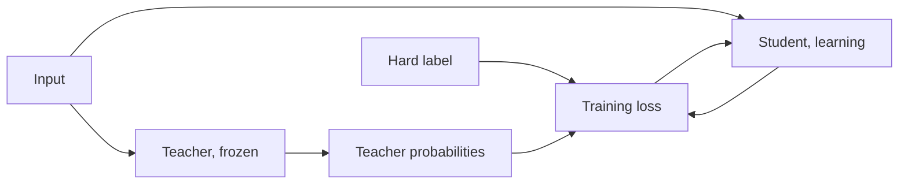

# 第 1 课：蒸馏能带来什么

**使命关联:** 本使命要求你解释为什么教师的软目标比硬标签携带更多训练信号，而这要从教师和学生是什么、以及命名这种方法的那篇论文里模仿带来了什么讲起。
**主要来源:** [论文：“Distilling the Knowledge in a Neural Network”，Hinton、Vinyals 和 Dean，2015](https://arxiv.org/abs/1503.02531)
**前置知识:** [logit](../GLOSSARY.md)、softmax 和交叉熵损失（README 的约束一节说明了默认你已掌握什么）

## 要点

### 教师与学生

[蒸馏](../GLOSSARY.md)是训练一个小模型去复现更大模型的行为。更大的模型是[教师模型](../GLOSSARY.md)，它在训练期间保持固定。较小的模型是[学生模型](../GLOSSARY.md)，也是唯一在学习的东西。

Hinton、Vinyals 和 Dean 从一个朴素的观察出发。模型的训练是为了优化它在训练数据上的得分，而你想要的却是它能泛化到新数据。用[硬标签](../GLOSSARY.md)训练，无法告诉模型该如何泛化，因为这类信息通常得不到。大模型或者模型集成，已经找到了一种泛化得好的方式。如果训练学生以同样的方式泛化，论文说，它在测试数据上的表现通常会比同一个小模型用同一份训练集以常规方式训练好得多。

机制就在目标上。学生训练时用的不是 one-hot 标签，而是教师在每个类别上的概率，论文把它叫作软目标。第 2 课会把它展开。现在先记住论文里的一个论断：当软目标的熵较高时，每个训练样本提供的信息比硬目标多得多，样本之间梯度的方差也更小。作者说，学生往往可以用少得多的数据、高得多的学习率来训练，相比原来的模型而言。

### 论文报告了什么

下面是论文在它自己的设置上得到的数字。两者都不是对其他模型的承诺。

在 MNIST 上，一个有两个隐藏层、每层 1200 个整流线性单元的网络，用 dropout 和权重约束做了强正则化，并在抖动过的输入上训练，测试集上出现了 67 个错误。一个较小的网络，有两个隐藏层、每层 800 个单元，且没有正则化，出现了 146 个错误。当这个较小网络唯一的正则化手段，是增加一项任务，即在温度为 20 时匹配大网络的软目标，它出现了 74 个错误（第 3 节）。尽管学生的迁移集里并没有平移过的图像，软目标仍然携带了抖动过的训练数据教给大网络的东西。

在语音识别上，论文训练了一个声学模型，有 8 个隐藏层，每层 2560 个单元，约 8500 万参数，使用约 2000 小时的英语语音。表 1 报告了开发集上的测试帧准确率和词错误率：

| 系统 | 测试帧准确率 | WER |
|---|---|---|
| 基线 | 58.9% | 10.9% |
| 10 个模型的集成 | 61.1% | 10.7% |
| 蒸馏后的单个模型 | 60.8% | 10.7% |

这里的教师是 10 个分别初始化的模型组成的集成。蒸馏后的单个模型与基线大小相同，准确率却几乎与集成相当。论文说，集成在帧准确率上的提升，有超过 80% 被迁移了过来。

### 一个 Transformer 的实例

DistilBERT（Sanh 等，2019）在预训练期间把同样的思路用在 BERT 上。学生的层数只有一半，初始化方式是从教师每两层取一层。它的损失是三项的线性组合：针对教师软概率的蒸馏损失、掩码语言建模损失，以及让学生与教师的隐藏状态对齐的余弦嵌入损失。论文报告，得到的模型小了 40%，推理快了 60%，在 GLUE 基准上保留了 BERT 97% 的表现。这只是一个学生、一个教师、一个基准。

### LLM 蒸馏有何不同

上面讲的都是针对每个输入，从一小组类别里预测一个标签。语言模型预测的是一条序列，一次一个 token，面对的词表有几万甚至几十万项，所以每个位置上都有一个分布，而学生之后还要从它自己写出的前缀继续往下生成。逐位置地匹配分布，要求两个模型使用同一套词表索引，而两个模型家族通常并不如此。同时还需要能访问教师的 logit。MiniLLM（Gu 等，2023）给这种分界起了名字：黑盒蒸馏只有教师生成的文本，白盒蒸馏则还有它的输出分布。

第 4 至 7 课讲 token 级损失、散度的选择、共享词表的约束，以及预训练期间的蒸馏。第 8 和第 9 课讲只有文本可用时该怎么办。

## 练习

1. ▢ 在 MNIST 上，没有正则化的 800 单元网络单独训练时出现了 146 个测试错误。当它增加一项任务，在温度 20 时匹配 1200 单元网络的软目标来训练，大约出现了多少个错误？

    - a) 大约 146 个错误，没有变化
    - b) 大约 74 个错误，几乎减半
    - c) 大约 67 个错误，与教师相同
    - d) 大约 206 个错误，差了很多

提示

论文的论断是，软目标迁移了大量的知识，但不是全部。

检查

**b)** 论文报告的是 74 个错误（第 3 节）。不是 (a)，因为软目标起了作用。不是 (c)：蒸馏后的网络接近教师的 67，但没有与之持平。不是 (d)：206 是另一个实验，是从未见过数字 3 的那个学生。

2. ▢ 在语音实验中，蒸馏后的单个模型，弥合了基线与 10 个模型的集成之间测试帧准确率差距的多大一部分？

提示

先用另外两个数字各自减去基线，再相除。

检查

(60.8 - 58.9) / (61.1 - 58.9) = 1.9 / 2.2，约 86%。论文说的是超过 80%。WER 上的收益要小一些，因为帧准确率并不是最终真正要紧的目标，论文也指出了同样的不匹配。

3. ▢ 在论文的表 4 中，DistilBERT 的配方里，去掉哪一部分会使 GLUE 宏平均分下降得最多？

    - a) 软目标蒸馏损失
    - b) 余弦嵌入对齐损失
    - c) 掩码语言建模损失
    - d) 每隔一层初始化

检查

**d)** 用随机初始化而不是教师的层来训练，损失了 3.69 分。去掉蒸馏损失损失了 2.96 分，去掉余弦损失损失了 1.46 分，去掉掩码语言建模损失只损失了 0.31 分。这项消融是 DistilBERT 自己的，所以它说明的是对那个学生什么要紧，而不是对每个学生。

4. ▢ 为什么一位同事只能调用托管的模型 API、读取它返回的文本，就得不到本课所说的软目标？

检查

软目标是教师的输出分布。MiniLLM 把只使用教师生成文本的蒸馏叫作黑盒，把还拥有输出分布的蒸馏叫作白盒。只有文本时，每个提示词只能得到一个采样出来的答案，更接近教师给出的一个硬标签。第 3 阶段会讲这条路线仍然能迁移什么。

5. ▢ Hinton 等人说，训练得像教师那样泛化的学生，通常比同一个学生用常规方式训练要好。他们说教师必须具备什么，这一点才成立？

检查

教师自己必须泛化得好，例如它是一个大型集成的平均。学生只能继承教师所拥有的泛化方式。论文在引言里陈述了这个条件，而第 6 阶段的模仿差距会回到模仿没有复制的东西上。

## 实战练习

- [ ] 阅读主要来源的第 1 节和第 3 节，并各用一句话写下：MNIST 实验里的迁移集是什么，以及大网络拥有而小网络缺少的是什么。
- [ ] 挑一个你在用的小模型，写下它可能的教师：你会从同一个家族里哪个更大的模型来训练它，你手里有它的 logit 还是只有它的文本？
- [ ] 明天：不看笔记，各用一句话定义教师、学生和软目标，然后说出你记得的 MNIST 和语音实验的数字。

## 延伸阅读

- [蒸馏损失](../reference/distillation-losses.md)
- [论文：“Distilling the Knowledge in a Neural Network”，Hinton、Vinyals 和 Dean，2015](https://arxiv.org/abs/1503.02531)
- [论文：“DistilBERT, a distilled version of BERT: smaller, faster, cheaper and lighter”，Sanh 等，2019](https://arxiv.org/abs/1910.01108)
- [论文：“MiniLLM: On-Policy Distillation of Large Language Models”，Gu 等，2023](https://arxiv.org/abs/2306.08543)
- [资源](../RESOURCES.md)

---

没学明白？请重读顶部的主要来源，因为本课是对它的压缩，而理解正是在压缩中流失的。如果有哪个术语觉得含糊，可以查看[术语表](../GLOSSARY.md)。

如果问题出在课程本身，而不是学习材料，那就是一个缺陷：[提交 issue](https://github.com/TokenCemetery/teach/issues)。
