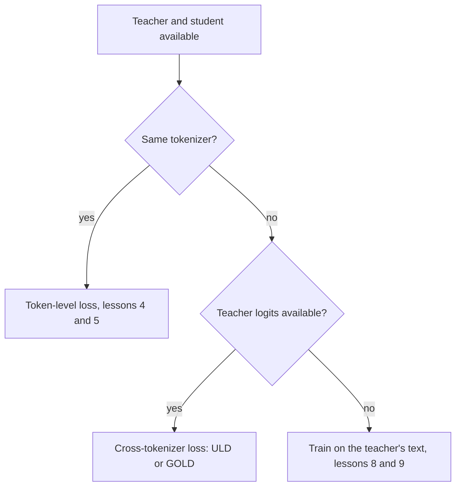

# Lección 6. La restricción del tokenizer

**Vínculo con la misión:** La misión te pide decir cuándo un desajuste de tokenizer descarta la destilación de logits, y esta lección da la razón, la pérdida entre tokenizers que lo rodea y lo que esa pérdida cuesta.
**Fuente principal:** [Paper: "Towards Cross-Tokenizer Distillation: the Universal Logit Distillation Loss for LLMs", Boizard et al., 2024](https://arxiv.org/abs/2402.12030)
**Requisitos previos:** [Lección 5](0005-forward-and-reverse-kl.md), [Destilación de logits](../GLOSSARY.md), [Destilación entre tokenizers](../GLOSSARY.md), [Destilación a nivel de token](../GLOSSARY.md)

## Calentamiento

1. ▢ ¿Qué dirección de la KL es casi sorda a una probabilidad diminuta del profesor, y cuál castiga la masa del estudiante colocada ahí?

<details markdown="1"><summary>Comprobación</summary>

La [KL directa](../GLOSSARY.md) es casi sorda, porque la probabilidad del profesor multiplica la razón logarítmica. La [KL inversa](../GLOSSARY.md) castiga la masa del estudiante en tokens a los que el profesor da casi nada, porque la probabilidad del estudiante multiplica la razón logarítmica.

</details>

2. ▢ ¿Cuáles son las formas de los tensores de logits que toma `token_kd_loss` de la lección 4, y sobre qué eje corre la divergencia?

<details markdown="1"><summary>Comprobación</summary>

Ambos son (batch, positions, vocab). La divergencia corre sobre el último eje, el vocabulario, así que la entrada i de la fila del estudiante se compara con la entrada i de la fila del profesor. Esa comparación es de lo que trata esta lección.

</details>

## Qué debes saber

### Por qué el índice tiene que coincidir

La pérdida a nivel de token compara la probabilidad del estudiante para el token i con la probabilidad del profesor para el mismo token i. Eso solo tiene sentido cuando el índice i nombra el mismo token en ambos vocabularios. Boizard et al. lo enuncian como una condición de la pérdida KL: depende de la igualdad de los vocabularios del estudiante y del profesor, de modo que las dos distribuciones tengan el mismo soporte (ecuación 2, sección 2.4). Su Figura 2 añade que un desajuste también rompe la continuidad absoluta necesaria para que esté definido el cociente dentro del logaritmo de la KL.

Dos cosas fallan a la vez cuando los tokenizers difieren.

- **El vocabulario.** Los tensores pueden tener tamaños distintos en el último eje, e incluso cuando coinciden, el índice 5,000 puede ser una cadena distinta en cada uno. Su Figura 1 muestra lo pequeño que puede ser el solapamiento: el tokenizer de Bloomz tiene el 30.03% del vocabulario de Mistral.
- **Las posiciones.** Un tokenizer puede dividir una palabra en tres tokens donde el otro la mantiene entera, así que el mismo texto tiene una longitud distinta y los límites de las posiciones no se alinean. Una comparación posición por posición no puede empezar.



Los métodos que construyen el estudiante a partir del profesor evitan el problema por construcción. DistilBERT inicializa su estudiante con una de cada dos capas del profesor, y Minitron poda al propio profesor. Ambos papers escriben su pérdida con un índice compartido por profesor y estudiante: la suma sobre i de t_i log s_i de DistilBERT, y el único tamaño de vocabulario |V| para ambos modelos de Minitron (sección 3). Elegir un estudiante de la familia del profesor es la forma más barata de sortear la restricción.

### La pérdida Universal Logit Distillation

ULD (Boizard et al., 2024) elimina el requisito de soporte compartido usando una distancia distinta. Mantiene la entropía cruzada ordinaria sobre el token de referencia y añade una distancia de Wasserstein entre las dos distribuciones en cada paso:

```text
L_ULD = sum_t CE(t) + lambda * W1(student distribution at t, teacher distribution at t)
```

La suma recorre |x|, la menor de las dos longitudes de secuencia cuando el texto se tokeniza con el tokenizer del estudiante y con el del profesor, y el paper fija lambda en 1.5 (sección 3.2, ecuación 4). Para abaratar W1 rellenan con ceros la distribución más corta hasta igualar la longitud y suponen que todos los costos de transporte son iguales a 1. Bajo esas dos elecciones W1 tiene una forma cerrada: ordena ambos vectores de probabilidad en orden decreciente y suma las diferencias absolutas. Cuesta O(n log n) en el tamaño del vocabulario (sección 3.3 y apéndice A.1).

```python
import numpy as np

def uld_w1(p_student, q_teacher):
    n = max(len(p_student), len(q_teacher))
    a = np.zeros(n); a[:len(p_student)] = p_student
    b = np.zeros(n); b[:len(q_teacher)] = q_teacher
    return float(np.abs(np.sort(a)[::-1] - np.sort(b)[::-1]).sum())

teacher = np.array([0.70, 0.20, 0.05, 0.05])
print(round(uld_w1(teacher, teacher), 4))                                       # same
print(round(uld_w1(np.array([0.05, 0.05, 0.20, 0.70]), teacher), 4))            # flipped
print(round(uld_w1(np.array([0.25, 0.25, 0.25, 0.25]), teacher), 4))            # flat
print(round(uld_w1(np.array([0.70, 0.20, 0.05, 0.03, 0.02, 0.0]), teacher), 4)) # larger vocab
```

Predice la segunda línea, donde el estudiante pone su 0.70 en el token al que el profesor da 0.05. La salida con NumPy 2.5:

```text
0.0
0.0
0.9
0.04
```

El estudiante invertido puntúa 0, igual que uno perfecto. Tras ordenar, los vectores son idénticos, así que la pérdida no puede saber que el estudiante cree en el token equivocado. El estudiante plano puntúa 0.9 porque su forma es distinta. La última línea muestra el sentido de la construcción: corre sin cambios sobre un vocabulario de seis entradas frente a uno de cuatro.

### A qué renuncia

Léelo a partir de la fórmula y de sus supuestos declarados.

- **La identidad del token.** Ordenar elimina a qué token pertenece cada probabilidad, así que la pérdida compara la forma de las distribuciones, cuán picudas o planas son, y no dónde está la masa. La señal de identidad viene solo de la entropía cruzada sobre el token de referencia. Eso es una consecuencia de la fórmula, como muestra el fragmento, y el propio texto del paper dice que la pérdida reproduce tanto las etiquetas casi nulas como la predicción de referencia.
- **El costo.** El paper llama al costo uniforme un supuesto fuerte y lo defiende con resultados.
- **La alineación de posiciones.** Las posiciones se emparejan por índice hasta la longitud menor, lo que es tosco cuando los dos tokenizers dividen el texto de forma distinta.
- **La KL directa y la inversa desaparecen.** La pérdida es una divergencia distinta, así que la elección de la lección 5 no se aplica.

En cuanto a resultados, el paper destila profesores de 7B, Llama 2 7B Chat y Mistral 7B Instruct, en modelos estudiantes más pequeños en question answering extractivo, question answering generativo y resumen. Informa de que ULD iguala a la destilación con el texto generado por el profesor con solo la mitad del dataset de entrenamiento o la mitad del tamaño del estudiante (conclusión). Son comparaciones propias de los autores en sus configuraciones.

### Qué ofrece TRL

El `GKDTrainer` de TRL toma un solo tokenizer, pasado como `processing_class`, y un `GKDConfig` sin argumento para un tokenizer de profesor aparte. La página de documentación no dice con palabras que profesor y estudiante deban compartir tokenizer, así que esto es una observación a partir de leer la API y la página ([documentación de GKD](https://huggingface.co/docs/trl/main/en/gkd_trainer), leída para esta lección). La documentación de GOLD dice qué añade.

GOLD, el trainer General Online Logit Distillation, se describe como una extensión de ULD que admite pares de estudiante y profesor con tokenizers distintos. Alinea los tramos de texto producidos por los dos tokenizers y fusiona los logits coincidentes para que no se descarte ningún token de la completion. Con `use_uld_loss=True` necesita `teacher_tokenizer_name_or_path`. Una opción híbrida compara directamente las coincidencias exactas de vocabulario y recurre a la pérdida ULD de probabilidades ordenadas para los tokens sin coincidencia. La página marca GOLD como parte del espacio de nombres `trl.experimental` y dice que sus API pueden cambiar sin aviso ([documentación de GOLD](https://huggingface.co/docs/trl/main/en/gold_trainer), leída para esta lección). Su propio ejemplo empareja un estudiante Llama 3.2 1B con un profesor Qwen2.5 0.5B.

Así que el orden práctico es: primero un estudiante de la misma familia, luego una pérdida entre tokenizers si no hay más remedio y tus herramientas la admiten, luego la vía de texto de la etapa 3 cuando no hay logits disponibles en absoluto.

## Práctica

1. ▢ En la ejecución de ULD, ¿por qué el estudiante invertido puntúa exactamente 0?

<details markdown="1"><summary>Pista</summary>

Escribe los dos vectores después de ordenar cada uno en orden decreciente.

</details>

<details markdown="1"><summary>Comprobación</summary>

Ordenado de forma decreciente, el estudiante invertido es 0.70, 0.20, 0.05, 0.05, idéntico al profesor. La forma cerrada suma las diferencias absolutas entre vectores ordenados, así que es 0. La pérdida compara formas, no tokens, así que un estudiante que pone su masa en el token equivocado le parece perfecto. La entropía cruzada sobre el token de referencia es lo que tiene que detectarlo.

</details>

2. ▢ Un estudiante Llama y un profesor Qwen están ambos disponibles con logits completos. ¿Por qué no se puede aplicar `token_kd_loss` directamente a ellos?

    - a) Al profesor no se le permite correr sin gradientes
    - b) Los dos modelos difieren en su número total de parámetros
    - c) El mismo índice nombra tokens distintos en cada modelo
    - d) No se puede fijar la temperatura para dos familias de modelos

<details markdown="1"><summary>Comprobación</summary>

**c)** La pérdida compara la probabilidad i de una fila con la probabilidad i de la otra, y con tokenizers distintos el índice i es una cadena distinta, los tensores pueden incluso diferir en el último eje, y las posiciones pueden no alinearse. No es (b): estudiante y profesor siempre difieren en parámetros. No es (a): el profesor siempre corre sin gradientes. No es (d): la temperatura es un escalar aplicado por modelo.

</details>

3. ▢ Nombra dos cosas a las que ULD renuncia a cambio de funcionar entre tokenizers.

<details markdown="1"><summary>Comprobación</summary>

Cualquiera de estas dos: la identidad del token, ya que la comparación ordenada no puede ver qué token tiene la masa; el costo por token, ya que supone que todos los costos de transporte valen 1, lo que el paper llama un supuesto fuerte; la alineación exacta de posiciones, ya que las posiciones se emparejan por índice hasta la longitud menor; y la elección de la dirección de la KL. El punto de la identidad es el que el fragmento muestra directamente.

</details>

4. ▢ Tu profesor es un modelo alojado cuya API devuelve solo texto. ¿Se aplica la pérdida de esta lección, y qué ofrecen en su lugar las lecciones 8 y 9?

<details markdown="1"><summary>Comprobación</summary>

No. Tanto la pérdida a nivel de token como ULD necesitan las probabilidades del profesor, y el texto solo da una única secuencia muestreada. La vía es entrenar con las salidas decodificadas del profesor, que enseña la etapa 3. La tabla de lecciones del README dice que la lección 9 cubre cómo elegir según si el profesor expone logits o solo texto.

</details>

5. ▢ Un equipo quiere destilar un modelo de 7B en un estudiante de 1B de otra familia de modelos y planea usar `GKDTrainer`. ¿Qué deberían comprobar primero, y a qué trainer apunta la documentación de TRL para ese caso?

<details markdown="1"><summary>Comprobación</summary>

Deberían comprobar si los dos modelos comparten tokenizer, por ejemplo comparando los dos diccionarios `get_vocab()`. Si difieren, GKDTrainer toma un solo tokenizer y no ofrece argumento de tokenizer de profesor, y el trainer GOLD es el que está documentado como compatible con tokenizers distintos, con `use_uld_loss=True` y `teacher_tokenizer_name_or_path`. GOLD está marcado como experimental, así que consulta su página actual.

</details>

## Prácticas en el mundo real

- [ ] Carga los tokenizers de dos modelos abiertos con `AutoTokenizer`, toma la intersección de las claves de sus `get_vocab()` y anota el solapamiento como fracción de cada vocabulario.
- [ ] Tokeniza una oración con ambos y anota cuántos tokens produce cada uno y dónde difieren las divisiones.
- [ ] Mañana: sin apuntes, dibuja el diagrama de flujo de esta lección y di a qué renuncia ULD.

## Para profundizar

- [Pérdidas de destilación](../reference/distillation-losses.md)
- [Paper: "Towards Cross-Tokenizer Distillation: the Universal Logit Distillation Loss for LLMs", Boizard et al., 2024](https://arxiv.org/abs/2402.12030)
- [Documentation: "Generalized Knowledge Distillation Trainer", Hugging Face TRL](https://huggingface.co/docs/trl/main/en/gkd_trainer)
- [Documentation: "General Online Logit Distillation (GOLD) Trainer", Hugging Face TRL](https://huggingface.co/docs/trl/main/en/gold_trainer)
- [Recursos](../RESOURCES.md)

---

¿No termina de quedar claro? Vuelve a leer la fuente primaria de arriba, ya que esta lección la comprime y en la compresión es donde se escapa la comprensión. Consulta el [glosario](../GLOSSARY.md) por si algún término te resultó resbaladizo.

Si lo poco claro es la propia lección y no el material, eso es un defecto: [abre un issue](https://github.com/TokenCemetery/teach/issues).
