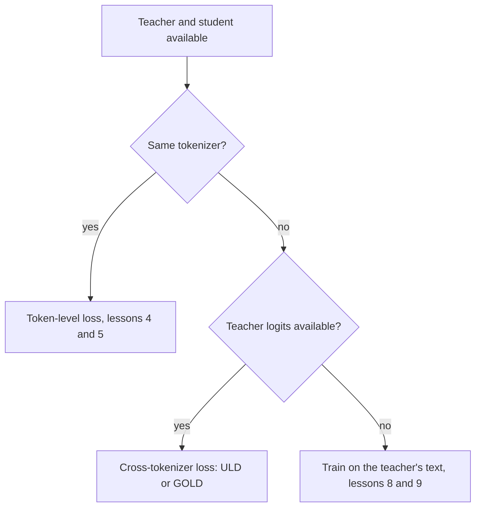

# Leçon 6. La contrainte du tokenizer

**Lien avec la mission :** La mission vous demande de dire quand une incompatibilité de tokenizer exclut la distillation de logits, et cette leçon donne la raison, la loss inter-tokenizers qui la contourne, et ce que cette loss coûte.
**Source primaire :** [Article : "Towards Cross-Tokenizer Distillation: the Universal Logit Distillation Loss for LLMs", Boizard et al., 2024](https://arxiv.org/abs/2402.12030)
**Prérequis :** [Leçon 5](0005-forward-and-reverse-kl.md), [Distillation de logits](../GLOSSARY.md), [Distillation inter-tokenizers](../GLOSSARY.md), [Distillation au niveau du token](../GLOSSARY.md)

## Échauffement

1. ▢ Quelle direction de la KL est presque sourde à une minuscule probabilité de l'enseignant, et laquelle punit la masse de l'élève placée à cet endroit ?

<details markdown="1"><summary>Vérifier</summary>

La [KL directe](../GLOSSARY.md) est presque sourde, parce que la probabilité de l'enseignant multiplie le log de rapport. La [KL inverse](../GLOSSARY.md) punit la masse de l'élève sur des tokens auxquels l'enseignant ne donne presque rien, parce que la probabilité de l'élève multiplie le log de rapport.

</details>

2. ▢ Quelles sont les formes des tenseurs de logits que prend `token_kd_loss` de la leçon 4, et sur quel axe porte la divergence ?

<details markdown="1"><summary>Vérifier</summary>

Les deux sont (batch, positions, vocab). La divergence porte sur le dernier axe, le vocabulaire, si bien que l'entrée i de la ligne de l'élève est comparée à l'entrée i de la ligne de l'enseignant. Cette comparaison est le sujet de cette leçon.

</details>

## À savoir

### Pourquoi l'index doit correspondre

La loss au niveau du token compare la probabilité de l'élève pour le token i à la probabilité de l'enseignant pour le même token i. Cela n'a de sens que si l'index i désigne le même token dans les deux vocabulaires. Boizard et al. l'énoncent comme une condition de la loss KL : elle repose sur l'égalité des vocabulaires de l'élève et de l'enseignant, pour que les deux distributions aient le même support (équation 2, section 2.4). Leur figure 2 ajoute qu'une incompatibilité casse aussi la continuité absolue nécessaire pour que le quotient à l'intérieur du logarithme de la KL soit défini.

Deux choses tournent mal à la fois quand les tokenizers diffèrent.

- **Le vocabulaire.** Les tenseurs peuvent avoir des tailles différentes sur le dernier axe, et même quand elles coïncident, l'index 5,000 peut être une chaîne différente dans chacun. Leur figure 1 montre à quel point le recouvrement peut être faible : le tokenizer de Bloomz représente 30.03 % du vocabulaire de Mistral.
- **Les positions.** Un tokenizer peut découper un mot en trois tokens là où l'autre le garde entier, si bien que le même texte a une longueur différente et que les frontières de positions ne s'alignent pas. Une comparaison position par position ne peut pas commencer.



Les méthodes qui construisent l'élève à partir de l'enseignant évitent le problème par construction. DistilBERT initialise son élève à partir d'une couche sur deux de l'enseignant, et Minitron élague l'enseignant lui-même. Les deux articles écrivent leur loss avec un seul index partagé par l'enseignant et l'élève : la somme sur i de t_i log s_i de DistilBERT, et la taille de vocabulaire unique |V| de Minitron pour les deux modèles (section 3). Choisir un élève dans la famille de l'enseignant est la manière la moins chère de contourner la contrainte.

### La loss Universal Logit Distillation

ULD (Boizard et al., 2024) abandonne l'exigence d'un support partagé en utilisant une autre distance. Elle garde l'entropie croisée ordinaire sur le token de référence et ajoute une distance de Wasserstein entre les deux distributions à chaque étape :

```text
L_ULD = sum_t CE(t) + lambda * W1(student distribution at t, teacher distribution at t)
```

La somme porte sur |x|, la plus petite des deux longueurs de séquence quand le texte est tokenisé par le tokenizer de l'élève et par celui de l'enseignant, et l'article fixe lambda à 1.5 (section 3.2, équation 4). Pour rendre W1 peu coûteuse, ils complètent par des zéros la distribution la plus courte jusqu'à égaler la longueur et supposent que chaque coût de transport vaut 1. Avec ces deux choix, W1 a une forme close : trier les deux vecteurs de probabilités par ordre décroissant et sommer les différences absolues. Elle coûte O(n log n) en la taille du vocabulaire (section 3.3 et annexe A.1).

```python
import numpy as np

def uld_w1(p_student, q_teacher):
    n = max(len(p_student), len(q_teacher))
    a = np.zeros(n); a[:len(p_student)] = p_student
    b = np.zeros(n); b[:len(q_teacher)] = q_teacher
    return float(np.abs(np.sort(a)[::-1] - np.sort(b)[::-1]).sum())

teacher = np.array([0.70, 0.20, 0.05, 0.05])
print(round(uld_w1(teacher, teacher), 4))                                       # same
print(round(uld_w1(np.array([0.05, 0.05, 0.20, 0.70]), teacher), 4))            # flipped
print(round(uld_w1(np.array([0.25, 0.25, 0.25, 0.25]), teacher), 4))            # flat
print(round(uld_w1(np.array([0.70, 0.20, 0.05, 0.03, 0.02, 0.0]), teacher), 4)) # larger vocab
```

Prédisez la deuxième ligne, où l'élève met son 0.70 sur le token auquel l'enseignant donne 0.05. La sortie avec NumPy 2.5 :

```text
0.0
0.0
0.9
0.04
```

L'élève inversé obtient 0, comme un élève parfait. Après le tri, les vecteurs sont identiques, donc la loss ne peut pas voir que l'élève croit au mauvais token. L'élève plat obtient 0.9 parce que sa forme est différente. La dernière ligne montre l'intérêt de la construction : elle tourne telle quelle sur un vocabulaire de six entrées face à un de quatre.

### Ce qu'elle abandonne

Lisez-le dans la formule et ses hypothèses déclarées.

- **L'identité des tokens.** Le tri supprime l'information de savoir à quel token appartient chaque probabilité, si bien que la loss compare la forme des distributions, leur caractère piqué ou plat, et non l'endroit où se trouve la masse. Le signal d'identité vient uniquement de l'entropie croisée sur le token de référence. C'est une conséquence de la formule, comme le montre le fragment, et le texte de l'article dit lui-même que la loss reproduit les labels proches de zéro aussi bien que la prédiction de référence.
- **Le coût.** L'article appelle le coût uniforme une hypothèse forte et la défend par les résultats.
- **L'alignement des positions.** Les positions sont appariées par index jusqu'à la longueur la plus courte, ce qui est grossier quand les deux tokenizers découpent le texte différemment.
- **KL inverse et KL directe disparaissent.** La loss est une autre divergence, donc le choix de la leçon 5 ne s'applique pas.

Pour les résultats, l'article distille des enseignants de 7B, Llama 2 7B Chat et Mistral 7B Instruct, en élèves plus petits sur de la question-réponse extractive, de la question-réponse générative et du résumé. Il rapporte qu'ULD égale la distillation sur le texte généré par l'enseignant avec seulement la moitié du jeu d'entraînement ou la moitié de la taille de l'élève (conclusion). Ce sont les comparaisons des auteurs sur leurs configurations.

### Ce qu'offre TRL

Le `GKDTrainer` de TRL prend un seul tokenizer, passé comme `processing_class`, et une `GKDConfig` sans argument pour un tokenizer d'enseignant séparé. La page de documentation n'énonce pas en toutes lettres que l'enseignant et l'élève doivent partager un tokenizer, c'est donc une observation tirée de la lecture de l'API et de la page ([documentation de GKD](https://huggingface.co/docs/trl/main/en/gkd_trainer), lue pour cette leçon). La documentation de GOLD dit ce qu'il ajoute.

GOLD, le trainer General Online Logit Distillation, est décrit comme une extension d'ULD qui prend en charge des paires élève-enseignant avec des tokenizers différents. Il aligne les segments de texte produits par les deux tokenizers et fusionne les logits correspondants pour qu'aucun token de complétion ne soit perdu. Avec `use_uld_loss=True`, il a besoin de `teacher_tokenizer_name_or_path`. Une option hybride compare directement les correspondances exactes de vocabulaire et se rabat sur la loss ULD à probabilités triées pour les tokens sans correspondance. La page marque GOLD comme faisant partie de l'espace de noms `trl.experimental` et dit que ses API peuvent changer sans préavis ([documentation de GOLD](https://huggingface.co/docs/trl/main/en/gold_trainer), lue pour cette leçon). Son propre exemple associe un élève Llama 3.2 1B à un enseignant Qwen2.5 0.5B.

L'ordre pratique est donc : d'abord un élève de la même famille, puis une loss inter-tokenizers si vous le devez et que votre outillage la prend en charge, puis la voie du texte de l'étape 3 quand les logits ne sont pas disponibles du tout.

## Pratique

1. ▢ Dans le run ULD, pourquoi l'élève inversé obtient-il exactement 0 ?

<details markdown="1"><summary>Indice</summary>

Écrivez les deux vecteurs après avoir trié chacun par ordre décroissant.

</details>

<details markdown="1"><summary>Vérifier</summary>

Trié par ordre décroissant, l'élève inversé donne 0.70, 0.20, 0.05, 0.05, identique à l'enseignant. La forme close somme les différences absolues entre vecteurs triés, donc elle vaut 0. La loss compare des formes, pas des tokens, si bien qu'un élève qui met sa masse sur le mauvais token lui paraît parfait. C'est l'entropie croisée sur le token de référence qui doit l'attraper.

</details>

2. ▢ Un élève Llama et un enseignant Qwen sont tous deux disponibles avec leurs logits complets. Pourquoi ne peut-on pas leur appliquer directement `token_kd_loss` ?

    - a) L'enseignant n'a pas le droit de tourner sans gradients
    - b) Les deux modèles diffèrent par leur nombre total de paramètres
    - c) Le même index désigne des tokens différents dans chaque modèle
    - d) La température ne peut pas être réglée pour deux familles de modèles

<details markdown="1"><summary>Vérifier</summary>

**c)** La loss compare la probabilité i d'une ligne à la probabilité i de l'autre, et avec des tokenizers différents l'index i est une chaîne différente, les tenseurs peuvent même différer sur le dernier axe, et les positions peuvent ne pas s'aligner. Ce n'est pas (b) : l'élève et l'enseignant diffèrent toujours par leurs paramètres. Ce n'est pas (a) : l'enseignant tourne toujours sans gradients. Ce n'est pas (d) : la température est un scalaire appliqué par modèle.

</details>

3. ▢ Nommez deux choses qu'ULD abandonne en échange de son fonctionnement entre tokenizers.

<details markdown="1"><summary>Vérifier</summary>

N'importe lesquelles de ces deux-là : l'identité des tokens, puisque la comparaison triée ne peut pas voir quel token détient la masse ; le coût par token, puisqu'elle suppose que chaque coût de transport vaut 1, ce que l'article appelle une hypothèse forte ; l'alignement exact des positions, puisque les positions sont appariées par index jusqu'à la longueur la plus courte ; et le choix de la direction de la KL. Le point sur l'identité est celui que le fragment montre directement.

</details>

4. ▢ Votre enseignant est un modèle hébergé dont l'API ne renvoie que du texte. La loss de cette leçon s'applique-t-elle, et qu'offrent à la place les leçons 8 et 9 ?

<details markdown="1"><summary>Vérifier</summary>

Non. La loss au niveau du token comme ULD ont besoin des probabilités de l'enseignant, et le texte seul donne une seule séquence échantillonnée. La voie est d'entraîner sur les sorties décodées de l'enseignant, ce qu'enseigne l'étape 3. Le tableau des leçons du README dit que la leçon 9 couvre le choix selon que l'enseignant expose des logits ou seulement du texte.

</details>

5. ▢ Une équipe veut distiller un modèle 7B en un élève 1B d'une autre famille de modèles et prévoit d'utiliser `GKDTrainer`. Que doit-elle vérifier d'abord, et quel trainer la documentation de TRL désigne-t-elle pour ce cas ?

<details markdown="1"><summary>Vérifier</summary>

Elle doit vérifier si les deux modèles partagent un tokenizer, par exemple en comparant les deux dictionnaires `get_vocab()`. S'ils diffèrent, GKDTrainer prend un seul tokenizer et n'offre aucun argument pour un tokenizer d'enseignant, et le trainer GOLD est celui documenté comme prenant en charge des tokenizers différents, avec `use_uld_loss=True` et `teacher_tokenizer_name_or_path`. GOLD est marqué expérimental, vérifiez donc sa page actuelle.

</details>

## Exercices en situation réelle

- [ ] Chargez les tokenizers de deux modèles ouverts avec `AutoTokenizer`, prenez l'intersection de leurs clés `get_vocab()`, et notez le recouvrement comme fraction de chaque vocabulaire.
- [ ] Tokenisez une phrase avec les deux et notez combien de tokens chacun produit et où les découpages diffèrent.
- [ ] Demain : sans notes, dessinez l'organigramme de cette leçon et dites ce qu'abandonne ULD.

## Pour aller plus loin

- [Loss de distillation](../reference/distillation-losses.md)
- [Article : "Towards Cross-Tokenizer Distillation: the Universal Logit Distillation Loss for LLMs", Boizard et al., 2024](https://arxiv.org/abs/2402.12030)
- [Doc : "Generalized Knowledge Distillation Trainer", Hugging Face TRL](https://huggingface.co/docs/trl/main/en/gkd_trainer)
- [Doc : "General Online Logit Distillation (GOLD) Trainer", Hugging Face TRL](https://huggingface.co/docs/trl/main/en/gold_trainer)
- [Ressources](../RESOURCES.md)

---

Ça ne passe pas ? Relisez la source primaire en haut de page, car cette leçon la condense et c'est dans la condensation que la compréhension s'échappe. Consultez le [glossaire](../GLOSSARY.md) pour tout terme qui vous a paru glissant.

Si c'est la leçon elle-même qui n'est pas claire plutôt que la matière, c'est un défaut : [ouvrez une issue](https://github.com/TokenCemetery/teach/issues).
