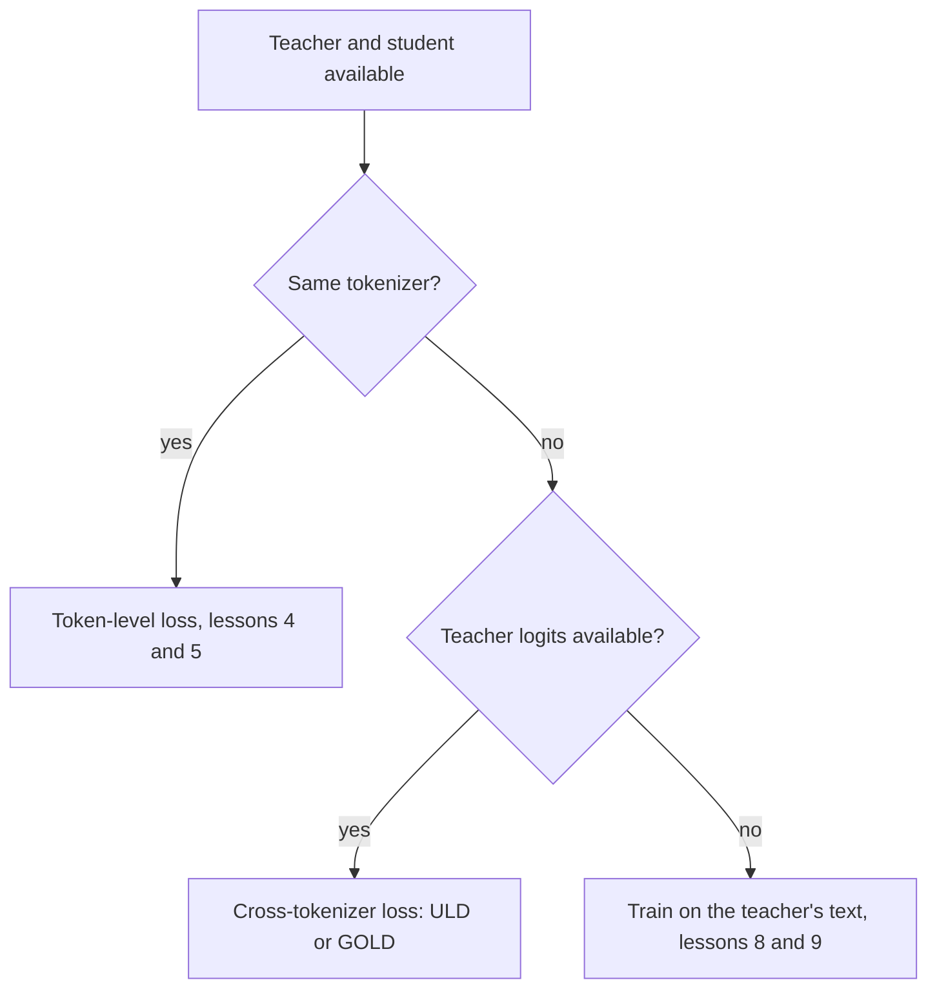

# पाठ 6. Tokenizer की बाध्यता

**मिशन से संबंध:** मिशन आपसे माँगता है कि आप बता सकें कि tokenizer mismatch कब logit distillation को नामुमकिन कर देता है, और यह पाठ उसका कारण, उसे दरकिनार करने वाला cross-tokenizer loss, और उस loss की क़ीमत देता है।
**मुख्य स्रोत:** [पेपर: "Towards Cross-Tokenizer Distillation: the Universal Logit Distillation Loss for LLMs", Boizard et al., 2024](https://arxiv.org/abs/2402.12030)
**पूर्व-आवश्यकताएँ:** [पाठ 5](0005-forward-and-reverse-kl.md), [Logit distillation](../GLOSSARY.md), [Cross-tokenizer distillation](../GLOSSARY.md), [Token-level distillation](../GLOSSARY.md)

## वार्म-अप

1. ▢ KL की कौन-सी दिशा teacher की बहुत छोटी probability के प्रति लगभग बहरी है, और कौन-सी student के वहाँ रखे mass को दंडित करती है?

<details markdown="1"><summary>जाँचें</summary>

[Forward KL](../GLOSSARY.md) लगभग बहरा है, क्योंकि teacher की probability log अनुपात को गुणा करती है। [Reverse KL](../GLOSSARY.md) student के उस mass को दंडित करता है जो उन tokens पर है जिन्हें teacher लगभग कुछ नहीं देता, क्योंकि student की probability log अनुपात को गुणा करती है।

</details>

2. ▢ पाठ 4 का `token_kd_loss` जो logit tensors लेता है उनके आकार क्या हैं, और divergence किस axis पर चलता है?

<details markdown="1"><summary>जाँचें</summary>

दोनों (batch, positions, vocab) हैं। Divergence आख़िरी axis, यानी vocabulary, पर चलता है, इसलिए student की पंक्ति की entry i की तुलना teacher की पंक्ति की entry i से होती है। यही तुलना इस पाठ का विषय है।

</details>

## यह जानें

### Index का मेल क्यों खाना चाहिए

Token-level loss student की token i की probability की तुलना teacher की उसी token i की probability से करता है। यह तभी अर्थपूर्ण है जब index i दोनों vocabularies में एक ही token का नाम हो। Boizard et al. इसे KL loss की शर्त के रूप में बताते हैं: वह student और teacher की vocabularies की समानता पर निर्भर है, ताकि दोनों distributions का support एक हो (equation 2, section 2.4)। उनकी Figure 2 जोड़ती है कि mismatch उस absolute continuity को भी तोड़ देता है जो KL के logarithm के अंदर के भागफल को परिभाषित रखने के लिए चाहिए।

जब tokenizers अलग हों तो दो चीज़ें एक साथ बिगड़ती हैं।

- **Vocabulary.** Tensors के आख़िरी axis का आकार अलग हो सकता है, और मेल खाने पर भी index 5,000 हर एक में अलग string हो सकता है। उनकी Figure 1 दिखाती है कि overlap कितना कम हो सकता है: Bloomz tokenizer के पास Mistral की vocabulary का 30.03% है।
- **Positions.** एक tokenizer किसी शब्द को तीन tokens में तोड़ सकता है जबकि दूसरा उसे साबुत रखता है, इसलिए एक ही text की लंबाई अलग होती है और position की सीमाएँ मेल नहीं खातीं। Position-दर-position तुलना शुरू ही नहीं हो सकती।



जो तरीक़े student को teacher से बनाते हैं, वे समस्या से निर्माण के स्तर पर ही बच जाते हैं। DistilBERT अपने student को teacher की हर दूसरी layer से initialize करता है, और Minitron ख़ुद teacher को prune करता है। दोनों पेपर अपना loss ऐसे लिखते हैं जिसमें teacher और student के लिए एक ही साझा index है: DistilBERT का i पर t_i log s_i का योग, और Minitron का दोनों models के लिए एक vocabulary आकार |V| (section 3)। Student को teacher के परिवार से चुनना इस बाध्यता को दरकिनार करने का सबसे सस्ता तरीक़ा है।

### Universal Logit Distillation loss

ULD (Boizard et al., 2024) अलग दूरी इस्तेमाल करके साझा-support की शर्त हटा देता है। वह gold token पर साधारण cross-entropy रखता है और हर चरण पर दोनों distributions के बीच Wasserstein distance जोड़ देता है:

```text
L_ULD = sum_t CE(t) + lambda * W1(student distribution at t, teacher distribution at t)
```

योग |x| पर चलता है, जो text को student के tokenizer और teacher के tokenizer से tokenize करने पर दोनों sequence लंबाइयों में से छोटी है, और पेपर lambda को 1.5 रखता है (section 3.2, equation 4)। W1 को सस्ता बनाने के लिए वे छोटे distribution को बराबर लंबाई तक pad करते हैं और मान लेते हैं कि हर transport cost 1 के बराबर है। उन दो चुनावों के तहत W1 का एक closed form है: दोनों probability vectors को घटते क्रम में sort करें और निरपेक्ष अंतरों का योग लें। इसकी लागत vocabulary आकार में O(n log n) है (section 3.3 और appendix A.1)।

```python
import numpy as np

def uld_w1(p_student, q_teacher):
    n = max(len(p_student), len(q_teacher))
    a = np.zeros(n); a[:len(p_student)] = p_student
    b = np.zeros(n); b[:len(q_teacher)] = q_teacher
    return float(np.abs(np.sort(a)[::-1] - np.sort(b)[::-1]).sum())

teacher = np.array([0.70, 0.20, 0.05, 0.05])
print(round(uld_w1(teacher, teacher), 4))                                       # same
print(round(uld_w1(np.array([0.05, 0.05, 0.20, 0.70]), teacher), 4))            # flipped
print(round(uld_w1(np.array([0.25, 0.25, 0.25, 0.25]), teacher), 4))            # flat
print(round(uld_w1(np.array([0.70, 0.20, 0.05, 0.03, 0.02, 0.0]), teacher), 4)) # larger vocab
```

दूसरी पंक्ति का अनुमान लगाएँ, जहाँ student अपना 0.70 उस token पर रखता है जिसे teacher 0.05 देता है। NumPy 2.5 पर output:

```text
0.0
0.0
0.9
0.04
```

उलटा student 0 score करता है, ठीक उतना जितना एक सटीक student। Sort करने के बाद vectors एक जैसे हो जाते हैं, इसलिए loss यह नहीं पहचान पाता कि student ग़लत token पर विश्वास करता है। समतल student 0.9 score करता है क्योंकि उसका आकार अलग है। आख़िरी पंक्ति इस रचना का मक़सद दिखाती है: वह छह-entry वाली vocabulary पर चार-entry वाली के मुक़ाबले बिना बदलाव चलती है।

### यह क्या छोड़ देता है

सूत्र और उसकी बताई मान्यताओं से पढ़ें।

- **Token की पहचान.** Sort करना यह हटा देता है कि हर probability किस token की है, इसलिए loss distributions का आकार तुलना करता है, कितने नुकीले या समतल हैं, यह नहीं कि mass कहाँ बैठा है। पहचान का signal सिर्फ़ gold token पर cross-entropy से आता है। यह सूत्र का नतीजा है, जैसा snippet दिखाता है, और पेपर का अपना text कहता है कि loss लगभग-शून्य labels को उतनी ही अच्छी तरह दोहराता है जितना gold prediction को।
- **Cost.** पेपर uniform cost को मज़बूत मान्यता कहता है और नतीजों से उसका बचाव करता है।
- **Position का alignment.** Positions को index से जोड़ा जाता है, छोटी लंबाई तक, जो तब मोटा तरीक़ा है जब दोनों tokenizers text को अलग तरह से बाँटते हैं।
- **Reverse और forward KL ग़ायब.** Loss एक अलग divergence है, इसलिए पाठ 5 का चुनाव लागू नहीं होता।

नतीजों के लिए, पेपर 7B teachers, Llama 2 7B Chat और Mistral 7B Instruct, को extractive question answering, generative question answering और summarization पर छोटे student models में distil करता है। वह बताता है कि ULD, teacher के generate किए text पर distillation के बराबर सिर्फ़ आधे training dataset या आधे student आकार के साथ पहुँचता है (conclusion)। ये लेखकों की अपनी setups पर अपनी तुलनाएँ हैं।

### TRL क्या देता है

TRL का `GKDTrainer` एक tokenizer लेता है, जो `processing_class` के रूप में दिया जाता है, और `GKDConfig` में अलग teacher tokenizer के लिए कोई argument नहीं है। Documentation पेज शब्दों में नहीं कहता कि teacher और student को tokenizer साझा करना होगा, इसलिए यह API और पेज को पढ़कर किया गया अवलोकन है ([GKD दस्तावेज़](https://huggingface.co/docs/trl/main/en/gkd_trainer), इस पाठ के लिए पढ़ा गया)। GOLD का दस्तावेज़ बताता है कि वह क्या जोड़ता है।

GOLD, यानी General Online Logit Distillation trainer, को ULD का विस्तार बताया गया है जो अलग tokenizers वाले student और teacher जोड़ों का समर्थन करता है। वह दोनों tokenizers से बने text spans को align करता है और मेल खाते logits को merge करता है ताकि कोई completion tokens न छूटें। `use_uld_loss=True` के साथ उसे `teacher_tokenizer_name_or_path` चाहिए। एक hybrid विकल्प vocabulary के ठीक मेल को सीधे तुलना करता है और बेमेल tokens के लिए sorted-probability ULD loss पर लौट आता है। पेज GOLD को `trl.experimental` namespace का हिस्सा बताता है और कहता है कि उसके APIs बिना सूचना बदल सकते हैं ([GOLD दस्तावेज़](https://huggingface.co/docs/trl/main/en/gold_trainer), इस पाठ के लिए पढ़ा गया)। उसका अपना उदाहरण Llama 3.2 1B student को Qwen2.5 0.5B teacher के साथ जोड़ता है।

इसलिए व्यावहारिक क्रम यह है: पहले उसी परिवार का student, फिर cross-tokenizer loss अगर आपको करना ही हो और आपका tooling उसे समर्थन दे, फिर चरण 3 का text वाला रास्ता जब logits बिल्कुल उपलब्ध न हों।

## अभ्यास

1. ▢ ULD run में उलटा student ठीक 0 score क्यों करता है?

<details markdown="1"><summary>संकेत</summary>

दोनों vectors को घटते क्रम में sort करके लिख लें।

</details>

<details markdown="1"><summary>जाँचें</summary>

घटते क्रम में sort करने पर उलटा student 0.70, 0.20, 0.05, 0.05 है, teacher जैसा ही। Closed form sort किए vectors के बीच निरपेक्ष अंतरों का योग लेता है, इसलिए वह 0 है। Loss आकारों की तुलना करता है, tokens की नहीं, इसलिए जो student अपना mass ग़लत token पर रखे वह उसे सटीक दिखता है। Gold-token cross-entropy को वह पकड़ना पड़ता है।

</details>

2. ▢ Llama student और Qwen teacher दोनों पूरे logits के साथ उपलब्ध हैं। `token_kd_loss` उन पर सीधे क्यों लागू नहीं हो सकता?

    - a) Teacher को बिना gradients के चलने की अनुमति नहीं है
    - b) दोनों models के कुल parameter counts अलग हैं
    - c) एक ही index हर model में अलग tokens का नाम है
    - d) दो model परिवारों के लिए temperature नहीं रखा जा सकता

<details markdown="1"><summary>जाँचें</summary>

**c)** Loss एक पंक्ति की probability i की तुलना दूसरी की probability i से करता है, और अलग tokenizers के साथ index i अलग string है, tensors का आख़िरी axis भी अलग हो सकता है, और positions मेल न खाएँ। यह (b) नहीं है: student और teacher के parameters हमेशा अलग होते हैं। यह (a) नहीं है: teacher हमेशा बिना gradients के चलता है। यह (d) नहीं है: temperature हर model पर लगाया जाने वाला scalar है।

</details>

3. ▢ दो चीज़ों के नाम बताएँ जो ULD tokenizers के आर-पार काम करने के बदले छोड़ देता है।

<details markdown="1"><summary>जाँचें</summary>

इनमें से कोई दो: token की पहचान, क्योंकि sorted तुलना यह नहीं देख सकती कि mass किस token के पास है; प्रति-token cost, क्योंकि वह मानता है कि हर transport cost 1 के बराबर है, जिसे पेपर मज़बूत मान्यता कहता है; सटीक position alignment, क्योंकि positions छोटी लंबाई तक index से जुड़ते हैं; और KL की दिशा का चुनाव। पहचान वाला बिंदु वही है जो snippet सीधे दिखाता है।

</details>

4. ▢ आपका teacher एक hosted model है जिसकी API सिर्फ़ text लौटाती है। क्या इस पाठ का loss लागू होता है, और पाठ 8 और 9 इसके बजाय क्या देते हैं?

<details markdown="1"><summary>जाँचें</summary>

नहीं। Token-level loss और ULD, दोनों को teacher की probabilities चाहिए, और अकेला text एक sampled sequence देता है। रास्ता teacher के decode किए outputs पर train करना है, जो चरण 3 सिखाता है। README की पाठ तालिका कहती है कि पाठ 9 इस आधार पर चुनना कवर करता है कि teacher logits देता है या सिर्फ़ text।

</details>

5. ▢ एक टीम 7B model को किसी दूसरे model परिवार के 1B student में distil करना चाहती है और `GKDTrainer` इस्तेमाल करने की योजना बनाती है। उन्हें सबसे पहले क्या जाँचना चाहिए, और TRL दस्तावेज़ उस मामले के लिए किस trainer की ओर इशारा करता है?

<details markdown="1"><summary>जाँचें</summary>

उन्हें जाँचना चाहिए कि दोनों models tokenizer साझा करते हैं या नहीं, उदाहरण के लिए दोनों `get_vocab()` dictionaries की तुलना करके। अगर वे अलग हैं, तो GKDTrainer एक tokenizer लेता है और teacher tokenizer का कोई argument नहीं देता, और GOLD trainer वह है जिसे अलग tokenizers का समर्थन करने वाला बताया गया है, `use_uld_loss=True` और `teacher_tokenizer_name_or_path` के साथ। GOLD को experimental चिह्नित किया गया है, इसलिए उसका मौजूदा पेज देखें।

</details>

## असली दुनिया का अभ्यास

- [ ] `AutoTokenizer` से दो open models के tokenizers load करें, उनकी `get_vocab()` keys का intersection लें, और overlap को हर vocabulary के अंश के रूप में लिख लें।
- [ ] दोनों से एक वाक्य tokenize करें और लिखें कि हर एक कितने tokens बनाता है और विभाजन कहाँ अलग हैं।
- [ ] कल: बिना नोट्स के इस पाठ का flowchart बनाएँ और बताएँ कि ULD क्या छोड़ देता है।

## आगे बढ़ने के लिए

- [Distillation Losses शीट](../reference/distillation-losses.md)
- [पेपर: "Towards Cross-Tokenizer Distillation: the Universal Logit Distillation Loss for LLMs", Boizard et al., 2024](https://arxiv.org/abs/2402.12030)
- [दस्तावेज़: "Generalized Knowledge Distillation Trainer", Hugging Face TRL](https://huggingface.co/docs/trl/main/en/gkd_trainer)
- [दस्तावेज़: "General Online Logit Distillation (GOLD) Trainer", Hugging Face TRL](https://huggingface.co/docs/trl/main/en/gold_trainer)
- [संसाधन](../RESOURCES.md)

---

बात नहीं बन रही? ऊपर दिए मुख्य स्रोत को दोबारा पढ़ें, क्योंकि यह पाठ उसे संक्षिप्त करता है और समझ संक्षेप में ही रिसती है। जो शब्द फिसलन भरा लगे, उसके लिए [शब्दावली](../GLOSSARY.md) देखें।

अगर दिक़्क़त सामग्री की नहीं बल्कि पाठ की ही है, तो वह एक खोट है: [issue खोलें](https://github.com/TokenCemetery/teach/issues)।
