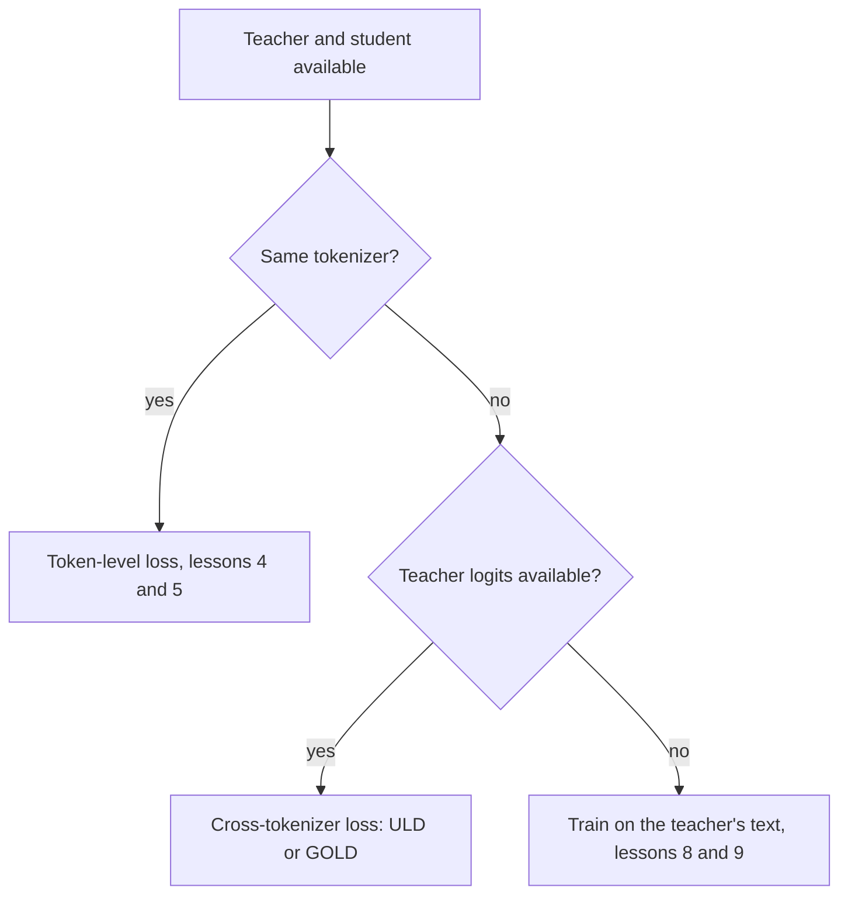

# Lesson 6. The Tokenizer Constraint

**Mission link:** The mission asks you to say when a tokenizer mismatch rules logit distillation out, and this lesson gives the reason, the cross-tokenizer loss that works around it, and what that loss costs.
**Primary source:** [Paper: "Towards Cross-Tokenizer Distillation: the Universal Logit Distillation Loss for LLMs", Boizard et al., 2024](https://arxiv.org/abs/2402.12030)
**Prerequisites:** [Lesson 5](0005-forward-and-reverse-kl.md), [Logit distillation](../GLOSSARY.md), [Cross-tokenizer distillation](../GLOSSARY.md), [Token-level distillation](../GLOSSARY.md)

## Warm-up

1. ▢ Which direction of KL is nearly deaf to a tiny teacher probability, and which punishes student mass placed there?

<details markdown="1"><summary>Check</summary>

[Forward KL](../GLOSSARY.md) is nearly deaf, because the teacher's probability multiplies the log ratio. [Reverse KL](../GLOSSARY.md) punishes the student's mass on tokens the teacher gives almost none, because the student's probability multiplies the log ratio.

</details>

2. ▢ What are the shapes of the logit tensors that `token_kd_loss` from lesson 4 takes, and which axis does the divergence run over?

<details markdown="1"><summary>Check</summary>

Both are (batch, positions, vocab). The divergence runs over the last axis, the vocabulary, so entry i of the student's row is compared with entry i of the teacher's row. That comparison is what this lesson is about.

</details>

## Know this

### Why the index has to match

The token-level loss compares the student's probability for token i with the teacher's probability for the same token i. That is only meaningful when index i names the same token in both vocabularies. Boizard et al. state it as a condition of the KL loss: it relies on equality of the student's and the teacher's vocabularies, so that the two distributions have the same support (equation 2, section 2.4). Their Figure 2 adds that a mismatch also breaks the absolute continuity needed for the quotient inside the KL logarithm to be defined.

Two things go wrong at once when the tokenizers differ.

- **The vocabulary.** The tensors may have different sizes in the last axis, and even when they match, index 5,000 can be a different string in each. Their Figure 1 shows how small the overlap can be: the Bloomz tokenizer has 30.03% of Mistral's vocabulary.
- **The positions.** One tokenizer may split a word into three tokens where the other keeps it whole, so the same text has a different length and the position boundaries do not line up. A position-by-position comparison cannot start.



Methods that build the student from the teacher avoid the problem by construction. DistilBERT initializes its student from every other layer of the teacher, and Minitron prunes the teacher itself. Both papers write their loss with one index shared by teacher and student: DistilBERT's sum over i of t_i log s_i, and Minitron's single vocabulary size |V| for both models (section 3). Choosing a student from the teacher's family is the cheapest way around the constraint.

### The Universal Logit Distillation loss

ULD (Boizard et al., 2024) drops the shared-support requirement by using a different distance. It keeps the ordinary cross-entropy on the gold token and adds a Wasserstein distance between the two distributions at each step:

```text
L_ULD = sum_t CE(t) + lambda * W1(student distribution at t, teacher distribution at t)
```

The sum runs over |x|, the smaller of the two sequence lengths when the text is tokenized by the student's tokenizer and by the teacher's, and the paper sets lambda to 1.5 (section 3.2, equation 4). To make W1 cheap they pad the shorter distribution to equal length and assume every transport cost is equal to 1. Under those two choices W1 has a closed form: sort both probability vectors in decreasing order and sum the absolute differences. It costs O(n log n) in the vocabulary size (section 3.3 and appendix A.1).

```python
import numpy as np

def uld_w1(p_student, q_teacher):
    n = max(len(p_student), len(q_teacher))
    a = np.zeros(n); a[:len(p_student)] = p_student
    b = np.zeros(n); b[:len(q_teacher)] = q_teacher
    return float(np.abs(np.sort(a)[::-1] - np.sort(b)[::-1]).sum())

teacher = np.array([0.70, 0.20, 0.05, 0.05])
print(round(uld_w1(teacher, teacher), 4))                                       # same
print(round(uld_w1(np.array([0.05, 0.05, 0.20, 0.70]), teacher), 4))            # flipped
print(round(uld_w1(np.array([0.25, 0.25, 0.25, 0.25]), teacher), 4))            # flat
print(round(uld_w1(np.array([0.70, 0.20, 0.05, 0.03, 0.02, 0.0]), teacher), 4)) # larger vocab
```

Predict the second line, where the student puts its 0.70 on the token the teacher gives 0.05. The output on NumPy 2.5:

```text
0.0
0.0
0.9
0.04
```

The flipped student scores 0, the same as a perfect one. After sorting, the vectors are identical, so the loss cannot tell that the student believes the wrong token. The flat student scores 0.9 because its shape is different. The last line shows the point of the construction: it runs unchanged on a six-entry vocabulary against a four-entry one.

### What it gives up

Read off the formula and its stated assumptions.

- **Token identity.** Sorting removes which token each probability belongs to, so the loss compares the shape of the distributions, how peaked or flat they are, and not where the mass sits. The identity signal comes only from the cross-entropy on the gold token. That is a consequence of the formula as the snippet shows, and the paper's own text says the loss reproduces the near-zero labels as well as the gold prediction.
- **The cost.** The paper calls the uniform cost a strong assumption and defends it by results.
- **Position alignment.** Positions are paired by index up to the shorter length, which is crude when the two tokenizers split the text differently.
- **Reverse and forward KL are gone.** The loss is a different divergence, so the choice of lesson 5 does not apply.

For results, the paper distills 7B teachers, Llama 2 7B Chat and Mistral 7B Instruct, into smaller student models on extractive question answering, generative question answering and summarization. It reports that ULD matches distillation on the teacher's generated text with only half the training dataset or half the student size (conclusion). These are the authors' own comparisons on their setups.

### What TRL offers

TRL's `GKDTrainer` takes one tokenizer, passed as `processing_class`, and a `GKDConfig` with no argument for a separate teacher tokenizer. The documentation page does not state in words that teacher and student must share a tokenizer, so this is an observation from reading the API and the page ([GKD documentation](https://huggingface.co/docs/trl/main/en/gkd_trainer), read for this lesson). The GOLD documentation says what it adds.

GOLD, the General Online Logit Distillation trainer, is described as an extension of ULD that supports student and teacher pairs with different tokenizers. It aligns the textual spans produced by the two tokenizers and merges the matching logits so no completion tokens are dropped. With `use_uld_loss=True` it needs `teacher_tokenizer_name_or_path`. A hybrid option compares exact vocabulary matches directly and falls back to the sorted-probability ULD loss for unmatched tokens. The page marks GOLD as part of the `trl.experimental` namespace and says its APIs may change without notice ([GOLD documentation](https://huggingface.co/docs/trl/main/en/gold_trainer), read for this lesson). Its own example pairs a Llama 3.2 1B student with a Qwen2.5 0.5B teacher.

So the practical order is: same-family student first, then a cross-tokenizer loss if you must and your tooling supports it, then the text route of stage 3 when logits are not available at all.

## Practice

1. ▢ In the ULD run, why does the flipped student score exactly 0?

<details markdown="1"><summary>Hint</summary>

Write the two vectors out after sorting each in decreasing order.

</details>

<details markdown="1"><summary>Check</summary>

Sorted decreasing, the flipped student is 0.70, 0.20, 0.05, 0.05, identical to the teacher. The closed form sums absolute differences between sorted vectors, so it is 0. The loss compares shapes, not tokens, so a student that puts its mass on the wrong token looks perfect to it. The gold-token cross-entropy is what has to catch that.

</details>

2. ▢ A Llama student and a Qwen teacher are both available with full logits. Why can `token_kd_loss` not be applied to them directly?

    - a) The teacher is not allowed to run without gradients
    - b) The two models differ in their total parameter counts
    - c) The same index names different tokens in each model
    - d) The temperature cannot be set for two model families

<details markdown="1"><summary>Check</summary>

**c)** The loss compares probability i in one row with probability i in the other, and with different tokenizers index i is a different string, the tensors may even differ in the last axis, and the positions may not line up. It is not (b): student and teacher always differ in parameters. It is not (a): the teacher always runs without gradients. It is not (d): temperature is a scalar applied per model.

</details>

3. ▢ Name two things ULD gives up in exchange for working across tokenizers.

<details markdown="1"><summary>Check</summary>

Any two of these: token identity, since the sorted comparison cannot see which token holds the mass; the per-token cost, since it assumes every transport cost equals 1, which the paper calls a strong assumption; exact position alignment, since positions pair by index up to the shorter length; and the choice of KL direction. The identity point is the one the snippet shows directly.

</details>

4. ▢ Your teacher is a hosted model whose API returns only text. Does this lesson's loss apply, and what do lessons 8 and 9 offer instead?

<details markdown="1"><summary>Check</summary>

No. Both the token-level loss and ULD need the teacher's probabilities, and text alone gives a single sampled sequence. The route is to train on the teacher's decoded outputs, which stage 3 teaches. The README lesson table says lesson 9 covers choosing from whether the teacher exposes logits or only text.

</details>

5. ▢ A team wants to distill a 7B model into a 1B student in a different model family and plans to use `GKDTrainer`. What should they check first, and which trainer does the TRL documentation point at for that case?

<details markdown="1"><summary>Check</summary>

They should check whether the two models share a tokenizer, for example by comparing the two `get_vocab()` dictionaries. If they differ, GKDTrainer takes one tokenizer and offers no teacher tokenizer argument, and the GOLD trainer is the one documented as supporting different tokenizers, with `use_uld_loss=True` and `teacher_tokenizer_name_or_path`. GOLD is marked experimental, so check its current page.

</details>

## Real-world reps

- [ ] Load the tokenizers of two open models with `AutoTokenizer`, take the intersection of their `get_vocab()` keys, and write down the overlap as a fraction of each vocabulary.
- [ ] Tokenize one sentence with both and write down how many tokens each produces and where the splits differ.
- [ ] Tomorrow: without notes, draw the flowchart of this lesson and say what ULD gives up.

## Going further

- [Distillation Losses](../reference/distillation-losses.md)
- [Paper: "Towards Cross-Tokenizer Distillation: the Universal Logit Distillation Loss for LLMs", Boizard et al., 2024](https://arxiv.org/abs/2402.12030)
- [Documentation: "Generalized Knowledge Distillation Trainer", Hugging Face TRL](https://huggingface.co/docs/trl/main/en/gkd_trainer)
- [Documentation: "General Online Logit Distillation (GOLD) Trainer", Hugging Face TRL](https://huggingface.co/docs/trl/main/en/gold_trainer)
- [Resources](../RESOURCES.md)

---

Not landing? Reread the primary source at the top, since this lesson compresses it and compression is where understanding leaks. Check the [glossary](../GLOSSARY.md) for any term that felt slippery.

If the lesson itself is unclear rather than the material, that is a defect: [open an issue](https://github.com/TokenCemetery/teach/issues).
