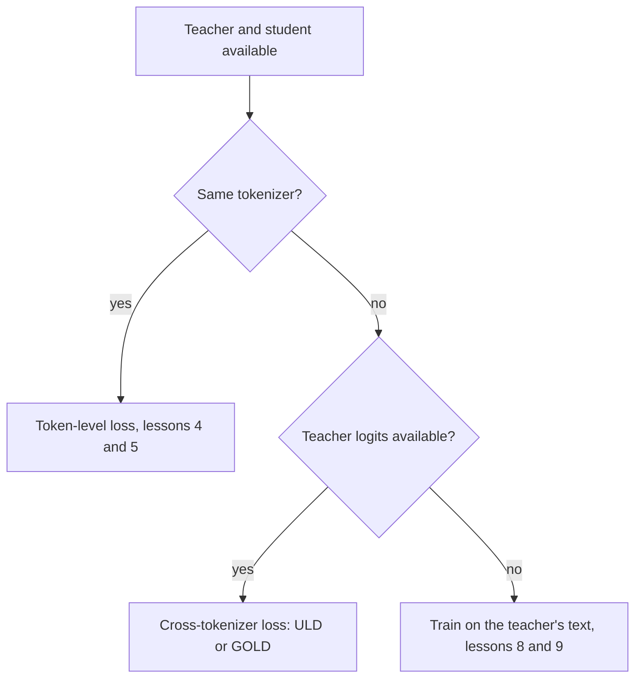

# Lição 6. A restrição do tokenizer

**Ligação com a missão:** A missão pede que você diga quando uma incompatibilidade de tokenizer descarta a destilação de logits, e esta lição dá a razão, a loss entre tokenizers que contorna o problema e o que essa loss custa.
**Fonte principal:** [Artigo científico: "Towards Cross-Tokenizer Distillation: the Universal Logit Distillation Loss for LLMs", Boizard et al., 2024](https://arxiv.org/abs/2402.12030)
**Pré-requisitos:** [Lição 5](0005-forward-and-reverse-kl.md), [Destilação de logits](../GLOSSARY.md), [Destilação entre tokenizers](../GLOSSARY.md), [Destilação em nível de token](../GLOSSARY.md)

## Aquecimento

1. ▢ Qual direção do KL é quase surda a uma probabilidade minúscula do professor, e qual pune a massa do aluno posta ali?

<details markdown="1"><summary>Verificação</summary>

O [forward KL](../GLOSSARY.md) é quase surdo, porque a probabilidade do professor multiplica a razão de logs. O [reverse KL](../GLOSSARY.md) pune a massa do aluno em tokens a que o professor dá quase nenhuma, porque a probabilidade do aluno multiplica a razão de logs.

</details>

2. ▢ Quais são os formatos dos tensores de logits que o `token_kd_loss` da lição 4 recebe, e sobre qual eixo a divergência roda?

<details markdown="1"><summary>Verificação</summary>

Ambos são (batch, positions, vocab). A divergência roda sobre o último eixo, o vocabulário, então a entrada i da linha do aluno é comparada com a entrada i da linha do professor. Essa comparação é o assunto desta lição.

</details>

## Saiba isto

### Por que o índice precisa coincidir

A loss em nível de token compara a probabilidade do aluno para o token i com a probabilidade do professor para o mesmo token i. Isso só faz sentido quando o índice i nomeia o mesmo token nos dois vocabulários. Boizard et al. enunciam isso como uma condição da loss KL: ela depende da igualdade dos vocabulários do aluno e do professor, para que as duas distribuições tenham o mesmo suporte (equação 2, seção 2.4). A Figura 2 deles acrescenta que uma incompatibilidade também quebra a continuidade absoluta necessária para que o quociente dentro do logaritmo do KL esteja definido.

Duas coisas dão errado ao mesmo tempo quando os tokenizers diferem.

- **O vocabulário.** Os tensores podem ter tamanhos diferentes no último eixo e, mesmo quando coincidem, o índice 5.000 pode ser uma string diferente em cada um. A Figura 1 deles mostra como a sobreposição pode ser pequena: o tokenizer do Bloomz tem 30,03% do vocabulário do Mistral.
- **As posições.** Um tokenizer pode dividir uma palavra em três tokens enquanto o outro a mantém inteira, então o mesmo texto tem um comprimento diferente e as fronteiras das posições não se alinham. Uma comparação posição por posição não consegue nem começar.



Os métodos que constroem o aluno a partir do professor evitam o problema por construção. O DistilBERT inicializa o seu aluno a partir de uma camada sim, outra não do professor, e o Minitron poda o próprio professor. Os dois artigos escrevem a sua loss com um índice compartilhado por professor e aluno: a soma sobre i de t_i log s_i no DistilBERT, e o tamanho de vocabulário único |V| para os dois modelos no Minitron (seção 3). Escolher um aluno da família do professor é o jeito mais barato de contornar a restrição.

### A loss Universal Logit Distillation

A ULD (Boizard et al., 2024) elimina a exigência de suporte compartilhado usando uma distância diferente. Ela mantém a cross-entropy comum no token gold e acrescenta uma distância de Wasserstein entre as duas distribuições a cada passo:

```text
L_ULD = sum_t CE(t) + lambda * W1(student distribution at t, teacher distribution at t)
```

A soma vai até |x|, o menor dos dois comprimentos de sequência quando o texto é tokenizado pelo tokenizer do aluno e pelo do professor, e o artigo define lambda como 1,5 (seção 3.2, equação 4). Para tornar o W1 barato, eles completam com zeros a distribuição mais curta até o mesmo comprimento e assumem que todo custo de transporte é igual a 1. Com essas duas escolhas, o W1 tem uma forma fechada: ordene os dois vetores de probabilidade em ordem decrescente e some as diferenças absolutas. Ela custa O(n log n) no tamanho do vocabulário (seção 3.3 e apêndice A.1).

```python
import numpy as np

def uld_w1(p_student, q_teacher):
    n = max(len(p_student), len(q_teacher))
    a = np.zeros(n); a[:len(p_student)] = p_student
    b = np.zeros(n); b[:len(q_teacher)] = q_teacher
    return float(np.abs(np.sort(a)[::-1] - np.sort(b)[::-1]).sum())

teacher = np.array([0.70, 0.20, 0.05, 0.05])
print(round(uld_w1(teacher, teacher), 4))                                       # same
print(round(uld_w1(np.array([0.05, 0.05, 0.20, 0.70]), teacher), 4))            # flipped
print(round(uld_w1(np.array([0.25, 0.25, 0.25, 0.25]), teacher), 4))            # flat
print(round(uld_w1(np.array([0.70, 0.20, 0.05, 0.03, 0.02, 0.0]), teacher), 4)) # larger vocab
```

Preveja a segunda linha, em que o aluno põe os seus 0,70 no token a que o professor dá 0,05. A saída no NumPy 2.5:

```text
0.0
0.0
0.9
0.04
```

O aluno invertido pontua 0, o mesmo que um aluno perfeito. Depois de ordenados, os vetores são idênticos, então a loss não consegue perceber que o aluno acredita no token errado. O aluno plano pontua 0,9 porque o seu formato é diferente. A última linha mostra o objetivo da construção: ela roda sem mudanças em um vocabulário de seis entradas contra um de quatro.

### O que ela sacrifica

Leia a partir da fórmula e das suas suposições declaradas.

- **A identidade do token.** Ordenar remove a qual token cada probabilidade pertence, então a loss compara o formato das distribuições, o quanto são pontudas ou planas, e não onde a massa está. O sinal de identidade vem apenas da cross-entropy no token gold. Isso é uma consequência da fórmula, como o trecho mostra, e o próprio texto do artigo diz que a loss reproduz tanto os rótulos próximos de zero quanto a previsão gold.
- **O custo.** O artigo chama o custo uniforme de suposição forte e a defende pelos resultados.
- **O alinhamento de posições.** As posições são pareadas por índice até o menor comprimento, o que é grosseiro quando os dois tokenizers dividem o texto de maneiras diferentes.
- **Reverse e forward KL ficam de fora.** A loss é uma divergência diferente, então a escolha da lição 5 não se aplica.

Quanto aos resultados, o artigo destila professores de 7B, o Llama 2 7B Chat e o Mistral 7B Instruct, em modelos-aluno menores em question answering extrativo, question answering generativo e resumo. Ele relata que a ULD se iguala à destilação no texto gerado pelo professor com apenas metade do dataset de treinamento ou metade do tamanho do aluno (conclusão). Essas são comparações dos próprios autores nos seus cenários.

### O que o TRL oferece

O `GKDTrainer` do TRL recebe um único tokenizer, passado como `processing_class`, e um `GKDConfig` sem argumento para um tokenizer separado do professor. A página da documentação não afirma com palavras que professor e aluno precisam compartilhar um tokenizer, então isto é uma observação feita lendo a API e a página ([documentação do GKD](https://huggingface.co/docs/trl/main/en/gkd_trainer), lida para esta lição). A documentação do GOLD diz o que ele acrescenta.

O GOLD, o trainer General Online Logit Distillation, é descrito como uma extensão da ULD que suporta pares de aluno e professor com tokenizers diferentes. Ele alinha os trechos de texto produzidos pelos dois tokenizers e mescla os logits correspondentes para que nenhum token da completion seja descartado. Com `use_uld_loss=True`, ele precisa de `teacher_tokenizer_name_or_path`. Uma opção híbrida compara diretamente as correspondências exatas de vocabulário e recorre à loss ULD de probabilidades ordenadas para os tokens sem correspondência. A página marca o GOLD como parte do namespace `trl.experimental` e diz que as suas APIs podem mudar sem aviso ([documentação do GOLD](https://huggingface.co/docs/trl/main/en/gold_trainer), lida para esta lição). O exemplo da própria página combina um aluno Llama 3.2 1B com um professor Qwen2.5 0.5B.

Então a ordem prática é: primeiro um aluno da mesma família, depois uma loss entre tokenizers se for preciso e a sua ferramenta suportar, depois o caminho do texto da etapa 3 quando os logits não estão disponíveis de forma alguma.

## Prática

1. ▢ Na execução da ULD, por que o aluno invertido pontua exatamente 0?

<details markdown="1"><summary>Dica</summary>

Escreva os dois vetores depois de ordenar cada um em ordem decrescente.

</details>

<details markdown="1"><summary>Verificação</summary>

Ordenado em ordem decrescente, o aluno invertido é 0.70, 0.20, 0.05, 0.05, idêntico ao professor. A forma fechada soma as diferenças absolutas entre vetores ordenados, então dá 0. A loss compara formatos, não tokens, então um aluno que põe a sua massa no token errado parece perfeito para ela. É a cross-entropy do token gold que precisa pegar isso.

</details>

2. ▢ Um aluno Llama e um professor Qwen estão ambos disponíveis com os logits completos. Por que o `token_kd_loss` não pode ser aplicado a eles diretamente?

    - a) O professor não tem permissão para rodar sem gradientes
    - b) Os dois modelos diferem no total de parâmetros
    - c) O mesmo índice nomeia tokens diferentes em cada modelo
    - d) A temperatura não pode ser definida para duas famílias de modelos

<details markdown="1"><summary>Verificação</summary>

**c)** A loss compara a probabilidade i de uma linha com a probabilidade i da outra, e com tokenizers diferentes o índice i é uma string diferente, os tensores podem até diferir no último eixo e as posições podem não se alinhar. Não é (b): aluno e professor sempre diferem em parâmetros. Não é (a): o professor sempre roda sem gradientes. Não é (d): a temperatura é um escalar aplicado por modelo.

</details>

3. ▢ Cite duas coisas que a ULD sacrifica em troca de funcionar entre tokenizers.

<details markdown="1"><summary>Verificação</summary>

Quaisquer duas destas: a identidade do token, já que a comparação ordenada não enxerga qual token detém a massa; o custo por token, já que ela assume que todo custo de transporte é igual a 1, o que o artigo chama de suposição forte; o alinhamento exato de posições, já que as posições se pareiam por índice até o menor comprimento; e a escolha da direção do KL. O ponto da identidade é o que o trecho mostra diretamente.

</details>

4. ▢ O seu professor é um modelo hospedado cuja API devolve apenas texto. A loss desta lição se aplica, e o que as lições 8 e 9 oferecem no lugar?

<details markdown="1"><summary>Verificação</summary>

Não. Tanto a loss em nível de token quanto a ULD precisam das probabilidades do professor, e o texto sozinho dá uma única sequência amostrada. O caminho é treinar nas saídas decodificadas do professor, o que a etapa 3 ensina. A tabela de lições do README diz que a lição 9 cobre a escolha conforme o professor exponha logits ou apenas texto.

</details>

5. ▢ Uma equipe quer destilar um modelo de 7B em um aluno de 1B de uma família de modelos diferente e planeja usar o `GKDTrainer`. O que ela deve verificar primeiro, e para qual trainer a documentação do TRL aponta nesse caso?

<details markdown="1"><summary>Verificação</summary>

Ela deve verificar se os dois modelos compartilham um tokenizer, por exemplo comparando os dois dicionários de `get_vocab()`. Se diferirem, o GKDTrainer recebe um único tokenizer e não oferece argumento de tokenizer do professor, e o trainer GOLD é o documentado como suportando tokenizers diferentes, com `use_uld_loss=True` e `teacher_tokenizer_name_or_path`. O GOLD está marcado como experimental, então confira a página atual dele.

</details>

## Prática no mundo real

- [ ] Carregue os tokenizers de dois modelos abertos com `AutoTokenizer`, tire a interseção das chaves de `get_vocab()` deles e anote a sobreposição como fração de cada vocabulário.
- [ ] Tokenize uma frase com os dois e anote quantos tokens cada um produz e onde as divisões diferem.
- [ ] Amanhã: sem consultar anotações, desenhe o fluxograma desta lição e diga o que a ULD sacrifica.

## Para ir além

- [Losses de Destilação](../reference/distillation-losses.md)
- [Artigo científico: "Towards Cross-Tokenizer Distillation: the Universal Logit Distillation Loss for LLMs", Boizard et al., 2024](https://arxiv.org/abs/2402.12030)
- [Documentação: "Generalized Knowledge Distillation Trainer", Hugging Face TRL](https://huggingface.co/docs/trl/main/en/gkd_trainer)
- [Documentação: "General Online Logit Distillation (GOLD) Trainer", Hugging Face TRL](https://huggingface.co/docs/trl/main/en/gold_trainer)
- [Recursos](../RESOURCES.md)

---

Não ficou claro? Releia a fonte principal no topo, já que esta lição a comprime e é na compressão que o entendimento escapa. Consulte o [glossário](../GLOSSARY.md) para qualquer termo que pareceu escorregadio.

Se o problema é a lição em si, e não o material, isso é um defeito: [abra uma issue](https://github.com/TokenCemetery/teach/issues).
