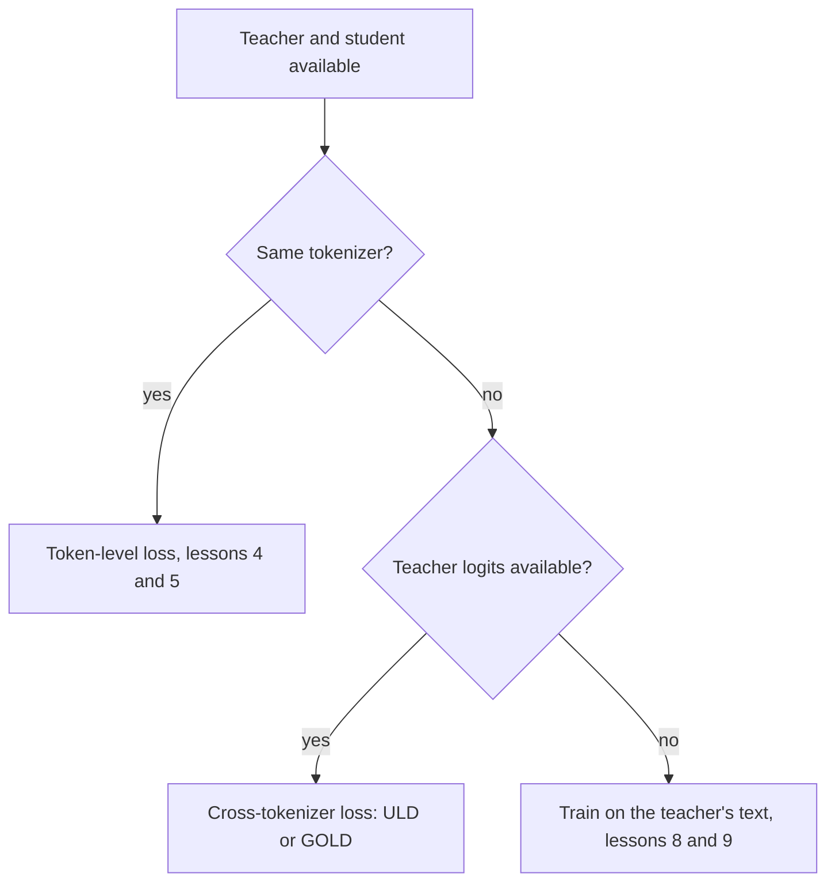

# Урок 6. Ограничение токенизатора

**Связь с целью курса:** Цель курса требует, чтобы вы могли сказать, когда несовпадение токенизаторов исключает логитную дистилляцию, и этот урок даёт причину, кросс-токенизаторную функцию потерь, которая её обходит, и то, чего эта функция стоит.
**Первоисточник:** [Научная статья: "Towards Cross-Tokenizer Distillation: the Universal Logit Distillation Loss for LLMs", Boizard et al., 2024](https://arxiv.org/abs/2402.12030)
**Предварительные требования:** [Урок 5](0005-forward-and-reverse-kl.md), [логитная дистилляция](../GLOSSARY.md), [кросс-токенизаторная дистилляция](../GLOSSARY.md), [дистилляция на уровне токенов](../GLOSSARY.md)

## Разминка

1. ▢ Какое направление KL почти глухо к крошечной вероятности учителя, а какое штрафует массу ученика, помещённую туда?

<details markdown="1"><summary>Проверка</summary>

[Прямая KL](../GLOSSARY.md) почти глуха, потому что вероятность учителя умножает логарифм отношения. [Обратная KL](../GLOSSARY.md) штрафует массу ученика на токенах, которым учитель даёт почти ноль, потому что вероятность ученика умножает логарифм отношения.

</details>

2. ▢ Какую форму имеют тензоры логитов, которые принимает `token_kd_loss` из урока 4, и по какой оси идёт дивергенция?

<details markdown="1"><summary>Проверка</summary>

Оба имеют форму (batch, positions, vocab). Дивергенция идёт по последней оси, по словарю, так что элемент i строки ученика сравнивается с элементом i строки учителя. Именно об этом сравнении и говорит этот урок.

</details>

## Что нужно знать

### Почему индекс должен совпадать

Токенная функция потерь сравнивает вероятность токена i у ученика с вероятностью того же токена i у учителя. Это осмысленно только тогда, когда индекс i называет один и тот же токен в обоих словарях. Boizard и соавторы формулируют это как условие KL-потери: она опирается на равенство словарей ученика и учителя, чтобы у двух распределений был один и тот же носитель (уравнение 2, раздел 2.4). Их рисунок 2 добавляет, что несовпадение также нарушает абсолютную непрерывность, необходимую для того, чтобы частное внутри логарифма KL было определено.

Когда токенизаторы различаются, сразу идут не так две вещи.

- **Словарь.** У тензоров по последней оси могут быть разные размеры, и даже когда они совпадают, индекс 5000 может быть в каждом из них другой строкой. Их рисунок 1 показывает, насколько мало может быть пересечение: токенизатор Bloomz составляет 30.03% словаря Mistral.
- **Позиции.** Один токенизатор может разбить слово на три токена, тогда как другой оставит его целым, так что один и тот же текст получает разную длину, а границы позиций не совпадают. Позиционное сравнение даже не может начаться.



Методы, которые строят ученика из учителя, избегают проблемы по построению. DistilBERT инициализирует ученика каждым вторым слоем учителя, а Minitron прунит самого учителя. Обе статьи записывают свою функцию потерь с одним индексом, общим для учителя и ученика: сумма по i от t_i log s_i у DistilBERT и единый размер словаря |V| для обеих моделей у Minitron (раздел 3). Выбор ученика из семейства учителя это самый дешёвый способ обойти ограничение.

### Функция потерь Universal Logit Distillation

ULD (Boizard et al., 2024) отказывается от требования общего носителя, используя другое расстояние. Она сохраняет обычную кросс-энтропию на эталонном токене и добавляет расстояние Вассерштейна между двумя распределениями на каждом шаге:

```text
L_ULD = sum_t CE(t) + lambda * W1(student distribution at t, teacher distribution at t)
```

Сумма идёт по |x|, меньшей из двух длин последовательности, когда текст токенизирован токенизатором ученика и токенизатором учителя, а статья задаёт lambda равной 1.5 (раздел 3.2, уравнение 4). Чтобы сделать W1 дешёвой, они дополняют более короткое распределение до равной длины и предполагают, что каждая стоимость переноса равна 1. При этих двух выборах у W1 есть замкнутая форма: отсортируйте оба вектора вероятностей по убыванию и просуммируйте абсолютные разности. Она стоит O(n log n) от размера словаря (раздел 3.3 и приложение A.1).

```python
import numpy as np

def uld_w1(p_student, q_teacher):
    n = max(len(p_student), len(q_teacher))
    a = np.zeros(n); a[:len(p_student)] = p_student
    b = np.zeros(n); b[:len(q_teacher)] = q_teacher
    return float(np.abs(np.sort(a)[::-1] - np.sort(b)[::-1]).sum())

teacher = np.array([0.70, 0.20, 0.05, 0.05])
print(round(uld_w1(teacher, teacher), 4))                                       # same
print(round(uld_w1(np.array([0.05, 0.05, 0.20, 0.70]), teacher), 4))            # flipped
print(round(uld_w1(np.array([0.25, 0.25, 0.25, 0.25]), teacher), 4))            # flat
print(round(uld_w1(np.array([0.70, 0.20, 0.05, 0.03, 0.02, 0.0]), teacher), 4)) # larger vocab
```

Предскажите вторую строку, где ученик ставит свои 0.70 на токен, которому учитель даёт 0.05. Вывод на NumPy 2.5:

```text
0.0
0.0
0.9
0.04
```

Перевёрнутый ученик получает 0, как и идеальный. После сортировки векторы идентичны, так что функция потерь не может заметить, что ученик верит в неверный токен. Плоский ученик получает 0.9, потому что его форма другая. Последняя строка показывает смысл конструкции: она без изменений работает на словаре из шести элементов против словаря из четырёх.

### От чего она отказывается

Читайте это по формуле и её заявленным допущениям.

- **Идентичность токена.** Сортировка убирает информацию о том, какому токену принадлежит каждая вероятность, так что функция потерь сравнивает форму распределений, насколько они острые или плоские, а не то, где находится масса. Сигнал об идентичности идёт только от кросс-энтропии на эталонном токене. Это следствие формулы, как показывает фрагмент, а в самом тексте статьи сказано, что функция потерь воспроизводит как околонулевые метки, так и предсказание эталонного токена.
- **Стоимость.** Статья называет единую стоимость сильным допущением и защищает её результатами.
- **Выравнивание позиций.** Позиции сопоставляются по индексу вплоть до меньшей длины, что грубо, когда два токенизатора по-разному разбивают текст.
- **Прямой и обратной KL больше нет.** Функция потерь это другая дивергенция, так что выбор из урока 5 к ней не относится.

Что касается результатов, статья дистиллирует учителей на 7B, Llama 2 7B Chat и Mistral 7B Instruct, в меньшие модели-ученики на экстрактивных вопросах и ответах, генеративных вопросах и ответах и резюмировании. Она сообщает, что ULD сравнивается с дистилляцией на сгенерированном учителем тексте, имея лишь половину обучающего набора или половину размера ученика (заключение). Это собственные сравнения авторов на их постановках.

### Что предлагает TRL

`GKDTrainer` из TRL принимает один токенизатор, передаваемый как `processing_class`, и `GKDConfig` без аргумента для отдельного токенизатора учителя. Страница документации не утверждает словами, что у учителя и ученика должен быть общий токенизатор, так что это наблюдение по прочтению API и страницы ([документация по GKD](https://huggingface.co/docs/trl/main/en/gkd_trainer), прочитана для этого урока). Документация GOLD говорит, что он добавляет.

GOLD, General Online Logit Distillation trainer, описан как расширение ULD, поддерживающее пары ученика и учителя с разными токенизаторами. Он выравнивает текстовые фрагменты, порождаемые двумя токенизаторами, и объединяет соответствующие логиты, чтобы ни один токен завершения не отбрасывался. При `use_uld_loss=True` ему нужен `teacher_tokenizer_name_or_path`. Гибридный вариант напрямую сравнивает точные совпадения словаря и для несовпавших токенов переходит на ULD-потерю по отсортированным вероятностям. Страница помечает GOLD как часть пространства имён `trl.experimental` и говорит, что его API могут измениться без предупреждения ([документация по GOLD](https://huggingface.co/docs/trl/main/en/gold_trainer), прочитана для этого урока). Её собственный пример сопоставляет ученика Llama 3.2 1B с учителем Qwen2.5 0.5B.

Так что практический порядок такой: сначала ученик из того же семейства, затем кросс-токенизаторная функция потерь, если без неё нельзя и ваш инструментарий её поддерживает, затем текстовый путь этапа 3, когда логитов нет вовсе.

## Практика

1. ▢ Почему в запуске ULD перевёрнутый ученик получает ровно 0?

<details markdown="1"><summary>Подсказка</summary>

Выпишите два вектора после сортировки каждого по убыванию.

</details>

<details markdown="1"><summary>Проверка</summary>

Отсортированный по убыванию перевёрнутый ученик это 0.70, 0.20, 0.05, 0.05, идентичный учителю. Замкнутая форма суммирует абсолютные разности между отсортированными векторами, так что получается 0. Функция потерь сравнивает формы, а не токены, поэтому ученик, который ставит свою массу на неверный токен, выглядит для неё идеальным. Это должна поймать кросс-энтропия на эталонном токене.

</details>

2. ▢ И ученик Llama, и учитель Qwen доступны с полными логитами. Почему к ним нельзя применить `token_kd_loss` напрямую?

    - a) Учителю нельзя работать без градиентов
    - b) Модели различаются общим числом параметров
    - c) Один и тот же индекс называет в каждой модели разные токены
    - d) Температуру нельзя задать для двух семейств моделей

<details markdown="1"><summary>Проверка</summary>

**c)** Функция потерь сравнивает вероятность i в одной строке с вероятностью i в другой, а при разных токенизаторах индекс i это другая строка, тензоры могут даже различаться по последней оси, и позиции могут не совпадать. Это не (b): ученик и учитель всегда различаются по параметрам. Это не (a): учитель всегда работает без градиентов. Это не (d): температура это скаляр, применяемый к каждой модели.

</details>

3. ▢ Назовите две вещи, от которых ULD отказывается в обмен на работу через токенизаторы.

<details markdown="1"><summary>Проверка</summary>

Любые две из этих: идентичность токена, поскольку отсортированное сравнение не видит, какому токену принадлежит масса; стоимость для каждого токена, поскольку предполагается, что каждая стоимость переноса равна 1, что статья называет сильным допущением; точное выравнивание позиций, поскольку позиции сопоставляются по индексу вплоть до меньшей длины; и выбор направления KL. Пункт об идентичности это тот, который напрямую показывает фрагмент.

</details>

4. ▢ Ваш учитель это размещённая модель, чей API возвращает только текст. Применима ли функция потерь этого урока и что вместо неё предлагают уроки 8 и 9?

<details markdown="1"><summary>Проверка</summary>

Нет. И токенной функции потерь, и ULD нужны вероятности учителя, а один лишь текст даёт единственную насэмплированную последовательность. Путь состоит в обучении на декодированных выходах учителя, чему учит этап 3. Таблица уроков в README говорит, что урок 9 охватывает выбор по тому, открывает ли учитель логиты или только текст.

</details>

5. ▢ Команда хочет дистиллировать модель на 7B в ученика на 1B из другого семейства моделей и планирует использовать `GKDTrainer`. Что им стоит проверить в первую очередь и на какой тренер указывает для этого случая документация TRL?

<details markdown="1"><summary>Проверка</summary>

Им стоит проверить, есть ли у двух моделей общий токенизатор, например сравнив два словаря `get_vocab()`. Если они различаются, GKDTrainer принимает один токенизатор и не предлагает аргумента для токенизатора учителя, а тренер GOLD задокументирован как поддерживающий разные токенизаторы, с `use_uld_loss=True` и `teacher_tokenizer_name_or_path`. GOLD помечен как экспериментальный, так что проверьте его актуальную страницу.

</details>

## Практика в реальной работе

- [ ] Загрузите токенизаторы двух открытых моделей через `AutoTokenizer`, возьмите пересечение ключей их `get_vocab()` и запишите это пересечение как долю каждого словаря.
- [ ] Токенизируйте одно предложение обоими токенизаторами и запишите, сколько токенов даёт каждый и где различаются разбиения.
- [ ] Завтра: без заметок нарисуйте блок-схему этого урока и скажите, от чего отказывается ULD.

## Что почитать дальше

- [Функции потерь дистилляции](../reference/distillation-losses.md)
- [Научная статья: "Towards Cross-Tokenizer Distillation: the Universal Logit Distillation Loss for LLMs", Boizard et al., 2024](https://arxiv.org/abs/2402.12030)
- [Документация: "Generalized Knowledge Distillation Trainer", Hugging Face TRL](https://huggingface.co/docs/trl/main/en/gkd_trainer)
- [Документация: "General Online Logit Distillation (GOLD) Trainer", Hugging Face TRL](https://huggingface.co/docs/trl/main/en/gold_trainer)
- [Ресурсы](../RESOURCES.md)

---

Не доходит? Перечитайте первоисточник в начале: этот урок его сжимает, а при сжатии понимание как раз и теряется. Загляните в [глоссарий](../GLOSSARY.md), если какой-то термин показался скользким.

Если неясен сам урок, а не материал, это дефект: [откройте issue](https://github.com/TokenCemetery/teach/issues).
