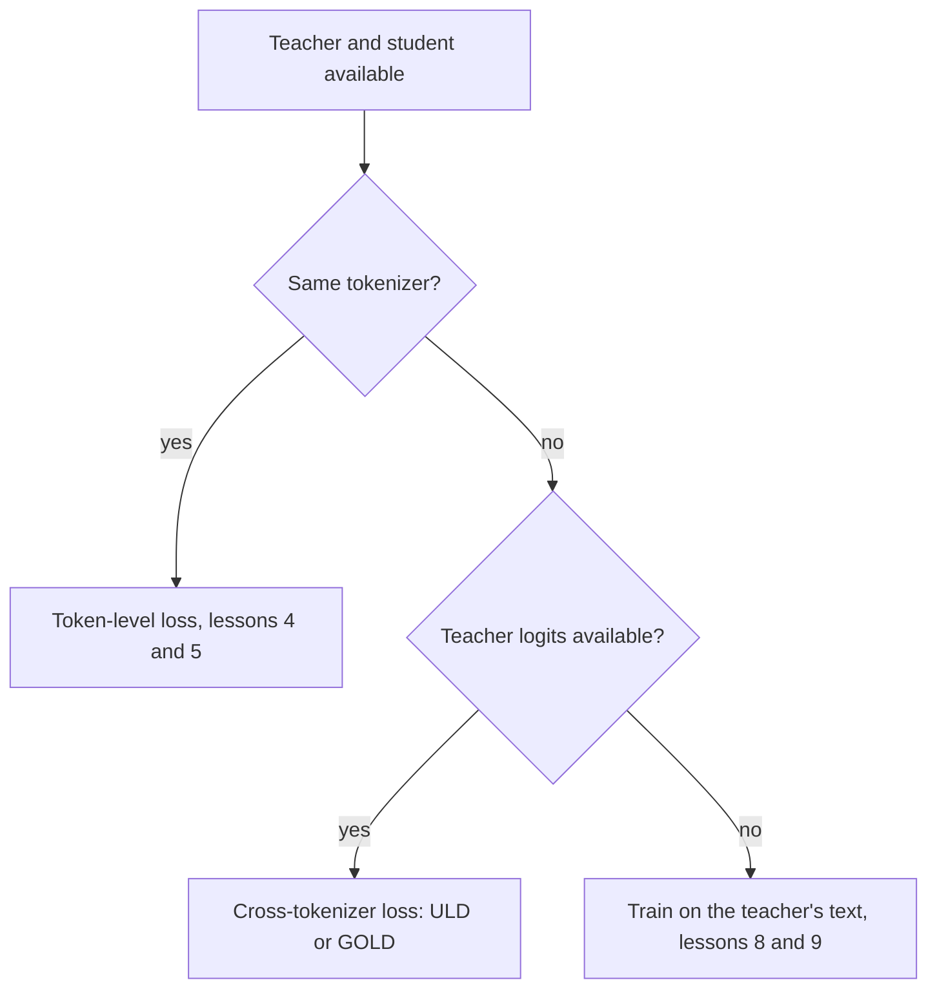

# 第 6 课：分词器的约束

**使命关联:** 本使命要求你说明分词器不匹配在什么时候会排除 logit 蒸馏，而本课给出其中的原因、绕开它的跨分词器损失，以及这个损失的代价。
**主要来源:** [论文：“Towards Cross-Tokenizer Distillation: the Universal Logit Distillation Loss for LLMs”，Boizard 等，2024](https://arxiv.org/abs/2402.12030)
**前置知识:** [第 5 课](0005-forward-and-reverse-kl.md)、[logit 蒸馏](../GLOSSARY.md)、[跨分词器蒸馏](../GLOSSARY.md)、[token 级蒸馏](../GLOSSARY.md)

## 热身

1. ▢ 哪个方向的 KL 对教师的微小概率几乎充耳不闻，哪个会惩罚学生把质量放在那里？

<details markdown="1"><summary>检查</summary>

[前向 KL](../GLOSSARY.md) 几乎充耳不闻，因为是教师的概率乘在对数比上。[反向 KL](../GLOSSARY.md) 会惩罚学生在教师几乎不给概率的 token 上放质量，因为是学生的概率乘在对数比上。

</details>

2. ▢ 第 4 课的 `token_kd_loss` 接收的 logit 张量形状是什么，散度沿哪个轴运行？

<details markdown="1"><summary>检查</summary>

两者都是 (batch, positions, vocab)。散度沿最后一个轴，也就是词表轴运行，所以学生那一行的第 i 项，是与教师那一行的第 i 项比较的。这个比较，就是本课要讲的东西。

</details>

## 要点

### 为什么索引必须一致

token 级损失，是把学生对 token i 的概率与教师对同一个 token i 的概率做比较。只有当索引 i 在两个词表里指的是同一个 token 时，这才有意义。Boizard 等人把它表述为 KL 损失的一个条件：它依赖于学生和教师的词表相等，使两个分布具有相同的支撑集（公式 2，第 2.4 节）。他们的图 2 补充说，不匹配还会破坏绝对连续性，而 KL 对数内部的商要有定义，需要这种连续性。

分词器不同时，有两件事会同时出错。

- **词表**。张量在最后一个轴上的大小可能不同，即使大小一致，索引 5000 在两边也可能是不同的字符串。他们的图 1 显示了重叠可以有多小：Bloomz 的分词器只有 Mistral 词表的 30.03%。
- **位置**。一个分词器可能把一个词拆成三个 token，而另一个把它保持完整，所以同一段文本的长度不同，位置的边界也对不上。逐位置的比较根本无从开始。



从教师构建学生的方法，在构造上就避开了这个问题。DistilBERT 用教师每隔一层来初始化它的学生，Minitron 则是直接对教师本身做剪枝。两篇论文写损失时，都用一个由教师和学生共享的索引：DistilBERT 是对 i 求和的 t_i log s_i，Minitron 是两个模型共用同一个词表大小 |V|（第 3 节）。从教师所在的家族里挑选学生，是绕开这个约束最便宜的办法。

### 通用 logit 蒸馏损失

ULD（Boizard 等，2024）通过使用另一种距离，去掉了共享支撑集的要求。它保留对标准答案 token 的普通交叉熵，并在每一步加上两个分布之间的 Wasserstein 距离：

```text
L_ULD = sum_t CE(t) + lambda * W1(student distribution at t, teacher distribution at t)
```

求和范围是 |x|，即文本分别用学生的分词器和教师的分词器分词后，两个序列长度中较小的那个，论文把 lambda 设为 1.5（第 3.2 节，公式 4）。为了让 W1 算起来便宜，他们把较短的分布填充到等长，并假设每一项传输代价都等于 1。在这两项选择下，W1 有闭式解：把两个概率向量都按降序排序，再对绝对差求和。它的代价是词表大小的 O(n log n)（第 3.3 节和附录 A.1）。

```python
import numpy as np

def uld_w1(p_student, q_teacher):
    n = max(len(p_student), len(q_teacher))
    a = np.zeros(n); a[:len(p_student)] = p_student
    b = np.zeros(n); b[:len(q_teacher)] = q_teacher
    return float(np.abs(np.sort(a)[::-1] - np.sort(b)[::-1]).sum())

teacher = np.array([0.70, 0.20, 0.05, 0.05])
print(round(uld_w1(teacher, teacher), 4))                                       # same
print(round(uld_w1(np.array([0.05, 0.05, 0.20, 0.70]), teacher), 4))            # flipped
print(round(uld_w1(np.array([0.25, 0.25, 0.25, 0.25]), teacher), 4))            # flat
print(round(uld_w1(np.array([0.70, 0.20, 0.05, 0.03, 0.02, 0.0]), teacher), 4)) # larger vocab
```

预测第二行，也就是学生把它的 0.70 放在了教师只给 0.05 的那个 token 上。在 NumPy 2.5 上的输出：

```text
0.0
0.0
0.9
0.04
```

翻转的学生得分是 0，与完美的学生一样。排序之后，两个向量完全相同，所以这个损失分辨不出学生相信的是错误的 token。平的学生得分 0.9，因为它的形状不同。最后一行显示了这种构造的要点：它原封不动地就能在六项的词表对四项的词表上运行。

### 它放弃了什么

从公式和它声明的假设里就能读出来。

- **token 身份**。排序去掉了每个概率属于哪个 token 的信息，所以这个损失比较的是分布的形状，即它们有多尖或多平，而不是质量落在哪里。身份信号只来自对标准答案 token 的交叉熵。这是公式本身的结果，代码片段已经展示了，而论文自己的文字也说，这个损失既能复现接近零的标签，也能复现标准答案的预测。
- **代价**。论文把均匀的代价称为一个很强的假设，并用结果为它辩护。
- **位置对齐**。位置按索引配对，只配到较短的长度，当两个分词器对文本的切分方式不同时，这很粗糙。
- **反向 KL 和前向 KL 都没有了**。这个损失是另一种散度，所以第 5 课的选择不适用。

在结果方面，论文把 7B 的教师（Llama 2 7B Chat 和 Mistral 7B Instruct）蒸馏进更小的学生模型，任务包括抽取式问答、生成式问答和摘要。它报告说，ULD 只用一半的训练数据集，或者一半的学生规模，就能与在教师生成文本上的蒸馏相当（结论）。这些是作者在他们自己的设置上做的比较。

### TRL 提供了什么

TRL 的 `GKDTrainer` 接收一个分词器，通过 `processing_class` 传入，而 `GKDConfig` 里没有为教师单独设置分词器的参数。文档页面没有用文字写明教师和学生必须共享分词器，所以这是阅读 API 和页面得到的观察（[GKD 文档](https://huggingface.co/docs/trl/main/en/gkd_trainer)，为本课而读）。GOLD 的文档则说明了它新增了什么。

GOLD，即通用在线 logit 蒸馏训练器，被描述为 ULD 的扩展，支持使用不同分词器的学生与教师组合。它把两个分词器产生的文本片段对齐，并合并匹配的 logit，这样就不会丢掉任何补全 token。设置 `use_uld_loss=True` 时，它需要 `teacher_tokenizer_name_or_path`。一个混合选项会直接比较完全匹配的词表项，对不匹配的 token 则退回到按排序概率计算的 ULD 损失。页面把 GOLD 标记为 `trl.experimental` 命名空间的一部分，并说它的 API 可能不经通知就会变化（[GOLD 文档](https://huggingface.co/docs/trl/main/en/gold_trainer)，为本课而读）。它自己的示例，是把 Llama 3.2 1B 学生与 Qwen2.5 0.5B 教师配对。

所以实际的顺序是：先选同一家族的学生；如果必须，并且你的工具支持，再用跨分词器的损失；完全拿不到 logit 时，再用第 3 阶段的文本路线。

## 练习

1. ▢ 在 ULD 的运行中，为什么翻转的学生得分恰好是 0？

<details markdown="1"><summary>提示</summary>

把两个向量各自按降序排序后写出来。

</details>

<details markdown="1"><summary>检查</summary>

按降序排序后，翻转的学生是 0.70、0.20、0.05、0.05，与教师相同。闭式解对排序后向量的绝对差求和，所以是 0。这个损失比较的是形状而不是 token，所以把质量放在错误 token 上的学生，在它看来是完美的。必须由对标准答案 token 的交叉熵来抓住这一点。

</details>

2. ▢ 一个 Llama 学生和一个 Qwen 教师都能提供完整的 logit。为什么 `token_kd_loss` 不能直接应用到它们身上？

    - a) 教师不允许在关闭梯度的情况下运行
    - b) 两个模型的总参数量不同
    - c) 同一个索引在两个模型里指的是不同的 token
    - d) 无法为两个模型家族设置温度

<details markdown="1"><summary>检查</summary>

**c)** 这个损失是把一行里的概率 i 与另一行里的概率 i 相比，而分词器不同时，索引 i 是不同的字符串，张量在最后一个轴上甚至大小也可能不同，位置也可能对不上。不是 (b)：学生和教师在参数量上总是不同的。不是 (a)：教师总是在关闭梯度下运行。不是 (d)：温度是对每个模型分别施加的一个标量。

</details>

3. ▢ 说出 ULD 为了能跨分词器工作而放弃的两样东西。

<details markdown="1"><summary>检查</summary>

下面任意两项：token 身份，因为排序后的比较看不出质量由哪个 token 持有；逐 token 的代价，因为它假设每项传输代价都等于 1，论文称这是一个很强的假设；精确的位置对齐，因为位置按索引配对，只配到较短的长度；以及 KL 方向的选择。身份这一点，是代码片段直接展示出来的那一点。

</details>

4. ▢ 你的教师是一个托管模型，它的 API 只返回文本。本课的损失适用吗？第 8 和第 9 课提供了什么作为替代？

<details markdown="1"><summary>检查</summary>

不适用。token 级损失和 ULD 都需要教师的概率，而只有文本时，得到的只是一条采样出来的序列。路线是在教师解码出的输出上训练，这是第 3 阶段讲的。README 的课程表说，第 9 课讲的是根据教师暴露的是 logit 还是只有文本来做选择。

</details>

5. ▢ 一个团队想把一个 7B 模型蒸馏进另一个模型家族的 1B 学生，并打算使用 `GKDTrainer`。他们应该先检查什么？对这种情况，TRL 文档指向哪个训练器？

<details markdown="1"><summary>检查</summary>

他们应该检查两个模型是否共享分词器，例如比较两个 `get_vocab()` 字典。如果不同，GKDTrainer 只接收一个分词器，也没有教师分词器的参数；GOLD 训练器是文档中写明支持不同分词器的那个，要配合 `use_uld_loss=True` 和 `teacher_tokenizer_name_or_path`。GOLD 被标记为实验性的，所以请查看它当前的页面。

</details>

## 实战练习

- [ ] 用 `AutoTokenizer` 加载两个开源模型的分词器，取它们 `get_vocab()` 键的交集，并把重叠写成各自词表的占比。
- [ ] 用两个分词器分别对同一个句子分词，写下各自产生多少个 token，以及切分在哪里不同。
- [ ] 明天：不看笔记，画出本课的流程图，并说出 ULD 放弃了什么。

## 延伸阅读

- [蒸馏损失](../reference/distillation-losses.md)
- [论文：“Towards Cross-Tokenizer Distillation: the Universal Logit Distillation Loss for LLMs”，Boizard 等，2024](https://arxiv.org/abs/2402.12030)
- [文档：“Generalized Knowledge Distillation Trainer”，Hugging Face TRL](https://huggingface.co/docs/trl/main/en/gkd_trainer)
- [文档：“General Online Logit Distillation (GOLD) Trainer”，Hugging Face TRL](https://huggingface.co/docs/trl/main/en/gold_trainer)
- [资源](../RESOURCES.md)

---

没学明白？请重读顶部的主要来源，因为本课是对它的压缩，而理解正是在压缩中流失的。如果有哪个术语觉得含糊，可以查看[术语表](../GLOSSARY.md)。

如果问题出在课程本身，而不是学习材料，那就是一个缺陷：[提交 issue](https://github.com/TokenCemetery/teach/issues)。
