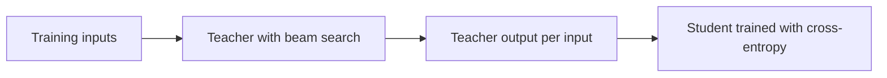

# Lección 8. Destilación a nivel de secuencia

**Vínculo con la misión:** La misión te pide destilar a nivel de secuencia y decir qué transfiere eso que los logits no transfieren, lo que empieza por el método original: entrenar con lo que decodifica el profesor, y ver por qué funciona.
**Fuente principal:** [Paper: "Sequence-Level Knowledge Distillation", Kim and Rush, 2016](https://arxiv.org/abs/1606.07947)
**Requisitos previos:** [Lección 7](0007-distilling-during-pretraining.md), [Destilación a nivel de token](../GLOSSARY.md), [Destilación a nivel de secuencia](../GLOSSARY.md), [Profesor](../GLOSSARY.md), [Estudiante](../GLOSSARY.md)

## Calentamiento

1. ▢ La destilación a nivel de token necesita dos cosas del profesor en cada posición. ¿Cuáles son?

Comprobación

La distribución completa del siguiente token del profesor (sus logits), y un vocabulario que el estudiante comparta, para que las dos distribuciones se alineen índice por índice. La lección 6 cubrió lo segundo: con tokenizers distintos no hay un índice compartido que comparar.

2. ▢ La KL directa y la KL inversa igualan ambas al estudiante con el profesor. ¿Cuál reparte al estudiante sobre cada modo del profesor, y cuál lo hace comprometerse con uno?

Comprobación

La [KL directa](../GLOSSARY.md) cubre cada modo, porque castiga al estudiante por poner poca probabilidad donde el profesor pone mucha. La [KL inversa](../GLOSSARY.md) se compromete con un modo, porque castiga al estudiante por poner probabilidad donde el profesor pone poca. Tenlo presente más abajo: el método de esta lección también se compromete con un modo, por otra vía.

## Qué debes saber

### La pérdida, y por qué está fuera de alcance

Kim y Rush trabajaron en traducción automática neuronal, donde un modelo produce una oración objetivo completa una palabra a la vez. Su pérdida a nivel de palabra es la pérdida [a nivel de token](../GLOSSARY.md) que ya conoces: en cada posición, entropía cruzada frente a la distribución del profesor sobre la palabra siguiente (sección 3.1).

Una oración, sin embargo, no es una única predicción. La probabilidad de una oración completa es el producto de las probabilidades de sus palabras, así que el profesor también define una distribución sobre todas las oraciones posibles. La pérdida a nivel de secuencia igualaría al estudiante con esa distribución. La suma recorre un número exponencial de oraciones, así que no se puede calcular (sección 3.2).

### La aproximación: la moda del profesor

Su solución más simple reemplaza la distribución de secuencias del profesor por un solo punto: su oración más probable. Encontrar esa oración exactamente también es intratable, así que usan [beam search](../GLOSSARY.md), que conserva en cada paso las pocas oraciones parciales de mayor puntuación. La receta tiene tres pasos (sección 3.2):

1. Entrenar un profesor.
2. Ejecutar beam search con el profesor sobre las entradas de entrenamiento, conservando la mejor oración para cada una.
3. Entrenar al estudiante con entropía cruzada ordinaria sobre esas salidas.

El paso 3 es el bucle de entrenamiento simple que ya tienes, ejecutado sobre un dataset nuevo. El estudiante nunca ve las probabilidades del profesor. La contribución del profesor es el texto que eligió.

### Por qué una muestra puede bastar

Reemplazar una distribución sobre oraciones por una sola oración parece una mala aproximación. Los autores sostienen que no lo es, porque la mayor parte de la masa del profesor se sitúa cerca de una salida. Lo midieron: con un beam de tamaño 1, la mejor oración lleva en promedio el 1.3% de la probabilidad del profesor en alemán a inglés y el 2.3% en tailandés a inglés, y un beam de 5 lo sube al 2.8% y al 3.8% (sección 3.2 y su nota al pie 5). Son porciones pequeñas del total, pero grandes comparadas con cualquier otra oración individual.

Es el mismo intercambio que la KL inversa de la lección 5: se pide al estudiante que modele la región alrededor de un modo y no toda la dispersión. Kim y Rush lo dicen directamente. Su hipótesis es que el estudiante no "desperdicia" parámetros en todo el espacio de traducciones, y los datos la respaldan: el estudiante 2×500 entrenado así pone en promedio el 16.9% de su masa en su propia mejor oración, frente al 0.9% del mismo estudiante entrenado con los datos originales (Tabla 1, columna p(t = ŷ)).

### Lo que consiguió

Todos los números de abajo son de este paper, en sus configuraciones: inglés a alemán (WMT 2014) con un profesor LSTM de 4×1000 de 221m de parámetros, y tamaños de estudiante 2×500 (84m) y 2×300. BLEU es la puntuación de traducción. K=1 es decodificación voraz y K=5 es beam search con beam 5 (Tabla 1).

| Modelo | BLEU, K=1 | BLEU, K=5 |
|---|---|---|
| Profesor, 4×1000 | 17.7 | 19.5 |
| Estudiante 2×500, entrenado con los datos originales | 14.7 | 17.6 |
| Estudiante 2×500, destilación a nivel de palabra | 15.4 | 17.7 |
| Estudiante 2×500, destilación a nivel de secuencia | 18.9 | 19.0 |

La destilación a nivel de palabra añadió 0.7 BLEU con decodificación voraz. La destilación a nivel de secuencia añadió 4.2, y el estudiante voraz puntuó por encima de la propia salida voraz del profesor. En tailandés a inglés el paper informa de que los dos métodos rindieron más o menos igual (sección 5).

### La sorpresa: no hace falta beam search

La distribución del estudiante está concentrada alrededor de la moda, así que su única mejor conjetura ya es esa moda. La decodificación voraz la encuentra, y la búsqueda costosa ya no hace falta. La Tabla 2 mide la velocidad: en una GPU el estudiante 2×500 con decodificación voraz tradujo 1051.3 palabras de origen por segundo, frente a 101.9 del profesor con beam 5, unas 10 veces más rápido, con un BLEU similar (sección 5.1).

Merece la pena conservar un detalle extraño. El estudiante 2×500 a nivel de secuencia tiene una perplejidad de prueba de 22.7 frente a 8.2 del baseline, y aun así puntúa más BLEU. Los autores señalan que una perplejidad menor no implica necesariamente un BLEU mayor. Una lectura plausible es que el estudiante se entrenó para comprometerse con la elección del profesor, no para repartir probabilidad entre otras traducciones razonables, aunque el paper no prueba esa explicación.

### Límites que hay que tener presentes

Es un paper sobre una tarea, con LSTM y un profesor cuyas salidas se podían decodificar para todo el conjunto de entrenamiento. Los autores también probaron a muestrear del profesor en lugar de tomar la moda y encontraron que la moda funcionaba bien en la práctica (nota al pie 5); ese es su hallazgo para traducción, no una regla para modelos de chat. También probaron una temperatura en {1, 1.5, 2} para la destilación a nivel de palabra y encontraron que 1 funcionaba mejor (nota al pie 4), un recordatorio de la lección 3 de que la mejor temperatura es un experimento.

El paper tiene un tercer método, la interpolación a nivel de secuencia, que elige del beam del profesor la oración más cercana a la referencia humana según BLEU. Necesita una referencia por entrada, así que no se traslada a la configuración de datos generados de la lección 10, y la siguiente lección lo deja de lado.

## Práctica

1. ▢ En la receta de Kim y Rush, ¿con qué entrena el estudiante en el paso 3, y qué no ve nunca?

    - a) Texto del profesor, más sus probabilidades en cada palabra
    - b) Solo probabilidades del profesor, nunca texto del profesor
    - c) Solo texto del profesor, nunca probabilidades del profesor
    - d) Solo texto humano, más una pérdida sobre los logits del profesor

Comprobación

**c)** El paso 3 es entropía cruzada sobre la salida de beam search del profesor. (b) y (d) describen la destilación a nivel de palabra o de token, que lee la distribución del profesor. (a) es la combinación de los dos niveles, que el paper probó como variante aparte y que cubre la lección 9.

2. ▢ La Tabla 1 da al estudiante 2×500 un baseline de 14.7 BLEU y 18.9 tras la destilación a nivel de secuencia con decodificación voraz, pero 17.6 y 19.0 con beam search. ¿Por qué la mejora de la destilación es mucho menor con beam search?

Pista

Pregunta cuál de los dos estudiantes necesita el beam para encontrar su mejor oración.

Comprobación

La distribución del baseline está dispersa (su mejor oración lleva el 0.9% de la masa), así que la decodificación voraz a menudo se pierde la mejor oración y beam search recupera mucho de ella. El estudiante destilado está concentrado en la moda del profesor (16.9%), así que la decodificación voraz ya aterriza cerca de su mejor salida y un beam no añade casi nada. La mejora es de 4.2 BLEU con decodificación voraz y de 1.4 con beam search porque el baseline se beneficia más de la búsqueda.

3. ▢ El profesor traduce 101.9 palabras por segundo en la GPU con beam 5, y el estudiante 2×500 traduce 1051.3 palabras por segundo con decodificación voraz. ¿Cuántas veces más rápido es el estudiante, y cuál es la fuente principal de la aceleración?

Comprobación

1051.3 dividido entre 101.9 es aproximadamente 10.3, así que unas 10 veces. En ese número se mezclan dos efectos. La Tabla 2 muestra al profesor solo alcanzando 425.5 palabras por segundo con decodificación voraz, así que quitar el beam vale por sí mismo unas 4 veces, y el modelo más pequeño (84m de parámetros frente a 221m) explica la mayor parte del resto. La idea del paper es que el estudiante puede prescindir del beam y mantener una calidad similar.

4. ▢ Un estudiante entrenado con destilación a nivel de secuencia tiene una perplejidad de prueba mayor que el baseline sobre las traducciones de referencia originales, pero un BLEU mayor. Un compañero lo llama un bug. ¿Qué le dices?

Comprobación

Aquí es lo esperado (22.7 frente a 8.2 en la Tabla 1). El estudiante se entrenó para poner su masa en la elección del profesor, no para cubrir las referencias, así que asigna menos probabilidad a las variantes escritas por humanos mientras sigue produciendo una buena salida única. La perplejidad sobre las referencias mide la dispersión, y el BLEU sobre la salida decodificada mide una oración. Comprueba la métrica que coincide con cómo se usará el modelo.

5. ▢ La lección 5 dijo que la KL inversa hace que un estudiante se comprometa con un modo del profesor. Nombra una cosa que la destilación a nivel de secuencia tiene en común con eso, y una que hace de forma distinta.

Comprobación

En común: ambas dirigen al estudiante hacia una región de la distribución del profesor, no hacia toda ella. Diferente: la KL inversa sigue leyendo las distribuciones por token del profesor y puntúa las propias muestras del estudiante frente a ellas, mientras que la destilación a nivel de secuencia no lee ninguna probabilidad e imita una muestra decodificada con entropía cruzada.

## Prácticas en el mundo real

- [ ] Abre el paper y encuentra la Figura 1. En una frase cada uno, escribe con qué se entrena el estudiante en los paneles izquierdo, central y derecho.
- [ ] Toma cualquier modelo de instrucciones abierto y pequeño que puedas ejecutar. Decodifica diez prompts de forma voraz y diez con muestreo a una temperatura alta, y anota con qué conjunto preferirías entrenar a un estudiante, y por qué.
- [ ] Mañana: sin apuntes, escribe los tres pasos de la receta y el único número que explica por qué una sola muestra puede sustituir a la distribución del profesor.

## Para profundizar

- [Secuencia y datos sintéticos](../reference/sequence-and-synthetic-data.md)
- [Paper: "Sequence-Level Knowledge Distillation", Kim and Rush, 2016](https://arxiv.org/abs/1606.07947)
- [Recursos](../RESOURCES.md)

---

¿No termina de quedar claro? Vuelve a leer la fuente primaria de arriba, ya que esta lección la comprime y en la compresión es donde se escapa la comprensión. Consulta el [glosario](../GLOSSARY.md) por si algún término te resultó resbaladizo.

Si lo poco claro es la propia lección y no el material, eso es un defecto: [abre un issue](https://github.com/TokenCemetery/teach/issues).
