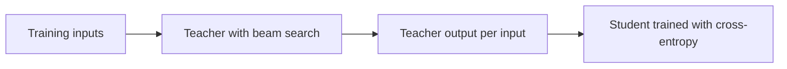

# पाठ 8. Sequence-Level Distillation

**मिशन से संबंध:** मिशन आपसे माँगता है कि आप sequence level पर distill करें और बताएँ कि वह ऐसा क्या transfer करता है जो logits नहीं करते, जिसकी शुरुआत मूल विधि से होती है: teacher जो decode करे उस पर train करें, और देखें कि वह काम क्यों करता है।
**मुख्य स्रोत:** [पेपर: "Sequence-Level Knowledge Distillation", Kim and Rush, 2016](https://arxiv.org/abs/1606.07947)
**पूर्व-आवश्यकताएँ:** [पाठ 7](0007-distilling-during-pretraining.md), [Token-level distillation](../GLOSSARY.md), [Sequence-level distillation](../GLOSSARY.md), [Teacher](../GLOSSARY.md), [Student](../GLOSSARY.md)

## वार्म-अप

1. ▢ Token-level distillation को हर position पर teacher से दो चीज़ें चाहिए। वे क्या हैं?

जाँचें

Teacher का पूरा next-token distribution (उसके logits), और ऐसी vocabulary जिसे student साझा करे, ताकि दोनों distributions index-दर-index मेल खाएँ। पाठ 6 ने दूसरी को कवर किया: अलग tokenizers के साथ तुलना करने के लिए कोई साझा index नहीं होता।

2. ▢ Forward KL और reverse KL, दोनों student को teacher से मिलाते हैं। कौन student को teacher के हर mode पर फैलाता है, और कौन उसे एक पर टिकाता है?

जाँचें

[Forward KL](../GLOSSARY.md) हर mode को कवर करता है, क्योंकि वह student को वहाँ कम probability रखने पर दंडित करता है जहाँ teacher ज़्यादा रखता है। [Reverse KL](../GLOSSARY.md) एक mode पर टिकता है, क्योंकि वह student को वहाँ probability रखने पर दंडित करता है जहाँ teacher कम रखता है। नीचे के लिए इसे याद रखें: इस पाठ की विधि भी एक mode पर टिकती है, पर दूसरे रास्ते से।

## यह जानें

### Loss, और वह पहुँच से बाहर क्यों है

Kim और Rush ने neural machine translation पर काम किया, जहाँ model पूरा target वाक्य एक-एक शब्द करके बनाता है। उनका word-level loss वही [token-level](../GLOSSARY.md) loss है जिसे आप जानते हैं: हर position पर अगले शब्द पर teacher के distribution के विरुद्ध cross-entropy (section 3.1)।

हालाँकि एक वाक्य कोई अकेली prediction नहीं है। पूरे वाक्य की probability उसके शब्दों की probabilities का गुणनफल है, इसलिए teacher हर संभव वाक्य पर भी एक distribution परिभाषित करता है। Sequence-level loss student को उस distribution से मिलाएगा। योग वाक्यों की घातांकीय संख्या पर चलता है, इसलिए उसे निकाला नहीं जा सकता (section 3.2)।

### सन्निकटन: teacher का mode

उनका सबसे सरल उपाय teacher के sequence distribution की जगह एक अकेला बिंदु रखता है: उसका सबसे संभावित वाक्य। उस वाक्य को ठीक-ठीक ढूँढना भी असाध्य है, इसलिए वे [beam search](../GLOSSARY.md) इस्तेमाल करते हैं, जो हर चरण पर सबसे ऊँचे score वाले कुछ आंशिक वाक्य रखता है। विधि के तीन चरण हैं (section 3.2):

1. एक teacher train करें।
2. Training inputs पर teacher के साथ beam search चलाएँ, हर एक के लिए शीर्ष वाक्य रखते हुए।
3. उन outputs पर साधारण cross-entropy से student को train करें।

चरण 3 वही सादा training loop है जो आपके पास पहले से है, नए dataset पर चलाया हुआ। Student कभी teacher की probabilities नहीं देखता। Teacher का योगदान वह text है जो उसने चुना।

### एक sample काफ़ी क्यों हो सकता है

वाक्यों पर एक distribution की जगह एक वाक्य रख देना बुरा सन्निकटन लगता है। लेखक तर्क देते हैं कि ऐसा नहीं है, क्योंकि teacher का ज़्यादातर mass एक output के आसपास बैठा है। उन्होंने इसे मापा: beam size 1 के साथ, शीर्ष वाक्य जर्मन से अंग्रेज़ी पर teacher की probability का औसतन 1.3% और थाई से अंग्रेज़ी पर 2.3% ढोता है, और beam 5 इसे 2.8% और 3.8% तक बढ़ा देता है (section 3.2 और उसका footnote 5)। ये पूरे के छोटे हिस्से हैं, पर किसी भी दूसरे अकेले वाक्य के मुक़ाबले बड़े।

यह पाठ 5 के reverse KL जैसा ही सौदा है: student से कहा जाता है कि वह एक mode के आसपास के क्षेत्र को model करे, पूरे फैलाव को नहीं। Kim और Rush यह सीधे कहते हैं। उनकी परिकल्पना है कि student translations के पूरे space पर parameters "बर्बाद" नहीं करता, और data इसका समर्थन करता है: इस तरह train हुआ 2×500 student औसतन अपने mass का 16.9% अपने ही शीर्ष वाक्य पर रखता है, जबकि मूल data पर train हुए उसी student के लिए यह 0.9% है (Table 1, p(t = ŷ) column)।

### इससे क्या मिला

नीचे की सारी संख्याएँ इसी पेपर की हैं, उसकी अपनी setups पर: अंग्रेज़ी से जर्मन (WMT 2014), 221m parameters वाले 4×1000 LSTM teacher के साथ, और student आकार 2×500 (84m) और 2×300। BLEU translation का score है। K=1 greedy decoding है और K=5 beam 5 वाला beam search (Table 1)।

| Model | BLEU, K=1 | BLEU, K=5 |
|---|---|---|
| Teacher, 4×1000 | 17.7 | 19.5 |
| Student 2×500, मूल data पर train | 14.7 | 17.6 |
| Student 2×500, word-level distillation | 15.4 | 17.7 |
| Student 2×500, sequence-level distillation | 18.9 | 19.0 |

Word-level distillation ने greedy decoding के तहत 0.7 BLEU जोड़ा। Sequence-level distillation ने 4.2 जोड़ा, और greedy student ने teacher के अपने greedy output से ऊपर score किया। थाई से अंग्रेज़ी पर पेपर बताता है कि दोनों विधियों ने लगभग एक-सा प्रदर्शन किया (section 5)।

### हैरानी की बात: beam search की ज़रूरत नहीं

Student का distribution mode के आसपास नुकीला है, इसलिए उसका एक सबसे अच्छा अनुमान पहले से वही mode है। Greedy decoding उसे ढूँढ लेता है, और महँगी खोज की ज़रूरत नहीं रहती। Table 2 गति मापती है: GPU पर greedy decoding के साथ 2×500 student ने प्रति सेकंड 1051.3 source शब्द translate किए, जबकि beam 5 वाले teacher ने 101.9, यानी लगभग 10 गुना तेज़, मिलते-जुलते BLEU के साथ (section 5.1)।

एक अजीब बात याद रखने लायक़ है। 2×500 sequence-level student की test perplexity 22.7 है, baseline की 8.2 के मुक़ाबले, फिर भी उसे BLEU ज़्यादा मिलता है। लेखक ध्यान दिलाते हैं कि कम perplexity का मतलब ज़रूरी नहीं कि ऊँचा BLEU हो। एक संभावित पढ़त यह है कि student को teacher के चुनाव पर टिकने के लिए train किया गया था, दूसरे उचित translations पर probability फैलाने के लिए नहीं, हालाँकि पेपर उस व्याख्या को परखता नहीं।

### ध्यान में रखने की सीमाएँ

यह एक task पर एक पेपर है, LSTMs के साथ, और ऐसे teacher के साथ जिसके outputs पूरे training set के लिए decode किए जा सकते थे। लेखकों ने mode लेने की जगह teacher से sampling भी आज़माई और पाया कि व्यवहार में mode अच्छा चला (footnote 5); यह translation के लिए उनकी खोज है, chat models के लिए नियम नहीं। उन्होंने word-level distillation के लिए {1, 1.5, 2} में temperature भी आज़माया और 1 को सबसे अच्छा पाया (footnote 4), जो पाठ 3 की याद दिलाता है कि सबसे अच्छा temperature एक प्रयोग है।

पेपर में एक तीसरी विधि है, sequence-level interpolation, जो teacher की beam में से वह वाक्य चुनती है जो BLEU के हिसाब से मानव reference के सबसे क़रीब हो। उसे हर input के लिए एक reference चाहिए, इसलिए वह पाठ 10 की generated-data सेटिंग में नहीं चलती, और अगला पाठ उसे एक तरफ़ रख देता है।

## अभ्यास

1. ▢ Kim और Rush की विधि में, चरण 3 में student किस पर train करता है, और वह क्या कभी नहीं देखता?

    - a) Teacher का text, और हर शब्द पर उसकी probabilities भी
    - b) अकेली teacher की probabilities, कभी कोई teacher text नहीं
    - c) अकेला teacher का text, कभी कोई teacher probabilities नहीं
    - d) अकेला मानव text, और teacher logits पर एक loss

जाँचें

**c)** चरण 3 teacher के beam-search output पर cross-entropy है। (b) और (d) word-level या token-level distillation का वर्णन करते हैं, जो teacher का distribution पढ़ता है। (a) दोनों levels का मेल है, जिसे पेपर ने अलग रूप में परखा और पाठ 9 कवर करता है।

2. ▢ Table 1, 2×500 student को baseline के रूप में 14.7 BLEU और greedy decoding के तहत sequence-level distillation के बाद 18.9 देती है, पर beam search के तहत 17.6 और 19.0। Beam search के साथ distillation का फ़ायदा इतना छोटा क्यों है?

संकेत

पूछें कि दोनों students में से किसे अपना सबसे अच्छा वाक्य ढूँढने के लिए beam की ज़रूरत है।

जाँचें

Baseline का distribution फैला हुआ है (उसका शीर्ष वाक्य mass का 0.9% ढोता है), इसलिए greedy decoding अक्सर सबसे अच्छा वाक्य चूक जाता है और beam search उसका बहुत कुछ लौटा देता है। Distilled student teacher के mode पर नुकीला है (16.9%), इसलिए greedy decoding पहले से उसके सबसे अच्छे output के पास पहुँचता है और beam लगभग कुछ नहीं जोड़ता। फ़ायदा greedy decoding के तहत 4.2 BLEU और beam search के तहत 1.4 है क्योंकि baseline को खोज से ज़्यादा फ़ायदा होता है।

3. ▢ Teacher GPU पर beam 5 के साथ प्रति सेकंड 101.9 शब्द translate करता है, और 2×500 student greedy decoding के साथ प्रति सेकंड 1051.3 शब्द। Student कितने गुना तेज़ है, और speedup का मुख्य स्रोत क्या है?

जाँचें

1051.3 को 101.9 से भाग देने पर लगभग 10.3 आता है, यानी क़रीब 10 गुना। उस संख्या में दो असर मिले हैं। Table 2 दिखाती है कि अकेला teacher greedy decoding से 425.5 शब्द प्रति सेकंड तक पहुँचता है, इसलिए beam हटाना ख़ुद में लगभग 4 गुना मायने रखता है, और बाक़ी का ज़्यादातर हिस्सा छोटे model (221m के मुक़ाबले 84m parameters) का है। पेपर का मुद्दा यह है कि student beam छोड़ सकता है और मिलती-जुलती गुणवत्ता रख सकता है।

4. ▢ Sequence-level distillation से train हुए student की मूल reference translations पर test perplexity baseline से ज़्यादा है, फिर भी BLEU ज़्यादा है। एक साथी इसे bug कहता है। आप उसे क्या बताएँगे?

जाँचें

यहाँ यह अपेक्षित है (Table 1 में 22.7 बनाम 8.2)। Student को अपना mass teacher के चुनाव पर रखने के लिए train किया गया था, references को कवर करने के लिए नहीं, इसलिए वह मानव-लिखित रूपों को कम probability देता है जबकि फिर भी एक अच्छा अकेला output बनाता है। References पर perplexity फैलाव मापती है, और decode किए output पर BLEU एक वाक्य मापता है। वह metric जाँचें जो इस बात से मेल खाता हो कि model कैसे इस्तेमाल होगा।

5. ▢ पाठ 5 ने कहा कि reverse KL student को teacher के एक mode पर टिका देता है। एक बात बताएँ जो sequence-level distillation में उसके साथ साझा है, और एक बात जो वह अलग ढंग से करता है।

जाँचें

साझा: दोनों student को teacher के distribution के एक क्षेत्र की ओर लक्षित करते हैं, सबकी ओर नहीं। अलग: reverse KL फिर भी teacher के token distributions पढ़ता है और student के अपने samples को उनके विरुद्ध score करता है, जबकि sequence-level distillation कोई probabilities नहीं पढ़ता और एक decode किए sample की नक़ल cross-entropy से करता है।

## असली दुनिया का अभ्यास

- [ ] पेपर खोलें और Figure 1 ढूँढें। बाएँ, बीच और दाएँ panel में student किस पर train होता है, एक-एक वाक्य में लिखें।
- [ ] कोई छोटा open instruction model लें जिसे आप चला सकें। दस prompts को greedy रूप से decode करें और दस को ऊँचे temperature पर sampling से, और लिखें कि student को आप किस सेट पर train करना पसंद करेंगे, और क्यों।
- [ ] कल: बिना नोट्स के विधि के तीन चरण लिखें और वह एक संख्या जो समझाती है कि एक अकेला sample teacher के distribution की जगह क्यों ले सकता है।

## आगे बढ़ने के लिए

- [Sequence और Synthetic Data शीट](../reference/sequence-and-synthetic-data.md)
- [पेपर: "Sequence-Level Knowledge Distillation", Kim and Rush, 2016](https://arxiv.org/abs/1606.07947)
- [संसाधन](../RESOURCES.md)

---

बात नहीं बन रही? ऊपर दिए मुख्य स्रोत को दोबारा पढ़ें, क्योंकि यह पाठ उसे संक्षिप्त करता है और समझ संक्षेप में ही रिसती है। जो शब्द फिसलन भरा लगे, उसके लिए [शब्दावली](../GLOSSARY.md) देखें।

अगर दिक़्क़त सामग्री की नहीं बल्कि पाठ की ही है, तो वह एक खोट है: [issue खोलें](https://github.com/TokenCemetery/teach/issues)।
