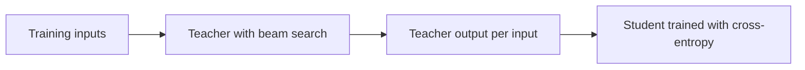

# Lesson 8. Sequence-Level Distillation

**Mission link:** The mission asks you to distill at sequence level and say what it transfers that logits do not, which starts with the original method: train on what the teacher decodes, and see why that works.
**Primary source:** [Paper: "Sequence-Level Knowledge Distillation", Kim and Rush, 2016](https://arxiv.org/abs/1606.07947)
**Prerequisites:** [Lesson 7](0007-distilling-during-pretraining.md), [Token-level distillation](../GLOSSARY.md), [Sequence-level distillation](../GLOSSARY.md), [Teacher](../GLOSSARY.md), [Student](../GLOSSARY.md)

## Warm-up

1. ▢ Token-level distillation needs two things from the teacher at every position. What are they?

Check

The teacher's full next-token distribution (its logits), and a vocabulary the student shares, so the two distributions line up index by index. Lesson 6 covered the second: with different tokenizers there is no shared index to compare.

2. ▢ Forward KL and reverse KL both match the student to the teacher. Which one spreads the student over every mode of the teacher, and which makes it commit to one?

Check

[Forward KL](../GLOSSARY.md) covers every mode, because it punishes the student for putting little probability where the teacher puts much. [Reverse KL](../GLOSSARY.md) commits to one mode, because it punishes the student for putting probability where the teacher puts little. Keep this in mind below: this lesson's method also commits to one mode, by a different route.

## Know this

### The loss, and why it is out of reach

Kim and Rush worked on neural machine translation, where a model produces a whole target sentence one word at a time. Their word-level loss is the [token-level](../GLOSSARY.md) loss you know: at each position, cross-entropy against the teacher's distribution over the next word (section 3.1).

A sentence is not a single prediction, though. The probability of a whole sentence is the product of its word probabilities, so the teacher also defines a distribution over every possible sentence. The sequence-level loss would match the student to that distribution. The sum runs over an exponential number of sentences, so it cannot be computed (section 3.2).

### The approximation: the teacher's mode

Their simplest fix replaces the teacher's sequence distribution with a single point: its most probable sentence. Finding that sentence exactly is also intractable, so they use [beam search](../GLOSSARY.md), which keeps the few highest-scoring partial sentences at each step. The recipe has three steps (section 3.2):

1. Train a teacher.
2. Run beam search with the teacher over the training inputs, keeping the top sentence for each.
3. Train the student with ordinary cross-entropy on those outputs.

Step 3 is the plain training loop you already have, run on a new dataset. The student never sees the teacher's probabilities. The teacher's contribution is the text it chose.

### Why one sample can be enough

Replacing a distribution over sentences with one sentence looks like a bad approximation. The authors argue it is not, because most of the teacher's mass sits near one output. They measured it: with a beam of size 1, the top sentence carries on average 1.3% of the teacher's probability on German to English and 2.3% on Thai to English, and a beam of 5 raises that to 2.8% and 3.8% (section 3.2 and its footnote 5). Those are small shares of the whole, but large next to any other single sentence.

This is the same trade as reverse KL in lesson 5: the student is asked to model the region around one mode and not the whole spread. Kim and Rush say so directly. Their hypothesis is that the student does not "waste" parameters on the whole space of translations, and the data supports it: the 2×500 student trained this way puts on average 16.9% of its mass on its own top sentence, against 0.9% for the same student trained on the original data (Table 1, p(t = ŷ) column).

### What it bought

All numbers below are this paper's, on its setups: English to German (WMT 2014) with a 4×1000 LSTM teacher of 221m parameters, and student sizes 2×500 (84m) and 2×300. BLEU is the translation score. K=1 is greedy decoding and K=5 is beam search with beam 5 (Table 1).

| Model | BLEU, K=1 | BLEU, K=5 |
|---|---|---|
| Teacher, 4×1000 | 17.7 | 19.5 |
| Student 2×500, trained on the original data | 14.7 | 17.6 |
| Student 2×500, word-level distillation | 15.4 | 17.7 |
| Student 2×500, sequence-level distillation | 18.9 | 19.0 |

Word-level distillation added 0.7 BLEU under greedy decoding. Sequence-level distillation added 4.2, and the greedy student scored above the teacher's own greedy output. On Thai to English the paper reports that the two methods performed about the same (section 5).

### The surprise: no beam search needed

The student's distribution is peaked around the mode, so its single best guess already is that mode. Greedy decoding finds it, and the expensive search is no longer needed. Table 2 measures the speed: on a GPU the 2×500 student with greedy decoding translated 1051.3 source words per second, against 101.9 for the teacher with beam 5, about 10 times as fast, with similar BLEU (section 5.1).

One odd detail is worth keeping. The 2×500 sequence-level student has a test perplexity of 22.7 against 8.2 for the baseline, and yet it scores more BLEU. The authors note that lower perplexity does not necessarily mean higher BLEU. A plausible reading is that the student was trained to commit to the teacher's choice, not to spread probability over other reasonable translations, though the paper does not test that explanation.

### Limits to keep in view

This is one paper on one task, with LSTMs and a teacher whose outputs could be decoded for the entire training set. The authors also tried sampling from the teacher in place of taking the mode and found the mode worked well in practice (footnote 5); that is their finding for translation, not a rule for chat models. They also tried a temperature in {1, 1.5, 2} for word-level distillation and found 1 worked best (footnote 4), a reminder from lesson 3 that the best temperature is an experiment.

The paper has a third method, sequence-level interpolation, which picks from the teacher's beam the sentence closest to the human reference by BLEU. It needs a reference per input, so it does not carry over to the generated-data setting of lesson 10, and the next lesson leaves it aside.

## Practice

1. ▢ In Kim and Rush's recipe, what does the student train on in step 3, and what does it never see?

    - a) Teacher text, plus its probabilities at each word
    - b) Teacher probabilities alone, never any teacher text
    - c) Teacher text alone, never any teacher probabilities
    - d) Human text alone, plus a loss on teacher logits

Check

**c)** Step 3 is cross-entropy on the teacher's beam-search output. (b) and (d) describe word-level or token-level distillation, which reads the teacher's distribution. (a) is the combination of the two levels, which the paper tested as a separate variant and lesson 9 covers.

2. ▢ Table 1 gives the 2×500 student 14.7 BLEU baseline and 18.9 after sequence-level distillation under greedy decoding, but 17.6 and 19.0 under beam search. Why is the gain from distillation so much smaller with beam search?

Hint

Ask which of the two students needs the beam to find its best sentence.

Check

The baseline's distribution is spread out (its top sentence carries 0.9% of the mass), so greedy decoding often misses the best sentence and beam search recovers a lot of it. The distilled student is peaked on the teacher's mode (16.9%), so greedy decoding already lands near its best output and a beam adds almost nothing. The gain is 4.2 BLEU under greedy decoding and 1.4 under beam search because the baseline benefits more from the search.

3. ▢ The teacher translates 101.9 words per second on the GPU with beam 5, and the 2×500 student translates 1051.3 words per second with greedy decoding. How many times faster is the student, and what is the main source of the speedup?

Check

1051.3 divided by 101.9 is about 10.3, so roughly 10 times. Two effects are mixed in that number. Table 2 shows the teacher alone reaching 425.5 words per second with greedy decoding, so dropping the beam is worth about 4 times by itself, and the smaller model (84m parameters against 221m) accounts for most of the rest. The paper's point is that the student can drop the beam and keep similar quality.

4. ▢ A student trained with sequence-level distillation has a higher test perplexity on the original reference translations than the baseline, yet a higher BLEU. A teammate calls that a bug. What do you tell them?

Check

It is expected here (22.7 against 8.2 in Table 1). The student was trained to put its mass on the teacher's choice, not to cover the references, so it assigns less probability to human-written variants while still producing a good single output. Perplexity on references measures spread, and BLEU on the decoded output measures one sentence. Check the metric that matches how the model will be used.

5. ▢ Lesson 5 said reverse KL makes a student commit to one mode of the teacher. Name one thing sequence-level distillation has in common with that, and one thing it does differently.

Check

In common: both aim the student at one region of the teacher's distribution, not at all of it. Different: reverse KL still reads the teacher's token distributions and scores the student's own samples against them, while sequence-level distillation reads no probabilities at all and imitates one decoded sample with cross-entropy.

## Real-world reps

- [ ] Open the paper and find Figure 1. In one sentence each, write what the student is trained on in the left, center and right panels.
- [ ] Take any small open instruction model you can run. Decode ten prompts greedily and ten with sampling at a high temperature, and write down which set you would rather train a student on, and why.
- [ ] Tomorrow: without notes, write the three steps of the recipe and the one number that explains why a single sample can stand in for the teacher's distribution.

## Going further

- [Sequence and Synthetic Data](../reference/sequence-and-synthetic-data.md)
- [Paper: "Sequence-Level Knowledge Distillation", Kim and Rush, 2016](https://arxiv.org/abs/1606.07947)
- [Resources](../RESOURCES.md)

---

Not landing? Reread the primary source at the top, since this lesson compresses it and compression is where understanding leaks. Check the [glossary](../GLOSSARY.md) for any term that felt slippery.

If the lesson itself is unclear rather than the material, that is a defect: [open an issue](https://github.com/TokenCemetery/teach/issues).
