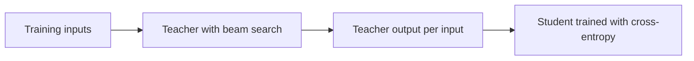

# Lição 8. Destilação em nível de sequência

**Ligação com a missão:** A missão pede que você destile em nível de sequência e diga o que isso transfere que os logits não transferem, o que começa pelo método original: treinar no que o professor decodifica, e ver por que isso funciona.
**Fonte principal:** [Artigo científico: "Sequence-Level Knowledge Distillation", Kim e Rush, 2016](https://arxiv.org/abs/1606.07947)
**Pré-requisitos:** [Lição 7](0007-distilling-during-pretraining.md), [Destilação em nível de token](../GLOSSARY.md), [Destilação em nível de sequência](../GLOSSARY.md), [Professor](../GLOSSARY.md), [Aluno](../GLOSSARY.md)

## Aquecimento

1. ▢ A destilação em nível de token precisa de duas coisas do professor em cada posição. Quais são?

Verificação

A distribuição completa de próximo token do professor (os seus logits) e um vocabulário que o aluno compartilhe, para que as duas distribuições se alinhem índice por índice. A lição 6 cobriu o segundo: com tokenizers diferentes, não há índice compartilhado para comparar.

2. ▢ O forward KL e o reverse KL igualam ambos o aluno ao professor. Qual deles espalha o aluno por todos os modos do professor, e qual o faz se comprometer com um só?

Verificação

O [forward KL](../GLOSSARY.md) cobre todos os modos, porque pune o aluno por dar pouca probabilidade onde o professor dá muita. O [reverse KL](../GLOSSARY.md) se compromete com um modo, porque pune o aluno por dar probabilidade onde o professor dá pouca. Guarde isto para o que vem abaixo: o método desta lição também se compromete com um modo, por outro caminho.

## Saiba isto

### A loss, e por que ela está fora de alcance

Kim e Rush trabalharam com tradução automática neural, em que um modelo produz uma frase-alvo inteira uma palavra por vez. A loss em nível de palavra deles é a loss [em nível de token](../GLOSSARY.md) que você já conhece: em cada posição, cross-entropy contra a distribuição do professor sobre a próxima palavra (seção 3.1).

Uma frase, porém, não é uma única previsão. A probabilidade de uma frase inteira é o produto das probabilidades das suas palavras, então o professor também define uma distribuição sobre todas as frases possíveis. A loss em nível de sequência igualaria o aluno a essa distribuição. A soma percorre um número exponencial de frases, então não pode ser calculada (seção 3.2).

### A aproximação: a moda do professor

A correção mais simples deles substitui a distribuição de sequências do professor por um único ponto: a sua frase mais provável. Encontrar essa frase exatamente também é intratável, então eles usam [beam search](../GLOSSARY.md), que mantém, a cada passo, as poucas frases parciais de maior pontuação. A receita tem três passos (seção 3.2):

1. Treine um professor.
2. Rode beam search com o professor sobre as entradas de treinamento, mantendo a melhor frase para cada uma.
3. Treine o aluno com cross-entropy comum nessas saídas.

O passo 3 é o loop de treinamento simples que você já tem, rodado em um novo dataset. O aluno nunca vê as probabilidades do professor. A contribuição do professor é o texto que ele escolheu.

### Por que uma amostra pode bastar

Substituir uma distribuição sobre frases por uma frase parece uma má aproximação. Os autores argumentam que não é, porque a maior parte da massa do professor fica perto de uma saída. Eles mediram: com um beam de tamanho 1, a melhor frase carrega em média 1,3% da probabilidade do professor em alemão para inglês e 2,3% em tailandês para inglês, e um beam de 5 eleva isso para 2,8% e 3,8% (seção 3.2 e sua nota de rodapé 5). Essas são frações pequenas do todo, mas grandes ao lado de qualquer outra frase isolada.

Essa é a mesma troca do reverse KL na lição 5: pede-se ao aluno que modele a região em torno de uma moda e não toda a dispersão. Kim e Rush dizem isso diretamente. A hipótese deles é que o aluno não "desperdiça" parâmetros em todo o espaço de traduções, e os dados a apoiam: o aluno 2×500 treinado assim põe em média 16,9% da sua massa na sua própria melhor frase, contra 0,9% do mesmo aluno treinado nos dados originais (Tabela 1, coluna p(t = ŷ)).

### O que isso rendeu

Todos os números abaixo são deste artigo, nos seus cenários: inglês para alemão (WMT 2014) com um professor LSTM 4×1000 de 221m de parâmetros e alunos de tamanhos 2×500 (84m) e 2×300. BLEU é a pontuação de tradução. K=1 é decodificação greedy e K=5 é beam search com beam 5 (Tabela 1).

| Modelo | BLEU, K=1 | BLEU, K=5 |
|---|---|---|
| Professor, 4×1000 | 17,7 | 19,5 |
| Aluno 2×500, treinado nos dados originais | 14,7 | 17,6 |
| Aluno 2×500, destilação em nível de palavra | 15,4 | 17,7 |
| Aluno 2×500, destilação em nível de sequência | 18,9 | 19,0 |

A destilação em nível de palavra acrescentou 0,7 de BLEU com decodificação greedy. A destilação em nível de sequência acrescentou 4,2, e o aluno greedy pontuou acima da própria saída greedy do professor. Em tailandês para inglês, o artigo relata que os dois métodos tiveram desempenho parecido (seção 5).

### A surpresa: não precisa de beam search

A distribuição do aluno é pontuda em torno da moda, então o seu único melhor palpite já é essa moda. A decodificação greedy a encontra, e a busca cara não é mais necessária. A Tabela 2 mede a velocidade: em uma GPU, o aluno 2×500 com decodificação greedy traduziu 1051,3 palavras de origem por segundo, contra 101,9 do professor com beam 5, cerca de 10 vezes mais rápido, com BLEU parecido (seção 5.1).

Um detalhe estranho vale ser guardado. O aluno 2×500 em nível de sequência tem perplexidade de teste de 22,7 contra 8,2 do baseline, e mesmo assim pontua mais BLEU. Os autores observam que uma perplexidade menor não significa necessariamente um BLEU maior. Uma leitura plausível é que o aluno foi treinado para se comprometer com a escolha do professor, e não para espalhar probabilidade por outras traduções razoáveis, embora o artigo não teste essa explicação.

### Limites para ter em vista

Este é um artigo sobre uma tarefa, com LSTMs e um professor cujas saídas podiam ser decodificadas para todo o conjunto de treinamento. Os autores também tentaram amostrar do professor em vez de tomar a moda e constataram que a moda funcionou bem na prática (nota de rodapé 5); isso é um achado deles para tradução, não uma regra para modelos de chat. Eles também tentaram uma temperatura em {1, 1,5, 2} para a destilação em nível de palavra e constataram que 1 funcionou melhor (nota de rodapé 4), um lembrete da lição 3 de que a melhor temperatura é um experimento.

O artigo tem um terceiro método, a interpolação em nível de sequência, que escolhe do beam do professor a frase mais próxima da referência humana por BLEU. Ele precisa de uma referência por entrada, então não se transporta para o cenário de dados gerados da lição 10, e a próxima lição o deixa de lado.

## Prática

1. ▢ Na receita de Kim e Rush, no que o aluno treina no passo 3, e o que ele nunca vê?

    - a) Texto do professor, mais as suas probabilidades em cada palavra
    - b) Apenas probabilidades do professor, nunca texto do professor
    - c) Apenas texto do professor, nunca probabilidades do professor
    - d) Apenas texto humano, mais uma loss nos logits do professor

Verificação

**c)** O passo 3 é cross-entropy na saída de beam search do professor. (b) e (d) descrevem a destilação em nível de palavra ou de token, que lê a distribuição do professor. (a) é a combinação dos dois níveis, que o artigo testou como uma variante separada e que a lição 9 cobre.

2. ▢ A Tabela 1 dá ao aluno 2×500 um baseline de 14,7 de BLEU e 18,9 depois da destilação em nível de sequência com decodificação greedy, mas 17,6 e 19,0 com beam search. Por que o ganho da destilação é tão menor com beam search?

Dica

Pergunte qual dos dois alunos precisa do beam para encontrar a sua melhor frase.

Verificação

A distribuição do baseline é espalhada (a sua melhor frase carrega 0,9% da massa), então a decodificação greedy muitas vezes perde a melhor frase e o beam search recupera muito dela. O aluno destilado é pontudo na moda do professor (16,9%), então a decodificação greedy já cai perto da sua melhor saída e um beam não acrescenta quase nada. O ganho é de 4,2 de BLEU com decodificação greedy e de 1,4 com beam search porque o baseline se beneficia mais da busca.

3. ▢ O professor traduz 101,9 palavras por segundo na GPU com beam 5, e o aluno 2×500 traduz 1051,3 palavras por segundo com decodificação greedy. Quantas vezes mais rápido é o aluno, e qual é a principal fonte da aceleração?

Verificação

1051,3 dividido por 101,9 dá cerca de 10,3, então aproximadamente 10 vezes. Dois efeitos estão misturados nesse número. A Tabela 2 mostra o professor sozinho chegando a 425,5 palavras por segundo com decodificação greedy, então abandonar o beam vale cerca de 4 vezes por si só, e o modelo menor (84m de parâmetros contra 221m) responde pela maior parte do resto. O ponto do artigo é que o aluno pode abandonar o beam e manter uma qualidade parecida.

4. ▢ Um aluno treinado com destilação em nível de sequência tem perplexidade de teste maior nas traduções de referência originais do que o baseline, mas um BLEU maior. Um colega chama isso de bug. O que você diz a ele?

Verificação

Isso é esperado aqui (22,7 contra 8,2 na Tabela 1). O aluno foi treinado para pôr a sua massa na escolha do professor, e não para cobrir as referências, então atribui menos probabilidade a variantes escritas por humanos e ainda assim produz uma boa saída única. A perplexidade nas referências mede dispersão, e o BLEU na saída decodificada mede uma frase. Confira a métrica que corresponde a como o modelo será usado.

5. ▢ A lição 5 disse que o reverse KL faz um aluno se comprometer com um modo do professor. Cite uma coisa que a destilação em nível de sequência tem em comum com isso e uma que ela faz de modo diferente.

Verificação

Em comum: ambos apontam o aluno para uma região da distribuição do professor, e não para toda ela. Diferente: o reverse KL ainda lê as distribuições de tokens do professor e pontua as próprias amostras do aluno contra elas, enquanto a destilação em nível de sequência não lê probabilidade nenhuma e imita uma amostra decodificada com cross-entropy.

## Prática no mundo real

- [ ] Abra o artigo e encontre a Figura 1. Em uma frase cada, escreva no que o aluno é treinado nos painéis da esquerda, do centro e da direita.
- [ ] Pegue qualquer modelo de instrução aberto pequeno que você consiga rodar. Decodifique dez prompts de forma greedy e dez com amostragem a uma temperatura alta, e anote com qual conjunto você preferiria treinar um aluno, e por quê.
- [ ] Amanhã: sem consultar anotações, escreva os três passos da receita e o número que explica por que uma única amostra pode substituir a distribuição do professor.

## Para ir além

- [Sequência e Dados Sintéticos](../reference/sequence-and-synthetic-data.md)
- [Artigo científico: "Sequence-Level Knowledge Distillation", Kim e Rush, 2016](https://arxiv.org/abs/1606.07947)
- [Recursos](../RESOURCES.md)

---

Não ficou claro? Releia a fonte principal no topo, já que esta lição a comprime e é na compressão que o entendimento escapa. Consulte o [glossário](../GLOSSARY.md) para qualquer termo que pareceu escorregadio.

Se o problema é a lição em si, e não o material, isso é um defeito: [abra uma issue](https://github.com/TokenCemetery/teach/issues).
