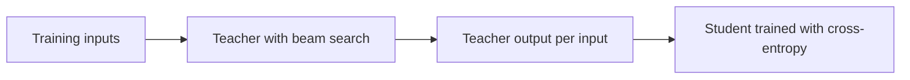

# Урок 8. Дистилляция на уровне последовательностей

**Связь с целью курса:** Цель курса требует, чтобы вы могли дистиллировать на уровне последовательностей и сказать, что она передаёт такого, чего не передают логиты, а это начинается с исходного метода: обучать на том, что декодирует учитель, и понять, почему это работает.
**Первоисточник:** [Научная статья: "Sequence-Level Knowledge Distillation", Kim and Rush, 2016](https://arxiv.org/abs/1606.07947)
**Предварительные требования:** [Урок 7](0007-distilling-during-pretraining.md), [дистилляция на уровне токенов](../GLOSSARY.md), [дистилляция на уровне последовательностей](../GLOSSARY.md), [учитель](../GLOSSARY.md), [ученик](../GLOSSARY.md)

## Разминка

1. ▢ Дистилляции на уровне токенов в каждой позиции нужны от учителя две вещи. Какие?

Проверка

Полное распределение следующего токена у учителя (его логиты) и словарь, общий с учеником, так что два распределения выстраиваются индекс за индексом. Урок 6 разобрал второе: при разных токенизаторах общего индекса для сравнения нет.

2. ▢ И прямая KL, и обратная KL подгоняют ученика под учителя. Какая из них растягивает ученика по всем модам учителя, а какая заставляет его выбрать одну?

Проверка

[Прямая KL](../GLOSSARY.md) покрывает все моды, потому что штрафует ученика за малую вероятность там, где у учителя она велика. [Обратная KL](../GLOSSARY.md) выбирает одну моду, потому что штрафует ученика за вероятность там, где у учителя она мала. Держите это в уме дальше: метод этого урока тоже выбирает одну моду, но другим путём.

## Что нужно знать

### Функция потерь и почему она недосягаема

Kim и Rush работали над нейронным машинным переводом, где модель порождает целое целевое предложение по одному слову. Их потеря на уровне слов это знакомая вам потеря [на уровне токенов](../GLOSSARY.md): в каждой позиции кросс-энтропия относительно распределения учителя по следующему слову (раздел 3.1).

Предложение, однако, не единичное предсказание. Вероятность целого предложения это произведение вероятностей его слов, так что учитель задаёт также распределение по всем возможным предложениям. Потеря на уровне последовательностей согласовывала бы ученика с этим распределением. Сумма идёт по экспоненциальному числу предложений, поэтому вычислить её невозможно (раздел 3.2).

### Приближение: мода учителя

Их простейшее решение заменяет распределение учителя по последовательностям одной точкой: его самым вероятным предложением. Найти это предложение точно тоже неразрешимо, поэтому они используют [лучевой поиск](../GLOSSARY.md), который на каждом шаге сохраняет несколько частичных предложений с наибольшей оценкой. Рецепт состоит из трёх шагов (раздел 3.2):

1. Обучить учителя.
2. Прогнать лучевой поиск с учителем по обучающим входам, сохраняя лучшее предложение для каждого.
3. Обучить ученика обычной кросс-энтропией на этих выходах.

Шаг 3 это обычный цикл обучения, который у вас уже есть, запущенный на новом датасете. Ученик никогда не видит вероятностей учителя. Вклад учителя это текст, который он выбрал.

### Почему может хватить одного сэмпла

Замена распределения по предложениям одним предложением выглядит плохим приближением. Авторы доказывают, что это не так, потому что большая часть массы учителя лежит около одного выхода. Они это измерили: при ширине луча 1 лучшее предложение несёт в среднем 1.3% вероятности учителя при переводе с немецкого на английский и 2.3% с тайского на английский, а луч шириной 5 поднимает эти доли до 2.8% и 3.8% (раздел 3.2 и его сноска 5). Это малые доли целого, но большие рядом с любым другим одиночным предложением.

Это тот же компромисс, что и обратная KL в уроке 5: от ученика требуют моделировать область вокруг одной моды, а не весь разброс. Kim и Rush говорят об этом прямо. Их гипотеза в том, что ученик не «тратит» параметры на всё пространство переводов, и данные её поддерживают: ученик 2×500, обученный таким образом, ставит в среднем 16.9% своей массы на собственное лучшее предложение, против 0.9% для того же ученика, обученного на исходных данных (таблица 1, столбец p(t = ŷ)).

### Что это дало

Все числа ниже принадлежат этой статье и получены на её постановках: перевод с английского на немецкий (WMT 2014) с учителем LSTM 4×1000 на 221m параметров и размерами ученика 2×500 (84m) и 2×300. BLEU это оценка перевода. K=1 это жадное декодирование, а K=5 лучевой поиск с шириной луча 5 (таблица 1).

| Модель | BLEU, K=1 | BLEU, K=5 |
|---|---|---|
| Учитель, 4×1000 | 17.7 | 19.5 |
| Ученик 2×500, обученный на исходных данных | 14.7 | 17.6 |
| Ученик 2×500, дистилляция на уровне слов | 15.4 | 17.7 |
| Ученик 2×500, дистилляция на уровне последовательностей | 18.9 | 19.0 |

Дистилляция на уровне слов добавила 0.7 BLEU при жадном декодировании. Дистилляция на уровне последовательностей добавила 4.2, и жадный ученик набрал больше, чем собственный жадный выход учителя. Для перевода с тайского на английский статья сообщает, что два метода показали примерно одинаковый результат (раздел 5).

### Сюрприз: лучевой поиск не нужен

Распределение ученика сосредоточено вокруг моды, так что его единственная лучшая догадка уже и есть эта мода. Жадное декодирование её находит, и дорогой поиск больше не нужен. Таблица 2 измеряет скорость: на GPU ученик 2×500 с жадным декодированием переводил 1051.3 исходных слова в секунду против 101.9 у учителя с лучом 5, то есть примерно в 10 раз быстрее, с близким BLEU (раздел 5.1).

Одну странную деталь стоит сохранить. У ученика 2×500 на уровне последовательностей перплексия на тесте 22.7 против 8.2 у базового уровня, и всё же он набирает больше BLEU. Авторы отмечают, что более низкая перплексия не обязательно означает более высокий BLEU. Правдоподобное прочтение состоит в том, что ученика обучили придерживаться выбора учителя, а не распределять вероятность по другим разумным переводам, хотя статья это объяснение не проверяет.

### Ограничения, которые нужно помнить

Это одна статья про одну задачу, с LSTM и учителем, чьи выходы можно было декодировать для всего обучающего набора. Авторы также пробовали сэмплирование от учителя вместо взятия моды и нашли, что на практике мода работает хорошо (сноска 5); это их вывод для перевода, а не правило для чат-моделей. Они также пробовали температуру из {1, 1.5, 2} для дистилляции на уровне слов и нашли, что лучше всего работает 1 (сноска 4), и это напоминание из урока 3 о том, что лучшая температура это эксперимент.

У статьи есть третий метод, интерполяция на уровне последовательностей, который выбирает из луча учителя предложение, ближайшее к человеческому эталону по BLEU. Ему нужен эталон для каждого входа, поэтому он не переносится на постановку со сгенерированными данными из урока 10, и следующий урок его оставляет в стороне.

## Практика

1. ▢ На чём в рецепте Kim и Rush обучается ученик на шаге 3 и чего он никогда не видит?

    - a) Текст учителя и его вероятности для каждого слова
    - b) Одни лишь вероятности учителя, никогда никакого текста учителя
    - c) Один лишь текст учителя, никогда никаких вероятностей учителя
    - d) Один лишь человеческий текст плюс потеря на логитах учителя

Проверка

**c)** Шаг 3 это кросс-энтропия на выходе лучевого поиска учителя. (b) и (d) описывают дистилляцию на уровне слов или токенов, которая читает распределение учителя. (a) это сочетание двух уровней, которое статья проверила как отдельный вариант и которое разбирает урок 9.

2. ▢ Таблица 1 даёт ученику 2×500 базовый уровень 14.7 BLEU и 18.9 после дистилляции на уровне последовательностей при жадном декодировании, но 17.6 и 19.0 при лучевом поиске. Почему выигрыш от дистилляции при лучевом поиске гораздо меньше?

Подсказка

Спросите, какому из двух учеников нужен луч, чтобы найти своё лучшее предложение.

Проверка

Распределение базового уровня размыто (его лучшее предложение несёт 0.9% массы), так что жадное декодирование часто упускает лучшее предложение, а лучевой поиск многое возвращает. Дистиллированный ученик сосредоточен на моде учителя (16.9%), так что жадное декодирование уже попадает около его лучшего выхода, и луч почти ничего не добавляет. Прирост составляет 4.2 BLEU при жадном декодировании и 1.4 при лучевом поиске, потому что базовый уровень больше выигрывает от поиска.

3. ▢ Учитель переводит 101.9 слова в секунду на GPU с лучом 5, а ученик 2×500 переводит 1051.3 слова в секунду с жадным декодированием. Во сколько раз ученик быстрее и каков главный источник ускорения?

Проверка

1051.3, делённое на 101.9, это около 10.3, то есть примерно в 10 раз. В этом числе смешаны два эффекта. Таблица 2 показывает, что один учитель достигает 425.5 слова в секунду с жадным декодированием, так что отказ от луча сам по себе даёт около 4 раз, а меньшая модель (84m параметров против 221m) объясняет большую часть остального. Смысл статьи в том, что ученик может обойтись без луча и сохранить близкое качество.

4. ▢ Ученик, обученный дистилляцией на уровне последовательностей, имеет на исходных эталонных переводах более высокую перплексию на тесте, чем базовый уровень, но более высокий BLEU. Коллега называет это багом. Что вы ему скажете?

Проверка

Здесь это ожидаемо (22.7 против 8.2 в таблице 1). Ученика обучили ставить массу на выбор учителя, а не покрывать эталоны, так что он назначает меньшую вероятность написанным людьми вариантам, при этом по-прежнему выдавая хороший единичный выход. Перплексия на эталонах измеряет разброс, а BLEU на декодированном выходе измеряет одно предложение. Проверяйте метрику, которая соответствует тому, как модель будет использоваться.

5. ▢ Урок 5 говорил, что обратная KL заставляет ученика выбрать одну моду учителя. Назовите одно, что у дистилляции на уровне последовательностей общего с этим, и одно, что она делает иначе.

Проверка

Общее: оба нацеливают ученика на одну область распределения учителя, а не на всё распределение. Различие: обратная KL всё ещё читает токенные распределения учителя и оценивает по ним собственные сэмплы ученика, тогда как дистилляция на уровне последовательностей вообще не читает вероятностей и имитирует один декодированный сэмпл кросс-энтропией.

## Практика в реальной работе

- [ ] Откройте статью и найдите рисунок 1. По одному предложению на каждую панель запишите, на чём обучается ученик на левой, средней и правой панелях.
- [ ] Возьмите любую малую открытую инструктивную модель, которую можете запустить. Декодируйте десять промптов жадно и десять с сэмплированием при высокой температуре и запишите, на каком наборе вы предпочли бы обучать ученика и почему.
- [ ] Завтра: без заметок запишите три шага рецепта и одно число, которое объясняет, почему один сэмпл может заменить распределение учителя.

## Что почитать дальше

- [Последовательности и синтетические данные](../reference/sequence-and-synthetic-data.md)
- [Научная статья: "Sequence-Level Knowledge Distillation", Kim and Rush, 2016](https://arxiv.org/abs/1606.07947)
- [Ресурсы](../RESOURCES.md)

---

Не доходит? Перечитайте первоисточник в начале: этот урок его сжимает, а при сжатии понимание как раз и теряется. Загляните в [глоссарий](../GLOSSARY.md), если какой-то термин показался скользким.

Если неясен сам урок, а не материал, это дефект: [откройте issue](https://github.com/TokenCemetery/teach/issues).
