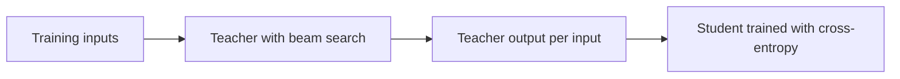

# 第 8 课：序列级蒸馏

**使命关联:** 本使命要求你在序列级做蒸馏，并说明它能迁移而 logit 不能迁移的东西，这要从最初的方法讲起：在教师解码出的内容上训练，并看看它为什么有效。
**主要来源:** [论文：“Sequence-Level Knowledge Distillation”，Kim 和 Rush，2016](https://arxiv.org/abs/1606.07947)
**前置知识:** [第 7 课](0007-distilling-during-pretraining.md)、[token 级蒸馏](../GLOSSARY.md)、[序列级蒸馏](../GLOSSARY.md)、[教师模型](../GLOSSARY.md)、[学生模型](../GLOSSARY.md)

## 热身

1. ▢ token 级蒸馏在每个位置上，需要教师提供两样东西。是哪两样？

检查

教师完整的下一个 token 分布（它的 logit），以及学生共用的词表，这样两个分布才能逐个索引对齐。第 6 课讲了第二样：分词器不同时，没有可供比较的共享索引。

2. ▢ 前向 KL 和反向 KL 都让学生去匹配教师。哪一个让学生铺开去覆盖教师的每个模式，哪一个让它只认定一个？

检查

[前向 KL](../GLOSSARY.md) 覆盖每一个模式，因为教师给了很高概率的地方，学生若给得很低就会受罚。[反向 KL](../GLOSSARY.md) 只认定一个模式，因为教师给得很低的地方，学生若给了概率就会受罚。下面请记住这一点：本课的方法同样只认定一个模式，只是走的是另一条路。

## 要点

### 这个损失，以及它为什么够不着

Kim 和 Rush 研究的是神经机器翻译，模型一次一个词地生成整个目标句。他们的词级损失，就是你已经知道的 [token 级](../GLOSSARY.md)损失：在每个位置上，针对教师在下一个词上的分布做交叉熵（第 3.1 节）。

不过，一个句子不是单个预测。整个句子的概率是各个词的概率之积，所以教师同样定义了一个覆盖所有可能句子的分布。序列级损失要让学生去匹配这个分布。这个求和要遍历指数级数量的句子，所以无法计算（第 3.2 节）。

### 近似：教师的众数

他们最简单的补救办法，是把教师的序列分布换成一个点：它最可能的句子。要精确找到这个句子同样不可行，所以他们用[束搜索](../GLOSSARY.md)，它在每一步保留得分最高的几个部分句子。这个配方有三步（第 3.2 节）：

1. 训练一个教师。
2. 在训练输入上用教师运行束搜索，为每个输入保留得分最高的句子。
3. 在这些输出上，用普通的交叉熵训练学生。

第 3 步就是你已有的那个普通训练循环，只是跑在新的数据集上。学生从未见过教师的概率。教师的贡献，是它选定的文本。

### 为什么一个样本可能就够了

把一个句子上的分布换成一个句子，看起来是很糟糕的近似。作者认为并非如此，因为教师的大部分质量都集中在某个输出附近。他们测量了这一点：束宽为 1 时，得分最高的句子平均占教师概率的比例，在德语到英语上是 1.3%，在泰语到英语上是 2.3%，而束宽为 5 时，这两个数升到 2.8% 和 3.8%（第 3.2 节及其脚注 5）。这些在整体中占的份额很小，但与任何其他单个句子相比就很大了。

这与第 5 课的反向 KL 是同样的权衡：要求学生去建模围绕一个模式的区域，而不是整个分布范围。Kim 和 Rush 直接这么说了。他们的假设是，学生不会把参数“浪费”在整个翻译空间上，而数据支持这一点：用这种方式训练的 2×500 学生，平均把 16.9% 的质量放在它自己得分最高的句子上，而同一个学生在原始数据上训练，这个数是 0.9%（表 1，p(t = ŷ) 一列）。

### 它带来了什么

下面所有的数字都是这篇论文在它自己的设置上得到的：英语到德语（WMT 2014），教师是 2.21 亿参数的 4×1000 LSTM，学生规模为 2×500（8400 万）和 2×300。BLEU 是翻译得分。K=1 是贪心解码，K=5 是束宽为 5 的束搜索（表 1）。

| 模型 | BLEU，K=1 | BLEU，K=5 |
|---|---|---|
| 教师，4×1000 | 17.7 | 19.5 |
| 学生 2×500，在原始数据上训练 | 14.7 | 17.6 |
| 学生 2×500，词级蒸馏 | 15.4 | 17.7 |
| 学生 2×500，序列级蒸馏 | 18.9 | 19.0 |

在贪心解码下，词级蒸馏多得了 0.7 BLEU。序列级蒸馏多得了 4.2，而且贪心解码的学生得分，高于教师自己的贪心输出。在泰语到英语上，论文报告说两种方法表现大致相同（第 5 节）。

### 意外之处：不需要束搜索

学生的分布围绕众数形成尖峰，所以它单次的最佳猜测本身就是那个众数。贪心解码就能找到它，昂贵的搜索不再需要。表 2 度量了速度：在 GPU 上，使用贪心解码的 2×500 学生每秒翻译 1051.3 个源词，而用束宽 5 的教师是 101.9，快了大约 10 倍，BLEU 相近（第 5.1 节）。

有一个古怪的细节值得留意。2×500 的序列级学生，测试困惑度是 22.7，而基线是 8.2，可它的 BLEU 得分更高。作者指出，困惑度更低并不一定意味着 BLEU 更高。一种说得通的解读是：学生被训练成认定教师的选择，而不是把概率铺到其他合理的翻译上，不过论文没有检验这个解释。

### 需要放在视野里的局限

这是一篇论文，一个任务，用的是 LSTM，而且教师的输出可以对整个训练集解码。作者还试过从教师那里采样，而不是取众数，发现众数在实践中效果不错（脚注 5）；那是他们在翻译上的发现，不是对聊天模型的规则。他们还在词级蒸馏上试过 {1, 1.5, 2} 里的温度，发现 1 最好（脚注 4），这提醒我们第 3 课说过，最佳温度是要靠实验的。

论文还有第三种方法，序列级插值，它从教师的束里挑出按 BLEU 最接近人工参考译文的句子。它需要每个输入都有一条参考，所以不能延续到第 10 课的生成数据设置里，下一课就把它放在一边。

## 练习

1. ▢ 在 Kim 和 Rush 的配方里，学生在第 3 步训练的是什么，它从未见过什么？

    - a) 教师的文本，加上它在每个词上的概率
    - b) 只有教师的概率，从来没有任何教师的文本
    - c) 只有教师的文本，从来没有任何教师的概率
    - d) 只有人类的文本，外加针对教师 logit 的损失

检查

**c)** 第 3 步是针对教师束搜索输出的交叉熵。(b) 和 (d) 描述的是词级或 token 级蒸馏，它们会读取教师的分布。(a) 是两个层级的结合，论文把它作为单独的变体测试过，第 9 课会讲到。

2. ▢ 表 1 给出的 2×500 学生，在贪心解码下基线是 14.7 BLEU，序列级蒸馏之后是 18.9，但在束搜索下是 17.6 和 19.0。为什么束搜索下蒸馏带来的提升要小得多？

提示

想想这两个学生里，哪一个需要束来找到它的最佳句子。

检查

基线的分布是分散的（它得分最高的句子只占 0.9% 的质量），所以贪心解码常常错过最佳句子，而束搜索能把其中很多找回来。蒸馏后的学生，在教师的众数上形成尖峰（16.9%），所以贪心解码已经落在它最佳输出的附近，束几乎没有再增加什么。提升在贪心解码下是 4.2 BLEU，在束搜索下是 1.4，是因为基线从搜索中获益更多。

3. ▢ 教师在 GPU 上用束宽 5 每秒翻译 101.9 个词，而 2×500 的学生用贪心解码每秒翻译 1051.3 个词。学生快了多少倍？提速的主要来源是什么？

检查

1051.3 除以 101.9 约为 10.3，所以大约是 10 倍。这个数字里混合了两种效应。表 2 显示，教师单独用贪心解码能达到每秒 425.5 个词，所以去掉束本身就值大约 4 倍，而更小的模型（8400 万参数对 2.21 亿）解释了其余的大部分。论文的要点是，学生可以去掉束，并保持相近的质量。

4. ▢ 一个用序列级蒸馏训练的学生，在原始参考译文上的测试困惑度比基线高，BLEU 却更高。一位队友说这是个 bug。你怎么告诉他？

检查

这在这里是预期之中的（表 1 中是 22.7 对 8.2）。学生被训练成把质量放在教师的选择上，而不是去覆盖那些参考译文，所以它给人类写的变体分配的概率更少，同时仍然能产出一个好的单个输出。在参考译文上的困惑度度量的是分散程度，而解码输出上的 BLEU 度量的是一个句子。请检查与模型将来如何使用相匹配的那个指标。

5. ▢ 第 5 课说，反向 KL 让学生只认定教师的一个模式。说出序列级蒸馏与此相同的一点，以及它做法不同的一点。

检查

相同之处：两者都把学生对准教师分布中的一个区域，而不是全部。不同之处：反向 KL 仍然要读教师的 token 分布，并拿学生自己的样本对照这些分布来打分，而序列级蒸馏完全不读概率，只是用交叉熵去模仿一个解码出来的样本。

## 实战练习

- [ ] 打开论文，找到图 1。分别用一句话写下左、中、右三个面板里，学生是在什么上训练的。
- [ ] 选一个你能运行的小型开源指令模型。对十个提示词做贪心解码，再对十个提示词在高温下做采样解码，写下你更愿意用哪一组来训练学生，以及原因。
- [ ] 明天：不看笔记，写出这个配方的三个步骤，以及那个能解释为什么单个样本可以代替教师分布的数字。

## 延伸阅读

- [序列与合成数据](../reference/sequence-and-synthetic-data.md)
- [论文：“Sequence-Level Knowledge Distillation”，Kim 和 Rush，2016](https://arxiv.org/abs/1606.07947)
- [资源](../RESOURCES.md)

---

没学明白？请重读顶部的主要来源，因为本课是对它的压缩，而理解正是在压缩中流失的。如果有哪个术语觉得含糊，可以查看[术语表](../GLOSSARY.md)。

如果问题出在课程本身，而不是学习材料，那就是一个缺陷：[提交 issue](https://github.com/TokenCemetery/teach/issues)。
