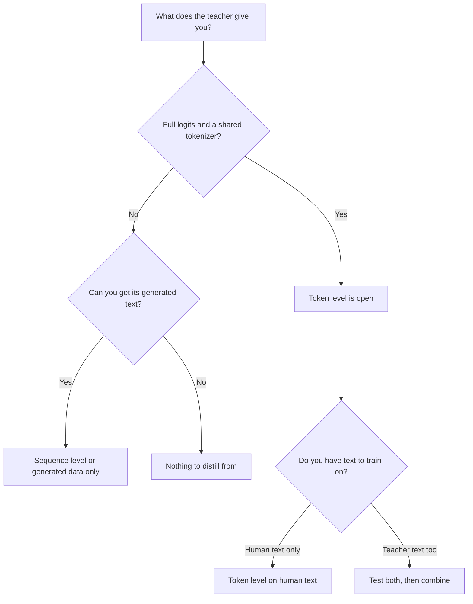

# Lección 9. Token o secuencia

**Vínculo con la misión:** La misión te pide decir qué transfiere cada nivel de destilación que el otro no transfiere, y elegir uno según lo que expone el profesor, que es la elección a la que te enfrentas la primera vez que un profesor está detrás de una API.
**Fuente principal:** [Paper: "Sequence-Level Knowledge Distillation", Kim and Rush, 2016](https://arxiv.org/abs/1606.07947)
**Requisitos previos:** [Lección 8](0008-sequence-level-distillation.md), [Lección 6](0006-the-tokenizer-constraint.md), [Destilación de logits](../GLOSSARY.md), [Destilación off-policy](../GLOSSARY.md), [Soft targets](../GLOSSARY.md)

## Calentamiento

1. ▢ En la receta de Kim y Rush, ¿cuál es la pérdida de entrenamiento del estudiante, y qué aporta el profesor?

Comprobación

Entropía cruzada ordinaria sobre oraciones completas. El profesor aporta solo el texto que decodificó con beam search, nunca sus probabilidades.

2. ▢ Nombra la razón por la que las probabilidades de respuestas incorrectas de un profesor enseñan más que un [hard label](../GLOSSARY.md).

Comprobación

Las probabilidades de las respuestas incorrectas dicen cómo las ordena el profesor: cuáles son casi aciertos y cuáles están muy lejos. Un hard label pone toda la probabilidad en una respuesta, así que ese orden se pierde (lección 2).

3. ▢ Dos modelos usan tokenizers distintos. ¿Qué nivel de destilación descarta eso, y cuál deja abierto?

Comprobación

Descarta la [destilación de logits](../GLOSSARY.md) simple, que compara distribuciones índice por índice y necesita un vocabulario compartido. Deja abierta la destilación a nivel de secuencia, porque el texto decodificado se puede volver a tokenizar con el propio tokenizer del estudiante.

## Qué debes saber

### Qué lleva cada nivel

Ambos niveles entrenan a un estudiante con el comportamiento del profesor. Difieren en qué parte de ese comportamiento llega al estudiante.

| | Nivel de token | Nivel de secuencia |
|---|---|---|
| Qué lee el estudiante | La distribución completa del profesor en cada posición | Una secuencia decodificada por entrada |
| Qué lleva | Cómo ordena el profesor las alternativas en cada paso | La elección global del profesor, incluida cómo encadena los pasos |
| Qué descarta | Nada en esa posición, pero solo sobre los prefijos que le das | Las probabilidades de cada alternativa que el profesor no eligió |
| Qué debe exponer el profesor | Logits y un vocabulario compartido | Texto |
| Pérdida de entrenamiento | Una divergencia por posición | Entropía cruzada simple |

La primera fila de la tabla es el corazón del asunto. La destilación a nivel de token da un objetivo rico en cada posición y deja abierta la pregunta de sobre qué secuencias evaluarlo. La destilación a nivel de secuencia entrega la propia secuencia, y el estudiante aprende a producirla, con un objetivo duro por posición. Kim y Rush describen la división en estos términos: la destilación a nivel de palabra transfiere conocimiento a nivel local y la destilación a nivel de secuencia a nivel global, y dicen que ambas son complementarias (sección 5).

### Combinarlos

Puedes hacer ambas a la vez. Decodifica con el profesor para obtener secuencias, y luego entrena al estudiante con esas secuencias con la entropía cruzada contra el texto más un término a nivel de token contra la distribución del profesor en cada posición de ese texto. El paper lo llama Seq-KD + Word-KD (sección 4, la nota al pie 9 describe la pérdida de mezcla).

Todos los números son de Kim y Rush, de la Tabla 1, en BLEU con decodificación voraz y beam 5 (K=1 / K=5):

| Estudiante | Baseline | Seq-KD | Seq-KD + Word-KD |
|---|---|---|---|
| Inglés a alemán, 2×500 | 14.7 / 17.6 | 18.9 / 19.0 | 18.7 / 18.9 |
| Inglés a alemán, 2×300 | 14.1 / 16.9 | 18.1 / 18.1 | 17.9 / 18.8 |
| Tailandés a inglés, 2×100 | 10.6 / 12.7 | 12.8 / 13.4 | 13.7 / 14.2 |

La combinación ayudó a los estudiantes 2×300 y 2×100 y no ayudó al 2×500 (sección 5). Así que trata el término a nivel de token como algo que probar con el estudiante que tienes, no como un añadido gratuito. También cuesta más de lo que sugiere la tabla: además del texto decodificado, necesitas la distribución del profesor en cada posición, cuyo precio fijó la lección 7.

### Elegir según lo que expone el profesor

La primera pregunta no es "cuál es mejor" sino "qué tengo". Eso fija qué niveles tienes abiertos.

Cómo leer el diagrama:

- **Logits y un tokenizer compartido:** ambos niveles están abiertos, y la elección se vuelve un experimento. El nivel de token sobre texto humano no necesita decodificación del profesor. El texto decodificado por el profesor añade información a nivel de secuencia. Combinarlos es lo que probaron Kim y Rush.
- **Logits pero un tokenizer distinto:** la pérdida habitual a nivel de token está cerrada (lección 6), así que el texto decodificado es la vía directa. Existen métodos entre tokenizers y renuncian a algo.
- **Solo texto, como cuando el profesor está detrás de una API que devuelve completions:** el nivel de secuencia es la vía, y también todo lo de las lecciones 10 a 13. La señal de destilación es el texto que puedes obtener, así que la elección de las entradas y el filtrado importan más.
- **Un modelo cuyas salidas no puedes obtener en volumen:** no hay nada de lo que destilar.

El informe R1 de DeepSeek es un ejemplo de elegir texto incluso teniendo los pesos. Para los modelos pequeños hicieron fine-tuning con unas 800,000 muestras generadas por R1 y aplicaron solo supervised fine-tuning, sin etapa de aprendizaje por refuerzo, y señalaron que añadir una podría ayudar más (informe R1, sección de destilación y apéndice B.4.3). Si el nivel de token habría funcionado mejor ahí no se prueba en ese informe, así que no es un resultado.

### Lo que comparten

Entrenar con un conjunto fijo de salidas del profesor es [destilación off-policy](../GLOSSARY.md): el estudiante aprende con secuencias que no generó. Ambos niveles, tal como se han enseñado hasta ahora, comparten esa propiedad. La etapa 5 vuelve sobre lo que eso cuesta.

## Práctica

1. ▢ Tu profesor es un modelo alojado que devuelve completions y nada más. ¿Qué niveles de destilación puedes ejecutar?

    - a) Solo el nivel de token, usando el texto que devuelve
    - b) Ambos niveles, una vez recogido todo el texto
    - c) Solo el nivel de secuencia, usando el texto que devuelve
    - d) Ninguno de los dos niveles, ya que los logits siempre son estrictamente necesarios

Comprobación

**c)** El texto es todo lo que necesita la destilación a nivel de secuencia. (a) y (b) suponen que puedes leer la distribución del profesor en cada posición, cosa que un profesor solo de texto no da. (d) confunde la destilación con la destilación de logits, que es una familia.

2. ▢ Un profesor abierto y un estudiante abierto comparten tokenizer, y puedes ejecutar ambos. Has decodificado la salida del profesor para tus prompts. Usando solo la Tabla 1, ¿qué esperas de añadir un término a nivel de token, y con cuánta seguridad?

Pista

Compara las tres filas de estudiantes, no solo la mejor.

Comprobación

Mixto. Ayudó a dos de los tres estudiantes (2×300 y 2×100) y no ayudó al tercero (2×500), así que la expectativa honesta es "pruébalo, y no lo des por supuesto". Solo estás seguro de que es un paper sobre traducción con LSTM, así que dice que hay que probar, no lo que hará un LLM.

3. ▢ ¿Qué afirmación sobre lo que descarta cada nivel es correcta?

    - a) El nivel de token descarta cada posición después de la primera
    - b) El nivel de secuencia descarta la elección final que hizo el profesor
    - c) El nivel de token descarta la forma de la distribución del profesor
    - d) El nivel de secuencia descarta las probabilidades de las alternativas del profesor

Comprobación

**d)** Una secuencia decodificada lleva solo lo que eligió el profesor, así que las alternativas y sus probabilidades desaparecen. (a) es falsa: el nivel de token lee cada posición que se le da. (b) lo invierte: la elección del profesor es exactamente lo que conserva el nivel de secuencia. (c) también lo invierte, ya que la forma de la distribución es lo que lee el nivel de token.

4. ▢ Tu colega dice que la destilación a nivel de token es estrictamente mejor porque usa más información por ejemplo. Da una razón por la que eso no se sigue.

Comprobación

Tres razones, basta cualquiera. No está disponible sin logits y un vocabulario compartido. La información extra es sobre las posiciones que evalúas, así que no dice nada sobre las secuencias que el profesor habría producido por sí solo. Y en la Tabla 1 la combinación no superó al nivel de secuencia solo en el estudiante 2×500. Más información por ejemplo no es lo mismo que un mejor estudiante.

5. ▢ Un equipo tiene un profesor de pesos abiertos con su propio tokenizer y un estudiante con otro distinto, y un presupuesto para decodificar un millón de prompts. ¿Qué vía recomiendas primero, y qué les dices que midan antes de gastar en algo más elaborado?

Comprobación

Primero el nivel de secuencia: decodifica los prompts con el profesor y entrena al estudiante con el texto, porque el estudiante puede tokenizar ese texto por sí mismo y no hace falta un vocabulario compartido. Mide al estudiante frente al profesor y frente a un baseline sobre prompts held-out, para que el siguiente paso (métodos entre tokenizers, o recoger más datos) se elija con evidencia. Es una recomendación a partir de las restricciones de la lección 6 y de esta lección, no un resultado de un paper.

## Prácticas en el mundo real

- [ ] Elige un modelo que uses que esté detrás de una API. Lee su documentación y enumera exactamente qué puede devolver una llamada. Marca qué niveles de destilación permitiría esa salida.
- [ ] Elige dos modelos abiertos. Comprueba si comparten tokenizer, y anota qué nivel podrías ejecutar entre ellos.
- [ ] Mañana: sin apuntes, dibuja de memoria el diagrama de decisión de arriba y añade un modelo real en cada hoja.

## Para profundizar

- [Secuencia y datos sintéticos](../reference/sequence-and-synthetic-data.md)
- [Paper: "Sequence-Level Knowledge Distillation", Kim and Rush, 2016](https://arxiv.org/abs/1606.07947)
- [Paper: "DeepSeek-R1: Incentivizing Reasoning Capability in LLMs via Reinforcement Learning", DeepSeek-AI, 2025](https://arxiv.org/abs/2501.12948)
- [Recursos](../RESOURCES.md)

---

¿No termina de quedar claro? Vuelve a leer la fuente primaria de arriba, ya que esta lección la comprime y en la compresión es donde se escapa la comprensión. Consulta el [glosario](../GLOSSARY.md) por si algún término te resultó resbaladizo.

Si lo poco claro es la propia lección y no el material, eso es un defecto: [abre un issue](https://github.com/TokenCemetery/teach/issues).
